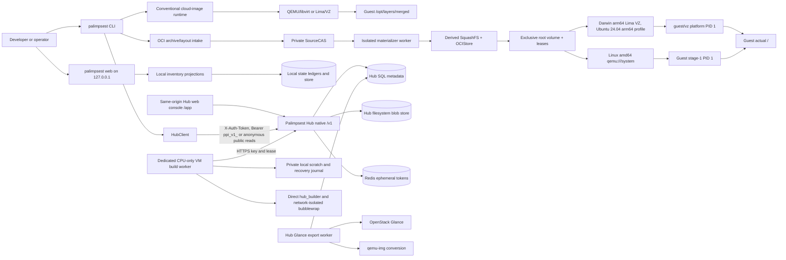

# Palimpsest Architecture

## M4 CPU slices: access preflight, Git source admission, session lifecycle — 2026-11-09 source

Source-reviewed by the author only; test-passed on hosted CI and the Hub scrubbed-environment suite, not released, deployed or live-verified.

- `palimpsest_hub.services.preflight` runs read-only checks under the caller's own token before any allocation: token project scope, the caller's policy action, service-catalog endpoints for compute, network, image and volumev3 (plus shared-file-system for the native path) and compute/block-storage quotas. Every failure is reported together as a structured `preflight_failed` response (403 scope/policy, 424 catalog, 409 quota); unreadable limits fail closed. `services/instances.py` and `services/native_instances.py` call it through `run_blocking` (the checks are network calls and must not run on the event loop) after the idempotent replay lookup, so an existing request still replays after a later quota exhaustion. It checks access and headroom only; it does not reserve resources, so a later allocation can still fail.
- `palimpsest_hub.services.git_source` admits a pinned Git build source: https only, no userinfo/query/fragment/IP literal, a 40-hex revision, an operator host allow-list (default deny), every resolved address public (loopback, private, link-local including the metadata address, CGNAT and multicast refused), the first resolved address pinned for the connection, redirects disabled, `GIT_ALLOW_PROTOCOL` limited, `.git` removed and byte/file/symlink limits enforced. It is a library only: no API route, build-worker step or private-credential resolution calls it yet, and `credential_ref` is an opaque name, never a secret.
- `palimpsest_hub.services.session_lifecycle` is a pure state machine for the delayed dev-instance shelve: shelve is due only after the full grace period with no open session, any connect cancels it and invalidates earlier claims, an observation failure is not a disconnect, one claim wins per due period, and a connect during an in-flight shelve requires an unshelve after it settles. `palimpsest_hub.services.session_controller` drives it through injected observer, provider and clock ports under a per-instance lock: an unreadable observation never shelves or moves the timer, a claim is re-checked by a second fresh observation before the provider is called, a failed shelve restarts the full grace period, and a user present while shelved triggers one unshelve (failed unshelve retries next tick). The lock and claim are process-local, so concurrent-shelve protection holds only within one Hub process; a multi-worker deployment must use `sql_mutex` or the instance row lock first. State is in memory, so a restart only delays a shelve. `palimpsest_hub.services.nova_shelve_provider.NovaShelveProvider` implements the provider port over an injected Nova connection: it confirms shelve only at SHELVED_OFFLOADED, treats an already-offloaded server as success (no second shelve), refuses other states, and maps SDK errors or timeouts to `ProviderError` without the SDK message. All SDK calls use `run_blocking`. It chooses no credential. `palimpsest_hub.services.session_observer.WhoSessionObserver` supplies the observer port from a guest probe: the listing must carry a utmp-readable marker, the probe shell's pid (`PALIMPSEST-SELF $$`), a full `ps -eo pid=,ppid=,args=` table and an end marker, and a failed `ps` never reads as no sessions. It counts `who` lines and every `sshd(-session)?: user@pts/N|notty` process (listener and pre-auth titles excluded), keyed by pid, but excludes the probe's own ancestor chain: the probe runs through the ssh path it observes, so its own session is its shell's parent. A shell missing from the table is refused rather than guessed. Failure, timeout, non-text and malformed input are `ObservationError`. Not done: production SSH/console injection, persistence, and live guest proof (utmp and `ps` on a real Linux guest are unverified; the process-table path is tested against a local `sh` and `ps`). `palimpsest_hub.services.shelve_delegation.ShelveDelegation` (M4-11 policy) creates or renews a short trust only from the trustor's own request; the idle path never mints or renews one; TTL equals the 5-minute grace; an expired, missing, out-of-scope or unopenable trust fails closed with `ProviderError` and the instance stays up; there is no service-credential fallback; the Hub enforces the one-server limit because Keystone trusts cannot bind a server; a rejected trust is deleted at once. Open owner conflict: SSH-only sessions never renew the trust, so the automatic shelve path is unreachable in the main flow. No production route wiring or live Keystone call yet. `palimpsest_hub.services.git_context.write_context_tar` turns a checkout that `git_source.fetch` already verified into a deterministic build-context tar: sorted entries, zeroed time and ownership, modes reduced to 0644/0755, symlinks stored unfollowed and refused when they leave the context, FIFOs and devices refused, `.dockerignore` exact/glob/prefix rules, and negated, `**` or climbing rules refused (fail closed: `**/.env` would otherwise miss a root `.env`). `palimpsest_hub.services.git_staging.stage_git_context` chains the gates: an empty allow-list raises `GitStagingUnavailable` before any DNS or Git call, then `git_source.validate` (https, allow-listed host, all addresses public), `git_source.fetch` at the pinned commit (SHA verified, `.git` removed), the deterministic tar (honouring the checkout's `.dockerignore`), and `store.promote_file` (digest verified, byte cap enforced). The scratch directory is removed on every path. The staged blob is registered through `services/image_jobs.register_context_blob` (the same project-owned `PalimpsestHubBuildContext` + `retain_blob` tail as `upload_context`), and `POST /v1/git-builds` admits a `dockerfile` job with the checkout's Dockerfile sent inline (`api/image_jobs.py`). The route is rate-limited (6/hour), runs the cheap admission gates (OS declarations, worker key, non-empty source policy) before any git call, holds the project's non-blocking package lock across staging and registration, and maps context refusals to 422. The Hub image installs `git`; a missing binary is a fetch refusal. Each Git-built job records its provenance in `request_json.git` and reads it back as a `git` field on `GET /v1/image-jobs[/{id}]` (null for other jobs and for worker responses) (repo URL, pinned commit actually checked out, context subdir, Dockerfile path), so M4-06 can name the commit it built. An identical retry of a `request_id` returns the existing job before any fetch; a reused id bound to another descriptor is a 409 before any fetch. Scratch `uploads/gitctx-*` trees older than one hour are swept when the next stage starts (`prune_uploads` has no caller, so it is not used). Tested with a fake git/DNS at the process boundary; not deployed or proven against a live Git host. The context is `context_subdir` of the checkout, with its own `.dockerignore`; `dockerfile_path` must be a regular file in the checkout; the worker writes the admitted Dockerfile text inline and never reads one from the context, so `.dockerignore` and `context_subdir` place no constraint on it. The tar is checked against the worker's extract limits (member count, expanded bytes, backslash or over-4096-byte names) at staging, and a round-trip test feeds it to `extract_context`. `dockerfile_path` must be a regular file in the checkout; the worker writes the admitted Dockerfile text inline and never reads one from the context, so `.dockerignore` and `context_subdir` place no constraint on it. The tar is checked against the worker's extract limits (member count, expanded bytes, backslash or over-4096-byte names) at staging, and a round-trip test feeds it to `extract_context`. Known gap for the route: scratch `uploads/gitctx-*` directories left by a killed process are not swept (`prune_uploads` skips directories).
- Correction to the session-observer wording in the bullet above (2026-11-12, supersedes `ps -eo pid=,ppid=,args=`): the guest probe runs `ps -e -o pid= -o ppid= -o args=` (one `-o` per column, for BusyBox compatibility), and only sshd rows keep their argv; every other row is reduced to pid and ppid so guest command lines never reach the Hub. The probe must run as a non-pty exec, because a pty session lists its own utmp line, which the probe cannot exclude. Tested against a local `sh` and `ps` only; BusyBox and real-guest behaviour is unverified.
- Correction to the preflight bullet above (2026-11-12): `PreflightNeed` now carries `flavor_id` and `ports`, and a new `resource` check (422) covers an unreadable flavor. Compute checks cover instances, cores and RAM (flavor `vcpus`/`ram`), block storage checks volume count and GiB, and Neutron checks ports through `get_quota(details=True)` (limit, used, reserved). A missing or non-integer limit or usage fails closed as "quota unreadable". Catalog endpoints are resolved for the Hub `os_region_name`. `services/instances.py` re-runs the quota check immediately before the Cinder volume POST (volume count and boot GiB) and before the Nova server POST; a failure ends the row through `fail_preparation("preflight_failed")` and does not delete an already created volume. The native path sizes its need from the private operator grant (`boot_gib`, `flavors[phase]`, one port, shared files) and returns 409 when the grant lacks them; the background execution re-checks it. Token-scope and policy denials are still returned as the plain 403 from the route dependencies (`_legacy_writer`) before the structured `preflight_failed` body, so those two checks are fail-closed but rarely reach the structured response. Tested against synthetic catalog, quota and provider objects only; real OpenStack SDK return shapes and allocation refusal are unverified.
- Native background preflight refusal (2026-11-12): when the re-check in `native_instances._execute` fails before any native run exists, `_run` settles the row as `deleted` with `error_code="preflight_failed"` (not `held`), so it does not block later consumers in the environment; missing `checkpoint.settings` fails closed as a HOLD. A flavor lookup that fails for a reason other than not-found or unreadable sizing is reported as an unreadable-compute quota failure (409), not a bad-input `resource` failure. Tested through a stub driver only; the real `_execute` refusal path against a live native environment is unverified.
- Client `--cloud NAME` (`palimpsest_local.cli.hub_client`, `cloud_cli.hub_credentials`) authenticates Hub-direct commands, `published push|pull`, and `run`/`build`/`compose` with the clouds.yaml Keystone token and sends its project as `X-Project-Id`; other operations reject `--cloud`. The direct OpenStack path (`cloud_cli._connect`, `OneShotSession`) calls Nova/Cinder/Neutron itself and does not go through the Hub.
- `palimpsest instance ls|status|create|advance|stop|rm` (`cli._dispatch_instance`) is a thin client over the existing Hub endpoints through `HubClient` (`POST/GET /instances`, `POST /instances/{id}/advance|stop`, `DELETE /instances/{id}`); it adds no server contract. Every local argument (UUIDs including the positional instance id, JSON argv arrays, `ls --limit` 1-100 to match the route) is validated before `hub_client` reads a credential, and `--cloud` is a registered consumer. `advance --operation` is stored as `args.effect` because `args.operation` is the top-level command name. `create` only reserves the boot volume; the server is created by the separate explicit `advance` call. `status` returns the guest-reported `result.stdout`/`result.stderr` (each at most 8192 characters) when one exists, but the Hub has no streaming log, SSH-connection-info or resume endpoint, so the CLI offers none. Tested with a stubbed `HubClient`; no real Hub or OpenStack call was made.
- Correction to the instance-CLI bullet above and to the session-lifecycle bullet earlier in this section (2026-11-12): the Hub now has `PUT /instance-bootstrap/{id}/sessions` (guest report), `POST /instances/{id}/resume`, `POST /instances/{id}/lifecycle/renew` and `GET /instances/{id}/connection`; `HubClient` and the CLI expose `instance resume|renew|connection` and `instance create --lifecycle {service,dev} --key-name`. There is still no streaming log endpoint. The session controller is no longer in-memory only, and `services/shelve_delegation.py` (short-TTL trust per shelve) is removed: the owner chose an instance-lifetime trust instead.
- Dev-instance idle auto-shelve (`lifecycle="dev"`; default `service` is never shelved and never touches the ledger table; source `services/instance_lifecycle.py`, `instance_lifecycle_models.py`, `worker.py`). (1) Create mints, from the owner's own validated request, a Keystone Trust (trustor owner, trustee the Hub service identity, `palimpsest_hub_session_delegated_roles`, finite `..._delegation_ttl_seconds`, default 7 days) and writes it with a `palimpsest_hub_instance_lifecycle` row in the same transaction as the durable instance intent; any exit, including cancellation, discards the trust. `create` can no longer allocate without it, and a missing `key_name` keypair is a 422 before any allocation. (2) The guest runs a separate root service (`session_reporter.py`, `session.json`, hardened unit) that PUTs the constant `GUEST_PROBE_COMMAND` output every 30 s with its own capability hash-checked server-side; the Hub parses it, stores only the session identities and its own receipt time, and a missing, stale (>120 s) or unparseable report is an unknown observation: it never counts as idle and clears a running grace timer. The capability is in Nova `user_data` (as the bootstrap capability is), so a guest process can forge its own instance's report, which can only shelve or keep up its own VM. (3) The worker runs `run_session_lifecycle` as a separate task under the SQL role `session-lifecycle`; each pass visits dev instances whose status is `ready`, `error` or `resumed` (never booting or shelved), oldest `updated_at` first, under the same `build-api:instance:` mutex the API uses, re-fenced and re-read after the claim checkpoint so a delete, resume or newer report cancels the claim. The first fresh report starts the 5-minute grace; shelve runs through the stored trust only, and an expired trust fails closed (the instance keeps running). A crash or an unconfirmed Nova wait leaves a durable `SHELVING` phase that the next tick settles from Nova's real status; the owner's `resume` can settle it too. (4) `resume` unshelves with the caller's own token, sets status `resumed`, restarts the timer at the first fresh report and replaces the trust only for the instance's creator; only the base VM boots from the preserved boot volume: the runner does not restart the layer overlay or command and processes do not survive. (5) Deleting retires the row and the worker revokes the trust through its own impersonating token (expired trusts are dropped); the retire call only runs for dev rows, so a database without the new table keeps deleting service instances. (6) Because `reconfigure` does not bootstrap, the new table needs the offline `palimpsest-hub-bootstrap` before dev instances are created; `migrate` copies the ledger. Known limits: the per-instance mutex is held during a Nova shelve/unshelve wait (up to 300 s; other requests on that instance wait, and on MariaDB may hit the lock timeout), `connection` returns addresses and key name only (SSH user and host keys unknown), and `inspect_boot_volume` accepts a SHELVED server's reserved volume without a matching attachment only if no other server holds it. Tested with fake Nova, Keystone and clock; not run against a real cloud, a real guest or real Keystone trusts.
- Admin-held ordinary credential for dev lifecycle (2026-11-13): a human who is also a system administrator is handled as the package-admin context, which has no `current_roles`; the original `create --lifecycle dev` returned 403 for such a user even with a project-scoped token. `instance_lifecycle.held_roles` now lets that context delegate with the roles of its own project-scoped token (validated by Keystone for this request), only when the token's project equals the instance project and the token is not delegated, system- or domain-scoped, and holds no `service` role; ordinary members still use their fresh `current_roles`. Keystone enforces the same roles when the Trust is created with that token. The package/export boundaries (administrators cannot authorize `ppi_v1_` keys or image exports) are unchanged.
- Review and sweep follow-up (2026-11-14, independent read-only review, NOT an Astra/Sol signoff: no blocker): the admin branch of `held_roles` also refuses `palimpsest_hub_package_forbidden_user_ids`/`..._project_ids` (the member path enforces them in `validate_package_owner`); `sweep_retired` skips a row whose trust reference is already cleared because every controller runs the sweep, so a peer's successful revocation is no longer overwritten with `last_error="trust_unrecoverable"`. Known test gap: `resume`/`renew` with an admin actor are covered only through the shared `admit_trust`/`held_roles` unit, not through `_package_admin_context`.
- Implied-role fix from the first real shelve (2026-11-14): Keystone role inference gives a `member`-only trust token the roles `['member','reader']`; `openstack.open_trust_connection` required the token roles to be a subset of the delegated set and refused it, so every shelve ended `shelve-failed`. It now also permits `reader` when `member` is delegated (weaker than `member`, nothing else added); extra roles and the forbidden set still fail closed. The same function serves image-export trusts, which had the same latent mismatch against a real Keystone. `TrustShelveProvider` now logs the failure reason (class and delegation code, no credential).

## M2 Hub image publication, quotas, image keys and anonymous public reads — 2026-11-07/08 merge-worktree source

**Independently reviewed merge-worktree source (whole-surface security review,
merge-integrity review, architecture review); not committed, released, deployed
or live-verified.** See the 2026-11-07/08 Maintenance entry for review results,
open items and verification levels.

**Quota.** [`services/image_quota.py`](hub/src/palimpsest_hub/services/image_quota.py)
owns publication limits. SQL `palimpsest_hub_image_quota_policies` (tier
`free|paid` × visibility; nullable `max_images`, `max_chain_bytes`,
`max_source_bytes`, null = unlimited) and `palimpsest_hub_image_quota_tiers`
(`user|project` subject → tier, default `free`) are authoritative. Code inserts
only missing seed rows (free 2/1GiB private, 5/5GiB internal, unlimited/10GiB
public; paid 20/50GiB, 50/50GiB, unlimited/100GiB; source seed = chain seed;
paid values were kept as proposed by owner decision 537, 2026-11-08). `register_image` in
[`services/published_images.py`](hub/src/palimpsest_hub/services/published_images.py)
calls `image_quota.enforce` after the request_id replay lookup, so a replay is
never re-charged, under the one global image SQL mutex that also orders admin
policy/tier changes. Private and public publications charge the publishing user,
internal the origin project. The count unit is one distinct name per
(visibility, subject); another version under an existing name is not counted.
Chain bytes are stored compressed sizes of the distinct payload digests in the
manifest `layers` (GiB = 2^30). An application-mode original cloud image
(`base_image_digest`) is outside every cap; oci-root counts every manifest layer,
including original OCI base layers (owner decision 537, 2026-11-08).
Source bytes are distinct source-closure digests. Refusals are 403
`image_count_limit`, 413 `image_chain_size_limit` and 413
`image_source_size_limit` with structured detail; `image_jobs.complete` settles
exactly these as a terminal job `error` instead of an uncertain worker halt.
[`api/image_admin.py`](hub/src/palimpsest_hub/api/image_admin.py) serves, to fresh
human system administrators (`require_admin`, `system:manage`), `GET
/v1/admin/image-quota/policies`, `PUT .../policies/{tier}/{visibility}`, `GET|PUT
.../tiers/{subject_kind}/{subject_id}`, `GET .../usage?subject_kind=&subject_id=`
and `GET .../physical`. `GET /v1/published-images/quota` needs `packages:inventory` on a
Keystone token or `images:read` on an image key; anonymous callers get 401 and
publish-only keys 403. Lowering a policy or tier never deletes images.
Known consequences: limits cap distinct names and per-image chain/source bytes,
not total storage per scope or versions under one name, and a scope already over
a lowered count can still add versions under existing names. Usage and the
physical report are SQL aggregations. Physical storage means Hub-known stored
blob bytes per storage namespace (owner decision 537; cloud-side Glance raw
conversion and Cinder usage are excluded): the report counts each digest once per
storage namespace (Hub-wide for local, per share/scope for Manila) and separates
logical from physical bytes. Null is reported only for unknown application
base-image sizes and for Manila or unreadable store capacity; a missing chain-layer
or membership row is a definite 409.

**Image API keys.** [`services/image_keys.py`](hub/src/palimpsest_hub/services/image_keys.py),
[`api/image_keys.py`](hub/src/palimpsest_hub/api/image_keys.py) and
[`image_key_models.py`](hub/src/palimpsest_hub/image_key_models.py) add a key
kind separate from package keys: `ppi_v1_<32 hex id>.<43 base64url>` in
`palimpsest_image_keys`, SHA-256 of the secret only, shown once with
`Cache-Control: no-store`, 1–90 days (default 30) and at most
`PALIMPSEST_HUB_IMAGE_KEY_MAX_ACTIVE_PER_USER` (50) active keys per user (409
`image_key_limit`). Only original human Keystone tokens issue/list/revoke them,
and only actions the issuer currently holds: `images:read` (needs current
`packages:inventory`+`packages:read`) and `images:publish` (needs
`packages:write`). Publish does not imply read: a publish-only key may publish
only payloads its owner staged and cannot extend or reuse visible images. Every
use, and every mutation boundary, revalidates expiry/revocation and current owner
project membership; effective actions are the stored actions intersected with
that current authority. Keys cannot manage keys or select a target project, and
`ppk_v1` package keys fail image-key decoding (401): they carry no image
authority. `migrate.py` copies keys, quota tables and source-closure rows only
after validating their shape, lifetime and state; membership and authority are
enforced at use.

**Public means anonymous-readable.** `public` publications are now readable
without any credential through `GET /v1/published-images`, `GET
/v1/published-images/{id}` and `GET /v1/published-images/{id}/blobs/{digest}`
only ([`services/public_images.py`](hub/src/palimpsest_hub/services/public_images.py)).
Layer-node graph routes, quota self-service and every write still require a
credential. The anonymous projection omits `created_by`, `storage_binding`,
`project_id` and node `project_id`/`payload_path`. A present but invalid
credential is 401, never a fallback to anonymous; Keystone being unavailable is
503. Anonymous requests pass a
fixed-window per-client limiter (`PALIMPSEST_HUB_ANONYMOUS_RATE_LIMIT_*`, default
120 requests/60s, 10000 tracked clients, 429 with `Retry-After`) keyed by
uvicorn's resolved `request.client.host`; IPv4-mapped IPv6 counts as IPv4, other
IPv6 per /64. When the table is full the entry whose window opened earliest is
evicted even if its window is still open, so rotating across many client buckets
(for example IPv6 /64s) evades the limit (accepted risk). Counters are per
process and per node. Behind a proxy that is not in
uvicorn's forwarded-allow list, all anonymous callers share that proxy's bucket:
the Kolla role renders `--proxy-headers` and the new
`palimpsest_api_forwarded_allow_ips` (default `127.0.0.1`, unchanged behaviour),
so operators must list the actual HAProxy sources; no deployment does so yet.

**OCI source closure (owner decision A).** A publication may carry an optional
`source_closure` (root index ≤1, manifest, config and contiguous original
compressed layers, ≤300 items) stored in `palimpsest_hub_image_source_blobs`
(image_id, role, ordinal, project_id, blob_digest, size_bytes, created_at), for
`oci-root` images only. Closure blobs use the existing staging route `PUT
/v1/published-images/blobs/{digest}`, which no longer requires SquashFS magic;
layer payloads are checked for the `hsqs` SquashFS magic bytes at registration.
The caller must have staged every closure blob itself. The manifest
must commit to the closure (`source.root_digest/manifest_digest/config_digest`
and each payload's original compressed descriptor by ordinal); the server
re-reads documents ≤1MiB, rejects duplicate JSON keys and checks manifest/config/
layer descriptor coherence. When the manifest declares `source.diff_ids` (the
client always does) they must equal config `rootfs.diff_ids`, and a stored root
index must list the manifest. Closure blobs are served through the image blob
route by image membership, and only to callers that can read the image.
**Consequence:** the config blob exposes image environment VALUES to everyone who
can read the image (anyone for `public`), unlike the public manifest projection,
which hides environment values.

**Platforms.** [`image_manifest.py`](src/palimpsest_local/image_manifest.py)
admits `linux/amd64` and `linux/arm64` for `oci-root` manifests; application
stays amd64. Payload rows accept any stored arch label (the first registrant's
label is not a property of the bytes). Instance and native paths decide by the
sealed manifest platform and refuse arm64 execution; image-job requests are typed
`Literal["linux/amd64"]` and the executor refuses other platforms.

**Client.** [`hub_publish.py`](src/palimpsest_local/hub_publish.py) implements
`palimpsest published push|pull|status`. Local catalog schema v2 (unreleased)
adds `publications`, `pulled_images` and `pulled_layers`; v1 catalogs stay
readable and upgrade only inside a publication/pull write, while any other DDL
under v2 (including the discarded round-1 tables) is refused. The request id is
persisted before the first network call and reused by retries of the same intent;
terminal outcomes start a new generation, and `published` is recorded only after
the Hub response matches the locally computed manifest. Credentials: owner-only
`--image-key-file`, then `PALIMPSEST_IMAGE_KEY`, then `PALIMPSEST_TOKEN`; pull may
be anonymous, push never. Credentials are not sent over plain `http://` to a
non-loopback Hub unless `--allow-insecure-http` is passed. `--confirm-public` is
mandatory for public, `--no-source` omits the closure, and when the closure is
included an environment-exposure notice precedes upload. Manifests
carry only content-derived receipt fields, so any state root yields the same
digest. Pull verifies every payload and the full OCI chain, rebuilds a standard
layout under `<state-root>/published/<id>/layout` (directories 0700, files 0400),
registers it through `LocalLayoutSource` and `inventory.record_oci_source` without
a VM and prints a `plm run` hint. If that local source registration fails, the
result reports `runnable: false`, no run hint, `source_registration_error` and a
message; the verified layout is kept. `store rm` refuses digests of pulled images,
and store listing/preview marks digests referenced by pulled Hub images as not
deletable (`deletion_blockers.published`).

**Evidence and open risks.** Test-passed only: Hub lane and root per-file runs in
a scrubbed macOS environment with synthetic Keystone and SQLite
(`tests/unit/test_hub_publish.py`: 72 cases, all passing; the five Hub M2 test files
pass with 21, 6, 36, 27 and 23 cases), and an isolated end-to-end harness (real Hub
app under loopback uvicorn, real client CLI, fake Keystone over HTTP, no dependency
overrides) that passed 77 checks, re-run after the last code edit (anonymous list
cap, inventory preview, registry child environment, pull result; the harness run
recorded source aggregate `63511eb2…`). A separate Hub-level script
exercised the seeded free chain caps with real byte counts (private 1073741824,
internal 5368709120, public 10737418240): a chain one byte under the cap and
exactly at the cap publish, one byte over returns 413 `image_chain_size_limit`;
11 checks passed on the same final code. Exact counts and digests are recorded in
docs/development-handoff.md. Not verified: live
Hub/Keystone/Afterglow OAuth, Kolla deployment, MySQL/MariaDB (the quota code uses
`CAST AS BINARY` and JSON extraction), Manila/CephFS closure copying, Linux-only
tests on this host, an actual `plm run` of a pulled image on a separate state root
and a second Apple Silicon device. Open: staged-but-unregistered blobs have no
aggregate quota or expiry (pre-existing); the Hub serves stored blobs without
re-verification (clients verify); in-place bootstrap does not add
`max_source_bytes` to a dev database that already has the never-shipped quota
tables (offline `migrate.py` copies seed it from the chain cap); the proxy
rate-limit caveat above; the arm64 pull precheck counts compressed closure bytes
only (a registration refusal after download is reported as
`source_registration_error`).

**Whole-surface review (2026-11-08).** An independent security reviewer reviewed
the whole M2 Hub and client surface and found no P0/P1 and one P2, fixed:
anonymous list pages are capped at `ANONYMOUS_LIST_LIMIT = 20` (each listed image
is normalized and projected synchronously, and the rate limiter counts requests,
not cost).
Accepted open P3 items: authenticated readers of another project's public or
internal image still see `project_id`, `storage_binding` and node payload paths
(only the anonymous projection redacts them; for Manila that exposes share ids);
a pulled image's local catalog reference label is the publisher-chosen source
reference; there is no unpublish/delete route, so `--confirm-public` is
irreversible; a publish is not re-authorized after waiting for the global image
mutex, so a key revoked while queued can still commit; image keys of a user who
left the project count toward the active-key cap and cannot be revoked until they
expire; image-key issuance checks `packages:*` but not `keys:issue`; anonymous pull
over plain `http://` is allowed without warning (a man-in-the-middle could replace
the whole self-consistent image); anonymous bandwidth and concurrency are not
metered; image keys hold a database connection during Keystone validation; the
global image mutex serializes publishers, admin policy changes and job completion;
`palimpsest_api_forwarded_allow_ips` is not validated (`*` would let clients spoof
`X-Forwarded-For`); the Hub cannot tie each SquashFS payload to its original layer
(pullers verify the closure, Hub-side instances run the payload); the client
opener honours `http_proxy`.

**Credential-owned publication attempts and replay (publish-only keys).** Request
ids are unique per Hub project (another user's id there returns 409) and scoped
by user, and a key with `images:publish` but not
`images:read` cannot read a stored `published` row back. Local generations of one
publication intent are therefore owned by credentials: `published` rows are
visible to every credential (each validates them against the Hub), while an
unpublished row (`pending`, `failed`, `unknown`) belongs to the credential that
began it, recorded in `publications.hub_credential` (the public `ppi_v1_` image-key
id; `NULL` for every non-key credential). `Catalog.intent_publications` and
`begin_publication` take a `credential` and only see published rows plus the
credential's own unresolved attempts; generation numbers stay global per intent.
A credential that cannot read replays, through the normal publication request,
the stored Hub request id of ONE published row that its own image key recorded
(idempotent per project and user); rows of other credentials are never replayed
or adopted, and a non-key credential that cannot read refuses. No replay runs
while the credential has any unresolved non-terminal attempt of its own: the
normal publication retries it, and a first-attempt 4xx is recorded as `failed`.
A replay never starts a generation by itself: a
definitive refusal (403/429/...) or an uncertain failure is reported (never as
"nothing changed") and leaves the row unchanged; HTTP 404 starts a new generation
that inherits the stored Hub request id (`begin_publication(inherit_hub_request_id=)`,
sent by `publish_local_image` as `hub_request_id or request_id`) so the Hub answers
an image it already holds. By design a second Hub image can still appear after a
credential switch during an uncertain attempt, for two image keys of one user, and
for a publish-only key next to a read-capable credential. Pull staging
directories are swept only when nothing inside them changed for a day. The
`publications` DDL changed in place under catalog `user_version` 2 (unreleased): the
exact-DDL check refuses any earlier draft catalog instead of upgrading it, so none
may exist on a state root meant to be kept. The test `FakeHub` routes before
recording, tracks per-(project, user) staging and applies the Hub's publish-only
staging precheck before the request-id lookup.

## M1 completion — 2026-11-07

`spec.md` records M1-01…M1-28 checked and M1 completion declared at 35/108
(M1-27 comparison receipt `M1-27-comparison-final527.json`, M1-28 gate receipt
`M1-28-gate-application530.json`). Completion scope is the local Lima VZ arm64
development environment (L0/L1/R1/local S1) on one host (n=1), with no security
attestation; OpenStack shelve/unshelve for S1 is deferred to M4. Overall goal
progress recorded in `spec.md` is 47/108 (M1 complete at 35, plus M2-01…04, 06, 07
and 09…14) with M2 in progress. Dated M1 sections below are historical
checkpoints at their stated source identities; where they say "open", "pending"
or "not implemented", the M1 checklist and the Code map/Status rows for the native
VZ OCI-root runtime record the later state.

## Standard roles with exact-owner self-service — 2026-11-06 stamped source

Fresh native project roles, not custom operation roles, determine thirteen
oslo-policy actions. Reader-or-above has visible inventory/content/cache reads,
own-key metadata and original-token `keys:revoke_own`. Member-or-above adds
publication/cache editing and `packages:manage_own` for only its recorded
consumer/exclusive boot volume. Manager-or-above adds project management,
package/layer/export deletion and key issuance/full owner-bound revocation.
Human system administration remains separately proved; project manager/admin
does not create cross-project or other-private-creator authority.

Original-token/current-owner intersections and native role-ID implications
remain mandatory. Both self-actions are excluded from the five package-key
actions. Private instance/native rows remain creator-bound. Cleanup rechecks
fresh authority after final provider observations and immediately before effect;
prepared-volume disposal preserves recorded creator/request/volume/provenance
rather than substituting its cleanup caller. Native profile-user/project binding
remains exact. Exact-owned unfinished-upload cancellation is write-tier rollback,
not permission to remove committed resources.

Layer deletion rejects all parent/base consumers and foreign-project grants
without fresh system authority. `/v1/policy/capabilities` exposes `{service,
actions}` rather than obsolete role-shaped aliases; public feature booleans stay.
Policy/sample and source reviews cover the thirteen-action contract, including
the user's two explicit self-service choices. Synthetic-Keystone regression was
then executed on the existing builder:1600 tests passed (the1388 Hub/Kolla
cases plus212 changed benchmark cases). Independent non-pytest registered
`main:app` Uvicorn/SQLite/CAS smoke331 passed28 actual loopback checks, including
member publication/tag update and byte readback, manager deletion/key issuance,
own-key revoke and fresh demotion. Keystone is synthetic; production lifespan
is off. The8GiB sparse-tar node remains skipped by the file-size cap, nonroot
Kolla policy-readability remains untested and the system-site-enabled hub-venv
is not a qualified locked install. No live IAM/provider/deployment/release claim.

## Historical project-role authorization — 2026-11-03 superseded source snapshot

Hub project authority now uses fresh exact native core member/manager/admin for
management and reader-or-above for visible metadata/content reads. Internal
capability labels are unchanged; default policy does not grant directly from
legacy service grades/leaves or personal-owner metadata. Current native role-ID
inference remains authoritative, including legitimate group/domain/custom paths;
this change neither reconstructs memberships nor deletes native IAM data.
Original-token/current-owner decisions intersect and policy overrides only narrow
the mandatory role ceiling. Keys retain exact stored package/action scope.

Ordinary project humans can publish/manage project packages/cache and delete
exact-project metadata; package keys still cannot delete or administer keys.
Legacy layer deletion additionally protects published global catalogs. Project
build admission uses write authority; project build status uses inventory.
Machine worker headers/leases, global catalog/system policy, private-user/project
visibility, deferred export credentials and unknown-I/O custody are unchanged.
Both independent token validators admit recognized human `openid` federation,
but all reduced credential markers still veto human administrative uplift.
Fresh enabled native home/project domains are checked independently of personal
provenance: disabled domains deny403 and unavailable/unknown identity state fails503.
The integrating parent's first complete Hub run found31failures (1680passed/7skipped), then final-source qualification passed1717tests/7skips; root Kolla49 and changed-source Ruff passed. The follow-up restored current enabled native home/project domains independently of personal metadata, removed obsolete raw personal provenance/flag plumbing, and corrected synthetic policy/action-withdrawal/validation fixtures without weakening guards. Canonical API/export-worker/build-worker were built for both architectures; all six execute the packaged role ceiling and57source hashes match the checkout. Registered API/worker real Redis/SQLite/CAS with synthetic Keystone passed245checks per architecture, including restart/recreation original bytes, scoped keys, revocation and current role inference. The hash-verified derived SQLite-driver image is test-only. No canonical MariaDB/lifespan, cloud/native-build, release, deployment or IAM change is claimed. Evidence: `~/.local/share/afterglow-proofs/chat-history-admin-20261103/`.

## Native live-read ownership and bounded mutex contention —192–264

Live native enumeration, identity resolution, preflight and refresh cooperate
with the canonical run-name lock before authoritative mutable payload reads.
One request-local allowance pays for at most five seconds of actual contended
run/custody acquisition across the pass; normal provider/file work does not
consume it. This is not a five-second total request deadline. Every acquired
directory/lock binding and existing config, expiry, actor, HOLD and session
guard remains enforced. Internal offline ps/catalog/inspect do not initialize
missing roots or rewrite legacy metadata.

Within one process, simultaneous selected-root native reads can join only an
ongoing reconciliation registered before mutable ledger/name-lock waits. Three
root descriptors pin the sharing key; deeply frozen private snapshots never
become public DTO authority. Each joiner pays its own remaining wait allowance
and compares the full current run/state generation under fresh host/custody
checks before any observer publication. Completed flights are immediately
removed. There is no TTL, recent-result cache, cross-process sharing or provider/
metadata retry. Leader cancellation is not re-raised into unrelated waiters.
Legacy observations remain independent; failed native joins retain only safe
stale discovery. A concurrent directory-membership change can still invalidate
native sharing as runtime-failure; it is not evidence of malicious identity.

VM metrics start independently every five seconds, join one in-flight promise
without queuing, and retain the source/run/boot/counter/15-second guards. Hidden
VM logs are not automatically reread outside Logs. Lifecycle/mutation handlers
capture and await already-started client observations before eligibility checks;
client abort is not server drain. Console use does not pause normal sampling.

`RuntimeBusyError` distinguishes a pure failed mutex acquisition from an
uncertain actor/resource HOLD. `RunLockTimeoutError` retains the narrower
named-lock identity: only it permits enumeration's first strict private
degraded read. A busy observation projects stale `runtime-busy`, issues no
capability report and supplies no fresh observer, alias or transport/lifecycle
grant. Native home identity is independent of alias eligibility, so fresh
removed history keeps retained logs despite an unrelated ambient Lima home.
Same-home and unproved identity collisions remain refused.

Native logs resolve fresh locked authority, refresh and pin in separate lock
windows. A non-authoritative routing hint preserves legacy boot-console reads;
the legacy reader independently requires complete immutable record equality.
Admitted native followers keep only their original pinned FD while a typed
run/namespace mutex is busy, with a new bounded allowance per EOF observation.
Initial admission and snapshots remain fail-closed; identity, console, actor
HOLD and uncertain provider failures terminate rather than being replayed.
No mutex crosses a refresh callback, yielded event or polling sleep.

Native creation/source acquisition keep preflight and source guards under
namespace custody, but try each needed run-name lock once: a busy reservation
creates no run and busy committed-deletion cleanup waits for a later ordinary
cleanup. Ordinary caller defaults remain unchanged. The existing registry
initialization flock is still blocking. Guest exec timeout is solely its guest
execution duration; host status actors keep their independent 40-second bound.

An unlocked `session-*` SSH custody marker (its owning client died) stays HOLD by default
("actor custody survived its owner"). The structured `exec`/`shell` session path (`_session`) may
settle it: `_custody(orphan_markers=[...])` collects only markers whose recorded host SSH
`actor_pid` no longer exists (a live or unrecorded/malformed actor, a read-only probe and a locked
marker are unchanged), and the caller unlinks them under custody only after the authenticated
guest status reports `user_sessions_known is True` and `user_session_count == 0`, the same
condition as the in-process `hold_actor` release. A dead host actor alone never settles a marker:
sshd may keep the guest command running. Other lifecycle operations (`stop`, `rm`, `commit`) still
hold until such an `exec` settles it. Test-defined only (`test_vz_native_session_marker.py`); a live
kill-client case on a real VM has not been re-run.

Source247's expanded19-file lane passed1792/92.52s. Source248's seven changed
nodes passed1079/21.74s and its final19-file lane passed1823/93.56s. Both
independent source re-reviews closed findings; scoped lint/format pass.
Those source/component results preceded immutable SDK153 capture/build249 and
actual private host/guest install250. Public n11 CLI254 proves physicalRunning
with mainExited7 and guest-only timeout, but single visible-tab Resources and
first-console acceptance257 FAILED: own automatic reads caused busy and rate
gaps. As of source264, Source154 in-flight-only reconciliation and independent
client sampling were under correction/review, not built or live-qualified. SDK152 failures216/219
and SDK153 failure257 remain failing evidence, not relabeled successes.

Final264 changed-node reconciliation/inventory694 passed19.24s; all19 affected
files1861 passed94.11s (`artifact://9921`). Scoped Ruff, JavaScript syntax and
four real-handler run-form consumer cases passed, including a metrics handle
dropped by inventory before an admitted sample settles. The first integrated
lane1857passed/3failed because its partial JS harness omitted the new production
helper; the harness now executes that helper, not a mock. New dataclass field
import shadowing was corrected without renaming unrelated collection fields.
Independent core and client source reviews closed all findings. Immutable154
and the required real single-tab acceptance remain unexecuted at this point.

Installed SDK151/152 source-share, catalog, dual-CLI and browser detach/shutdown
proofs179/181/200/201/203/234/238 remain valid at their exact source identities.
SDK152 with fresh profile246 also proved default prod restart, main normal/
crash/bounded-cgroup OOM recovery and explicit-stop priority in n10. The 256MiB
main limit was an experiment control, not a new product default or host/kernel
fault guarantee. n07–n10 and their exclusive disks were normally removed, lease
authorities retired and shared/source bytes reverified. Needed builder and new
n11 reproducer/original-source control remain Running;14/28 creates are spent.
Packer plugin/template preparation was then (source264) not an executed bake or
benchmark; M1-27 later executed the comparison.

## Native physical liveness and dashboard completion protocols —143–156

Managed native inventory now separates physical `status` from canonical
`runtime_status`. Fresh pinned reconciliation validates full run/plan/instance,
main state, home identity and no HOLD before supplying the physical baseline.
Ambient tools or a foreign Lima home cannot revoke that authority. Supplementary
aliases merge only under the same home device/inode and full native identity;
they cannot upgrade pinned stopped state or lend SSH/guest/publication fields.
Same-home collisions still revoke eligibility. Transport custody remains final.

Dashboard OCI exec keeps one retained non-daemon worker through foreground
detach, actual drain/cleanup and registry shutdown waiting. Canonical dispatch
selects explicit native process-only completion versus default strict KVM ACK
completion. Native never invents/counts an ACK; missing or throwing required
observations count unconfirmed but always remove/notify the registry entry.
The direct-native-return proposal was withdrawn because timeout/disconnect would
cancel the process and leave cleanup to a daemon; receipt155b is not this fix.

Actual child-process counterexample154 showed exit0 plus a completion-property
error and a stuck active entry. Real stdin-gated child regressions now cover
timeout/drawer detach, retained non-daemon cleanup, shutdown waiting and strict
protocol selection. Independent reviews146 found no surviving production defect;
the requested Access-level native0/KVM1 accounting controls passed in101 focused
tests/2.70s. Final expanded nine-file host/UI/ACK lane passed1178/76.92s,
with Ruff check and six scoped formatting checks passing. These are component/
host results, not a new NativeProcessSession/provider settlement or live
dashboard VM proof.

Existing Packer1.15.1 and host Buildx0.38.1 were qualified without installation.
A real private host Buildx remote connection reached owned guest BuildKit0.34.1
through strict pinned SSH Unix forwarding149; private client entry, forward and
transient guest unit were fully settled150. No build/benchmark or Docker Desktop
use followed. Offline guest wheel preparation and a separately scoped host
private-prefix installation decision precede the next native consumer.

## Native lifecycle and generic-host custody cutover —127–133

Ordinary stop settlement now binds persisted authenticated quiescence to its
original run/plan/start-attempt/HOLD marker, preserves verified-before-unlink
recovery, and performs complete stopped/actor/socket/upper observation after the
final source/resource reload. The loader cannot ignore its own contrary provider
read. Unknown/unfinished journals cannot disappear on start. Port admission
precedes start mutation and typed known pre-effect rejection does not create
false uncertainty. Clean natural dev exits can reconcile exact provider Stopped
before a retained-upper boot. These changes grant no force or stop replay.

Observed native or ambiguous Lima rows no longer inherit generic cloud-image
force-delete or guest/detail transport. Classification reserves native naming/
boot evidence without asserting ownership, while actual host-control and generic
transport rechecks independently fence stale rows. Managed native exec uses
canonical runtime dispatch and pinned main logs, not `limactl shell` into a
platform root. Genuine managed cloud-image fingerprints/ledger authority remain
usable even for reserved-looking names. OCI network identity now comes only from
owner-bound ledgers, never an observed same-UUID provider alias.

Durable discovery accepts legitimate no-plan reservation metadata but rejects
malformed planless/self-hashed contracts. Native image links are bound through
pure canonical descriptors, CAS membership and the existing snapshot digest,
qualification/top-level fields and committed plan; no source blobs are reopened
or decompressed on catalog refresh. Metadata is not lifecycle/payload authority.

The approved trusted host lane passed903 tests in15.72s after final review
corrections. Its first run had902pass/1fail because the new accepted-plan control
accidentally lacked canonical v2 ledger identity; accepted/malformed fixtures
were corrected without weakening production. Native re-review131, host/access132
and metadata132 now report no remaining assigned findings. The vacuous source-link
delete check was replaced with a concrete content-store artifact: eligible before,
protected after each invalid link. Static lint and ten scoped format checks pass;
unrelated runtime-dispatch formatting debt was not restyled. Subsequent immutable
host134 actually settled n06, proved cold boot/provider absence and persistent
files/packages135, and resumed directly from canonical exited after observed
natural dev shutdown136/138. Normal final stop/RM140 and complete absence/shared
preservation142 closed that consumer; only the necessary builder remains.
Canonical main logs and generic-provider denial139 work, but main-exited versus
running native-platform status currently disables metrics; that liveness view
is the next source correction. Native VZ network-detail projection remains
unsupported by the KVM-only status helper and is not claimed.

## Actual native VZ root, access and durable development state —105–125

Frozen source100 (guardc90a4544…/634files, archive3cf6d4a7…/746files,
package3f939968…) with platform142ed75e…/assetsc2756163… and profile1179ac2f…
launched n06 `166584d3-c98d-4795-8fbf-f066294fa512`. Authenticated and user-observed
OverlayFS `/` is29:2 and matches PID1's root. Five source-bound readonly loop
lowers preserve their ordinals; OverlayFS precedence is004→000, with upper/work on
the dedicated4f0fa194… root volume. An actual lower write returned EROFS.

Real public CLI exec, CLI console PTY and an independent pinned OpenSSH PTY ran
the embedded original C program, producing its expected41-byte stdout/15-byte
report. Console starts at `/`; explicitly select the image workdir. Receipt114's
incorrect success field was withdrawn by correction115; only the fail-fast
console115 and directSSH116 qualify. No implicit host project share was present.
An explicit opt-in source share and separate-consumer upper isolation remain
unqualified; do not extrapolate from the successful default.

Source edits and a newly compiled binary, three access-path work files, and a
real offline dpkg package survived actual Running→stop→start118. Five file hashes
and four package/version/status records matched before and after. This is retained
disk state, not RAM or process checkpointing. Guest os-release bytes match the
qualified original layer digest87458b3b…; the exact supported tuple remains
ubuntu24.04/linux-arm64/lima-vz/direct-linux.182 qualification tests passed.
Private plmctl1000, real privileged sudo, wrong-key rejection and normal inetd
reaping were independently exercised in the real Linux component102.

This does not complete native lifecycle acceptance: dev idle shutdown left a
stale canonical exited state that public start109 rejected. Later cleanup stop120
passed authenticated quiescence/poweroff but entered stop-incomplete HOLD on an
intermediate provider state. Read-only observation122 then saw exact Stopped and
no hostagent/driver PIDs. No RM, signal, force, stop replay or manual marker
mutation followed. Successor lifecycle edits require review/checks before
observation-only settlement and ordinary deletion; no next native case while held.

Catalog119 persisted n06's image/binding/five ordered lower links but no build or
tag in this selected root. Diagnosis124 initially called the partial warning valid;
correction125 withdraws that conclusion: an unprepared failed reservation without
a committed native plan was incorrectly rejected by the VZ discovery projection.
Missing/null plan is discovery absence, not provider absence or lifecycle
authority. Non-null malformed plans must remain fail-visible. Never fabricate
build31/34 provenance from matching manifest bytes.

Historical checkpoint (source125): the Canonical Goal then recorded23/108, next
incomplete M1-08. Packer's cold, reuse and source-change comparison was then a
measurement requirement; M1-27 later executed it and M1-28 applied the M1 gate
(see "M1 completion — 2026-11-07").

## Returned-stop reconciliation and qualified SSH bootstrap —97/98/99

The supported Lima2.2.1 default network starts an in-process gvisor under the
instance directory and names its sockets `default_ep.sock`/`default_fd.sock`.
Normal stop may leave these inactive filesystem entries. A returned ordinary
stop may be reconciled by observation only: no second stop, signal, manual
endpoint unlink, VM adoption or start. Require the original actor/related
processes absent, authoritative Stopped/zero provider PIDs, exact unconfigured
network/namespace, full input/upper/port/directory/deadline authority and no signal
history. Only the owned single-link0755 socket pair qualifies; both STREAM and
DGRAM must return ECONNREFUSED. Initial mtime/ctime/birthtime must lie inside the
original start→before-stop lifetime.

Persist these as **current-after-normal-stop** pins, never fabricated pre-stop
inode observations. Later checks may record stronger absence but reject changed
or reappeared leaves. Recheck every leaf/directory and full process inventory
before settlement and ordinary deletion. Unknown/active endpoints and configured/
shared networks hold. Ordinary provider deletion removes its own directory;
resource absence precedes root/export/lease release and HOLD removal. The separate
SIGKILL-only original ha/vz metadata exception is unchanged.

The inetd argv matches the selected static Dropbear build: omit `-E` and `-s`
because syslog/password/PAM/plugin support is compiled out. Builder and loader
now independently qualify actual archived bytes against the reviewed506576byte
Dropbear digest7ecd073d… rather than trusting version strings or manifest claims.
Alternate same-version builds fail closed. ABI2/manifest schema stay unchanged.

117focused lifecycle/asset cases and Ruff passed. An actual otherwise valid
self-consistent bundle with one changed ELF-comment byte was accepted by frozen94
and rejected by the new public loader; the qualified original still reopens and
the temporary forgery was removed. Tests do not pin incidental exception wording.
Reviewed source100 has now settled the original returned stop by observation and
completed one ordinary n05 RM. Fresh proof101 confirms actor/provider/exclusive
root/ref/projection/HOLD absence, retired leases, unchanged5shared layers/source
and only the necessary builder. No second Lima stop, signal or manual endpoint
unlink. Usable native root/SSH remained unverified as of source101 (later live n06
root/SSH: 105–125). Prepared real SSH/jail/SUID
component code requires private network/PID namespaces and explicit SYS_PTRACE
for genuine procfs credential checks, not weakened guards or ptrace attachment.
Actual option probe101 rejects-E but accepts-s; the latter is omitted as redundant
under the exact password-disabled profile, not claimed unsupported.

## Native readonly file injection and private worker diagnostics — source90/92

The actual n04 serial trace identified `MS_BIND|MS_REMOUNT|MS_RDONLY|MS_NOSUID|
MS_NODEV` failing with EINVAL through the pre-bind `/proc/self/fd/3`. That FD still
names the covered inode/mount, not the newly attached bind mount. Readonly binds
now clone a source-pinned detached mount with `open_tree`, add readonly/nosuid/
nodev through `mount_setattr` without clearing inherited restrictions, and attach
directly to the validated target FD with `move_mount`. No pathname reopen,
writable attachment window, compatibility fallback or ABI change is introduced.
Writable binds and the separate deliberate private-jail setuid self-remount stay
unchanged. Injection provenance continues to describe the covered target inode.

Worker HOLDs expose bounded, explicitly private child diagnostics separately from
public exception messages: at most64KiB stderr tail, observed byte count/EOF,
truncation and observed returncode. Drain immediately available stderr before
reporting premature stdout EOF; preserve the existing1MiB total cap, active marker,
retained actor/locks and no-replay/no-signal behavior. Isolated root import checks
require explicit `-B` with `-I`; the latter ignores PYTHONDONTWRITEBYTECODE. Strict
bytecode ownership rejection is not relaxed.

The production C compiled and passed an actual Linux6.8 private-namespace smoke:
legacy EINVAL22, fixed pinned file/directory binds, readonly root-write EROFS30,
inherited noexec/nosuid/nodev, writable source and alias, symlink rejection,
covered-inode provenance, FD closure and independent jail flags. This is not
usable VZ root/SSH proof. Original fixture91's exclusive-create/overwrite mistake
is preserved; corrected fixture92 passes against unchanged production source.
Five new real-child diagnostic cases pass on Darwin; the broader existing
protocol run terminated with SIGSYS140 after21dots and is not claimed green.
The complete206-case file then passed on actual isolated Linux in3.04s. A
separate production-C sysfs bind smoke94 also passed with readonly/nosuid/nodev/
noexec intact. Final followup changes only test formatting, replaces a bare
serialization check with actual JSON-roundtripped evidence assertions and
removes incidental message/copy pins; runtime package/platform bytes are unchanged.

Actual n04 normal stop and one SIGTERM did not settle its actor. Its separately
approved single SIGKILL/stale cleanup and ordinary RM settled; fresh receipt90
proves provider/exclusive-root/projection/ref/HOLD/actor and six lease authorities
absent, five shared layers and original OCI unchanged. Fresh nonce-bound worker
observation91 held host/guest locks simultaneously, classified stable Lima
baseline/query processes and found no worker/preparation actor, staging or cache.
It does not retroactively validate earlier manual marker deletion/replays or
retrospective create accounting. Renewal74 limits and5/12spent creates remain.

## Offline renewed builder and mount diagnosis — source81/82/83

After complete n03 cleanup, renewal74's successor controller preserves original
grant timestamps/counters and requires effective expiry, original builder inode,
isolated HOME/LIMA_HOME/cache, pinned tools, retired old run authority and resource
bounds. Shared content-addressed projection paths may be freshly published for a
new accounted owner; an old run reference or lease may not reappear. No custody
list, timer clock or old quota allowance is reset by loading this fence.

The necessary builder resumed normally. A new transient expiry timer targets
2026-11-05T22:05:10Z. A separate guest-owned offline nft table allows local/SSH/DHCP
and drops other traffic; the original quota was absent on resume and was not
recreated/refunded. A reserved-address TCP probe increased its actual drop
counter. Startup traffic before that guard was not wire-metered.

Fresh source81 C64 diagnostic platform and immutable asset manifest282ad0a5…
compiled/assembled offline, then strictly reopened on Darwin. The original5lower
payloads and a new32MiB ext4 upper completed OverlayFS plus every early MS_MOVE
in an isolated child namespace. Builder PID1 root, modprobe path and ptrace policy
were unchanged; own loops and fixtures were removed. This does not qualify VZ
PID1 or reproduce n03's generic mount failure. Later init_main mounts remain
possible failure sites as well. No speculative mount fix was applied.

New worker82 and host82 profiles bind source81/package2a4b8fd6… and asset81, with
read-only native preflight for proposed case5/n04. No new VM was admitted.
The standalone asset-builder CLI now correctly documents platform ABI2; its help
path was exercised. This wording correction changes no runtime/package behavior.
The standalone script keeps checkout-path setup before first-party imports,
now inside main rather than late module imports. This resolves its existing
E402 lint failure without suppressing diagnostics or breaking offline invocation.
Cleanup regressions retain exception-class/state/resource invariants, not
incidental diagnostic wording constraints.

## Source80 exact forced-cleanup exception

Owner amendment79 permits one SIGKILL for the original n03 actor after normal
stop75 and one SIGTERM78 failed, followed only by exact stale-instance metadata
and exclusive proof-resource cleanup after actual absence. It is not a standing
fallback or a new allocation grant. Scope uses `signal_request=None|SIGTERM|SIGKILL`
with exact enum typing and STOP-only signals; the earlier private boolean/helper
is replaced at every current caller, not retained as a compatibility alias.

Forced delivery has its own durable `forced_termination` attempt/sent/settled
record and requires the original SIGTERM record to remain sent. Before delivery,
capture and compare original stable ha.pid/vz.pid/ha.sock identities. After true
actor/related-process absence, only those same owned single-link PID files with
the original PID, or the same socket with a refused connection, may be removed.
Unknown names, permission/probe errors, replaced endpoints and active sockets
remain HOLD. Each unlink revalidates full original authorities, the fresh
complete process inventory, visible and retained directory identities, leaf pin
and both deadlines. Durable per-file intent/progress plus fsync prevent replay.

Strict endpoint/provider absence and resource revalidation still precede forced
settlement and ordinary conditional RM. The normal-stop and SIGTERM failures
are preserved. Source review closed directory-exchange, late-actor and slow-read
deadline gaps; component tests and real owned-child IO/signal evidence are not
qualification of n03 itself. Same-UID numeric-PID/stat-unlink races are not claimed
atomic. No shared layer, foreign VM, builder or host installation is authorized.

Actual n03 source80 shutdown/removal then settled under amendment79. Fresh
provider/root/projection/reference/HOLD/actor absence, retired lease-group5members,
full5artifact readback and unchanged original-source requalification are recorded
in the final absence receipt. Only the necessary builder remains Stopped; original
stop/TERM failures remain recorded and no attempt/download budget was refunded.
This qualifies exact cleanup only, not native-root/SSH behavior or standing force.

## Source77 explicit one-shot failed-stop termination

Normal STOP never grants a signal fallback. A parent-only failed-start scope
must separately opt into one SIGTERM and must be a STOP scope with its own live
deadline. The canonical original failed ordinary-stop marker, actor and attempt
must match; any previous termination or delete intent blocks a new signal.
Full original input/network/root/custody and positive actor checks precede a
durable termination intent and another identity/deadline check before SIGTERM.

Delivery is not settlement. The canonical path requires concrete actor, related
process and endpoint absence, provider Stopped and full retained resource checks
before marking termination settled. It preserves the failed ordinary-stop
history, and RM accepts that separately settled shutdown only with fresh absence.
Partial writes, process reuse, expired scope or remaining endpoints retain HOLD.
As of source77 there was no SIGKILL (source80 above later added one exact
owner-approved SIGKILL exception), extra signal, normal-stop replay, manual state adoption or
new-consumer permission. Darwin's check-then-signal cannot eliminate concurrent
same-UID PID reuse; immediate identity checks do not constitute a pidfd guarantee.

The owner selected a single SIGTERM in amendment76, but its fixed cleanup window
had expired before the response arrived. No signal was sent under that receipt.
Successor78 supplied that response-relative window. Actual SIGTERM delivery did
not settle the original actor within15seconds: termination=sent, stop=attempted
and original HOLD remain. There was no replay, force, delete or new consumer.
This real failed proof is separate from the357passing component contracts.
Upstream2.2.1 pre-signal SSH-setup channel ordering can explain the persistence;
the unsymbolized native sample does not prove that live Go location.

## M1 renewal74 / source75 process-inventory correction

The owner renewed the existing M1 local bounds; receipts preserve the old grants
and cumulative four create attempts rather than refunding them. Exact n03
normal-stop/conditional-delete qualification remains separate from boot authority.
The first renewed preflight stopped before any effect because a live same-UID
process had no observable executable vnode path (`proc_pidpath` ENOENT).
An owned compiled child reproduced this condition after unlink, with stable
kernel metadata and complete argv; this does not establish PID1081's cause.

Inventory retains such a process with `executable=None`, never as absence or as
an inferred executable name. Exact actor reads still reject it. All metadata and
argv observations remain mandatory, bounded and double-read; other path errors
remain fatal. Native custody classifies every inventory entry by transitive
parentage, process group and instance/directory argv before an operation.
Unknown-executable related actors still block positive custody or absence.
The extracted pure classifier preserves that predicate for direct regression
coverage. No fallback to argv[0], procargs executable prefix or filesystem name
is introduced. This does not remove the existing concurrent-exec/snapshot limit.

Actual repaired preflight75 passed before one canonical normal-stop attempt.
The CLI returned nonzero; original PID24719 and provider Running remain, with
durable cleanup.stop=attempted and original launch HOLD. No retry, extra signal,
delete or new consumer followed. Component tests338passed and source-only review
do not authorize a fallback or prove native OverlayFS root/SSH.

## Source64 actual early-kernel boundary — n03 held, no actual-root success

Owner successor66 separately permits n03 normal-stop/conditional-delete
reconciliation and bounded CPU continuation; original records/counters remain.
The builder stopped at its original timer and remains stopped, with no quota
reset/resume or new consumer. The current exact scope uses the cleanup deadline,
not the longer CPU deadline, and cannot restore boot/adoption authority.

`darwin_process.py` reads real same-UID PID birth/UID/parent/group/executable/argv
through libproc/sysctl, double-checking identity. Kernel ESRCH alone is absence;
permission, partial data and unstable reads are errors. Environment data is
never returned/copied as strings, argv is excluded from repr, and unrelated
argument tables are not logged. Native recovery consumes this real observer,
not an injected permission witness. It requires exact original launch provenance,
full retained authorities, no related processes/autostart, closed default network
semantics and no actionable daemon/global PID paths, plus exact owned upper link.
Unknown filesystem errors are not absence. Durable single-attempt fences and
no-timeout-signal policy retain HOLD on uncertainty; deletion follows actual
actor/endpoint/provider absence and releases authority before HOLD removal last.

Actual source69 actor/network/root observation passed, but full admission still
fails: n03's carrier SHA and other seven historical stamp fields match, ctime
differs. No stop/signal/delete was attempted. Clone/qemu and canonical Python
failure/unwind components did not reproduce the writer. Historical continuity
is not current-read stability; neither case49 approval nor successor66 waives
this known prerequisite. Thirteen real/error-boundary process regressions and
472 affected portable contracts passed; an explicit n03 action-specific owner
amendment is required before any ctime exception.


Fresh source63 n03 reached Linux6.8.0-147 `/init`, the exact ext4 UUID and five
SquashFS loop mounts, then a generic mount EINVAL and normal PID1 poweroff at
0.25s. OverlayFS null-UUID warning occurs before mount completion in the pinned
kernel; it does not distinguish the overlay mount from subsequent move calls.
Actual image-root transition, privileged roles, SSH and handoff remained unproven
as of source63/64 (later live n06 evidence: 105–125).

The guest stopped, but its exact hostagent24719 remains and the provider reports
Running. Its upper's in_use_by points to that same instance. Never classify this
as failed-prestart or transfer case49's approval. Ordinary Lima delete can kill
live actor PIDs/unlock disks; stop/delete also reconcile configured global
networks. Current read-only executable/global PID/named-usernet path absences do
not authorize effects or remove the need for fresh predicates.

Source64 C `5be7534e…` adds only failure-time mount source/target/fs/flags/saved
errno diagnostics, not options, retries or a speculative transition fix. Parent
static musl compile and a real nonprivileged failing mount probe passed with
matching errno2 and existing exit125; no init/root_transition/global sysctl ran.
Independent source review found no issue. Asset44/actual n03 still used C44;
no replacement asset bundle or later native run is claimed. Exact started-case
normal-stop/conditional-delete reconciliation and further CPU execution windows
require their own owner decision; original expiries and attempts4/12 stand.


## M1 VZ implementation — source61 component checkpoint (historical; native boot was then blocked)

`vz_native_runtime.py` is the distinct typed Darwin/ARM64 OCI-root adapter.
It reuses canonical source qualification, ordered materialization/leases,
root-volume ownership and private lower-export authority; worker outputs do not
import a guest store identity into host authority. Existing KVM routing remains
separate. Current platform ABI is `palimpsest.vz-platform.v2`.

Lima2.2.1 rejects a root/UID0 bootstrap account. The selected implementation uses
real `plmctl` UID/GID1000 in its private dependency root, a separately guarded
privileged helper/control class, and original OCI User/account lookup for main
and structured exec. User administrative SSH/console must enter PID1's actual
image root. Guest root/SUID/SSH authentication was not yet live-verified at
source61; later live n06 root, exec, console and SSH are recorded above (105–125).

Actual CLI `create` invokes `Prepare`: it already produces raw primary, kernel,
initrd and command-line files without starting the VM. After the same successful
new create, the adapter admits only exact owned outputs and compares the raw
primary to the pinned carrier. Kernel/initrd are0400, command line0644; provider
primary0600/0644 is recorded and must remain unchanged, without changing the
private upper policy. Producer Lima CLI and read-only comparison qemu pins are
distinct. Resume never repairs/regenerates boot files or adopts a failed create.
CIDATA/stock-agent reservation precedes effects and all attachments share32GiB.
Provider config dictionaries stay in private pinned files, not secret-shaped
ledger keys. Actor journals fence every custody path; failed-prestart cleanup
requires exact ownership, never-started/Stopped state, no uncertain session/actor,
one ordinary deletion, fresh absence before storage release and HOLD removal last.

Observed components: static ARM C44 compiled and actual session/JSON probes
passed; asset44 assembled on Linux and strict-loaded on Darwin; worker45 replayed
all five original layers and prepared a new ext4/host key. Source51 affected
portable checks passed751/15skipped; after the new asset test's missing lane
classification was repaired, final source61 selection passed894/15skipped in
77.97s. Isolated filesystem/flock and orphan-actor probes passed. These are
not native root/access proof. Case49 created one Stopped, never-started provider
then failed the obsolete boot-file recreation assumption. Canonical cleanup51
subsequently stopped before deletion on a carrier full-stamp mismatch: digest,
inode/owner/mode/link count/size/mtime match, ctime differs. Isolated clone, unlink
and full image/qemu experiments did not reproduce that drift. Cause is unproven.
Runtime continuity remains strict. Owner-approved source62 permits only qualified
failed-prestart destruction to compare digest and all seven non-ctime original
stamp fields while preserving full current-read stability and the original pin.
Only original launch-incomplete marker with launch-incomplete/retained-authority-
changed ledger qualifies; every other authority/actor/root/absence guard remains.
This is not permission to boot/adopt or a benign-history claim. Current source
is uncommitted; no publication/deployment/host installation is claimed.


## M1 platform/image separation — M1-15 design checkpoint

The [platform contract](openspec/specs/vz-native-root/spec.md#m1-15-selected-platform-component-boundary)
selects a new static POSIX-C ARM64 init/supervisor/session component, pinned
BusyBox/Dropbear and separately pinned Lima guestagent. It reuses canonical
process/root/ownership/control contracts, not the x86 raw-syscall/ELF or its
sandbox claim. PID1 transitions into the original ordered OCI root. A private
platform account/shell/key control root is dependency isolation only; user
SSH/console must enter and verify PID1's actual root, while structured exec
retains canonical workload-root argv/env/User/cwd/StopSignal/account resolution.

Pre-start per-VM host-key binding/private known-hosts and distinct trusted key
classes separate host control from user activity. No image account/shell/library
overwrite, inherited daemon secrets or borrowed host SSH keys. The actual
Lima2.2.1 DHCP/TCP22 prerequisite requires a genuine authenticated bootstrap;
strict verified vsock handoff closes TCP22 before main admission. The initial
direct-vsock-to-Dropbear design had a P2: stock musl `-i` performs IP address
lookup. The corrected design selects a bounded per-connection AF_INET loopback
connected-pair/opaque relay, no permanent alternate port, no crypto patch or
fabricated peer address. Both final independent task design slices closed.

The Ubuntu24 injection map records exact private mounts, root-confined symlink
handling and generated placeholders; mandatory capture is consistent-copy-only.
It does not blanket-delete user `/etc`, `/root`, network config, package DBs or
`/tmp`. Private state/RAM/growth/peak copies stay within the resource envelope;
disk siblings are accounting breakdowns, not duplicate raw-disk charges.
Capture, session/restart behavior and genuine readiness remain live gates.

Actual builder component evidence proves ARM static BusyBox/Lima-agent bytes,
required applets/ash features and the observed6.8.0-147 kernel config. Approved
guest-only35-package50.5MB download plus offline install prepared GCC13.3/
musl1.2.4/qemu8.2.2; dpkg audit was clean and restarts deferred. Exact upstream
Dropbear2026.94 source `e098034a…` was acquired from its listed public mirror
after primary403, then offline-built to506576byte static ARM64 `7ecd073d…`;
actual version passed. This is an asset component, not SSH authentication,
the first-party helper, custom initramfs, native root or VM proof. No host
package/service install, key generation, new VM or public release occurred.

## M1 VZ transport and upper binding — M1-14 design checkpoint

The selected [transport/upper contract](openspec/specs/vz-native-root/spec.md#m1-14-selected-transport-and-custody-design)
binds Lima2.2.1 source commit `27bc4c4b…`, effective host/guest paths and read-only
virtiofs. The guest tag is the selected source's hash of both resolved paths,
not `mount0` or a host path. Plain mode removes mounts; Rosetta sharing must be
explicitly disabled along with all unapproved implicit/explicit shares.

Canonical source/store validation and ordered durable leases precede runtime
preparation. An allowlisted same-chain shared export projection is only a
transport view; no worker DB/receipt/store/lease identity is copied into host
authority. Path custody lasts across attachment and stopped resume. Existing
KVM QEMU-DAC boot/lower export receipts retain their guards and are not VZ
receipts. Guest RO enforcement is not malicious-host protection or attestation.

Private upper storage uses canonical run/root-volume ownership and Lima named-
disk physical operations, not disposable treatment of user data volumes.
Preformat an authorized new owned raw ext4 file offline, set `format:false`
from first start and bind host inode/attachment plus unique guest UUID and a
prelaid run/root-plan/chain nonce. Initialize once; uncertain/partial/replaced
state fails closed. Resume never formats or clears populated upper/work.
All attached disks/images count toward the VM bound, including cidata/installer;
physical copies/temporaries/platform assets count separately.

Before every create/first start/resume, revalidate retained projection directory
identity/completed publication, exact file allowlist/identities/hashes/sizes,
ordered leases and run references. Lima can auto-create a missing share path;
unchanged YAML/tag or later guest hashing is insufficient. Missing/recreated/
replaced/incomplete projection and unknown cleanup block resume before effects,
without rebuilding/adopting authority. Before first start/resume also recheck
effective/persisted upper disk name and `format:false`, not post-boot sealing.

Actual installed `validate --fill` preserved the distinct paths/read-only
setting, removed mounts for plain mode and resolved explicit Rosetta-off values.
Five actual verified payloads totaling35491840bytes supplied schema input data;
the resulting path-specific tag was `lima-4f213fc473c0c7df`. Two disclosed
independent task design audits initially accepted the draft; a follow-up P2
missing-projection resume gate reopened that checkpoint. The explicit pre-effect
contract above closed it in snapshot8943 with no remaining assigned P1/P2 blocker.
Receipts `M1-14-{installed-transport-schema-validation,
resolved-transport-binding,explicit-rosetta-off-schema}.json` are source/config
evidence only. No VM was created or booted. Native boot assets, early guest
mount/write denial, actual root, upper mapping/resume and access remain gates.

## M1 installed command names — source34 component

`pyproject.toml` installs `palimpsest` and `plm` as the same
`palimpsest_local.cli:main`, not separate dispatchers. Help retains the canonical
program name. `scripts/build_package.py` actually installs the built wheel into
private venv/tool prefixes and runs both commands. The former mocked-command
echo test was removed rather than repinned.

Source34 `b82231b4…` built the canonical sdist→wheel offline and installed two
executables. Wheel `4f6d0816…` loaded both entrypoints from its own site-packages;
both real commands built the C/source fixture to manifest `74ba65eb…`, read the
same persisted two-build frame and returned the same empty status table.
Focused packaging/CLI/reference/completion contracts passed298/4skips; Ruff
check/format passed. This is an unpublished candidate, not release identity.
Actual VZ run/exec through both commands was then M1-13's open acceptance; M1-13
is now checked in `spec.md`.

## M1 local relational catalog — source31 component (historical; VZ linkage then pending, M1-12 now checked)

The [catalog contract](openspec/specs/vz-native-root/spec.md#requirement-one-local-relational-catalog-behind-state-and-inventory)
uses standard-library SQLite at the selected state's private
`catalog-v1/metadata.sqlite3`. `StatePaths.catalog`/`metadata_db` select the path;
`local_catalog.py` owns the engine and shared pure row admission; existing
`inventory.py` APIs collect/query for both CLI and web. This implements the
metadata component, not the then-outstanding M1-12 actual VZ run linkage (M1-12
is now checked in `spec.md`).

| Existing boundary | Preserved authority / catalog role |
|---|---|
| `build.create_build_record`, `_finalize_build_output`, `buildkit.build_with_buildkit` | JSON progress/logs and independently committed output facts; relational discovery keeps known base/parents and does not invent ordinary OCI/cloud ancestry |
| `state.write_tag_record`, retained package/source readers | Verified tag/reference binding; build output labels remain provenance, never inferred durable aliases |
| `SourceCAS`, hard materializer, `OCIStore` | Original graph/bytes and contiguous ordered receipt authority; DB stores separate repeated occurrences and distinguishes source-only/partial/complete conversion |
| `state.read_run_dispatch_record`, `runtime_dispatch.ps`, `inventory.list_vms(live=False)` | Owner UUID/backend/revision-bound ledger observations; DB name/project joins cannot confer ownership or live status |
| `inventory.remove_artifact`, retained-instance/lease guards | Actual deletion/retention safety checks remain outside the discovery DB |
| `inventory.move_state_root`, source-only initialization | Selected root only; no implicit quarantine cleanup/config creation or live backend probes during metadata refresh |

The catalog owns local discovery registrations and a transactional read model,
not a second payload/security authority. Existing collectors are reused for
snapshot refresh; absent-state reads stay absent. Metadata-cache writes are
explicitly distinguished from runtime-read-only behavior. Run identity is UUID,
not reusable name. Image rows reference config descriptors rather than duplicate
potentially secret process environments. Existing LayerCache and cloud-project
AssetCatalog are scoped components, not sources of transferable local authority.

M2 merge source raises the registered schema to `user_version` 2 with
`publications`, `pulled_images` and `pulled_layers`. These are discovery facts
about Hub results (request id, generation, terminal flag, status, Hub ids,
public credential id; pulled chain/closure/layout), never credentials or byte
authority. A v1 catalog stays readable unchanged and is upgraded only inside the
first publication/pull write; any other v2 table set is refused. Pulled payload
and closure digests block `inventory.remove_artifact`.

Collect and admit rows before short SQLite transactions; never acquire runtime/
artifact/digest locks inside a transaction. The private writer lock serializes
catalog observers while the connection is idle outside SQL transactions.
Malformed entries yield path-free warnings and an incomplete frame, preserving
valid unrelated rows. Incomplete frames disable artifact deletion previews;
actual deletion still uses independent guards. The normal `builds/outputs`
transport directory is validated, not mistaken for a build ledger. Metadata
refresh uses the shared unlocked retained-reference projection and creates no
retention lock, config tree, quarantine cleanup or live backend reconciliation.

`store catalog` reads the persisted frame without refreshing. Explicit
`store catalog --refresh`, artifact and build queries recollect selected-root
facts. Catalog/artifact envelopes expose scope/time/warnings; legacy build
list/detail response shapes remain unchanged, with full-frame completeness
available through `store catalog`. An absent state stays absent. Read-only
store dispatch occurs before global `ContentStore` construction.

Completed build/materialize CLI producers record metadata after durable output
commits and released guards. A late catalog failure returns an explicit error
but preserves the successful record/bytes, without replay. Source registration
reopens the exact CAS graph; complete registration validates every ordered typed
receipt and existing store authority. Re-registering the same source-only graph
cannot downgrade complete/partial materialization. Config descriptors, not
process environments, are stored. Original source reference is part of image
identity. Native package aliases and build labels remain different relations.
Build provenance records the existing pre-solve context/Dockerfile digests and
lookup key; the source-record digest is explicitly
`canonical-json-semantic-v1`, not raw file bytes or atomic BuildKit attestation.

Private owner/no-follow/link/inode checks cover DB, lock and rollback journal;
parent-directory aliases are canonicalized without following the selected root
leaf. Existing shared-traversal state permissions are not tightened. Bounded
busy waits, foreign keys, exact schema/application identity, full sync and the
local rollback journal apply; no WAL/network multi-host writing. Corrupt/unknown
DBs fail visibly without fallback/rebuild. Catchable first-initialization failure
cleans only newly created pinned DB/journal files after closing. Process death/
power loss or a pre-return file-creation failure can leave unknown files and
require operator recovery; crash-atomic first publication is not claimed.

Relocation quiesces/closes the catalog, preserves immutable graph/reference/
ordinal facts, assigns an independent destination catalog identity and invalidates
copied derivations. Destination CAS metadata and bytes must verify before source-
only rebinding. No lease or global cross-filesystem atomicity is transferred.

Source31 `0d1b30c8…` passed1202 focused cases/11skips. An actual pinned Ubuntu
Dockerfile/COPY/C-compile build used the default output namespace, then all five
original ordered occurrences were cold-materialized. Separate CLI processes
read identical source/derived/build facts; persisted reads did not refresh.
The actual read-only web images/build detail/log surface and provenance API
matched those facts. BuildKit and web units stopped normally; an isolated
installed Chrome was normally terminated and its temporary profile removed.
These receipts are `M1-12-{real-build,new-build-chain,new-build-cli-restart,
web-surface}31.json`; they do not prove actual VZ `/`, SSH or run UUID linkage.
The older `M1-11-sqlite-design-proof28.json` remains engine/design evidence only.

Source32 `6711ab38…` additionally binds the per-image CAS callback explicitly
(Ruff B023, no suppression). Actual public config-selected `store move
--keep-source` preserved the new build's graph/reference/order, verified copied
source bytes, assigned a new catalog ID and invalidated derived registration to
source-only; explicit refresh restored a complete observational frame. The
environment-override rejection was preserved, then corrected using documented
`store set` selection, not bypassed. Ruff check/format passed all12 changed files.
The storage/integration task audits closed their latest assigned source scopes,
with crash-first-init limitations still explicit.

## M1 contextual immutable filesystem layers — source27

The v3 canonical changeset normalizer applies whiteout/opaque effects only to
the preceding filesystem, independent of marker order. Same-layer payloads
survive; deletion/type-recreated directories cannot resurrect lower children.
`EffectiveFilesystem` is the shared effective-prefix reducer for the OS reader
and materializer, not a second physical-tar interpreter. Omitted parent/root
directory headers inherit surviving effective UID/GID, mode, mtime and admitted
xattrs. Explicit headers win; deleted/recreated directories use new metadata.
Only generated `trusted.overlay.opaque` is removed from inherited metadata.

SquashFS contains immutable filesystem entries/content/control metadata.
The separate ordered OCI/materialization manifest owns source descriptors,
DiffIDs, graph/config/process identity and occurrence receipts; it is not a
filesystem payload or evidence of a running VM. No flattened fallback exists.
The v2 derived recipe additionally binds the ordered preceding compressed
descriptors and DiffIDs. It excludes unrelated config/future-layer identity.
Original source/occurrence identities remain unchanged; old parentless recipe
records/leases remain readable, but cannot authorize new contextual output.
Cache views advertise only the exact verified parent context, and historical
inspection never publishes new occurrence records.

Warm workers authenticate the bounded CAS graph/prefix before lookup and reject
noncurrent fixed semantic contracts. Cold workers replay preceding layers one
at a time, retaining no closed-layer payload capabilities. Prefix admission
caps128 layers,32GiB cumulative decompressed bytes and250000 members; the
effective map bounds entries and cumulative metadata work. Intake still has its
per-layer caps, and aggregate byte/member rejection occurs after each intake.
One cooperative300s prefix deadline reaches chunk/hash/scan/normalization
checkpoints, inside the existing parent hard boundary. Context entry failures
retain their observed source/staging phase; new teardown failures are unknown.

Source27 archive `f4f5cf45…` passed1178 focused cases and3 actual privileged
SquashFS/OverlayFS cases: inherited directory/root attributes, read-only lower/
merged views and same-leaf/different-parent cold/warm isolation. Original pinned
ARM five-layer CLI cold/warm conversion and verified-stream `unsquashfs`
inspection passed with new recipe keys, unchanged original graph/process and
identical per-layer cold/warm receipts. Normal cleanup left no loop devices.
These are filesystem proofs, not actual VZ `/`, SSH or runtime admission.

## M1 ordered ARM filesystem conversion — source17 (execution was then separate)

The existing hard materializer now accepts native and acquisition snapshots for
Linux amd64/arm64. ARM cold workers reconstruct the exact graph with the existing
archive resolver and compare source/CAS/image/binding/occurrence/recipe identity.
Original native amd64 source identities and outer worker wire v3 stay unchanged.
OCIStore keeps every ordinal, including repeated source descriptors, while immutable
recipe/physical payloads may deduplicate. The aggregate receipt preserves original
root/manifest/config, process, ordered compressed descriptors and DiffIDs.

`oci materialize --platform linux/arm64` exposes this filesystem-only path on
Linux; default amd64 snapshot resolution is unchanged. ARM source spelling is
preserved for secure intake and acquisition consumes the conversion deadline.
Neither generic conversion nor warm-cache success admits a VM. Legacy KVM
intent rejects ARM before process/lease/volume effects; persisted root recovery
also enforces exactly Linux amd64. The VZ consumer
(`vz_native_runtime.run_local_oci`) now revalidates qualification and binds the
actual root and boot inputs.

Source17 focused903 passed after fixture-only repairs. Real CLI converted the
five original fixture occurrences to five SquashFS results, then reused identical
per-layer receipts. Actual `unsquashfs` inspection through verified artifact
streams confirmed source/input/output, ARM ELF, owner/mode and original OS link;
reversed receipt order failed store validation. Initial outer64MiB spool limits
and incorrect disposable cache-label assertions are preserved as harness failures;
only the assigned outer envelope changed to512MiB, not product limits. Native
VZ `/`, access, durable runtime leases and complete whiteout fidelity were then
open (as of source17); see the M1 completion record for their later status.

## M1 local build context and ignore boundary

The local Dockerfile frontend keeps the complete original context and explicit
Dockerfile path. `buildkit.py` delegates ignore matching to BuildKit: the selected
filename-specific Docker ignore (otherwise root `.dockerignore`) precedes root
`.plmignore`, so explicit later `!` patterns may reinstate baseline exclusions.
The existing key additionally binds effective ignore bytes, including an external
Dockerfile's sidecar. With an overlay, a private temporary exact-byte Dockerfile
and merged sidecar live through solve/export/cache finalization and are removed
afterward. No context copy, second matcher, source writeback or FROM rewrite is
introduced. Root-only lookup and bounded regular UTF-8 inputs are explicit.
Remote CloudEnv context packing does not implement this matcher and now rejects
any root `.plmignore` before constructing/uploading an archive, including dangling
symlinks and nonregular entries. It cannot silently disclose excluded files.


Optional local cache output can be genuinely empty for a config-only OCI solve.
Only an existing empty export directory permits success without cache records:
`cache_exported=false`, null archive digest and zero archive bytes; the previous
cache pointer is preserved. Partial/missing export and mandatory native cache
still fail. No empty cache index/archive is fabricated.

The retained ARM fixture installs exact TCC plus development headers, copies C
and text inputs, compiles and runs them against independently specified output.
Real product Buildx0.30.1/BuildKit0.34.1 proof covers compilation, exact outputs,
Dockerfile-only and external-definition contexts, absent required source,
exclusion/reinclusion/path boundaries, and unchanged source trees. These are
build proofs, not actual VZ user-root/SSH, direct host-source mounts, remote
Git/Hub-worker ignore or commit implementation. M1-04 was then open; it is now
checked.

## M1 VZ actual-root contract — reviewed design (historical; `root_transition` now implemented, `base_root` schema still not)

The [VZ native-root contract](openspec/specs/vz-native-root/spec.md) records the
M1-01 exact-base and M1-02 shared-manifest designs accepted after separate
base-binding, boot-boundary, projection and caller-cutover reviews. Neither is
a native execution, SSH, conversion or workload-readiness receipt.

- `application` requires the exact cloud-root projection explicitly selected as
  Dockerfile ancestry. Disk identity and matching OS release do not prove that
  an unrelated OCI image can be rebased onto the cloud root.
- `oci-root` retains the complete original OCI base and ordered occurrences.
  A cloud image may provide boot assets, never an unrelated userspace lower.
  Ordinary supported Dockerfiles and imported OCI images keep this route;
  unavailable Dockerfile genealogy is not fabricated for imported images.
- Direct VZ Linux kernel/initrd boot and a read-only virtiofs artifact share are
  source-backed candidates. Exact tag/device mapping, attachment-lifetime host
  custody, early kernel capabilities and real root transition remain unproven.
- Persistent upper/work must bind the authoritative run, exact owned host disk,
  expected guest filesystem and immutable base/chain. First use is explicit;
  resume never formats/clears populated state or accepts label-only identity.
- Main workloads and public SSH/console sessions must use PID1's actual root.
  Platform init/access is a separate M1-15 implementation gate; no assumption
  that arbitrary OCI images contain systemd, bash, sudo, SSH or Lima guestagent.

M1-02 selects a typed, absent-only `base_root` extension of the existing manifest,
real cloud-base node plus ordered suffix, required normalization intent and one
conditional compatibility authority. Historical OCI identities/read output stay
stable; old application data remains descriptive, never a runtime fallback.
Structural JSON cannot establish clean-disk/projection qualification. Throughout
M1, SDK/Hub publication was amd64 OCI-root-only; the M2 merge source admits
`linux/arm64` oci-root manifests (application stays amd64; Hub execution refuses
arm64). The `base_root` schema/caller implementation remains pending; the guest
`root_transition` in `guest/vz/platform.c` and the M1 runtime proofs exist.
Any changed package needs its own applicable native approval; old grants do not
carry to changed bytes. Existing cloud/deployment authority is not widened.

## M1 source OS qualification — implemented; execution admission now bound (historical heading: source11)

`oci_os_release.py` reads the effective OS file from a pinned original OCI graph,
using existing SourceCAS occurrence leases and staged normalized changesets.
Every compressed layer and DiffID is verified in order. Only metadata and exact
payload occurrence identities survive each staging context; the selected origin
is replayed for bounded file reads. `/etc/os-release` has exclusive precedence,
with `/usr/lib/os-release` fallback only when absent. Image-root symlink and
same-layer hardlink resolution never use host paths or execute image contents.

The reader bounds occurrences, physical members, effective entries, retained
metadata, decompression including replay, file/path bytes, symlink depth and a
cooperative deadline. The shared normalizer now bounds synthetic ancestor/table
growth, cumulative normalized UTF-8/bookkeeping work and deadline checkpoints
before reader-level accounting. Its new entry limit is in the intake fingerprint;
no receipt schema or alternate reducer was introduced. Accounting is not RSS or
aggregate PAX measurement. Cross-layer hardlinks remain an explicit unsupported
admission subset. The later v3 canonical reducer above supersedes the earlier
whiteout-after-visible-target restriction without widening execution authority.

`native_root_source.py` binds graph/OS evidence to the exact reviewed
Ubuntu24.04/linux-arm64/lima-vz/direct-linux profile in `platforms.py`.
`oci qualify` is a real source-inspection command, not a VM launcher. Revalidation
reparses and rehashes CAS bytes; descriptive JSON does not confer authority.
Acquisition independently caps the complete archive carrier before staging or
logical layout metadata/distinct selected blobs before promotion, including warm
CAS. Source-only state initialization preserves runtime/quarantine bytes and
does not create an absent config tree, repair permissions or take run-name locks.

Source11 passed focused778 and four portable lanes7560/20skipped/142warnings.
Actual official Ubuntu ARM source qualification passed both Linux guest and
Darwin arm64 CLI paths; Mac sandbox denial of network/outside-case writes was
observed separately. Derived unsupported OS, dangling preferred OS link and wrong
architecture were rejected. These are not image execution or native VZ proof.
At source11 no native request/preparation/launcher consumed the qualification.
The VZ run path now qualifies before materialization and revalidates after it
and on reopen (`vz_native_runtime.run_local_oci`, `_reopen_source`;
`vz_worker.materialize_vz_source`); M1-04 is checked. Existing KVM, experimental
carrier, Hub/SDK publication and native/cloud grants were not widened.

## M1 operator image-source admission — source and local proof

`image_source_policy.py` owns exact normalized registry/namespace/repository
rules in the existing owner-only main config. Missing/empty rules deny upstream
images; a namespace permission is not a signature or verified-vendor claim.
Acquisition, cached/offline reuse, retained upstream-origin run selection and
Docker-store adoption share this authority before inspection or effects. Explicit
local artifacts do not fabricate a publisher identity.

Buildx receives the mandatory source-policy snapshot; stable client0.11 and
every running BuildKit node0.12 or newer are required. Local syntax the scanner
cannot interpret is deferred to that engine fence, not treated as permission.
Dedicated workers use `buildctl build --source-policy-file`. Source policy is
not a general RUN/HTTP/Git network firewall.

Jobs preserve their original policy/digest and reload current authority at actual
publication commits. `image_policy_channel.py` transports bounded nonce/digest/
stage challenges over existing authenticated SSH stdin/stdout, without a listener
or new credential. Cloud payload/receipt links, registry asset/cache metadata
renames and recovered Hub output publication check after long verification/copy/
fsync work. Revocation yields durable HOLD and preserves an already committed
prefix; policy restoration does not replay a held job. TERM-resistant children
retain custody; no force kill or automatic retry is added.

Hub API and worker consume the same strict operator DTO, with the registry-host
fence as an additional restriction. A same-request retry returns its immutable
receipt after policy changes; new admission, claim and live publication fail
closed. Legacy queued jobs without provenance are not assigned invented policy.
Kolla's empty default and API/worker environment wiring are source-only changes:
no image build, Kolla rollout or live operator setting is claimed.

Local proof covers the declared CLI entrypoint, actual BuildKit arm64 COPY-to-OCI
and source rejection, real publication pipes/filesystem commits, and real
loopback Uvicorn/SQLite admission/revocation with explicitly synthetic identity.
It does not prove original Ubuntu/CUDA acquisition, Docker Desktop, actual VZ
user root, Keystone, Ceph/Nova/GPU or deployed service behavior.

## SDK image authority and namespace-native integration — 2026-11-03

**Source lineage `0.3.11.dev0` (never published); current metadata is the unpublished `0.3.12` candidate. Publication, deployed state and native qualification have separate receipts.**
`image_manifest.py` owns bounded canonical metadata and single-parent logical
node identities, separately from physical payload digests. `image_models.py`
adds published images, ordered memberships, creator-bound staging and inherited
reuse ceilings. `services/published_images.py` is the common publication engine
for `image_jobs.complete` and SDK pushes/extensions. The extension API resolves
the exact authorized base on the server and preserves its private runtime rather
than reconstructing it from a redacted catalog response.

Offline bootstrap upgrades pre-publication image tables before creating dependent
FKs: historical job visibility is `internal`, proven creators become part of the
context key, and unknown creators block before DDL. Missing legacy creator/OS
declarations are quarantined before worker effects; admission and replay share
nonblank, NUL-free,128-byte UTF-8 OS bounds. Audience ceilings are validated as
decoded lists and bound to the destination's JSON or reflected LONGTEXT type.
No migration synthesizes authors, OS facts, catalog images or reuse permission.
MariaDB cutover requires all writers stopped and paired SQL/CAS restore proof.

Visibility is immutable per publication: private selects the exact creator
(including that user's other authenticated projects), internal selects the origin
project, and public selects all authenticated service-authorized readers plus,
since the M2 merge source, anonymous image list/get/blob reads (see the M2 section).
Visible membership gates graph/image/blob discovery; old project-wide physical
layer routes cannot expose or mutate new `image-payload` rows. Borrowed audience
ceilings survive intermediate images and cannot be erased by public aliases for
the same bytes. The explicit conventional HTTPS/chroot instance backend can bind
an authorized canonical image without broad physical-blob visibility; personal
published-image results remain creator-only in that backend.

For Manila, `ceph_scoped_store.py` verifies the exact mount/device/filesystem and
scope directory/file pool and namespace layouts. Each complete image resides in
one private-user/internal-project/public namespace. Payloads deduplicate within
that scope; publication across security scopes copies bytes once. MDS paths alone
do not isolate raw RADOS access, so no hardlink-view/broad data-tag solution is
used. `ceph_path_access.py` creates finite per-run credentials with exact
read-only MDS path and OSD pool/namespace caps using a separately provisioned
private issuer. Mutation intents, process custody, final original-grant checks,
key fingerprints and auth absence are retained; no blind auth replay or global
eviction is added.

`api/native_instances.py` and `services/native_instances.py` resolve authorized
Hub images and return durable creating/deleting intents before background work.
That work obtains a freshly validated original-human connection; tokens are not
persisted and service credentials are not an execution fallback. The existing
native carrier/PID1 is reused with an explicit canonical published-image variant
and pinned namespace storage plan. Native GET/list are SQL-only. Kept successful
VMs are idle after a bounded command, not long-lived application readiness.
Exact-image grants remain exact; project-image grants are explicitly CPU-only,
share one cumulative allowance across different image IDs and retain spent
history across deletion. Controller death/ambiguous commits or still-owned
processes remain HOLD, not authorization to restart or refund.

Hub and client package metadata are an exact unpublished pair. Kolla exposes
disabled operator mount/profile settings but does not create shares, issuers,
worker preparations or approvals. Existing populated ACL schemas missing required
ownership/visibility are not silently reinterpreted. Real namespace/RADOS denial,
native warm reuse, container/deployment and exact resource closure require their
own final-source/resource authorization. The earlier N-tree actual-root/CUDA
success remains historical evidence for its different package and storage path.

## Consolidated local source — 2026-11-02

The primary `dev` checkout now includes the committed PR36/PR37 lineage through
`7962b18e45cd87534ee1cf0c1d5c30af68e0a8a9`, plus the retained local SDK/Manila
experimental source and semantically ported allocation-expiry repair. This is a
local source cutover, not a remote protected-branch merge, release or deployment.
Dated sections below retain their original source/deployment identities.

Nova's final provider-thread deadline uses the actual integer guest expiry.
Certified no-call settlement survives cancellation but retains the prepared
Cinder root, quota and references until exact cleanup/404. Benchmark guards bind
original request identity and durable no-send evidence; live capacity release
never refunds cumulative budgets. Later prepared-root and cold/warm contracts
remain intact. Cinder/auxiliary-network final-effect expiry gaps are not claimed
solved by this port.

The separate local `cloud` path publishes immutable CephFS layers with per-consumer
RO access, but its local/share metadata is not Hub-authoritative metadata. Native
root/GPU execution remains unqualified. Consolidation review repairs result
registration, one-shot deletion recovery, SSH credential isolation, bounded
retained output, native tunnel admission and complete bounded authorized-key
removal. Controlled SIGTERM enters existing cleanup and restores its handler;
controller death still does not provide autonomous cleanup. No provider policy
or live credential is changed by these source fixes.

## Finite database reads and uncertain commit preservation — 2026-10-31

The Hub configures a separate asyncmy protocol read wait limit, default30seconds
(1–120), for API, export worker and offline bootstrap. TCP connect and pool
checkout timeouts do not bound a silent handshake, pre-ping or query response.
A real asyncmy0.2.13/SQLAlchemy loopback peer established this gap and verified
the bounded driver failure and peer closure. This is not proof of the exact
await point or cause of the separately observed unhealthy controller3 process.
The read limit is per incoming-data wait, not a whole-transaction wall deadline.
The HTTPS-only image/build worker has no database credentials or read policy.

A COMMIT reply timeout leaves server outcome uncertain. Legacy upload/bundle
registration, image context/output retention and native package/cache publication
therefore preserve newly published CAS bytes once their final metadata commit
has started; a fresh nonlocking read showing no reference is not rollback proof.
Native finalization also avoids its own exception-driven state reset after that
point. Earlier known precommit failures keep normal compensation; successful
publication retains the existing reference-aware cleanup. Errors still propagate,
and no claim, output publication, COMMIT or provider effect is blindly replayed.
Verified resumable staging stays available; anonymous receive temporaries need
not survive after their content is already published in CAS. Ordinary concurrent
retry races are not newly claimed solved by this exception-compensation guard.

## Fixed service-image packing profile — 2026-10-31

The next real CUDA attempt retained an observed `squashfs_packing` failure with
code `oci-packer-timeout`; this establishes the120-second packer-policy rejection,
not a disk-full or network cause. Service image execution explicitly selects the
fixed `service-image` profile with900seconds per packer invocation. Canonical
local/default callers retain their original120-second policy and recipe keys.
The service policy has one stable fingerprint, independent of each attempt's
remaining time; parent and exec child recompute matching derived keys/toolchain
authority. Strict request wirev3 requires the known profile; no arbitrary policy
JSON or v2 compatibility shim is accepted. Response wire staysv4.

The enclosing original image-job/materialization deadline still stops the child
earlier when necessary; no3600-second lease extension, timeout success, retry of a
failed image, or changed artifact bytes is introduced. A tiny real-child fixture
can prove selected-policy/key binding, but only a large API image attempt can
qualify the newly admitted packing duration and actual GPU/cuDNN behavior.

## Materialization diagnostic wire — 2026-10-31

OCI layer conversion/packing occurs in a hard-bounded child process. Error
category alone previously discarded the child's structured intake/packer cause,
leaving a generic executor failure even after a real image export. Response wire
v4 carries only allowlisted domain codes and validated resource/I/O errno metadata
through the child, strict parent decoder and retained executor summary. Bounded
cause/context traversal includes suppressed context but never messages, paths,
locals or raw stderr. Resource errno/stage restrictions remain distinct from the
small I/O errno allowlist. Parent and child migrate together within one worker
package; successful artifacts, quotas, timeouts and API schemas do not change.
Historical a2 failure cannot be retrospectively classified from its generic log.

## Exact-descriptor image publication recovery — 2026-10-31

After real overlay-backed registry acquisition, compilation, materialization and
cleanup, a2.067GB/11-layer result reached `output_pending`. Six layers committed,
including a1.269GB PUT whose server response took29.208seconds; the worker halted
before that successful commit. A ten-second client response timeout is supported
by the timing/source evidence, not a captured original exception. The retained
pack is publication state, not an uncertain executor or permission to rebuild.

A private publication-intent endpoint binds the canonical complete descriptor in
the existing job `result_json`; no table/lease extension is added. Private status,
staging and completion share the per-job output lock and expose exact staged
digest/size receipts plus the unchanged deadline/result fingerprint. Public result
remains hidden until completion. After exact cleanup and local span rehashing,
the worker skips committed stages and sends only missing exact idempotent stages;
completion is fenced by the bound full descriptor. Journal intent precedes every
effect. No build execution is replayed, and terminal/expired attempts are not
renewed. Bulk response waits use the remaining original deadline after sending,
not the ten-second ordinary socket timeout. Connect/send/ordinary GET bounds stay
unchanged. Deploy all API replicas before the compatible new worker; schema stays
unchanged, and retained journals/packs require authoritative terminal settlement.

## Quota-bound BuildKit overlay snapshots — 2026-10-31

Retained production evidence separated acquisition from local extraction: one
compiler layer downloaded in8.5seconds but its native-snapshot extraction took
2832.8seconds; the image attempt reached its3600-second deadline without a GPU
consumer. These timings are not a network-speed measurement, and the exact
production parent-copy volume was not measured. Native snapshot copy amplification
is addressed by requiring BuildKit's overlayfs snapshotter on the existing
quota-bound ext4 scratch, not by raising the deadline or silently falling back.

Before context extraction or daemon startup, a real private overlay mount must
demonstrate lower reads, copy-up, whiteouts and unchanged lower contents. Failure
retains a bounded private command return code/stderr tail in the existing last-
failure path. Uncertain unmount prevents recursive probe cleanup. Physical quota,
source/network policy, short private socket and exact executor cleanup stay intact.
Unit tests and a kernel mount probe are distinct from a real registry-backed
BuildKit build and the eventual API GPU/cuDNN acceptance; record each separately.

## Image executor socket and retained failure evidence — 2026-10-30

Production-length private state paths exposed BuildKit's104-byte Unix-socket
limit: the generated job socket was120bytes. An actual native BuildKit smoke
reproduced the refusal and reached worker RPC readiness using the29-byte
`/run/palimpsest-buildkit.sock` instead. The socket belongs to the already
namespace-private per-executor `/run` tmpfs; persistent context/cache/payload
storage remains on the quota-bound ext4 scratch. No shared host socket, shorter
unqualified state root, network-policy relaxation or extra volume is required.

Image failures retain bounded trailing executor/BuildKit diagnostics in private
host-side job files, outside the disposable mounted scratch. Only after exact
executor cleanup may the worker atomically replace one owner-only
`last-image-failure.json` beside its journal, before disposing the job directory.
The final serialized artifact is capped at266240bytes; raw tool output stays
private, and public failure codes/logging do not expose recipes, URLs, paths or
credentials. This artifact is not claim/recovery authority. Idle validation
permits only its exact safe filename; unfinished diagnostic staging is discarded,
not adopted. The root cause of historical failures without retained diagnostics
must not be inferred from a later successful build or a scratch-size estimate.

## Durable HTTP-worker claim settlement — 2026-10-30

The production worker exposed a correctness/availability boundary: a claim can
commit after the client loses its response. A larger socket timeout alone cannot
establish whether a job was assigned. The repaired protocol binds each claim to
a private durable worker channel and monotonically increasing sequence. The API
stores one latest receipt per channel/protocol in the additive
`palimpsest_worker_claims` table under the same SQL mutex as job selection.
Authoritative recovery settles an unseen request as empty before a delayed POST
can claim anything; an already committed assignment returns its exact identity.
Recovery is a state-changing fence, not a read-only diagnostic. Claims are not
blindly retransmitted, and recovered assignments retain the existing no-reexecution
rule. Legacy unidentified pending journals remain fail-closed and preserved.

The worker retains channel/sequence in a durable idle checkpoint rather than
unlinking all identity after each poll. A repair deployment must bootstrap the
additive table explicitly before starting the new worker, preserve every existing
table and CAS object, and leave old journals intact in their original locations.
Source/test verification, canonical deployment, and real workload acceptance are
separate evidence; none is implied by this design record.

The owner's current acceptance target is official API acquisition of a pinned
CUDA/cuDNN image and execution in an OpenStack GPU instance: `nvidia-smi`, matching
CUDA device identity, and synchronized `cudnnConvolutionForward` output checked
against an independent numerical oracle. Library presence or CPU execution is
not cuDNN GPU proof. The existing worker's physical scratch quota and its logical
claim-output limit are distinct; the latter must admit the API's declared bound
without lowering the API's global upload contract. Guest-side image acquisition,
build orchestration, and manual provisioning are not substitutes for this path.

## Bounded available-GPU and fixed API cluster candidate — 2026-10-30

The resumed study prioritizes intended framework behavior and explainable phase
measurements, not faster results. Available original-project flavors and GPU/RAM
tuples are checked independently of the dashboard screenshot; real Ada8c16GiB
boot/driver evidence is not vendor injection or GPU framework qualification.
CUDA compilation explicitly targets the validated actual compute capability and
rejects a compiled/executed mismatch instead of relying on default-target PTX JIT.

`api-cluster` is a separate, default-disabled `cluster_profile` privilege contract,
not a CPU/GPU chroot relaxation. Exact original projects, content-qualified guest
image and permitted CPU flavors admit fixed k3s only. `cluster_server_id` binds the
same original user's unexpired live server and its one immutable agent to identical
ordered layers/runtime. Server eligibility is fenced at admission and allocation.
A capability-scoped domain-separated HMAC token is derived, never plaintext SQL/
projection/argv/environment; source expiry and profile changes fail closed.

The existing worker builds pinned k3s plus exact offline airgap archive/static
probe bytes. Guests only mount/run; no Palimpsest CLI or registry/layer acquisition.
Explicit whole-VM root/cgroupfs/native-snapshotter operation reports exact two-node
readiness and per-node4950 numerical proofs through the existing bounded sealed
callback. Private join data, child ownership, bounded capture and normal mount
cleanup remain mandatory; no hostile-code isolation or DNS/HTTP/PVC/reboot proof
is implied. Both live slots are atomically held; each pair has its own deployment
deadline. Later pairs reuse one completed job without acquisition/build and use
fresh writable guests, then agent-first normal API cleanup. Old provider RPC/
attachment failures are not framework workload failures.

The dedicated API module is `services/instance_cluster_runtime.py`; external
hash/byte/deadline-bounded acquisition lives in `benchmark_cluster_context.py`.
Kolla `palimpsest_instance_cluster_profiles` defaults to empty; new fields are
immutable spec JSON in the existing table, with no added SQL schema or secret rows.
Actual deployment and live cluster/GPU evidence must be recorded separately.

## API GPU cold/warm candidate — 2026-10-30

The owner selected official API GPU execution before benchmarking, one cold/warm
pair each for CUDA, PyTorch and TensorFlow. This worktree starts from05cba09;
the previously deployed1afca684 remains the production baseline until a separately
approved canonical rollout. Current implementation is still verified HTTPS layer
delivery, not the target Manila/CephFS mount or zero-copy path.

GPU requests select `gpu_profile`; an empty operator
`palimpsest_hub_instance_gpu_profiles` denies GPU admission. Each strict profile
binds exact original projects, hash-qualified Glance image, flavor/PCI aliases,
driver version and GPU count. Both provider fences precede fresh original-human
read/write checks and the durable intent/Nova effect. Ungrouped, numeric-group and
named-group GPU flavor resources cannot bypass the opt-in. CPU idempotency and
its existing Nova cloud-init byte budget are retained.

The qualified guest base must already provide working NVIDIA driver plus vendor
CLI/library1.18+. Server-generated bootstrap verifies assigned UUIDs and driver,
then the vendor CLI injects compute/utility support into a private chroot namespace.
It does not install/reset drivers, reassign host GPUs, run Docker, install Palimpsest
in the workload VM, or build layers there. The image UID/GID is preserved. Vendor
mount IDs, subreaped children and normal unmount/loop cleanup are fenced; unowned
overmounts are never peeled off. GPU failures share the API's bounded result vocabulary.

Independent admission and namespace reviews closed grouped-resource admission,
post-provider authority, callback-vocabulary and pinned-mount cleanup defects.
The affected instance node passed111tests. One separately approved isolated Linux
proof exercised actual mount/unowned-overmount preservation and exact loop detach,
then ordinarily removed its exact stopped container. This is not actual NVIDIA
injection or GPU numerical evidence. Live base qualification and six measurements
are distinct subsequent proofs; no CPU fallback or historical timing is substituted.

## Full current integration and Kolla rollout — 2026-10-30

The owner's new request expands the earlier Hub-only publication to all remaining
current changes, followed by actual canonical Kolla-Ansible deployment. Integration
starts at pushed `5c9a30bd5595d5c2246ca2ef823814e6537f9f88`, preserving both original
dirty worktrees/indexes and released0.3.10 security/process/worker contracts. Older
dirty implementations already present or superseded in the released source are
reconciled semantically, not copied back over newer code. New scenario/station
programs and `scripts/smoke_hub_execution.py` are now included with their complete
dependencies; the earlier exclusion is no longer the current scope.

The target storage architecture below is unchanged. Deployment of the current
HTTPS consumer implementation must not be described as a Manila/CephFS cutover.
Actual approved source `1afca6843356116859de61aaa94d6d97c1567548` is pushed as
`integrate/all-current-20261030` ([PR36](https://github.com/openstack-afterglow/palimpsest/pull/36));
hosted Test/PR image checks and the separately dispatched SHA-image publisher passed.
The existing Wireguard operator installs the exact checksum-bound candidate wheel/
role with109non-target package payloads preserved. A fresh all-writer paired
SQL/CAS/config capture and successful isolated recovery verified15old tables/rows,
44CASfiles884,748,288bytes and only four empty additions; second bootstrap was
schema/data-idempotent. Production bootstrap then verified15→19tables before actual
canonical controller reconfigure. All six API/export containers on the three
controllers execute revision1afca684 with restart0,36old effective settings preserved
and direct/public readiness passed. No protected merge, formal version/tag/PyPI,
new cloud VM, benchmark, GPU/IAM or Manila runtime cutover occurred.

Owner approved preserving the old uncertain worker journal/volume while deploying
fresh private scratch on the same dedicated VM. Original26-byte claim_pending SHA
878378605d8ce777d519b583a3471d50a48d765cecc07a6e5b63080043909347 remains unchanged
on its now-unattached original volume, with encrypted original inspect/config/file
evidence retained. After direct user re-login, original-human Hub identity/context
GETs returned200 and all API key/worker-network TLS checks passed. The canonical
dedicated worker playbook then reconfigured the existing host successfully.
Actual worker revision1afca684, restart0,6GiB/2CPU/512PIDs, private `0::/` cgroup,
fresh labelled scratch and unchanged key were verified across four observations.
Both real image/recipe SQL claim mutexes advanced with no submitted jobs; the four
new tables remain empty. All14non-mutex old-table fingerprints and44CASfiles'
bytes/numeric metadata still match the cold pair. This is seven-service deployment/
idle-protocol proof, not workload, GPU or Manila qualification. No token refresh,
original-journal clear/replay, old-image GC rollback or fabricated result was used.
Dated failures and exact scopes remain in the [handoff](docs/development-handoff.md).
Astra participation remains unavailable.

### Integrated client and operator source map

`benchmark_cli.py` registers fixed `scenario` and retained `station` commands;
`benchmark_worker.py` admits one-shot queued scenarios without mutation replay.
`benchmark_scenarios.py` owns original-caller admission, cumulative `ResourceBudget`,
retained measurement references and forward-only completion/cleanup. SDK provider
effects are isolated in `benchmark_scenario_cloud.py`, peer lifecycle in
`benchmark_scenario_peer.py`, numerical/cluster programs in
`benchmark_scenario_workloads.py`. Fixed repository entrypoints are
`scripts/benchmark_scenario.py`, `scripts/benchmarks/*.py` and the public-HTTP
functional acceptance harness `scripts/smoke_hub_execution.py`.

`benchmark_station_cloud.py` owns the retained VM/data-volume identity and a
station-wide operation lock spanning lifecycle/sample/disk/repair/cleanup.
`benchmark_station_measurements.py` owns eligible hourly paired-provider cohorts;
`benchmark_station_disk.py` owns independently timestamped disk checkpoints;
`benchmark_station_cli.py` exposes bounded resident windows and status/reporting.
`benchmark_workflow.py` accepts recent `environment_context` without reprobes;
explicit standalone `environment` remains a distinct opt-in mode, never both.
These are client/operator tools, not controller startup tasks or deployment-time
benchmark instructions. The historical exact40GPU matrix is retained but is not
the current station-based default.

Native selection guards are integrated into the existing `host_vm_control.py`,
not the old duplicate `vm_removal.py`. Lima selection binds canonical physical
directory, owned no-follow single-link bounded config bytes, resolved config and
protected state. Mutation rechecks selection and descriptor-pinned absence, so
a renamed surviving directory cannot be called deleted. Libvirt selection binds
full XML/backend/UUID/name and rejects OCI lifecycle metadata; inactive TPM and
explicit NVRAM retention support are verified before stopping. Existing release
retained-root/topology/named-volume policies and diagnostics remain unchanged.
Synthetic tests and real temporary-file/directory smoke are not a live VZ or
libvirt VM-deletion qualification.

<a id="working-source-public-execution-api--2026-10-28-unpublished-native-functional-flow-verified"></a>

## Hub execution API candidate — 2026-10-29

User-authorized commit/push scope on `feature/hub-execution-api-20261029`, based on `origin/dev` `49b57d34781ede527ea45965817a0078f09dc5ff`. This integrates the current Hub API/server, dedicated worker, client methods, worker child and Kolla policy changes from the separate unpublished implementation based on `977c4f297e57eb05dc53f5991bdcb4d4a95c8f23`. It does not change package versions, publish release artifacts, merge protected branches or deploy services. Original shared and release worktrees/indexes remain preserved. Benchmark scenario/station tools and their coupled live smoke harness remain outside this scoped candidate.

<a id="owner-architecture-contract-2026-10-29"></a>
## Owner architecture contract — 2026-10-29

**TARGET — 설명·그림의 현재 기준이며, 구현·배포 완료 선언이 아니다.** Docker처럼 외부 Palimpsest 제어 계층이 인증된 요청, image 취득·build·변환, VM lifecycle, ordered layer 선택과 mount 구성을 소유한다. 실행용 workload VM에 Palimpsest CLI를 설치하거나 독립 제어 계층·수동 SSH provisioning을 두지 않는다. Guest는 외부에서 확정한 구성에 필요한 최소 mount/overlay 활성화와 workload 실행만 담당한다. 별도 build/layer-creation worker와 workload VM을 혼동하지 않는다.

- **Payload / metadata:** layer payload는 Manila를 통해 제공·관리하는 **CephFS**에 두고, authoritative layer metadata·권한·순서·provenance는 **Palimpsest Hub DB**에서 관리한다. 로컬 catalog는 Hub DB의 대체 정본이 아니다.
- **RW build / RO runtime:** build·layer-creation 경로만 필요한 write 권한을 갖는다. 새 bytes를 staging하고 digest 검증·atomic publication/DB registration을 거쳐 공개하며, 이미 공개된 digest의 layer를 RW 경로에서 in-place 변경하지 않는다. 실행 consumer는 provider가 제한한 **read-only** 접근으로 선택된 layer를 사용하고, writable upper/work는 workload별로 분리한다.
- **미완료 cutover 계약:** Manila share identity와 실제 export/backend의 결합, provider-enforced RO grant와 project/workload namespace, 접근 발급·회수와 mount 수명, 다른 project 데이터 접근 거부, guest에 광역 storage master key를 주지 않는 자격 경계 및 실제 mount/RO/revocation qualification이 아직 필요하다. DB tenant visibility만으로 shared filesystem isolation을 증명하지 않는다. CephFS라는 backend 요구는 확정됐지만 client/export protocol·credential 방식은 여기서 임의로 선택하지 않는다.

### Current implementation

The API candidate retains externally authored HTTPS payload fetch, SHA/size verification and read-only SquashFS mounts. The guest already has no Palimpsest CLI/build/conversion orchestration. This is not a Manila shared-storage implementation.

### Local SDK execution check — 2026-11-01

The owner requested a local-first check of Dockerfile input → an existing Nova
worker → Manila CephFS layer publication → a separate Nova consumer → actual
package/library use. `cloud_cli.py` dispatches this path to `cloud_env.py`, which
uses the named `clouds.yaml` connection via `cloud_cli._connect`. Credentials stay
on the external client; the worker receives source/context and its own CephX
write grant, while consumers receive separate read-only grants. This is not a
change to Hub API authentication or a shared-service deployment.

`cloud_transport.py` supplies `OneShotSession` through the SDK's supported
cloud-region session constructor. Factory users (CloudEnv, NovaController and
the importing benchmark adapters) retain original auth/public/TLS settings,
but POST/PUT/PATCH/DELETE never silently retry, reauthenticate or follow a
redirect, even when an SDK service default requests retries. Mutation3xx fails
closed; GET/HEAD discovery behavior is unchanged. Independent connectors that
do not call this factory are intentionally outside this cutover.

`cloud_layer_worker.py` runs BuildKit and reuses `LayerCache`/the canonical OCI
materializer to produce ordered SquashFS blobs. The consumer mounts those files
from CephFS, verifies digests, assembles read-only lowers plus private upper/work,
and executes an explicit command inside the merged root. It does not install the
Palimpsest CLI in the consumer. The conventional Ubuntu VM boots first; this is
not an OCI-root VM boot or container-isolation claim.

The local environment/image receipt is execution evidence for this requested
check, not a replacement for Hub-authoritative metadata in the target contract
above. The existing Hub path still downloads layers over HTTPS; neither the Hub
DB nor production service credentials were changed. A single CPU live check
observed eight layers, NumPy computation, Requests import, jq and linked shared
libraries; it does not qualify CUDA or any five-success comparison. Exact live
source, retained resources and later local-only review fixes are recorded in the
handoff. See [local command usage](docs/vm-workflow.md#local-driven-openstack-layers-on-manila-cephfs).

The subsequent registry-intake slice adds `cloud image-pull`: only the worker
acquires a digest-pinned OCI image. `LayerCache.materialize(on_layer=...)` commits
each validated derived-cache result and synchronously hands it to the publisher
before the next ordinal. The worker publishes the unique CephFS blob, an immutable
content-addressed provenance receipt and its ordered job journal; final image
publication requires the complete exact sequence. Callback errors or deadlines
retain the committed prefix without claiming image success. Existing verified
blobs incur no duplicate CephFS payload copy. The original config/manifest,
compressed descriptors and DiffIDs are retained; graph identity is distinct from
manifest identity. Client request/job/source/runtime checks precede local retention.

The owner then explicitly required the CUDA image to become the Nova VM's actual
root and required real GPU computation. This is not implemented by the prior
conventional cloud-image/chroot consumer or by registry intake. See
[native-root/GPU gates](docs/oci-gpu-support.md#registrycephfs-acceptance-selected-on-2026-11-01).
No new boot artifact, native-root VM, CUDA execution or GPU allowance is implied
by the registry-intake source checks.

A separate experimental native candidate now has explicit ownership boundaries:
`nova_boot_carrier.py` builds a BIOS kernel/initramfs carrier and private upper;
`nova_ceph_boot.py` is initramfs PID1 and moves the verified CephFS-backed overlay
onto the actual root; `nova_bootstrap_service.py` provides per-run mTLS enrollment,
credential delivery and immutable result receipt; `nova_native_cloud.py` owns the
grant-bound SDK lifecycle and exact cleanup. The standalone CUDA probe in
`guest/nova/cuda_probe.c` is carried outside the unchanged upstream layers and
requires both real Driver API/PTX arithmetic and cuBLAS SGEMM from the image.
The protected local stage-1 parser/device/control-channel contracts are unchanged.

Bootstrap media carries short-lived per-run identity, never a CephX or OpenStack
credential. The loopback service is reached via a source-IP-restricted SSH forward
to the existing worker; it has no cloud credentials and exposes no new SG ingress.
Fresh controller identity/binding, client certificate fingerprint, nonce and
expiry gate the selected RO grant. This trusted-workload proof is neither remote
attestation nor confidentiality from a root workload/private-carrier owner.
Source preparation preserves predecessor bytes and metadata as `.prior`; ordinary
`env up` cannot bypass that cutover to replace recorded source. Source/carrier
construction, actual CPU-root boot and actual GPU output remain separate gates.
If the controller dies, expiry stops new bootstrap access but does not autonomously
delete cloud resources; cleanup retains exact IDs and needs current bounded authority.

Explicit recovery grants bind the exact predecessor preparation, all cleaned
failed-run digests and the ordered failure-resource history. Fresh exact404
reads, revoked enrollment, terminal builders and no orphan native records precede
any new reservation. Acknowledgment does not rewrite failed outcomes, refund
old counters or qualify CPU results. Source replacement additionally confirms
the old bootstrap unit inactive/dead/MainPID0 and preserves its preparation in
`preparation_history`; new CA/runtime/probe/service artifacts use a fresh
`generation-<package-sha256>` directory and suffixed unit. The original kernel
bundle path and DNS remain unchanged. `cleanup_reserve_seconds` subtracts from
the post-Nova execution deadline, not the allocation allowance. Cleanup overruns
fail both CPU and GPU outcomes; even acknowledged CPU overruns cannot open GPU.


Failed native runs now attempt an exact-owned Nova serial-console read before
cleanup. Private no-clobber evidence retains at most256KiB of sanitized UTF-8
console tail; known carried secrets, private-key material and credential-labelled
lines are redacted before truncation. The SDK session temporarily uses5s
connect/read timeouts and zero proxy retries, then restores its settings. This is
not an absolute response deadline or a new allocation allowance. Missing/invalid
console evidence never qualifies a run or prevents ordinary cleanup. Positive
ACTIVE/enrollment timestamps and pre-failure phase survive enrollment revocation.
PID1 failure handling additionally emits a bounded serial diagnostic containing
only a fixed operation label, an exact allowlisted exception type and bounded
numeric errno. It never includes exception messages, paths, arbitrary class
names, traceback locals or keys. Labels survive the unchanged console credential
sanitizer. Existing failure/HOLD/result/PID1 behavior and all admission gates are
unchanged; this diagnostic-only successor is not evidence of a repaired boot.
Completed nonzero builder transports now retain a separate private no-clobber
diagnostic before exact cleanup: sanitized stdout/stderr tails of64KiB each,
bounded serialized payload, transport-client exit code and remote_outcome
unconfirmed. A returned SSH exit status never substitutes for the existing
carrier-terminal/custody check; interruptions remain TERM-only unknown holds.
The carrier deliberately rejects source identity/ctime changes while copying
live host runtime files. Operators must establish a fully configured, quiescent
package cohort before another explicitly approved case; updater activity is not
permission to disable updates, replay a failed build or reuse its partial tree.
Carrier data uses one image-proxy PUT with the same Glance path/media/size
headers as Image.upload. Its scalar socket timeout is min(remaining pre-Nova
deadline,600s): requests sends body chunks under the connect timeout as well as
using the read timeout for responses, so a small connect component is unsafe.
This is not a total HTTP deadline; source reads and completion reject expiry,
and no Nova POST can follow an expired grant. Metadata keeps its40s session
default. No shared timeout/retry settings or full-carrier memory buffer change.
Safe upload-failure diagnostics retain at most eight exception class/errno
records, source bytes read (not delivered), expected size and HTTP status;
messages, arguments, headers, URLs and tracebacks are not stored.

Existing deleting intents are observation-only until authoritative404, including
Cinder's deleting state; volume origin remains bound to its durable image intent
if the live image record disappears. Retained upload clients block recovery.
Strict no-replay can leave a paid resource present when the original DELETE
never arrived. That is an explicit HOLD requiring separately authorized manual
provider disposition, not permission to infer no effect from ConnectFailure or
a fresh non-deleting GET and automatically dispatch another DELETE.


#### Ownership and source map

`main.py` registers `api/image_jobs.py` and `api/instances.py` under `/v1`;
`api/hub.py` owns layer metadata mutation. `services/image_jobs.py` owns context
admission, attempt leases and atomic publication; `image_executor.py` and the
existing `build_worker.py` own HTTPS transport, journal settlement and cleanup.
The credential-free child is `src/palimpsest_local/hub_image_builder.py`, reusing
the existing registry resolver, `LayerCache` and OCI materializer rather than a
second converter. `services/instances.py` owns original-caller provider effects
and retained snapshots; `services/instance_bootstrap.py` generates the guest
runner. `image_models.py`, `instance_models.py` and `RuntimeBlobReference` own
durable ledgers; `database.create_schema` and offline `migrate.py` register them.
Cold bootstrap may create missing tables; it is not a migration ledger or
evidence that an existing production schema has been upgraded.

`HubClient` in `src/palimpsest_local/hub.py` exposes layer PATCH, context upload,
registry import, Dockerfile submission, image-job list/get, instance create/list/
get/advance/stop/delete. These are real HTTP calls, not local execution or SDK fallback;
the client adds no mutation-retry loop. Kolla remains the deployment owner:
role defaults wire registry/context/resource policies, exact base qualification,
guest CA certificates and optional worker-only hostname pins. The dedicated
build-worker playbook remains separate from the controller API/export services.

#### Layer metadata and retention

`PATCH /v1/layers/{digest}` requires an exact-owned row, writer authority and
`If-Match` equal to the current `config_digest` (quoted or bare): missing428,
stale412, success returns an ETag. Blob lock plus SQL row lock fence the edit;
authority is refreshed before commit. Only `name`, `ubuntu_base`,
`python_version`, `os_variant` and `is_published` are accepted. Omitted fields
stay unchanged; name cannot be null, while nullable descriptive fields can be
cleared. Bytes/digest, kind, architecture, media type, ancestry and runtime
identity cannot be rewritten through this route. Setting publication either
way additionally requires current human system-admin `system:manage` authority.

Actual descriptive changes other than a display-name change are rejected409
when descendants/base references or retained execution references exist. Name
changes do not rewrite a consumer's sealed runtime snapshot. `config_digest`
tracks descriptive config, **not** `is_published`; publication-only updates
therefore do not advance that concurrency token. Runtime references retain
contexts/staged outputs and instance inputs/base blobs independently of guest
lifecycle. Layer deletion rejects retained references409, and shared CAS cleanup
honors them alongside package/export references. Stop/delete does not release
these references: no automatic retention expiry/GC contract is implied.

#### Registry/context/Dockerfile attempts and physical identity

`POST /v1/build-contexts` accepts an uncompressed `application/x-tar` with exact
Content-Length and `X-Content-SHA256`; server verification precedes project-bound
CAS registration. Defaults bound tar request bytes to16MiB, expanded
members to256MiB and count to10,000. Validation rejects traversal, duplicate
paths, hardlinks/special/sparse entries, non-directory ancestors and escaping or
cyclic symlinks; the child independently extracts bounded files/directories
before internal symlinks. The admitted Dockerfile is separate from the context
and cannot be replaced by a context member.

`POST /v1/registry-imports` and `/v1/dockerfile-builds` admit `linux/amd64` jobs;
`GET /v1/image-jobs[/{id}]` projects sanitized state. Registry references use an
exact operator host allowlist and anonymous verified acquisition. Dockerfile
inputs include optional retained context digest, target and bounded build args;
the Dockerfile limit is1MiB. `(project_id, request_id UUID)` binds the canonical
request fingerprint: an identical request returns its existing job, changed
intent409; at most four queued/building image jobs per project are admitted.
Public results expose source root/manifest/config digests and runtime metadata
with environment **names**, not environment values or submitted Dockerfile/args.

`/v1/image-worker/claim` uses the existing dedicated worker key; per-job status,
input, output, complete and fail routes require the exact lease. SQL single-flight
allows one active image attempt, with a fixed deadline of at most3600s. Expiry
becomes terminal `worker_interrupted`, not requeue/re-execution. The worker
journals claim/execution/output intent before effects; uncertain claim requires
operator disposition, and uncertain upload/completion is settled by status only,
never mutation replay. The native root Linux-amd64 service-VM child uses private
mounts, bounded cgroups and credential-free tools, built-in BuildKit Dockerfile
frontend, native snapshotter and source policy; RUN network defaults to `none`.
Exact process/cgroup/mount cleanup is a publication prerequisite, not something
proved by image-import or portable tests.

`BuildWorkerSettings.palimpsest_hub_image_scratch_bytes` and the packaged Kolla
worker setting default to4GiB (256MiB–64GiB). Real `posix_fallocate` on a
non-CoW ext4/xfs/tmpfs backing filesystem reserves the complete data capacity;
unsupported allocation, sparse files, overlay and btrfs fail closed. One quarter
(capped by maximum output bytes) is a fixed packed-output reserve, the remainder
a private ext4 loop workspace formatted/mounted without discard. A transient
8MiB reserve leaves outer journal/cleanup metadata headroom. BuildKit snapshots,
acquisition, conversion, CNI state and Python/tool temporary files stay inside
the workspace. Existing durable exact loop identities are reused with read-only
recipe defaults unchanged. Image cleanup proves its recorded cgroup empty before
detaching loops. Packed range readers preserve individual layer EOF and validate
file identity/size; output hash checks and cleanup still precede any upload.


The worker stages and independently verifies SquashFS bytes before one atomic
SQL completion (at most128 ordered occurrences and configured aggregate bytes).
Physical blob rows stay parentless: shared/repeated digest bytes have one
physical identity, with compatible project access, not invented global parents
or mutable per-image runtime. The completed job retains **ordered occurrences**,
including repeated digests, source root/manifest/config identity and runtime
Entrypoint/Cmd/Env/WorkingDir/User. Stage upload deduplicates physical digests;
completion preserves occurrence order. Same-byte output with different runtime
requires explicit `image_job_id` when instance provenance would be ambiguous.

#### Instance effects, guest boundary and result semantics

`POST /v1/instances` selects an explicit complete layer stack, a completed exact-
project `image_job_id`, or an exact-project `source_instance_id`. Admission seals
ordered digest/size/runtime/provenance under CAS locks. Original authenticated
human, original project and caller SDK connection subject/project must agree;
target-only admin inventory does not confer provider-effect authority. Input
validation checks active bootable raw/qcow2 Glance image, flavor access/size,
exact-owned network/SGs, stack visibility/availability and configured capacity
before allocation. Admission separately requires download authority; fresh
original-subject write/download grants and selected-layer visibility are checked
before durable admission and immediately before the provider/capability effect.
Revocation at the final fence seals the unused intent and clears the capability,
without allocation or replay.
Data-only `external-layer-store` images are explicitly rejected as boot bases.

For an unannotated boot base, operator configuration may supply an exact UUID
plus `x86_64`/Linux qualification and SHA256 or SHA512 Glance content hash; every
admission compares the live hash to that pin. This is not a Glance metadata edit,
a blanket image allowlist or bootability inferred from a filename. The guest
still checks actual architecture and filesystem tools. Application-layer mode
additionally requires exact base-digest provenance; OCI mode requires the exact
completed job's ordered stack and runtime, not a user-written descriptor flag.

`(project_id, request_id UUID)` uniquely binds immutable instance intent. Initial
`POST /v1/instances` persists retained inputs and a private versioned preparation
intent, then requests **one image-backed Cinder root**, never a Nova server. The
root binds original project, image, size, instance ID, request digest and boot
role in exact metadata. The create response supplies only a candidate UUID.
An exact-ID authoritative detail GET must establish full owner/markers/size/image
binding and no attachment before that UUID is persisted; absent, mismatched or
failed reads retain the durable uncertain intent and never authorize another
POST. `creating`/`downloading` are observed asynchronously: public status remains
`booting`, with `provider_phase=volume_preparing`. No Nova/
Cinder/GPU-host wait configuration is changed, and HTTP admission does not wait
ten minutes for image download. Available roots expose `volume_ready`.

`GET /v1/instances/{id}` performs provider reads and SQL reconciliation only;
it never dispatches Cinder/Nova POST or DELETE, even for an original writer.
Its responses carry `Cache-Control: no-store`. The explicit
`POST /v1/instances/{id}/advance` requires exactly `operation` (`create-server`
or `delete-volume`), original `request_id` and bound `boot_volume_id`. Creation
advance requires the original subject/project, current write/download/selected-
payload authority, unchanged qualification and unexpired original acceptance.
After slow provider reads and every continuation COMMIT it retakes the same SQL
write fence and refreshes state. Nova receives the exact available Cinder UUID
with `source_type=volume`, `destination_type=volume` and
`delete_on_termination=true`; no image-source Nova create path remains. Bootstrap
capability generation happens only for this first explicit Nova attempt; only
its hash is persisted, and the original expiration is never renewed. Nova ACTIVE
is never guest readiness.

The private `spec_json._boot_prepare` integer version1 state chart is
`volume_not_attempted -> volume_create_uncertain -> volume_waiting ->
nova_not_attempted -> nova_create_uncertain -> nova_observed`.
`volume_create_attempted` and `server_create_attempted` are committed before each
possibly-called provider POST. `terminal`, `delete_phase` (`not_attempted`,
`uncertain`, `absent`) and `delete_ready` retain cleanup disposition; boot UUID
and attempt history survive deletion. Definite pre-call authority/expiry/input
failures atomically record terminal no-call evidence; a crash or unknown COMMIT
after a possible effect never resets that evidence or licenses replay. No raw
caller token or bootstrap capability is stored, and no SQL schema is added.

Lost Cinder replies recover only after a complete bounded original-project
inventory (at most1000 entries), using the original project-scoped connection
without a provider-side `project_id` filter: actual Cinder rejects that query400.
Exact owner and all intent markers are still checked client-side; exactly one
matching size/image and no attachment are required. Truncated, ambiguous, foreign
or empty reads never authorize a replacement allocation. Bound UUID reads must
return that same UUID. Expired/
revoked pre-Nova intents remain eligible for ownership observation/recovery,
never a new server. Lost Nova replies likewise use bounded exact ownership/
intent discovery without replay. Public `provider_phase` is one of
`volume_preparing`, `volume_ready`, `server_attempted`, `delete_volume_pending`,
`delete_volume_ready`, `deleted`, `uncertain`, `legacy`.
`server_create_attempted=false` is emitted only for a recognized strict private
version and literal false history; legacy/unknown/malformed history is null,
not absence evidence. Identical create requests return the retained intent;
descriptor conflicts return409. Legacy server-backed rows are observation/
lifecycle-only and never enter new preparation.

Stop/delete revalidate exact server and original boot-volume attachment/ownership
and refuse unknown delete-on-termination attachments. Empty attachments on an
unbound legacy ERROR server do **not** prove that no boot disk exists. Prepared-
volume-only DELETE latches intent without a Cinder mutation, including available
or ERROR roots; GET may later expose `delete_volume_ready`. Only explicit advance
`delete-volume` can issue one ordinary Cinder DELETE only after fresh original
manager or exact-creator self-cleanup authority, exact project/markers/image
binding and unattached settled status are verified immediately before effect.
Creating/downloading volumes wait. When a server was attempted, its bound exact
absence is required first; a zero-match unknown server create is not absence.
An unknown DELETE is GET-only until actual Cinder404; it is never repeated.
No arbitrary SDK error or `None` response proves volume absence. Existing
server-backed DELETE can still issue ordinary Nova DELETE. Terminal deletion
requires the exact boot volume404 as well as known server absence/no-call proof;
surviving/unknown resources retain capacity. Lifecycle cleanup does not erase
shared CAS or refund cumulative allocations.

**CURRENT IMPLEMENTATION — guest acquisition and mounts (not the Manila target).**

The runner below is externally authored and contains no Palimpsest CLI, image acquisition/build/conversion control plane or independent lifecycle orchestration. It does fetch layer **payloads** over HTTPS inside the workload guest. That current transport/mount behavior is not the owner's [Manila-managed CephFS target](#owner-architecture-contract-2026-10-29); provider RO access, tenant/workload isolation and revocation still require a separately reviewed cutover.

Cloud-init installs a root-readable spec and `Restart=no`, private-mount systemd
runner. Only a hashed, fixed-expiry bootstrap capability is stored server-side;
its guest copy grants exact bound layer downloads/result reporting, not Keystone
or general Hub access. HTTPS canonical origin is mandatory; up to four bounded
operator PEM CA certificates can be injected through cloud-init trust without
disabling TLS verification. Download streams recheck capability expiry/revocation;
the guest verifies every layer SHA256/size before read-only SquashFS mounting.

Writable upper/work reside on an exclusively created, allocated, private ext4
loop filesystem on the new guest boot disk (`writable_gib`, default8, operator
maximum64; smaller than `boot_gib`). No tmpfs upper or prepared Cinder attachment
is substituted. Guest-local mounts and disk-capacity checks fail closed. OCI
mode chroots into the assembled image; application mode also includes the
read-only boot root as a lower. The runner resolves image UID/GID after chroot,
drops supplementary groups and executes actual argv/env/cwd; it is **not** the
OCI-root stage-1/PID1 path or a container-security/escape guarantee. The dedicated
VM is the kernel boundary; guest `/dev`, proc, read-only sys and network files
are supplied explicitly.

Guest stdout/stderr are drained with only8KiB retained per channel. The reporter
also bounds its actual serialized JSON envelope to70,000bytes, trimming escaped
output before constructing identical delivery retries. The result route bounds
each field at8192characters/32,768bytes, redacts the capability and seals one
identical result (conflicting update409).
Ready means command exit0, or one explicit readiness-argv success for a still-
running command; running-without-probe is rejected. This is timestamped point-
in-time proof, not ongoing health, a durable output archive or later process-exit
monitoring. Only identical result delivery may retry; workload execution does
not. Bootstrap expiry and delete revoke capability authority.

`source_instance_id` reuses the retained ordered **Hub digest/runtime snapshot**
and provenance in a new independently allocated consumer. It neither shares nor
reattaches the old Cinder boot disk/upper/work, performs zero-copy block reuse,
nor promises a warmed prepared filesystem. The isolated native build→consumer→
second-consumer/lifecycle path was subsequently verified as recorded in the
handoff; this is HTTPS/disk-backed functional evidence, not Manila mount proof.


## Overview

**Current source — unpublished 0.3.12 candidate (2026-11-07/08 merge worktree):** root/Hub metadata and both package `__init__` versions are `0.3.12`; this source is not committed, released or deployed. Its lineage `0.3.11.dev0` was never published. The latest publication is still 0.3.10 (next paragraph).

**Current publication —0.3.10:** protected [PR34](https://github.com/openstack-afterglow/palimpsest/pull/34) merged as `c63d9507b774220164babd1bb6e7eb450a693c26`; immutable `v0.3.10`, PyPI/GitHub client distributions and all three versioned GHCR services are published from that revision. Public package bytes and pulled image source/version labels were verified against the reviewed source. The Kolla deployment server now selects/locks/installs client0.3.10 and selects the matching immutable service digests; other packages and non-image configuration are unchanged. This is not a production service rollout, database upgrade, worker unquarantine, API workload acceptance or native/GPU qualification. Exact digests, checks and installer recovery are in the [completion handoff](docs/development-handoff.md#latest-source-formal-release0310--2026-10-28-published-operator-selection-updated-no-service-rollout). Later documentation-only follow-through never moves the release tag or changes its code.

**Historical publication snapshot — 0.3.1:** the next paragraph records that
release's metadata, pins and held rollout; dated0.3.5 integration contracts follow it, not the current publication state.

Palimpsest Local은 검증된 cloud image, SquashFS layer, OCI-layout bundle을 로컬에서 보관하고, 선언형 VM 프로젝트와 OCI-root 실행을 제공하는 독립 Python CLI다. root 배포판(`palimpsest-client`)의 repository는 [openstack-afterglow/palimpsest](https://github.com/openstack-afterglow/palimpsest)다. Immutable `v0.3.1` source `1458db42a1449a25b664584d144d0a97086f8f6f`의 root wheel/sdist는 PyPI와 GitHub Release에 게시됐고 별도 Hub API/worker image도 같은 revision의 Linux amd64 digest로 게시됐다. Hub Python wheel은 root release 산출물이 아니다. Root/Hub metadata/locks/module/Kolla image tag는 0.3.1로 일치하지만 운영 배포나 native KVM qualification을 뜻하지 않는다. Kolla source-build 기본 ref는 기존 검토된 Hub 0.3.0 commit `c4887f7806608e98f215abbd377d2eafe159ff76`이므로 source-mode에는 별도 검토한 release SHA를, image-mode에는 [`docs/install.md`](docs/install.md)의 정확한 API/worker digest를 pin해야 한다. 운영 cutover는 승인된 requester-project service-grade 할당·auth/storage/recovery 검토 전까지 보류됐다.

The 0.3.4 base `ad1674e842c6cefaf4e2d38705b109a579f56040` is retained with its native direct system-admin lookup, management console and private HTTPS build executor. Released **0.3.5** integrates distributed SQL export ownership and all preserved local/client WIP. Root/Hub metadata, modules, native-generated locks and Kolla image defaults are 0.3.5. Parent-run local qualification on 2026-10-14 passed the root full lane (**7,064 passed, 264 skipped**) and Hub suite (**559 passed, 2 skipped**), root/Hub Ruff lint/format, root lane/OCI-fixture/CLI-reference checks, root package build/install smoke and Hub wheel/sdist build; Python 3.11 CLI version smoke returned `0.3.5` (not a full minimum-interpreter suite). Parent fixes were nine import-order/unused-import corrections, formatting 38 root and ten Hub files within integrated/version-metadata paths, and a test-only context-Dockerfile/output-location repair; production validation is unchanged. Separate disposable MariaDB 11.4 process ownership smoke passed **2** cases with two/three workers and independent flocks; remote execution/provider effects were synthetic. All three canonical Hub images built and executed for declared `linux/amd64` under local emulation, imported their entry modules and reported Hub `0.3.5`/`x86_64`; build-worker also carried client `0.3.5`, `bwrap`, `mksquashfs` and `mkfs.ext4`. See [verification and release receipts](docs/testing.md#full-source-035-integration--local-verification). Dated inherited receipts remain historical.

0.3.5 was released on 2026-10-14: PR #24 passed all six strict required hosted checks on `1ff87efe` and merged into protected dev as `04d51ad6e1bf00c4b6e5bf82050383d0bb0a10cf`; dev CI, annotated `v0.3.5`, PyPI/GitHub release and GHCR Hub image publication succeeded. Production Hub on `dms-controller1` and the dedicated build-worker VM were upgraded after the terminal gate and cold restore receipt (15 SQL tables, 10 rows, exact; encrypted blob archive 884,766,720 bytes). The worker resumed idle polling after server-state-proven `claim_pending` disposition with the journal preserved and lock retained. Stop/drain the remote build worker before stopping the Hub API in future maintenance. Native KVM proof was NOT performed (repository-policy skip exactly as for 0.3.4); BuildKit/cloud proofs and live recipe execution/restart/cleanup remain unqualified. Hub has no migration ledger; bootstrap `create_all` is not existing-schema compatibility proof. All-writer drain, reviewed offline upgrade and paired SQL/CAS backup/isolated restore remain future cutover prerequisites.

The 0.3.10 authority (later revised by the 2026-11-06 standard-role cutover near the top of this document) superseded the following dated0.3.5 policy snapshot: registered service-local actions replace mandatory implication leaves after fresh exact native membership/role provenance. Personal project owners and independently verified human system administrators have explicit bounded paths; admin-issued keys remain attenuated and old ordinary keys cannot inherit later system promotion. Application credentials/Trust/delegated/service subjects cannot become human controllers. Required actions and identity are revalidated after blocking CAS work and before SQL publication, with reference-aware compensation on revocation. Offline MySQL/MariaDB bootstrap adds nullable human audit columns and key issuer provenance with every old writer stopped; merely updating the operator wheel does not perform that upgrade.

**Historical0.3.5 authority snapshot:**
`GET /v1/me` preserves original token identity/project/roles and fresh independent capabilities with `Cache-Control: no-store`. Legacy/native credentials remain separate and memory-only. Legacy upload requires ordinary current-project publish roots even for system admins, excluding builtin admin/manager roots and `links.prior_role` copies; admin alone never grants publication. Service/protected/validator identities remain denied; build/delete stay system-admin. Native owners and deferred exports retain separate admin/manager/service exclusions, including fresh direct system-grant attenuation. These authority rules need no IAM fallback; the integrated ownership schema additions are documented below.

The controller runs the Hub build API only. A dedicated CPU-only Nova VM in `palimpsest-service` runs the HTTPS worker and direct Linux-root executor: no nested/per-build KVM, libvirt, controller recipes, shared SQL/CAS/NFS, or worker DB/Redis/Keystone credentials. `PALIMPSEST_HUB_BUILD_WORKER_KEY` replaces the builder-interpreter setting; unset admission returns 503 `isolated build worker is not configured`. Lease-bound claims, digest-revalidated inputs, private original-project outputs and durable worker journals separate control-plane authority from execution. The privileged VM is the kernel isolation boundary, not hostile-kernel isolation. Header/body watchdogs do not bound DNS/connect establishment. Kolla has a disjoint `palimpsest-build-worker` group and packaged lifecycle playbook; the deployed Afterglow aggregate does not yet target that group/image. These implemented contracts have local Hub suite and emulated image-import evidence above, not current dedicated-VM live-build evidence.

Multi-host API/export Kolla deployments require `palimpsest_hub_storage_mode: shared`, one operator-qualified canonical mountpoint and an exact `findmnt` TARGET/FSTYPE/SOURCE match on every host; identically named local Docker volumes are not shared CAS. Local mode remains single-host only. The role checks mounts before bootstrap and immediately before each writer start, never provisions/chowns shared storage, and leaves pull/stop/destroy available during a mount outage. Operators must independently prove cross-client flock, atomic rename, file/directory fsync, numeric ownership and a non-writable underlying mountpoint; these checks are not runtime mount-loss fencing. Only database bootstrap is delegated to the first host. The build VM retains local private scratch and HTTPS, never shared SQL/CAS. Metadata-first service selection keeps SQL/Redis/Keystone/reader configuration off worker-only hosts; reader preconditions run through `kolla_toolbox` and still reset passwords with `update_password: always`. See [installation and operational recovery](docs/install.md#multi-controller-hub-ha-037), including final `99-palimpsest.yml` overrides.

Distributed ownership is integrated at the control plane, not by restoring the obsolete SQL/KVM worker. The API persists a fixed build `lease_expires_at`, fences globally single-active claims across API processes with SQL authority and never renews/replays expired recipes. Export maintenance and delegation cleanup retain renewable token-owned SQL roles, generation/expiry fences, blocking-effect drain and ownership-aware scratch preservation. Only API/export hosts share SQL/CAS and coherent digest locks; the build VM remains HTTPS/private-scratch only.

The 0.3.7 Redis client discovers the writable primary through configured Sentinel nodes. `REDIS_URL` retains data-server credentials, DB and connection options, but its seed is never a fallback when Sentinel is configured. Discovery credentials are separate; stock Kolla defaults to unauthenticated discovery, not the Valkey data password. HA socket waits default to two seconds and must be finite in (0,30]; TLS uses `rediss://` for both transports. A failed/ambiguous write is never replayed, and asynchronous Redis replication is not a durability guarantee. Initialization/shutdown owns and closes discovery/data clients; redis-py minimum5.0.1 matches `aclose()`. Invalid URL parser errors are translated without credential-bearing exception text.

The 0.3.6 release adds anonymous `GET /v1/ready` dependency readiness while preserving `/health` and `/v1/health` as process liveness. Readiness concurrently checks the initialized SQL session with `SELECT 1`, a fresh Redis `PING`, and read-only effective-user access to the configured existing blob root/children. Missing lazy children are allowed; files, denied paths and dangling child symlinks fail closed. Responses expose only `ready`/`not_ready` and `ok`/`error`/`timeout` dependency statuses with `Cache-Control: no-store`; any failed/timed-out dependency returns 503. One unfinished probe per dependency is retained across requests and cancellation under a fixed two-second asynchronous response wait, preventing unbounded thread/checkout queues. This does not bound kernel I/O, driver lifetime, shutdown or event-loop starvation, and does not prove write/fsync/capacity, schema compatibility, correct mounts, cloud identity or worker execution. Kolla API/container and role HAProxy definitions use readiness; Dockerfile health is API-only. Changing role metadata does not update an installed external loadbalancer or certify deployment.

The separately authorized 2026-10-17 production rollout is recorded in the [0.3.6 publication and runtime receipts](docs/testing.md#published-036-production-rollout). It preserved the existing controller1/remote-worker placement and skipped shared HAProxy changes. Runtime readiness, original-requester artifact bytes and idle worker claims were observed independently; no native/GPU qualification is implied.


Afterglow's separately owned local block path remains sealed SquashFS → protected Glance RBD source → per-VM read-only Cinder lower and writable upper. Durable source/consume ledgers, project fencing and response-loss discovery belong to that sibling source; this integration neither replaces it nor promotes historical synthetic/CPU-only evidence to actual Cinder/KVM/GPU proof.

The public Hub HAProxy hostname derives only from an exact HTTPS hostname origin
with an optional single trailing slash: no port, path, query, fragment or
credentials. Other inputs, including the default `:8020` endpoint, derive an
empty hostname and disable the public service/map even in HAProxy-only plays
that bypass the role precheck. Public exposure remains opt-in; prechecks still
require explicit hostname overrides to match the configured origin. Afterglow's updated Kolla role consumes an explicitly supplied
Hub URL as its package transport default. This connects configuration boundaries
without changing private VIP/listen ports, package authority, reader credentials,
SQL/blob ownership or image versions. Local real Ansible rendering and stock
HAProxy templates were exercised; amd64/arm64 HAProxy containers routed verified
HTTPS requests to a synthetic HTTP upstream and rejected an unmatched hostname.
This is routing evidence, not production rollout or authenticated package proof.

### Cloud service goal and control planes

2026-10-28 owner clarification: the cloud product is implemented server functionality deployed into OpenStack through Kolla-Ansible, controlled externally through authenticated APIs, with real artifact builds and workload execution proven through that service path. Local CLI/runtime and developer-controlled SDK/SSH experiments are separate execution modes, not substitutes for deployed-service acceptance. The external client or assistant does not need controller/compute SSH, management-network access or private broker/log endpoints as a product prerequisite. Kolla administration and any server-owned guest transport remain internal implementation/operations boundaries.

Keep source generations explicit. The preserved original dirty `dev` checkout remains at `aa397a0fd976e35302974a347748a9773e3084bf`; release0.3.10 is integrated separately on published0.3.9 commit `5c0fef0604ca631bef40ed505a0d02d742ccba9a`. The earlier reviewed0.3.7 source `89758077aa8c32fd84b4b8a02287bf4b7f483140` already includes the dedicated HTTPS build-worker protocol and `palimpsest-build-worker.yml`, retained through0.3.9. Historical rollout receipts do not establish today's in-progress deployment identity. Do not diagnose the product as missing its build worker from the old shared role, or overwrite latest released source with the older dirty tree.

- **Deployment plane:** Kolla installs reviewed API/export/build-worker images, settings, service identity, storage and health/readiness wiring. The0.3.7 role's worker group is separate from controllers/computes and is reached through its packaged worker playbook; the retained Afterglow aggregate's missing worker-group inclusion is a deployment-entrypoint gap, not absence of the Palimpsest worker role.
- **Hub build/data plane:** clients submit and poll `POST /v1/builds`, `GET /v1/builds`, `GET /v1/builds/{id}` and download verified layer blobs. In0.3.7, the isolated worker claims jobs and transfers inputs/results over the authenticated `/v1/build-worker/...` HTTPS lease contract; `hub_builder` performs direct Linux service-VM image-overlay/bubblewrap work, not nested KVM. API/SQL and CAS own admission/result publication. The worker's private journal fences uncertain requests and execution replay. This differs from the old candidate's node-local KVM/SQL/store worker.
- **Consumer API plane:** Afterglow currently mounts inline Dockerfile admission at `POST /api/v1/palimpsest/builds/dockerfile`, catalog consumption at `POST /api/v1/palimpsest/catalog/environments/{profile_id}/consume`, consume status/cleanup under `/api/v1/palimpsest/catalog/environments/consumes/{id}`, and generic Nova lifecycle under `/api/v1/instances`. Server services own caller-scoped allocation, resource tracking, activation and readiness. The inspected catalog path explicitly selects NFS; separate block-source/Cinder support does not make that route a block consumer. Hub asset discovery alone is not a managed published environment or evidence of a complete Hub-output-to-consumer bridge.
- **Actual integration limits:** neither inspected Hub generation registers a consumer run/exec router; the Afterglow execution APIs must not be ignored because of that narrower Hub boundary. The inspected client has no Hub-build submit/poll methods, and `palimpsest build`/`cloud` SDK workflows are not automatically Hub requests. New `nova_*`, `oci_build_assets` and external-layer experiments therefore need explicit server API/worker/deployment integration before their success can count as the API product's build/run acceptance.
- **Acceptance:** from the external Mini client, original-user/project API admission must produce a durable build ID, verified output digest, a consumer admission bound to that exact supported artifact, actual guest/workload readiness and output, then API-visible lifecycle/cleanup with exact resource ownership. Health, a202queue receipt, artifact download, private guest SSH success or old n1/GPU measurements prove only their own stages. Missing worker phases/diagnostics must be made observable through sanitized job APIs rather than requiring the assistant to inspect infrastructure nodes.

This reassessment used source inspection and offline AST route audits on `mac-mini`, not production access, API authentication, deployment, a new build/run or application-source modification. Full route/source identities and the withdrawn node-access checklist are recorded in the latest handoff.

1분 요약:

- `src/palimpsest_local/cli.py:main`이 artifact, registry, build, VM, compose 명령을 분기한다.
- conventional cloud-image runtime은 immutable `qcow2`/`raw` base와 read-only SquashFS layers를 QEMU/libvirt 또는 Lima에 붙이고, guest의 `/opt/layers/merged`에 OverlayFS를 만든다.
- OCI-root runtime은 로컬 OCI archive/layout을 snapshot하고 private source CAS, 격리된 SquashFS 변환, exclusive root volume을 거쳐 Linux amd64 KVM guest의 실제 `/`로 전환한다.
- `hub/`는 별도 배포 단위인 native `/v1` artifact API와 Glance export worker다. Hub는 Docker/OCI `/v2` registry가 아니다.

The 0.3.5 integration retains conventional cloud-image application overlays and Linux amd64 OCI-root `/` switching, plus the latest dedicated CPU-only VM HTTPS/direct Hub executor. Historical stage-1 KVM, macOS ARM64 HVF base-only boot and former KVM Hub build/timeout/restart evidence remain scoped to those dated executors. They do not qualify this integrated source, actual x86_64 private service-VM execution or conventional cloud-image reboot readiness after `/etc/cloud/cloud-init.disabled`. No current native/cloud/GPU qualification is claimed.

## Development status

개발 세션 재개는 [개발 인계 문서](docs/development-handoff.md)에서 시작한다.
이 문서는 전체 목표·최근 검증·작업트리의 미게시 변경·승인 대기와 다음 순서를
모으는 탐색 문서이며, 아래 source 계약이나 실행 증거를 대체하지 않는다.
[`README.md`](README.md)와 [`agent.md`](agent.md), [`AGENTS.md`](AGENTS.md)가
같은 인계로 연결된다. 2026-09-14 문서화 작업은 런타임 변경 또는 원격 게시·
GPU 점검 승인이 아니며 기존 staged PCI 구현과 미승인 증거 변경을 보존한다.

공개 OCI `run IMAGE [OPTIONS] -- COMMAND [ARG...]`는 원본 Entrypoint를 유지하고 Cmd만 교체한다. trusted SourceCAS의 descriptor-verified config를 다시 읽어 원본 process 전체와 대조하며, 새 boot-plan v4에 원본 벡터·명시 command·선택 user·실행 process를 결합한다. 기본 v2와 user-only v3, source/lower receipt와 guest ELF·권한 정책은 유지한다. 공식 TensorFlow 2.21 CPU와 PyTorch 2.8 CUDA runtime 원본 archive의 취득은 통과했으며, 각각의 실제 CPU 행렬 연산·root/PID1·정리 증거는 별도 [ML 검증](docs/oci-ml-compatibility.md)으로 구분한다. GPU passthrough/sharing은 미구현이며 [GPU 및 OpenStack 경계](docs/oci-gpu-support.md)에 조사와 제안만 기록한다.

`9239dbd`에서 ML native 두 사례를 각각 1회 실행했고 둘 다 CPU tensor·root identity·PID 1 단계에 도달하지 못했다. TensorFlow의 detached run은 116.6초에 이름과 exit 0을 반환했고 guest console에 root 전환·workload 시작·READY commit이 남았지만, 이어진 공개 `exec`이 5.09초에 `timeout-source=run-lock-timeout` 하나만 남기고 실패했다. 저장된 stdout은 비어 있고 `did not complete: timeout` 안내도 없어 만료한 경계는 30초 guest exec 기한이 아니라 host run lock 획득이다. `MonitorClient.exec_request`는 각 mailbox 교환의 전과 후에 그 lock을 잡으므로 guest 명령이 이미 admit됐는지는 확정되지 않고, lock 보유자도 어떤 receipt에도 남지 않는다. 별개로 ledger는 status `failed`와 일반 메시지 `OCI-root launch failed`, handoff `failed`(lifecycle receipt는 `ready`), monitor owner journal `control-lost` revision 7을 남겼다. 이는 durable READY 이후 detached worker가 제어를 잃었음을 보여 주지만 exec lock 대기와의 시간 순서는 기록되지 않아 인과는 미확정이다. PyTorch는 더 앞선 `public-run-command`에서 고정 coordinator 코드 `[parent-response:timeout]`으로 실패했고 ledger는 `defined`에 머물렀다. 관측된 두 경계는 모두 guest 실행 기한이 아니라 coordinator spawn handshake와 host run lock이다. 남은 진단 대상은 post-READY worker 실패 사유가 일반 메시지로 소실되는 점, run lock 보유자 식별, coordinator spawn 15초·launch authority 60초·run lock 5초 고정 한도의 대용량 materialization 적합성이다. 자원 보존은 확인했다. TensorFlow 실행 뒤 새 domain은 남지 않았고 PyTorch의 새 `ml-pytorch-69afe41a`는 inactive로 보존했으며 archive digest와 zero-active는 그대로다. GPU·CUDA·외부 network는 여전히 범위 밖이다. 상세는 [ML 검증](docs/oci-ml-compatibility.md)에 있다.

공개 `exec`은 이제 `--timeout SECONDS`(정수1–600, 기본30)로 한 명령의 guest 실행 기한만 정한다. protocol v2와 guest PID 1의 상한은600,000 ms이고 생략 시 기존30초 동작이 그대로다. OCI-root 전용이며 cloud-image run에 지정하면 adapter 호출 전에 거부한다. 재시도·run lock·monitor 대기·권한·정리·64KiB 출력 한도는 바꾸지 않으므로 이 변경만으로 `9239dbd`에서 관측된 coordinator spawn 또는 run lock 경계가 사라지지는 않는다. `init.c` 변경에 따라 봉인 stage-1 ELF를 고정 toolchain image로 두 번 재현 빌드해 `1fe7b61cdf856d85d7ab37681e386e303534658f1874846859c43d48788052bf`(103,360 bytes, mode0644)를 확인하고 source-bundle pin을 `b2788f5f9609b27157b382bd884442ff8c1b9cb8f7dba7a2b6f10dc708614bf0`으로 갱신했다. 변경 ELF의 native 부팅 matrix와 ML 재검증은 별도 증거다.

정확한 Linux checkout `06697bde83f4e0734955320577a59cc9c7e06f27`에서 timeout/CLI/guest-C/dispatch 선별605건(4 skip)과 monitor/ML/lane contract 186건이 통과했고, 변경된 packaged stage-1은 43-boot KVM matrix를 122.35초에 통과했다. 이어진 TensorFlow 실기는 공개 `exec --timeout 150`을 실제 사용했지만 126.39초 뒤 동일한 `framework-exec-command`/`timeout-source=run-lock-timeout` 경계에서 실패했다. 따라서 넓어진 guest 기한이 host run-lock 경계를 제거하지 않았다는 것만 확인하며 guest 명령 admit·실행·인과 순서는 여전히 미확정이다. 새 domain은 남지 않았다. PyTorch는 303.18초 뒤 `public-run-command`에서 `[parent-response:timeout]`으로 실패했고 새 `ml-pytorch-8be2db32`(UUID `bfed8772-c656-41ac-8514-164c3e7bb00b`)를 inactive·persistent·autostart disable로 보존했다. 최종 full inventory는 기존18개와 새1개 domain 모두 inactive, active0, 원본 archive16개 전체 digest 불변이다. 어느 retained domain도 stop·undefine·adopt하지 않았고 두 framework 모두 CPU tensor·root identity·PID1 검증에는 도달하지 못했다.

정확한 Linux checkout `2bb3a2dd70ad1b7e71765eb44a6bf43e4b0ed5cf`에서 timeout/CLI/guest-C/dispatch 선별 및 새 진단 검사 선별353건(187건 47.78초 + 166건 9.13초)이 통과했다. 이어진 TensorFlow 실기는 125.65초 뒤 `framework-exec-command`에서 실패했지만, 새로 구현된 진단이 `timeout-source=run-lock-timeout`과 함께 Linux kernel lock 보유자 `run-lock-holder-pid=1727406`을 성공적으로 포착했다. 해당 PID는 detached monitor child worker(`oci_monitor_ipc --private-child-v2`)였으며, run ledger는 durable READY 수신 후 worker failure인 `oci_root_launch_failure={"stage": "post-ready-worker", "source": "lifecycle-transport", "category": "timeout"}`를 기록했다. 관측된 lock 보유자 PID와 사후 failure receipt는 독립된 사실이며, transport timeout이 lock 대기에 선행했다거나 실패 처리 중에 lock을 잡았다는 인과 순서를 뜻하지 않는다. 소스상 exec은 run lock 아래에서 `before_stop_send`를 호출하고 그 직후 `_send_all` 또는 `_recv_frame`이 transport `TIMEOUT`을 일으킬 수 있어, lock 경합이 worker 실패에 앞섰거나 공통 원인을 공유할 가능성이 열려 있다. 두 사건의 인과 순서와 정확한 transport 만료 지점은 미확정이다. 새 domain은 남지 않았다. PyTorch 실기는 297.04초 뒤 `public-run-command`에서 coordinator timeout(`[parent-response:timeout]`)으로 실패했고 새 `ml-pytorch-484e1dda`(UUID `74cc9561-61cc-45d1-a070-a4262b6c73a9`)를 inactive·persistent·autostart disable로 보존했다. 최종 full inventory는 기존19개와 새1개 domain 모두 inactive, active 0, 원본 archive 16개 전체 digest 불변이다. 어느 retained domain도 stop·undefine·adopt하지 않는다.

PyTorch CPU-only proof가 guest에 진입하기 전에 세 차례 `public-run-command`의 `[parent-response:timeout]`에서 멈춘 관측에 따라, 현재 source는 OCI monitor child의 bounded spawn handshake를 15초에서 허용 상한30초로, 이를 감싸는 parent coordinator response 대기를30초에서60초로 늘린다. 두 기한은 [`oci_run_adapter.py`](src/palimpsest_local/oci_run_adapter.py)의 모든 OCI-root launch에 고정 적용되고, coordinator의 hard maximum120초·불확실 결과 보존·no-kill·endpoint/journal 재인증·guest READY75초·guest exec 기한은 바꾸지 않는다. 이 변경은 GPU attach가 아니며, proof의 성공 조건은 여전히 hostdev/NIC/filesystem 없이 `torch`가 exact 2×2 결과 `[19,22,43,50]`, sum134, device `cpu`, `torch.cuda.is_available()==False`를 guest에서 출력하는 것이다. 관련 local coordinator/run-adapter/ML contract 선별119건은 통과했지만 native CPU 연산 성공은 별도 exact-SHA 실기로만 판정한다.

`32ac1c3` exact checkout의 Linux 선별119건은 통과했지만 첫 PyTorch 재실기는 326.87초 뒤 다시 `public-run-command`의 `[parent-response:timeout]`에서 실패했다. 새 `ml-pytorch-aeed93b0`(UUID `a1ed4f44-4dd5-48ac-b948-86425eb2e710`)은 inactive·persistent·autostart disable로 보존됐고, monitor journal은 `committed` revision3과 `active_binding=null`, worker PID1980445를 남겼다. 부모 만료 뒤 살아 있던 worker의 `/proc/1980445/io`는 `rchar=183498278198`을 기록했다. Source 추적 결과 `MonitorLaunchAuthority.validate()`의 각 monitor-lease guard가 3.7GB lower payload 전체를 다시 digest했으며, 단순 30/60초 확대만으로는 이 반복 검증을 수용할 수 없었다. 현재 source는 각 process의 authority reconstruction과 worker launch 직전에 full payload/ACL 검증을 수행하고 그 결과의 immutable stamp를 보존한다. 그 뒤 같은 authority의 checkpoint는 held FD와 visible path의 device·inode·owner·mode·link count·size·mtime·ctime 및 기존 receipt/ACL 경계를 stamp와 재검증하되 payload를 다시 읽지 않는다. 선행 full validation 없는 metadata-only 요청은 거부한다. 이는 GPU 경로를 추가하지 않으며, CPU tensor proof는 다음 exact-SHA native 실기 전까지 미통과다.

`021dd38` exact checkout의 Linux monitor/lower/run-adapter 선별248건은 통과했다. 이어진 PyTorch 실기는 이전 coordinator response 경계를 넘어섰지만 193.63초 뒤 `public-run-command`에서 `Domain not found` 진단과 `run-lock-holder-pid=2063885; timeout-source=run-lock-timeout`으로 실패했다. 보존 ledger는 이후 `ml-pytorch-ed03b448`(UUID `b02f65da-773e-4767-b9a8-63c373abc9a7`)의 `status=running`과 durable READY에 도달했고 domain은 running·persistent·autostart disable, interface/hostdev/host-filesystem 없음으로 관측됐다. 작업자가 stop·undefine·adopt하지 않았다. 원인은 coordinator 반환 직후 initial `MonitorClient` 생성만 일반5초 기한으로 run lock을 기다린 반면 worker가 activation 전 committed-domain resolution과 검증 중 같은 lock을 더 오래 보유할 수 있는 경계다. 현재 source는 이 최초 client 획득만60초로 제한한다. 이후 public exec/stop의 client 기한, IPC5초, READY75초, guest exec, retry·cleanup·kill 정책은 바꾸지 않으며 성공은 새 exact-SHA native proof로만 판정한다.

같은 보존 run이 durable READY에 도달한 뒤 exact state root에서 동일한 공개 `exec --timeout 150`을 실행했고 5.30초에 `ML_OK pytorch 2.8.0+cu126 [19, 22, 43, 50] 134 cpu False`를 반환했다. 이는 핀된 공식 image의 PyTorch import·정확한 행렬 연산·CPU device·CUDA unavailable을 guest 안에서 직접 확인한 증거다. 앞선 pytest 호출은 실패했으므로 root identity·PID1 거부·proof-owned stop/rm/cleanup까지 통과한 전체 qualification으로 승격하지 않는다.

정확한 Linux checkout `58e9cb8e7c024deaa6e58f86344d420ce9f42c66`에서 run-adapter/monitor-client 선별103건(49.67초)과 PyTorch native case 1건(289.62초)이 통과했다. 성공 run `ml-pytorch-451d9107`은 interface/hostdev/host-filesystem 없이 공개 `exec --timeout 150`에서 exact `ML_OK pytorch 2.8.0+cu126 [19, 22, 43, 50] 134 cpu False`를 반환했고, 인증 root identity device21/inode2, `/proc/1/root` 접근 거부, proof-owned stop/rm, run/root-volume 제거, source archive hash 불변까지 확인했다. Full postflight에서 새 domain은 없고 archive16개 hash는 모두 불변이며 `/tmp` 48,021,008,384 bytes가 남았다. 이전 실패에서 보존된 `ml-pytorch-ed03b448`은 running·persistent·autostart disable로 그대로 두었고 성공 cleanup 대상에 포함하거나 adopt하지 않았다. 따라서 PyTorch CPU-only qualification은 완료됐지만 CUDA/GPU helper·attach·rebind·TensorFlow post-READY 진단은 수행하지 않았다.

정확한 Linux checkout `fac2ec594f7f03e1ec5745babbf8337ebc7568c3`에서 service contract 30건(1.85초)과 PyTorch loopback HTTP inference service native case 1건(279.07초)이 통과했고 GitHub development package workflow `34944305626`도 통과했다. 공개 detached run `ml-pytorch-service-b336089f`는 guest `127.0.0.1:18080`에서 deterministic six-layer/256-wide Transformer를 제공했고, 공개 `exec --timeout 300`이 health 및 동일 inference 2건의 HTTP 200·증가 counter·finite `[1,128,256]` CPU output·CUDA false·동일 SHA-256 `73cf2a3cfaf2e95a0962b15c4eb8d259760ad5bf3a370562ec2c9296a38dc464`를 확인했다. CPU-only XML, 인증 root device21/inode2, PID1 거부, source hash 불변, proof-owned stop/rm과 run/root-volume 제거도 통과했다. 새 service domain은 postflight에 없고 archive16개 hash는 보존됐으며, 이전 실패의 running `ml-pytorch-ed03b448`은 건드리지 않았다. 당시 inventory는 `exec-cli`, `exec-cli-e16c31ba`, `hub-*` 13개, `ml-pytorch-3033056e`, `ml-pytorch-484e1dda`, `ml-pytorch-69afe41a`, `ml-pytorch-8be2db32`, `ml-pytorch-ed03b448`, `ml-tensorflow-0dbda853`였다. 위 `32ac1c3` 기록의 `ml-pytorch-aeed93b0`은 이 목록에 없으며 사라진 원인은 확인되지 않았다. 이 세션의 조작이 아니고 transient domain 동작으로 단정하지도 않는다. 이는 guest-loopback 실제 서비스 실행만 live-verify한다. `network none`이므로 host/외부 reachability, pretrained model 품질, CUDA/GPU helper·attach·rebind는 여전히 미검증이다. 당시 보존 evidence `/tmp/pms-a/m-434a58e7`(11,239,440,912 bytes) 때문에 `/tmp` 여유가 36,758,560,768 bytes로 40GiB next-run precondition 아래였다. 이후 networking 실기 중 디스크 확보를 위해 이 tree를 삭제했으며, 이는 명시적 승인 없이 수행된 정리다. 사실 근거는 위 문단의 digest·출력 기록으로 남고, 삭제 자체를 보존으로 표기하지 않는다. 남은 retained evidence는 승인 없이 삭제하지 않는다.

정확한 Linux checkout `f6fa271ce0804ad85f09362da3328822ad1b5ce8`에서 현재 TensorFlow native case를 다시 실행하자 과거의 post-READY lifecycle transport timeout은 재현되지 않았다. Detached run은 durable READY에 도달했고 framework 공개 `exec`은 process exit127을 반환했다. 보존 run의 bounded 공개 진단은 핀된 공식 image에 `/usr/bin/python`과 `/usr/bin/python3`만 regular mode0755로 존재하고 proof가 지정한 `/usr/local/bin/python`은 없음을 확인했으며, 동일 run에서 `/usr/bin/python`으로 실행한 정확한 TensorFlow 행렬 명령은 6.47초에 `ML_OK tensorflow 2.21.0 [19, 22, 43, 50] 134 CPU:0 []`를 반환했다. Native proof 입력을 실제 image interpreter인 `/usr/bin/python`으로 바로잡는 변경은 runtime protocol, deadline, retry, authority 또는 architecture를 바꾸지 않는다. 전체 root/PID1/stop/remove/cleanup qualification은 수정된 exact-SHA case를 새로 통과한 뒤에만 승격한다.

정확한 Linux checkout `84b30f86e569aa93999e192002d3682ea6b98b8f`에서 ML proof contract 30건(1.99초)과 수정된 TensorFlow native case 1건(112.27초)이 통과했다. 공개 detached run은 `/usr/bin/python`으로 정확한 `ML_OK tensorflow 2.21.0 [19, 22, 43, 50] 134 CPU:0 []`을 반환했고, interface/hostdev/host-filesystem 없는 CPU-only XML, 실제 guest `/`와 인증 root identity 일치, `/proc/1/root` 직접 접근 거부, proof-owned stop/rm과 run/root-volume 제거, source archive digest `sha256:7ae425e96903deec47ba048fa72cdbecf02bf66a681876d6b8aac92eb5a6eb92` 불변을 확인했다. postflight에 새 domain은 없고 기존22 domain 중 `ml-pytorch-ed03b448`과 앞선 실패의 `ml-tensorflow-f70228a2`는 running·persistent로 그대로 보존했다. 이로써 TensorFlow CPU-only qualification은 완료됐다. CUDA/GPU helper·attach·rebind는 여전히 미검증이며 과거 post-READY transport timeout은 재현되지 않아 원인 미확정으로 남는다.

공개 OCI `run`은 이제 `--network nat|host-only|none`과 반복 가능한 `--publish [HOST_IP:]HOST_PORT:GUEST_PORT[/tcp|/udp]`로 하나의 가상 network를 선택한다. 생략하면 `nat`이며 이는 기존 no-NIC 기본값을 바꾸는 명시적 breaking change다. 구현은 libvirt network·bridge·tap·firewall·DNS를 만들지 않고 domain에 QEMU user-mode(SLIRP) netdev와 virtio NIC을 직접 authoring한다. guest는 고정 `10.0.2.15/24`·gateway `10.0.2.2`를 kernel `ip=`로 받고 `nat`에서만 resolver `10.0.2.3`을 얻는다. `host-only`는 `restrict=on`으로 host·외부 egress를 차단하고 loopback publication만 허용한다. host listener는 해당 QEMU process가 소유하므로 domain 종료가 listener 종료를 증명하며 별도 revocation 상태가 없다. host port는 1024–65535 IPv4 literal만 허용하고 기본 bind는 `127.0.0.1`, 외부 노출은 `0.0.0.0` 명시로만 가능하며 IPv6·port range·hostname·privileged port·중복/wildcard 충돌은 state 변경 전에 거부한다. 계약은 domain core v10·domain plan v16·stage-1 plan v16에 digest로 묶이고 PID 1이 workload 전에 MAC·주소·netmask·default route·인터페이스 집합을 검증한 뒤 `nat`에서만 `/etc/resolv.conf`를 `O_NOFOLLOW`로 쓴다. 읽기 전용 `oci network NAME`이 committed plan에서 mode·publication·external 노출을 투영한다. VM 간 L2 network는 없다. 상세 계약은 [network contract](docs/oci-network.md)에 있다.

상위 runtime 관찰은 OCI-root publication을 별도 writable state로 복제하지 않는다. [`runtime_dispatch.py`](src/palimpsest_local/runtime_dispatch.py)는 한 번 읽은 ledger snapshot의 `oci_root_domain` plan과 digest/run identity를 순수하게 재검증한 뒤 `ps`의 immutable `ports` projection과 [`OCIRootInspectDetail`](src/palimpsest_local/runtime_types.py)을 만든다. `ps`는 `PORTS` 열에 `HOST_IP:HOST_PORT->GUEST_PORT/PROTOCOL`을 출력하고 `inspect`는 같은 값을 typed JSON으로 출력한다. 두 명령은 backend call·state write를 하지 않으며 committed plan 전에는 publication을 보고하지 않는다. 종료된 run에도 설정값은 보존되므로 이 출력은 listener liveness 증명이 아니다. 강한 OCI-specific plan/stage-1 transport 검증과 external 분류는 `oci network NAME`에 남는다.

후속 network 범위는 두 계약으로 분리한다. **IPv6 publication**은 기존 IPv4 guest로 전달되는 host-side IPv6 listener 계약이며 guest IPv6 주소·route·DNS·egress를 포함하지 않는다. 현재 colon-delimited IPv4 parser를 넓히지 않고 별도 grammar/schema에서 canonical 주소, `::1`/`::` 노출 분류, IPv4/IPv6 wildcard 충돌, v6-only 동작과 exact QEMU TCP/UDP 실기를 먼저 정의해야 한다. **VM-to-VM networking**은 현재 per-domain SLIRP mode의 네 번째 값이 아니라 owner-bound shared-network resource/backend 계약이다. membership, 주소/MAC 할당과 충돌 방지, egress/host reachability, 동시 attach/remove, recovery와 unrelated host network 비채택을 먼저 정하고 두 실제 guest의 양방향 application traffic·negative isolation·owned cleanup으로 검증한다. 두 범위는 서로의 선행 조건이 아니며 현재 network v1 record를 재해석하지 않는다. QEMU socket/stream/multicast backend 존재만으로 backend 선택이나 qualification을 주장하지 않는다.

정확한 Linux checkout `9ada8ca2aba2c40aa932a35d04a8379930bcc7e8`에서 변경된 stage-1 ELF의 43 boots/44 QEMU matrix(122.23초)와 networking native 3 node(513.02초)가 모두 통과했다. NAT+loopback publication node `net-nat-service-31d0ee9e`는 host에서 forwarded port로 `/healthz` HTTP200(`pytorch 2.8.0+cu126`·`cpu`·CUDA false)과 동일 `/infer` 2건(counter 1·2, `[1,128,256]`, finite, 동일 SHA-256 `73cf2a3cfaf2e95a0962b15c4eb8d259760ad5bf3a370562ec2c9296a38dc464`)을 받았고, guest는 `NET_EGRESS_OK verified 1 200 26`으로 가상 network DNS 해석·인증서 검증 TLS·`https://api.github.com/meta` HTTP200을 실제 수행했다. host-only node `net-host-only-60435d58`은 published port로 실제 Redis `+PONG`을 받으면서 guest의 DNS·외부 TCP·host TCP 시도가 모두 실패하는 `NET_NO_EGRESS_OK`를 증명했다. wildcard publication node `net-external-9c14c501`은 host 자신의 LAN 주소 `172.31.0.60:50711`에서 HTTP200을 반환하고 owned 제거 후 listener가 사라졌다. 세 node 모두 authored QEMU 인자 벡터, libvirt interface/hostdev/host filesystem 부재, `oci network` 노출 투영, 인증 root identity, PID1 거부, owned stop/rm, source archive hash 불변을 확인했고 위에 이름으로 적은 domain 집합과 archive hash는 전후 동일했다. 이어서 exact `e5bc4f74ac144b03d45fbc9ebf50a0a7c439bc0c`에서 fail-closed로 고친 host-only isolation probe를 다시 실기했고 `net-host-only-e388c8bf`가 40.37초에 통과했다(`+PONG`, `NET_NO_EGRESS_OK`, owned stop/rm). 앞선 세 차례 native 실패는 각각 주소 미지정 NIC의 PCI slot 0x1 충돌, carrier 미보고 시점의 link-state 거부, `/proc/net/route` 대문자 hex 파싱 거부였고 현재 source가 이를 고쳤다. IPv6·privileged host port·VM 간 L2·다른 image는 여전히 미검증이다.

Linux OCI layer의 경로 문법은 `/`만 계층 구분자로 사용하고 리터럴
backslash는 파일명 문자로 보존한다. `a\\b`를 `a/b`로 치환하거나 같은
entry로 합치지 않으며 hardlink·whiteout·normalized tar도 이 구분을
유지한다. NUL, absolute path, slash-delimited `..`, normalized root escape와
예약 `.palimpsest/` subtree 거부는 그대로다. 새 admission은
`palimpsest.oci-layer-intake.v2`로 derived recipe에 결합되어 v1 cache와
alias하지 않는다. pack/normalization contract와 guest 정책은 바꾸지 않는다.

GPU 후속 목표는 사용자가 선택한 **OpenStack GPU instance 자체의 OCI rootfs
부팅**이다. 중첩 L2나 로컬 host GPU 재할당을 선행 조건으로 삼지 않는다.
Nova가 장치 할당을 소유하고 Palimpsest는 self-contained boot disk·cloud 전용
bootstrap/control 신뢰 계약·kernel-matched guest driver를 별도로 제공해야 한다.
현재 local kernel/initrd·virtio serial/monitor binding은 일반 Nova 부팅에 자동
이식되지 않으며 Hub의 Glance-to-Hub export도 반대 방향이다. Cinder root는
instance별 exclusive attachment와 명시 delete/retain 정책을 목표로 하고,
보존된 detached root 재사용과 shared data volume을 구분한다. 이는
[선택된 구현 경로](docs/oci-gpu-support.md#selected-target-the-nova-instance-itself-owns-the-oci-root)의
계획이며 새 boot exporter·GPU·OpenStack 실기 성공 또는 cloud 변경 승인이 아니다.

로컬 KVM PCI 검증의 첫 구현은 독립적인 read-only sysfs 사전 점검기다.
PCI 주소 하나의 장치 ID·현재 드라이버·부팅 화면 표시·reset 파일 존재와
IOMMU 그룹 구성원을 관찰할 뿐, 할당 가능 판정이나 장치 소유권을 부여하지
않는다. OCI-root의 `hostdev` 거부·guest 장치 집합은 그대로이며
passthrough 연결·게스트 GPU 드라이버·CUDA 성공은 아직 미구현/미검증이다.
이번 원격 hardware 점검 helper는 내부 코드 전송 승인 단계에서 차단되어
실행하지 않았고, 새 서버 GPU 상태나 VFIO 할당 결과를 얻지 못했다.

`049a978`의 ML 실기는 두 framework 모두 VM 전에 중단됐다. TensorFlow는
격리 materializer의 layer ordinal4에서 `oci-invalid-path`로 실패했고, 후속
bounded 진단은 경로 원문 없이 원인이 리터럴 backslash임을 확인했다.
PyTorch는 큰 export 준비 중 libvirt keepalive 연결 만료로 defineXML 전에
실패했으며 partial run ledger를 보존했다. 두 결과 모두 CPU tensor·root/PID1
또는 cleanup 성공이 아니고, 기존 inactive domain15개·archive16개와
zero-active 상태 보존만 확인했다.

`3f8e79e`의 정확한 Linux checkout 선별 검사는763건이 다른 outcome 없이
통과했고, 테스트 전용 `132c6c5`의 새 synthetic pack/exact-name readback도1건
통과했다. 두 SHA의 GitHub 패키지가 성공했다. 같은 `132c6c5` TensorFlow 실기는
VM 생성까지 진행한 뒤 pytest rc1로 실패했다. 새 domain은 accounting error 없이
inactive로 보존됐고 journal, 기존15개와 새1개 domain, archive16개 및 zero-active
postflight를 확인했다. 정확한 실패 명령과 guest root 전환·CPU tensor·인증 root·
PID1 거부 도달 여부는 미확정이다. 제한된 원격 진단 조회는 거부 또는 중단되어
재시도하지 않았으며 별도 명시 승인을 기다린다. 따라서 이 항목은 해당 guest
검사의 성공 증거가 아니고 GPU 작업도 수행하지 않았다. 동일 SHA의 PyTorch 실기도
pytest rc1로 실패했고 wrapper의 inner attribution/snapshot과 outer attribution/
postflight가 모두 실패해 resource disposition을 확인하지 못했다. 별도 read-only
inventory는 새 persistent domain 하나가 shut off·autostart disable 상태임을
확인했지만 이는 owned attribution이나 전체 domain/archive 보존 성공이 아니다.
해당 domain은 owned로 채택하거나 재실행·제거·추가 조회하지 않았다. 두 native
실패 원인과 후속 수정은 제한된 진단의 별도 승인을 기다린다.

후속 사용자 승인으로 서버 원문을 반출하지 않고 분석한 결과, `132c6c5`
TensorFlow는 root-volume entry 수 assertion에서 중단됐음을 확인했다.
테스트가 디렉터리 한 개를 기대했지만 실제 `oci_root_volume._paths` 계약은
동일 volume ID의 `.raw`·`.json` 두 regular file이다. 후속 테스트는 preparation
transaction의 volume ID에 묶인 두 파일과 정확한 생성/제거 집합을 검사한다.
이는 테스트 계약 수정이며 CPU tensor·인증 root/PID1 검사 통과 또는 production
저장 구조 변경이 아니다. 과거 실패는 유지하고 수정 후 실기를 별도로 기록한다.

`a6a1d84`의 후속 TensorFlow 실기는 고정 phase receipt 기준
`framework-exec-command`에서 rc1로 실패했다. 공개 detached run·provenance·
root volume·초기 인증 root·CPU-only domain 검사는 앞서 완료했지만 CPU 연산,
독립 앱 root 비교·PID1 거부·정상 stop/rm 성공은 아니다. 사후17개 baseline
domain·16개 archive·zero-active 보존은 통과했고 추가 domain은 남지 않았으나
wrapper attribution은 RuntimeError로 실패했다. 따라서 부팅 전 실패나
정리 성공을 추론하지 않는다. `5b94a728`의 coordinator 관련 선별 검사는
로컬228건과 Linux 전용6skip 뒤 정확한 Linux checkout에서234건 모두 통과했고
GitHub 패키지도 성공했다. 새 ML 또는 GPU 실기 성공과 구분한다.

같은 TensorFlow 실패의 후속 제한 진단은 고정 monitor-client timeout
표시만 확인했다. 자체 deadline·IPC timeout·run-lock timeout이 동일 오류로
합쳐지므로 어느 대기에서 만료됐는지, Python이 실행됐는지는 미확정이다.
나머지15개 고정 오류 표시 부재를 guest 성공으로 해석하지 않으며,
실행 경로·시간 제한·guest 정책 변경이나 새 VM 재시험은 하지 않았다.

`de304ea`의 익명 registry intake는 같은 Linux checkout 선별76건과 공개 `oci pull`을 통한 GHCR 비특권 NGINX·Quay Prometheus BusyBox 취득/OCI CAS 검증을 통과했다. 새 archive의 부팅 성공은 아니다. 직전 동일 guest/runtime `cfb8015`의 별도 VM 재검증은 Redis user override와 비특권 NGINX가 통과했고 기본 PostgreSQL·Redis·NGINX는 권한 거부와 함께 실패했다. 실패는 inactive로 보존하고 성공 자원은 정상 제거했으며 guest 권한 정책은 바꾸지 않았다. 새 [registry 검증 기록](docs/registry-intake.md#verified-checkpoint)은 취득 성공과 VM 호환성 결과를 분리한다.

`cfb8015`의 일회용 MySQL `--user mysql` 진단은 같은 서버 SHA 선별160건(7.19초) 뒤117.49초에 통과했다. 최종 초기화·서버 준비·Unix-socket 도달성, 실제 `/`와 인증 root(device21/inode2) 일치, PID1 거부와 권한 경계를 확인했다. 난수는 게스트에서만 생성했고 새 VM/run/root 폐기 및 기존12개 domain/archive·zero-active 보존을 확인했다. 검사한 출력의 비밀번호 패턴은 미검출이며 인증 SQL·물리적 secure erase·원본 default 이미지 성공은 아니다. GitHub 패키지도 통과했다. Production/ELF는 `93c1eb0`과 같고 [MySQL 성공 범위](docs/docker-hub-service-matrix.md)를 앞선 실패와 분리한다.

`93c1eb0`의 self-FD 변경은 같은 서버 SHA 선별481건·packaged-binary34건과 stage1 43boots/44QEMU(121.28초), UID0/101 stdio V3(16.16/16.11초), 기존 v2 빌드 이미지 cold 공개 lifecycle(22.56초)을 통과했다. MySQL 일회용 진단은 최종 초기화·서버 준비, 실제 `/`와 인증 root 일치, PID1 거부까지 통과했지만 passwordless ping의 exit0/인증 거부에 alive 문자열을 추가 요구한 테스트가 실패했다(116.21초). 새 VM/root는 폐기했고 기존12개 domain/archive와 zero-active를 보존했다. 후속은 일회용 테스트의 도달성 판정만 공식 ping exit-status 계약에 맞추며 인증 SQL 성공이나 기본 이미지 성공으로 확대하지 않는다. [상세 결과와 중간 실패](docs/oci-linux-process.md#self-fd-verification-checkpoint--93c1eb0)를 구분한다.

사용자 승인 self-FD 호환성은 workload 자식 전용 `/dev/fd → /proc/self/fd` 한 별칭을 추가한다. 정확한 `/dev` 집합은 여섯 장치와 `stdout`·`stderr`·`fd`의 아홉 항목이며 `stdin`은 없다. PID1 FD 마스킹·자식 FD 폐쇄·capability/credential/seccomp 정책은 변경하지 않는다. 재현 stage1 ELF와 독립 proof fixture를 함께 갱신하며, 변경된 게스트의 native matrix·UID0/101 main/exec·일회용 MySQL 최종 준비 검증은 각각 별도 증거로 기록한다. 아래 `/dev/fd/63` 실패는 변경 전 결과다.

`89fad3c`의 일회용 MySQL 난수 비밀번호 실기는 공개 `run -d --user mysql` 반환과 DB 파일 초기화·임시 서버 시작까지 진행했다. 이후 이미지 entrypoint의 process substitution이 사용하는 `/dev/fd/63` defaults 파일 열기 실패로103.24초에 실패했다. 최종 초기화/서버 준비·service/root/PID1 독립 probe는 통과하지 않았다. 같은 서버 SHA 선별152건(7.23초)과 GitHub 패키지는 통과했고, 새 VM/run/root disk 폐기 및 기존12개 domain/archive·zero-active 보존을 확인했다. 검사한 출력의 비밀번호 패턴은 미검출이며 물리적 secure erase 보장은 아니다. Production/ELF 변경 없이 [결과와 다음 self-FD 호환성 경계](docs/docker-hub-service-matrix.md)를 기록한다.

`2626229`의 난수 비밀번호 진단은 같은 서버 SHA 선별173건(66.06초)을 통과했지만 실기1건은 host preflight에서4.04초에 실패했다. 테스트의 lifecycle 경로104B가 임시 suffix를 고려한97B 제한을 초과했으며 VM 부팅·난수 생성 전이다. 기존12개 domain/archive와 zero-active 상태는 보존됐다. 후속은 이 테스트의 VM 이름만 줄여90B로 만들며 production 경로 제한·guest·권한은 그대로다. [실패 증거](docs/docker-hub-service-matrix.md)를 서비스 또는 비밀번호 폐기 성공과 구분한다.

사용자 승인 후속 MySQL 난수 비밀번호 진단은 제품의 secret 입력 기능이 아니라 별도 테스트다. 원본 archive/layer는 보존하고 테스트용 파생 config의 고정 wrapper가 게스트 안에서만 난수를 생성한다. 값 자체는 host argv/environment나 OCI config에 넣지 않는다. 기존 default·`--user mysql` 실패와 별개로 초기화 완료 후 최종 서버 준비를 검사하며, socket ping은 인증 SQL 검증으로 확대하지 않는다. 비밀번호가 남을 수 있는 이번 테스트의 workload와 root disk는 성공·실패 모두 정확한 소유권을 확인한 공개 stop/rm으로 폐기한다. 정리 실패는 폐기 성공이 아니며 기존 실패 VM을 삭제하지 않는다. Production CLI·guest ELF·PID1·capability 정책은 변경하지 않는다. 구현·실행 증거는 [service matrix](docs/docker-hub-service-matrix.md)에 구분한다.

`aef88ef`의 별도 `--user mysql` 진단은 setgid 오류 없이 초기화 비밀번호 옵션 누락까지 진행했으나61.44초에 실패했다. 실제 `/` 전환·workload 시작은 확인했지만 detached run 반환·서비스 준비/socket과 독립 앱 root/PID1 검사는 통과하지 않았다. 같은 SHA 선별124건과 GitHub 패키지 발행은 통과했다. 기존11개+새 실패1개 domain·archive12개를 보존하고 활성 VM/QEMU 없음까지 확인했다. 다음 경계는 secret-safe 초기화 설정 전달이며 환경변수/secret 입력 계약과 사용자 결정 없이 비밀번호·빈 비밀번호 모드·권한 완화를 추가하지 않는다. [MySQL 결과](docs/docker-hub-service-matrix.md)를 참고한다.

`b7b8162`에서 `/dev` 독립 진단2boots(13.62초)와 배포 stage1 43boots/44QEMU(122.61초)가 통과했다. 원본 MySQL은 실제 `/` 전환·workload 시작을 지나 entrypoint의 `mysqld --verbose --help` 중 `setgid` 권한 거부로 종료했다(61.04초). 서비스 준비/socket 성공은 아니며 PID1·capability 정책을 유지한다. 기존10개와 새 실패1개 domain을 inactive로, archive12개를 원본 그대로 보존했고 활성 VM/QEMU는 없다. 다음 진단은 지원 중인 `--user mysql`의 별도 사례이며 원본 결과와 분리한다. [상세 증거](docs/docker-hub-service-matrix.md)를 참고한다.

`67cb80c`의 정확한 서버 checkout에서 선별475건(71.35초)이 통과했고 GitHub SHA별 패키지도 발행됐다. 별도 `/dev` 진단은 지원하지 않는 테스트 fixture mode0400 때문에 QEMU 시작 전에 실패했다. 기존10개 inactive domain·12개 archive·활성 VM/QEMU 없음 보존 검사는 통과했다. 중복 fixture 제거와 portable 생성 회귀를 추가하며, 아직 새 stage1/MySQL 실기 성공으로 기록하지 않는다. [실패와 후속 증거](docs/docker-hub-service-matrix.md)를 구분한다.

사용자 승인 후속은 `/dev` transition target에만 populated 입력을 허용하고, 원본 항목은 읽거나 복사하지 않은 채 검증된 devtmpfs로 덮는다. root0:0·정확한0755·nofollow·OverlayFS 및 mount 직전 identity 검사를 유지한다. `/proc`·`/sys`·generic의 빈 디렉터리 조건과 workload 전용6개 장치/2개 alias·PID1 보호는 그대로다. 별도 real-mount 진단과 새 ELF 부팅/MySQL 결과는 구현과 분리한다.

`71704b2`의 `/sys`0555 변경은 같은 서버 SHA 선별393건과 새 ELF의43 boots/44QEMU(122.74초)를 통과했다. 원본 MySQL은 다음 `dev; nonempty` 검사에서 실패(119.94초)해 root 전환·앱·socket 성공은 아니다. 원본 base layer에 `/dev` 장치/FIFO10개가 있으며 빈 디렉터리 정책은 유지했다. 기존10개 inactive domain·12개 archive·활성 VM/QEMU 없음 보존 검사는 통과했고 새 실패 runtime은 보존, 해당 domain은 없다. GitHub 패키지 workflow는 jobs 없이 startup_failure여서 패키지 공개 성공을 주장하지 않는다. [상세 증거와 다음 계약](docs/docker-hub-service-matrix.md)을 참고한다.

2026-09-13 사용자 승인에 따라 root 전환의 `/sys` 입력도 root 소유·빈 디렉터리의 정확한0555 또는0755를 허용한다. `/dev`·generic 정책, nofollow·전체 mode bits·mount 직전 초기/현재 FD identity 비교와 PID1/workload 보호는 유지하며 chmod나 원본 변경은 없다. 변경 전 서버13bd2e9의 C 선택3건으로 sys0555 거부를 재현했다. 새 배포 ELF와 MySQL 실기 검증은 이 진단과 분리하며 [service matrix](docs/docker-hub-service-matrix.md)에 기록한다.

`2cb6a3e`의 공식 Redis `--user redis` 실기1건이 새 테스트 계약으로 통과했다(27.96초). 공개 detached run, readiness/version, UUID-bound NIC 없는 XML, proc/sysfs 장치 대조, PONG, 실제 `/`와 인증 root 일치, PID1 거부, stop/rm을 확인했다. 동일 서버 SHA 선별139건(7.34초)도 통과했으며 기존10개 inactive domain·12개 archive를 보존하고 활성 VM/QEMU 없음까지 확인했다. 기본 Redis·Postgres·MySQL·NGINX 및 전체 Gate2의 새 성공은 아니며 production/ELF는 그대로다. [실기 증거](docs/docker-hub-service-matrix.md)를 참고한다.

후속 Redis-user 테스트 계약은 proc/sysfs 인터페이스 집합·유일한 양수 index를 대조하고 `lo`(type772, flags0x9/0x49) 외에는 선택적 `tunl0`(type768)·`ip6tnl0`(type769)의 정확한 flags0x80만 허용한다. 실행 중 domain XML의 NIC 부재도 별도로 검사한다. 알 수 없는 장치·UP 터널·불일치·중복/누락은 거부하며 UID/GID·capability·NNP/seccomp·PING·root/PID1·정상 정리 검사는 유지한다. 이는 literal only-lo에서 명시적으로 바꾼 테스트 계약이며 production/ELF 변경이나 이전 실패의 소급 통과가 아니다. 새 native 결과는 별도로 기록한다.

`bb879dd`의 Redis `--user redis` 재진단에서 실제 `PONG`(exit0), 앱 `/`와 전후 인증 root identity의 일치(device21/inode2), PID1 직접 접근 거부를 확인했다. 추가 장치는 `tunl0`(type768)·`ip6tnl0`(type769)이고 둘 다 flags0x80으로 UP 비트가 없다. 엄격한 only-lo 검사는 그대로 실패했다(23.62초). 서비스 응답 성공과 전체 qualification 실패를 구분한다. 기존9개 inactive domain·12개 archive 및 새 실패 domain 보존 검사는 통과했고 활성 VM/QEMU는 없다. Production/ELF나 검사 허용 기준은 변경하지 않았다. 다음 검토는 비활성 커널 터널과 외부 NIC를 구별하는 검증 계약이며, 상세 증거는 [service matrix](docs/docker-hub-service-matrix.md)에 있다.

`f86e4da`의 같은 서버 SHA에서 선별453건, 새 배포 ELF의 stage-1 43 boots/44 QEMU(122.02초), UID0/101 stdio2건(31.00초)이 통과했다. Redis 사용자 지정은 lo의127.0.0.1/8·UID999/GID1000·capability0·NNP/seccomp를 확인했으나 추가 인터페이스2개를 감지한 테스트가 PING 전에 실패했다. NIC 없는 domain XML과 커널 내장 터널 설정을 확인했지만 장치 이름/상태는 다음 진단 대상이다. 새 실패 domain은 shut off로 보존했고 기존8개만 기대한 최종 inventory gate는 실패했다. 상세 범위는 [service matrix](docs/docker-hub-service-matrix.md)에 기록하며 Redis 서비스 통과를 주장하지 않는다.

후속 guest loopback 구현은 workload 자식의 mount 격리 후, credential/capability 제거 전에 고정 `lo`만 검증하고 올린다. 메인과 추가 exec는 같은 VM 내부 network namespace를 공유하며 매 실행 준비에서 idempotent 검사를 수행한다. `network=none`은 외부 NIC·host port·DNS·default route를 추가하지 않는 경계로 유지한다. 이 source 변경의 packaged ELF 재현 빌드와 native Redis PING 결과는 별도 증거이며, 아래 `1752ba9` 실패를 소급 수정하지 않는다. `/sys` 모드·환경변수 override·DB 초기화 정책은 이번 변경에 포함하지 않는다.

`1752ba9`의 공식 서비스 실기는 기본 Postgres·Redis·MySQL·NGINX 네 건과 별도 Redis `--user redis` 한 건 모두 실패했다. Postgres/NGINX는 소유권·사용자 전환 관련 권한 거부, 기본 Redis는 setpriv capability 유지 거부, MySQL은 root 전환의 sys mode 검사 거부로 서비스 probe에 도달하지 않았다. Redis 사용자 지정만 readiness·version·실제 /의 device 21·inode 2 및 PID1 접근 거부까지 확인했지만 PING은 Network unreachable이었다. 로컬·동일 서버 SHA 선별109건과 마지막41개 보존 검사는 통과했으며 활성 VM/QEMU는 없다. 새 실패 등록 네 개와 runtime·원본을 보존했다. Production guest·권한·네트워크 정책은 변경하지 않았고 다음 단계는 내부 loopback 및 이미지 초기화 요구의 분리 검토다. 상세 증거와 미검증 경계는 [service matrix](docs/docker-hub-service-matrix.md)에 기록한다.

공식 Docker Hub 서비스 네 종류의 새 검증은 [service matrix](docs/docker-hub-service-matrix.md)로 분리한다. Postgres 17·Redis 7 Alpine·MySQL 8.4·NGINX stable Alpine의 원본 기본 실행과 별도 Redis user override를 각각 검사한다. 서비스 readiness와 실제 SQL/PING/HTTP 응답을 구분하며, 기존 비특권 NGINX나 Gate 2 성공을 이 matrix의 성공으로 간주하지 않는다. 이 추가는 테스트 경계이며 OCI env/argv override, guest loopback 설정, 권한 또는 production guest 변경이 아니다.

현재 local build-to-run checkpoint는 exact `d72796c`다. 같은 qualified
Linux/KVM host에서 기존 `g35` Linux amd64 OCI archive의 pinned manifest를
안전한 local layout으로 읽고, fresh network-none Buildx builder를 사용한
Gate 1 두 건(2.47초)과 새 v2 artifact 생성, fresh runtime의 Gate 2 한 건
(18.90초)이 통과했다. 새 archive SHA-256은
`e7782db13bfd97bbf9cb2788007e51ffc7b2c4f7f61aed504b8b0f3b98492117`,
manifest는 `sha256:7844e9d0355d74cd435ede5a96681f7c87545ff15a17d6c02143e14ca38a87db`다.
Gate 2는 detached run, running domain, 전후 root proof, image-baked marker와
실제 root identity 일치, PID 1 root 접근 거부, stop/rm, source 보존과 Docker
CLI 미사용을 확인했다. 24개 pre/post-build/post 보존 검사는 기존 inactive
domain 네 개와 archive 일곱 개, zero-active 상태를 유지했고 owned builder는
제거됐으며 private command journal도 통과했다. 이는 같은 host의 기존 base를
사용한 새 Palimpsest image proof이며 fresh third-party download, Docker Hub
direct run, HTTP, cross-host transfer 또는 일반 application 호환성 증명이 아니다.
Production source·guest ELF·PID 1·권한 정책은 바뀌지 않았다. 첫 wrapper는
Buildx 출력 열 간격 가정 때문에 Gate 1 전에 실패했고 그 evidence를 보존했다.
상세 범위와 evidence는 [build-to-run acceptance](docs/oci-root-build-run-acceptance.md)에 있다.

현재 별칭 실기 checkpoint는 `c563867`이다. workload 전용 `/dev`에 `stdout → /proc/self/fd/1`, `stderr → /proc/self/fd/2`만 추가하고 기존 여섯 character device와 부모 전용 console, PID 1 보호·capability·NNP/seccomp 정책을 유지했다. 같은 서버 SHA에서 core/qualification1,357건과 guest/ELF623건을 별도 통과했고, 재현 빌드된 게스트로43 boots/44 QEMU(121.81초), UID0/101 stdio2건(31.26초), 원본 NGINX1건(31.65초), 기존 빌드 이미지 cold lifecycle1건(22.08초)을 순차 통과했다. 각 실행 전후24개 보존 검사에서 기존 inactive VM네 개와 archive일곱 개를 보존하고 활성 VM/QEMU 없음을 확인했다. NGINX는 원본 argv/user의 `run -d`, worker 시작, 공개 exec, 실제 root 비교, PID1 거부, stop/rm을 통과했으며 HTTP·네트워크·직접 registry run·새 build·전체 Gate2는 검증하지 않았다. 상세 source/ELF pin, 실패 기록과 journal 증거는 [현재 process checkpoint](docs/oci-linux-process.md#bounded-stdio-alias-verification-checkpoint-c563867-2026-09-11)에 있다. 아래 과거 별칭 부재와 NGINX 실패는 소급해 성공으로 바꾸지 않는다.

2026-09-11 `7c7ac54`의 같은 Docker Hub `hello-world` archive는 기존 공개 foreground 실기 항목에서 1건 통과했다(13.68초). Linux KVM·512MiB·1vCPU·network none에서 원본 `/hello`의 출력·exit0와 새 run/domain 제거를 확인했다. 기존 inactive domain 네 개의 UUID/state/autostart와 archive 여섯 개의 hash를 전후 보존했다. 최초 preflight는 빈 `virsh` 출력의 줄바꿈 처리에서 VM 실행 전에 중단됐으며, 빈 줄 정규화만 수정한 후 본 검사를 실행했다. 이 항목은 독립적인 guest root/PID1 거부 검사·detached/exec·전체 Gate 2가 아니다. [실기 checkpoint](docs/docker-hub-intake-analysis.md)와 [GitHub 패키지 설치 검증](docs/install.md)을 구분한다. Production source·게스트 ELF·보안 정책 변경은 없다.

2026-09-10 `3aafb7a`의 새 Docker Hub `hello-world` 취득은 외부 Skopeo의 digest-preserving OCI archive 생성, 선택된 Linux amd64 manifest pin의 secure CAS snapshot, 실제 hard-worker cold SquashFS 변환까지 통과했다. remote index와 local manifest pin을 혼동한 거부 및 첫 root-owned archive의 chmod 실패는 보존했다. 기존 inactive domain 네 개는 변경하지 않았으며 새 archive의 VM 부팅·Gate 2는 실행하지 않았다. 상세 digest와 재현 경계는 [현재 intake 분석](docs/docker-hub-intake-analysis.md)에 기록하며 direct registry `run` 구현으로 확대하지 않는다.

메인 출력 통합의 현재 실기 checkpoint는 `9736132`다. `d32328a`의 동일 guest에 로컬·서버 선별686건이 통과했고, proof 동기화 후속은 로컬·정확한 서버 SHA의423건이 통과했다(중복 합산하지 않음). 같은 `9736132`의43 boots/44 QEMU와 영수증 검증, UID0/101 stdio2건, 기존 빌드 이미지 cold 공개 lifecycle1건이 통과했다. 메인·추가 exec의 workload-owned0600 FIFO 재열기, 인증된 실제 root와 PID1 거부를 확인했다. 각 실행의21개 사전·사후 보존 검사와 stdio/cold의 전용 journal 각28기록도 통과했다. 중간 STOP/receipt 순서 실패는 [process evidence](docs/oci-linux-process.md)에 보존하며 표준 별칭·원본NGINX·새 application build·전체Gate2 또는 운영 계정 설치 완료로 확대하지 않는다.

구현 상태와 검증 수준은 분리한다. 2026-09-08 아키텍처 정리 시 portable lane manifest 검사와 합쳐진 작업트리의 `core-cli` 1025건, architecture guard focused 13건이 통과했다. 이후 `c95d948`의 서버 관련 검사 567건·real packer 3건과 기존 빌드 이미지의 cold public exec 1건이 통과했다. 같은 SHA의 원본 Redis는 변환 뒤 stage-1 filesystem 검증에서 실패했다. 아래 현재 checkpoint와 역사적 qualification을 구분하며 전체 suite·Gate 2 재통과를 뜻하지 않는다.

| 기능 | Implementation | Verification evidence | Current limit | Source |
| --- | --- | --- | --- | --- |
| 로컬 artifact store와 XDG state | implemented | source-reviewed, test-defined | 같은 UID가 state를 악의적으로 다시 쓰는 OS sandbox는 아님 | [`state.py`](src/palimpsest_local/state.py), [`artifact_store.py`](src/palimpsest_local/artifact_store.py), [`tests/unit/test_state.py`](tests/unit/test_state.py) |
| conventional cloud-image VM | implemented | source-reviewed, test-defined; macOS HVF의 aarch64 Ubuntu base-only run/SSH exec/restart live-verified; 새 serial/fallback seed는 portable-verified | backend별 host 도구 필요; 병합 후 x86 KVM native boot와 cloud-init-disabled reboot readiness 미검증. macOS 실기는 layer/build/project/Linux KVM/OCI-root 증거가 아니며 conventional guest의 `/`를 pivot하지 않음 | [`platforms.py`](src/palimpsest_local/platforms.py), [`kvm.py`](src/palimpsest_local/kvm.py), [`cloudinit.py`](src/palimpsest_local/cloudinit.py), [`cloud_runtime.py`](src/palimpsest_local/cloud_runtime.py), [`lima.py`](src/palimpsest_local/lima.py), [`tests/unit/test_cloud_runtime.py`](tests/unit/test_cloud_runtime.py) |
| `palimpsest.yml` multi-VM reconcile | implemented | source-reviewed, test-defined | strict subset; Linux KVM port publishing과 shared writer는 거부 | [`project_runtime.py`](src/palimpsest_local/project_runtime.py), [`project.py`](src/palimpsest_local/project.py), [`tests/unit/test_project_runtime.py`](tests/unit/test_project_runtime.py) |
| OCI local archive/layout intake | implemented | source-reviewed, test-defined | source는 로컬 archive/layout만 받으며 registry reference를 직접 받지 않음 | [`oci_source.py`](src/palimpsest_local/oci_source.py), [`tests/unit/test_oci_source.py`](tests/unit/test_oci_source.py) |
| OCI layer materialization | implemented | source-reviewed, test-defined | Linux amd64와 qualified `mksquashfs` 경계; `/`만 separator이고 literal backslash는 보존; v2 intake recipe가 v1 cache와 분리되며 warm hit도 source authority를 우회하지 않음 | [`oci_converter.py`](src/palimpsest_local/oci_converter.py), [`oci_materializer.py`](src/palimpsest_local/oci_materializer.py), [`oci_materializer_worker.py`](src/palimpsest_local/oci_materializer_worker.py), [`tests/unit/test_oci_converter_first_pass.py`](tests/unit/test_oci_converter_first_pass.py) |
| OCI-root public KVM lifecycle | partial | source-reviewed, test-defined; `071d82d` PR의 native stage-1 KVM gate passed, 이전 exact-SHA cold public run/exec도 별도 기록 | `qemu:///system`, Linux x86_64, explicit host proof만 지원; 이 증거는 모든 OCI image·recovery·다른 architecture의 일반 보증이 아님. Network는 QEMU user-mode `nat`/`host-only`/`none`과 명시 publication으로 한정되고 VM 간 L2와 IPv6는 없음 | [`oci_run_adapter.py`](src/palimpsest_local/oci_run_adapter.py), [`oci_network.py`](src/palimpsest_local/oci_network.py), [`OCIStartupEventService`·`close_oci_root_libvirt`](src/palimpsest_local/oci_root_runtime.py), [`MonitorLaunchAuthority.run`](src/palimpsest_local/oci_monitor_launch.py), [`tests/unit/test_oci_run_adapter.py`](tests/unit/test_oci_run_adapter.py), [network contract](docs/oci-network.md) |
| OCI-root selectable networking | implemented | source-reviewed, test-defined; native 결과는 별도 기록 | QEMU user-mode NAT/host-only/none과 명시 publication만 제공하며 libvirt network·bridge·firewall·DNS·IPv6·VM 간 L2·privileged host port는 없음 | [`oci_network.py`](src/palimpsest_local/oci_network.py), [`oci_network_status.py`](src/palimpsest_local/oci_network_status.py), [`prepare_workload_network`](guest/stage1/init.c), [`tests/unit/test_oci_network.py`](tests/unit/test_oci_network.py), [network contract](docs/oci-network.md) |
| OCI-root explicit run user | implemented | source-reviewed; focused/native 결과는 별도 기록 | `--user USER[:GROUP]`만 허용하며 capability 추가·argv/env/cwd override·자동 소유권 변경은 없음 | [`oci_run_request.py`](src/palimpsest_local/oci_run_request.py), [`oci_boot_plan.py`](src/palimpsest_local/oci_boot_plan.py), [user contract](docs/oci-run-user.md) |
| guest stage-1 root transition와 PID 1 | implemented | source-reviewed, test-defined; `071d82d` PR native KVM proof passed | production host lifecycle와 hostile-root availability 보장은 아님; conventional cloud-image boot의 증거가 아님 | [`guest/stage1/init.c`](guest/stage1/init.c), [`guest/stage1/README.md`](guest/stage1/README.md), [`tests/kvm/test_oci_guest_stage1_live.py`](tests/kvm/test_oci_guest_stage1_live.py) |
| native Hub `/v1` upload/download/bundle | implemented | source-reviewed, portable Hub lane test-passed | native `/v2` registry protocol은 없음 | [`hub/src/palimpsest_hub/api/hub.py`](hub/src/palimpsest_hub/api/hub.py), [`hub/tests/test_hub_api.py`](hub/tests/test_hub_api.py), [`hub/tests/test_upload_limits.py`](hub/tests/test_upload_limits.py) |
| native project package registry (`palimpsest.project-packages.v1`) | implemented | source-reviewed; historical Hub 208, root `core-cli`/`build-registry` 1598, Afterglow BFF 95, UI controller 13 test-passed; 2026-10-02 isolated local Keystone/MariaDB/Redis/Afterglow TLS gateway proof live-verified (아래 Hub 보안 경계 참조); historical 0.3.5 Hub suite and amd64 image-import smoke above | 운영 Kolla·cloud.dmslab 배포와 실제 federated owner는 미검증; emulated image import는 authenticated registry/runtime acceptance가 아님. native `/v2` registry가 아님 | [`api/packages.py`](hub/src/palimpsest_hub/api/packages.py), [`package_registry.py`](hub/src/palimpsest_hub/services/package_registry.py), [`package_contents.py`](hub/src/palimpsest_hub/services/package_contents.py), [`packages.py`](src/palimpsest_local/packages.py), [contract](docs/project-package-registry.md) |
| Hub `/app` and `/v1/builds` | implemented (0.3.5 released) | local Hub suite 559 passed/2 skipped, MariaDB/process ownership 2 passed, amd64 image imports and hosted CI passed; controller1 Hub/build VM upgraded, uncertain-claim disposition and idle polling observed; live recipe execution/restart/cleanup unqualified; former 2026-09-24 KVM proof remains historical | exact system-admin/project authority, visible x86_64 base/chain; HTTPS key/lease private CPU VM executor without worker SQL/CAS. VM is kernel boundary; DNS/connect outside watchdog; synthetic provider/remote effects are not live-build acceptance | [`api/builds.py`](hub/src/palimpsest_hub/api/builds.py), [`build_worker.py`](hub/src/palimpsest_hub/build_worker.py), [`hub_builder.py`](src/palimpsest_local/hub_builder.py), [`test_builds.py`](hub/tests/test_builds.py) |
| Hub Glance export worker | partial | source-reviewed, test-defined; 2026-09-23 분리된 scratch SQL/Redis/store에서 실제 CirrOS·Ubuntu Glance export live-verified(당시 service password tenant-scope 경로). 2026-10-07 requester Trust 전환은 source-reviewed이며 synthetic Keystone HTTP + 실제 SDK로 test-passed(Hub lane 285, delegation 28). live Trust 미검증 | 운영 Hub 배포·Keystone trust policy·실제 Trust 생성/삭제는 별도 검증; 비동기 worker는 OpenStack/DB/Redis, read-only validator와 qemu-img가 필요 | [`hub/src/palimpsest_hub/services/image_exports.py`](hub/src/palimpsest_hub/services/image_exports.py), [`hub/src/palimpsest_hub/openstack.py`](hub/src/palimpsest_hub/openstack.py), [`hub/src/palimpsest_hub/worker.py`](hub/src/palimpsest_hub/worker.py), [`hub/tests/test_image_exports.py`](hub/tests/test_image_exports.py), [`hub/tests/test_export_delegation.py`](hub/tests/test_export_delegation.py) |
| anonymous registry → local OCI archive | implemented | source-reviewed, live-verified | `oci pull`은 GHCR·Quay 익명 HTTPS Linux amd64 취득과 source CAS 검증을 통과함. 인증 및 직접 registry `run`은 미지원이며 취득은 부팅 증거가 아님 | [`registry_intake.py`](src/palimpsest_local/registry_intake.py), [`registry-intake.md`](docs/registry-intake.md) |
| Hub image quota/keys/anonymous public reads/source closure + `published push/pull/status` | implemented (merge worktree, independently reviewed (whole-surface security review, merge-integrity review, architecture review); not live-verified) | test-defined, test-passed: Hub lane와 root 파일별 실행(scrubbed macOS env, synthetic Keystone, SQLite); `test_hub_publish.py` 72 cases; 격리 harness(loopback uvicorn의 실제 Hub app + 실제 client CLI + HTTP fake Keystone) 77 checks 통과; 시드된 free 체인 한도 1/5/10 GiB를 실제 바이트로 검증(한도−1·한도 허용, 한도+1은 413) 11 checks 통과. 두 run은 마지막 코드 수정(anonymous list cap, inventory preview, registry child env, pull result) 뒤 재실행됨(위 M2 절 참조). live-verified 아님 | live Hub/Keystone/Afterglow OAuth, Kolla 배포, MySQL/MariaDB, Manila/CephFS closure 복사, 이 host의 Linux-only test, 별도 state root에서 pull한 image의 실제 `plm run`, 두 번째 Apple Silicon 기기 미검증. 설계상 남는 중복 게시: 불확실한 시도 중 자격증명 전환, 같은 사용자의 이미지 키 2개, 게시 전용 키와 읽기 가능 자격증명 혼용, Keystone 토큰(키 id 없음)의 공유 시도, 두 state root에서의 같은 이미지. 물리 저장량 범위는 소유자 결정(537)으로 Hub가 아는 blob 기준(클라우드측 raw 변환 제외) | [`image_quota.py`](hub/src/palimpsest_hub/services/image_quota.py), [`image_keys.py`](hub/src/palimpsest_hub/services/image_keys.py), [`public_images.py`](hub/src/palimpsest_hub/services/public_images.py), [`hub_publish.py`](src/palimpsest_local/hub_publish.py) |
| native VZ OCI-root runtime (Darwin arm64 Lima VZ, Ubuntu 24.04 arm64 profile) | implemented | live-verified on one Apple Silicon host at M1 scope: actual OverlayFS `/`, public exec/console/SSH, retained-disk restart, dev/prod restart policy and lifecycle receipts (M1-01…M1-28 checked in `spec.md`) | n=1 host; no attestation or security-parity claim; OpenStack shelve/unshelve deferred to M4; Hub execution refuses arm64; VZ network-detail status projection unsupported | [`vz_native_runtime.py`](src/palimpsest_local/vz_native_runtime.py), [`vz_worker.py`](src/palimpsest_local/vz_worker.py), [`vz_runtime_assets.py`](src/palimpsest_local/vz_runtime_assets.py), [`guest/vz/platform.c`](guest/vz/platform.c), [`runtime_dispatch.py`](src/palimpsest_local/runtime_dispatch.py) |

`162cebe` 진단 checkpoint: exact-SHA 서버 집중 검사 198건과 전용 게스트 native 43 boots / 44 QEMU proof가 통과했다. 당시 원본 Redis 실기는 실패했고, 고정 로그가 root-owned `/proc`0555와 exact0755 검사 충돌을 확인했다. entrypoint는 실행되지 않았다. 후속 사용자 승인에 따라 `/proc`에만 0555를 추가 허용하는 구현을 반영하며, 해당 수정의 native 결과는 별도로 검증한다. PID 1 보호는 유지한다. 이전 기존 빌드 이미지의 cold public exec 성공을 새 게스트 검증·전체 Gate 2·일반 이미지 호환성 완료로 확대하지 않는다. 자세한 결과는 [compatibility checkpoint](docs/oci-docker-hub-compatibility.md)에 기록한다.

후속 `d9b3593`의 로컬·exact-SHA 서버 집중 검사 각209건과 전용 native43 boots /44QEMU proof가 통과했다. 원본 Redis는 공개 `run -d`와 실제 `/` 전환·workload 시작까지 진행했으나 entrypoint의 `setpriv` capability 유지 요청이 거부돼 status1로 종료했다. 서비스 readiness 및 이후 service exec/root/PID1 비교 검사는 미통과다. 실패 domain 이름이 남아 기존 cold exec의 empty-domain preflight를 중단했지만, 추가 조회에서 guest는 이미 `shut off`이고 inactive 등록만 남았음을 확인했다. 독립 승인된 대체 계획으로 해당 등록의 UUID·shut-off·autostart 비활성·활성 VM 없음·원본 해시를 전후 확인했고, 동일 SHA의 별도 기존 빌드 이미지 cold 공개 run/exec/root/PID1 refusal/stop/rm이 통과했다(21.07초). 실패 Redis의 등록·자료는 보존했고 수동 stop/삭제나 PID1/workload 권한 추가는 하지 않았다.

`IMPLEMENTATION_PLAN.md`와 [`docs/oci-public-runtime-roadmap.md`](docs/oci-public-runtime-roadmap.md), [`docs/oci-docker-hub-compatibility.md`](docs/oci-docker-hub-compatibility.md)는 역사적 계획/qualification 기록이다. [`tracking/afterglow-palimpsest.json`](tracking/afterglow-palimpsest.json)은 Afterglow `main`과 standalone Hub/client 사이의 현재 구조적 소유권 계약이며, 완료·runtime/authentication/native 증거가 아니다. 현재 소스와 behavioral 테스트 정의가 우선한다.

## System context

`bb04a5b` 추가 exec 출력 소유권 checkpoint: 로컬·동일 SHA 서버 집중 검사 각297건과 게스트 바이너리 검사 각34건이 통과했다. 서버 체크아웃의 umask002로 ELF가0664가 된 초기 실패는 별도 재현 뒤 정확한 파일만0644로 복구했고, 내용·검사 기준은 유지했다. 이후 게스트43 boots/44 QEMU proof, UID0/101 stdio2건, 기존 빌드 이미지 cold public lifecycle1건이 통과했다. UID101 추가 exec의 FIFO는101:101·0600으로 재열기가 성공하고 main console은 기존root0:0·0600으로 재열기를 거부한다. PID1 보호·실제 root 비교·기존 실패 VM3개와 archive4개 보존을 확인했다. main 출력 전송·별칭·원본 NGINX·새 application build·전체Gate2 완료로 확대하지 않는다. [실기 결과](docs/oci-linux-process.md)를 참고한다.

`cc1fca7` 표준 I/O 실기 진단: 로컬·정확한 서버 SHA 집중 검사 각113건과 UID0/101 전용 native 2건(30.54초)이 통과했다. 실제 main console과 추가 exec pipe는 root-owned0600이며, 상속 FD 쓰기는 모두 성공하지만 UID101의 self-FD pathname 재열기는 EACCES였다. 표준 스트림 별칭은 없고 PID1 보호·capability0·NNP/seccomp·인증된 실제 root 비교는 유지됐다. 기존 실패 VM3개와 archive4개 해시 보존 및 새 진단 VM의 정상 정리를 확인했다. 앞선 테스트 C 컴파일 실패도 보존한다. 이 진단은 guest 구현 변경·원본 NGINX 성공·새 application build·전체 Gate2가 아니다. [실측 결과와 다음 경계](docs/oci-linux-process.md)를 참고한다.

`866d5e6` Linux ArgsEscaped checkpoint: 로컬 집중661건 통과·Linux 전용1skip, 정확한 서버 SHA에서662건 모두 통과했다. 원본 NGINX는 intake와 root 전환·entrypoint 실행을 지났으나 error.log 열기 권한 오류로 종료해 실기는 실패했다(20.71초). 보존 lower의 로그 symlink는 `/dev/stderr`·`/dev/stdout`을 가리키고 현재 게스트의 전용 `/dev`에는 해당 경로가 없어 후속 계약 검토 대상이다. 이는 소스 기반 설명이며 symlink 추가의 해결 효과는 미검증이다. 새 NGINX와 기존 Redis의 inactive 등록·자료 및 원본 해시는 보존한다. [상세 결과와 미완료 경계](docs/oci-linux-process.md)를 참고하며 NGINX readiness·public root/PID1 비교·전체 Gate2 성공으로 확대하지 않는다.

같은 SHA의 별도 기존 빌드 이미지 cold 회귀도 host ancestor 재검증 오류로 실패했다(5.51초). 어느 경로/필드가 변했는지는 미확정이며 기존 verifier를 수정하거나 재시도로 숨기지 않았다. 새 `exec-cli`까지 세 inactive 등록과 실패 자료를 보존하고 활성 VM 없음·원본 해시 불변을 확인했다. 이번 cold 성공이나 전체 Gate2 재통과를 주장하지 않는다.

`4cbc863`의 명시적 `run --user` 후속 checkpoint: 관련 13개 모듈의 로컬·서버 검사 각1,057건이 통과했다. 원본 Redis 아카이브의 별도 `--user redis` 실기는 통과(28.05초)했고 UID999/GID1000·capability0·NNP1/seccomp2·실제 root 비교·PID1 거부·stop/rm을 확인했다. 같은 SHA의 기존 빌드 이미지 기본 cold exec도 통과(20.68초)했다. 원본 기본 Redis 실패와 기존 inactive 등록·자료는 보존하며, 새 build·전체 Gate2·직접 registry intake 성공으로 확대하지 않는다. 상세 근거는 [compatibility checkpoint](docs/oci-docker-hub-compatibility.md)에 있다.

2026-09-09 후속 진단은 `oci_host.verify_runtime_parent`의 기존 거부 조건과 syscall 순서를 유지하며 `post-acl` / `final-identity` / `final-stamp`, root 기준 depth, 변경된 필드 이름만 제한된 오류에 덧붙인다. 경로·metadata 값은 출력하지 않으며 ACL/ctime 검사 완화·재시도·게스트 변경은 없다. 이 관측성 변경은 이전 cold 실패의 원인 확정이나 재통과가 아니다. [표준 I/O 경로 검토](docs/oci-linux-process.md)는 별칭과 FD 재열기 권한을 구분하며 아직 게스트 allowlist를 변경하지 않는다. 검증 범위는 [focused host diagnostic loop](docs/testing.md)에 분리한다.

Palimpsest 안에는 서로 다른 실행/저장 경계가 있다. conventional runtime과 OCI-root runtime은 같은 `run` 명령 계층을 공유할 수 있지만, cloud-image base와 OCI source graph를 같은 artifact로 취급하지 않는다.



텍스트 흐름: 사용자가 CLI로 로컬 base/layer를 선택하면 conventional 경로는 base overlay와 layer disks를 hypervisor에 투영하고 guest가 `/opt/layers/merged`를 활성화한다. OCI 경로는 archive/layout의 descriptor graph를 한 번 snapshot한 뒤 source CAS를 재사용하고, 각 layer occurrence를 derived SquashFS로 변환하여 lease와 root volume을 준비한 다음 stage-1(Linux amd64 KVM) 또는 `guest/vz` platform PID 1(Darwin arm64 Lima VZ, Ubuntu 24.04 arm64 profile)이 인증한 root를 `/`로 이동한다. Hub 요청은 Keystone token(`X-Auth-Token`), image API key(`Authorization: Bearer ppi_v1_…`) 또는 `public` published-image 익명 읽기로 native `/v1`에 도착하며 SQL metadata, 파일 blob, ephemeral Redis token이 분리된다. Hub worker는 SQL job을 polling하여 Glance image를 qemu-img로 변환하고 blob store에 publish한다.

형제 서비스는 이 저장소의 import 대상이 아니다. Afterglow는 별도 dashboard/BFF, Drover는 K3s control plane, Lumen은 chat runtime, Waygate는 gateway control plane이며, Palimpsest는 이들을 내부 모듈로 가져오지 않는다.

## Code map

| 영역 | 주요 경로와 심볼 | 책임과 의존 방향 |
| --- | --- | --- |
| generic ordered filesystem conversion | [`oci_materializer.py`](src/palimpsest_local/oci_materializer.py), [`oci_materializer_worker.py`](src/palimpsest_local/oci_materializer_worker.py), [`oci_store.py`](src/palimpsest_local/oci_store.py); CLI `oci materialize --platform` | validated native/acquisition snapshots, exact platform-aware cold reconstruction and original ordered receipts; native amd64 identities retained, no launch authority. Legacy intent/root transaction separately reject ARM before effects. |
| local context/ignore and optional cache | [`buildkit.py`](src/palimpsest_local/buildkit.py)의 `_effective_dockerignore`, `_local_dockerfile_definition`, `compute_build_key`, `build_with_buildkit`; [`tests/fixtures/vz-native-root/`](tests/fixtures/vz-native-root/) | BuildKit-native effective ignore/key binding, temporary definition custody and no source writes; truthful optional cacheless result preserves prior pointer, native mandatory-cache authority unchanged. |
| effective image OS identity | [`oci_os_release.py`](src/palimpsest_local/oci_os_release.py)의 `read_image_os_release`; [`oci_changeset.py`](src/palimpsest_local/oci_changeset.py), [`oci_converter.py`](src/palimpsest_local/oci_converter.py) | bounded metadata-only multilayer lookup, image-root links, occurrence-bound payload replay and strict data-only os-release parsing; no host extraction/image execution or self-declared OS authority. |
| source/profile qualification | [`native_root_source.py`](src/palimpsest_local/native_root_source.py), [`platforms.py`](src/palimpsest_local/platforms.py)의 `select_native_root_boot_profile`; CLI `oci qualify`; [`state.py`](src/palimpsest_local/state.py)의 `init_source_roots` | exact CAS/OS/profile binding and source-only initialization without runtime cleanup; descriptive output explicitly does not admit execution. |
| upstream image-source policy | [`image_source_policy.py`](src/palimpsest_local/image_source_policy.py)의 `ImageSourcePolicy`, `admit_image_source`, `load_image_source_policy`; [`state.py`](src/palimpsest_local/state.py) | canonical registry resolution and bounded owner-only main-config snapshot; exact rules shared by intake/build/cache/run without a second configuration authority. |
| current-policy publication channel | [`image_policy_channel.py`](src/palimpsest_local/image_policy_channel.py)의 `CurrentPolicyAuthority`, `PipePolicyAuthority`, `run_policy_process`; [`cloud_env.py`](src/palimpsest_local/cloud_env.py), [`cloud_layer_worker.py`](src/palimpsest_local/cloud_layer_worker.py), [`registry_worker.py`](src/palimpsest_local/registry_worker.py) | immutable job provenance plus fresh commit-time authority over existing SSH pipes; bounded framed challenges, isolated child I/O, durable HOLD/prefix preservation and TERM-only custody. |
| native dashboard asset catalog | [`catalog_dto.py`](hub/src/palimpsest_hub/catalog_dto.py), [`api/catalog.py`](hub/src/palimpsest_hub/api/catalog.py), [`services/catalog.py`](hub/src/palimpsest_hub/services/catalog.py) | SQL-only visible complete named leaves and separately fresh-human-system global graph/provenance inventory; exact shared DTOs, no CAS/provider synchronization or VM API. |
| published-image quota, image keys and anonymous reads | [`services/image_quota.py`](hub/src/palimpsest_hub/services/image_quota.py), [`api/image_admin.py`](hub/src/palimpsest_hub/api/image_admin.py), [`services/image_keys.py`](hub/src/palimpsest_hub/services/image_keys.py), [`api/image_keys.py`](hub/src/palimpsest_hub/api/image_keys.py), [`services/public_images.py`](hub/src/palimpsest_hub/services/public_images.py), [`api/published_images.py`](hub/src/palimpsest_hub/api/published_images.py) | `register_image` 안의 DB-authoritative quota(count=scope별 고유 이름, 고유 digest 압축 bytes), `ppi_v1_` image key 인증, `public` list/get/blob 익명 읽기와 per-client rate limit, oci-root source closure 검증/제공 |
| Hub publication client | [`hub_publish.py`](src/palimpsest_local/hub_publish.py)의 `publish_local_image`, `pull_published_image`, `local_status`; CLI `published push/pull/status` | catalog image → canonical manifest/closure 재검증 → durable request id → Hub 응답 일치 후 `published`; pull은 payload/OCI chain 검증 후 OCI layout 재구성과 `inventory.record_oci_source` 등록, VM 시작 없음 |
| published-image engine and manifest | [`image_manifest.py`](src/palimpsest_local/image_manifest.py)의 `normalize_manifest`, `manifest_digest`, `public_manifest`, `native_image_projection`; [`services/published_images.py`](hub/src/palimpsest_hub/services/published_images.py)의 `register_image`, `publish_image`, `extend_image`, `verify_source_closure`; [`image_models.py`](hub/src/palimpsest_hub/image_models.py); [`image_key_models.py`](hub/src/palimpsest_hub/image_key_models.py) | client와 Hub가 공유하는 canonical manifest/logical node identity; Hub publication engine은 `image_jobs.complete`와 SDK push/extension이 공통으로 사용하며 quota·source closure·storage binding을 한 transaction 경계에서 적용 |
| local discovery catalog | [`local_catalog.py`](src/palimpsest_local/local_catalog.py); [`inventory.py`](src/palimpsest_local/inventory.py)의 `_collect_artifacts`, `remove_artifact` | selected state `catalog-v1/metadata.sqlite3`의 owner-bound SQLite discovery/read model(schema `user_version` 2에 publication/pull 표 포함); byte·execution·lease 권위 아님. Store listing/preview와 `store rm`은 pulled Hub image가 참조하는 digest를 삭제 불가로 표시(`deletion_blockers.published`) |
| experimental Hub native instances | [`api/native_instances.py`](hub/src/palimpsest_hub/api/native_instances.py), [`services/native_instances.py`](hub/src/palimpsest_hub/services/native_instances.py), [`native_models.py`](hub/src/palimpsest_hub/native_models.py), [`services/ceph_scoped_store.py`](hub/src/palimpsest_hub/services/ceph_scoped_store.py) | opt-in grant-bound native API(`/native-instances` POST/GET/DELETE); 일반 HTTPS instance lane으로 dispatch하지 않음. Durable SQL intent와 private journal/SQL checkpoint가 각 provider mutation보다 먼저이며 불확실성은 replay 권한이 아님 |
| Nova native-root proof modules | [`nova_native_cloud.py`](src/palimpsest_local/nova_native_cloud.py), [`nova_boot_carrier.py`](src/palimpsest_local/nova_boot_carrier.py), [`nova_ceph_boot.py`](src/palimpsest_local/nova_ceph_boot.py), [`nova_bootstrap_service.py`](src/palimpsest_local/nova_bootstrap_service.py), [`ceph_path_access.py`](src/palimpsest_local/ceph_path_access.py), [`guest/nova/cuda_probe.c`](guest/nova/cuda_probe.c) | experimental grant-bound Nova proof transactions, BIOS carrier, trusted-workload Nova PID1, controller-enrolled loopback-mTLS bootstrap, path/namespace-bound CephX consumers와 SDK 없는 CUDA Driver API probe. Attestation·protected local stage-1·security parity가 아님 |
| anonymous registry acquisition | [`registry_intake.py`](src/palimpsest_local/registry_intake.py)의 `pull_anonymous_oci_archive`; CLI `oci pull` | 명시적 registry reference → 익명 TLS Skopeo → private staging → 기존 LocalArchiveSource/SourceCAS 검증 → non-overwrite archive. Docker store/Hub credential과 분리; caller가 지정한 local/private authority도 허용하되 system TLS trust는 유지 |
| explicit Nova build/runtime | [`nova_build.py`](src/palimpsest_local/nova_build.py)의 `NovaController`, `build_nova_layer_user_data`; [`cloud_cli.py`](src/palimpsest_local/cloud_cli.py); [`nova_runtime.py`](src/palimpsest_local/nova_runtime.py) | `build --executor nova --nova-config`가 explicit project/flavor/network/retained Cinder policy로 원래 cloud-init을 전달한다. GPU 할당은 Nova flavor가 소유하며 nested libvirt/host rebind는 없다. capture upper/output은 UUID·serial·size-bound `/srv/palimpsest` ext4에 기록한다. ACTIVE와 checked guest success를 구분하고 uncertain create는 재생하지 않는다. |
| original-caller mutation transport | [`cloud_transport.py`](src/palimpsest_local/cloud_transport.py)의 `OneShotSession`; [`cloud_cli.py`](src/palimpsest_local/cloud_cli.py)의 `_connect` | Supported session constructor preserves original identity/TLS/public scope; mutation connect/status retries, implicit reauth and redirects are disabled, mutation3xx fails closed, metadata reads retain SDK behavior. Bulk Glance PUT separately binds one-pass byte/hash proof and remaining-deadline socket waits. |
| cloud assets/internal registry worker | [`nova_assets.py`](src/palimpsest_local/nova_assets.py)의 `AssetCatalog`; [`registry_worker.py`](src/palimpsest_local/registry_worker.py)의 `run_job` | canonical LayerCache/OCIStore bytes를 재사용하는 project-bound permanent catalog와 durable internal jobs. Source manifest/config/compressed/DiffID/recipe/output identities 및 contextual occurrence parents를 구분한다. Runtime preparation은 copy/hardlink 없이 canonical blob paths와 empty RO mountpoints를 만든다. Consumer release는 metadata-only다. |
| local OCI build asset adapter | [`oci_build_assets.py`](src/palimpsest_local/oci_build_assets.py)의 `LocalBuildEvidence`, `register_local_oci_build`; [`nova_assets.py`](src/palimpsest_local/nova_assets.py) | Verify actual paired BuildKit records/spec keys/archive bytes and source OCI→local export→assembly artifact, then reuse canonical LayerCache materialization and occurrence catalog with distinct `oci-build` provenance. No fabricated registry job, repack or native-only timestamp relaxation. |
| sequential Nova measurements | [`nova_metrics.py`](src/palimpsest_local/nova_metrics.py); [`scripts/benchmark_nova_gpu.py`](scripts/benchmark_nova_gpu.py) | 실제 guest diskstats/network counters와 monotonic request→ordinary-user NVIDIA readiness를 수집한다. Torch/TensorFlow × cloud-init/Nova-layer/registry-layer/Ansible × 5를 순차 실행하고 exact-owned VM만 회수하며 boot/data는 보존한다. CPU fallback·다른 boot/device·불완전 횟수·측정 실패를 성공으로 승격하지 않는다. |
| environmental benchmark/workflow controller | [`environment_benchmark.py`](src/palimpsest_local/environment_benchmark.py), [`benchmark_openstack.py`](src/palimpsest_local/benchmark_openstack.py), [`benchmark_workflow.py`](src/palimpsest_local/benchmark_workflow.py), [`benchmark_worker.py`](src/palimpsest_local/benchmark_worker.py), [`benchmark_cli.py`](src/palimpsest_local/benchmark_cli.py), [`benchmark_reporting.py`](src/palimpsest_local/benchmark_reporting.py) | Explicit local or API-verified guest fio/HTTPS/iperf3 qualification precedes five-method operator workflows. Record creation/allocation flavor separately, retain raw evidence and fail closed on missing measurements/clock drift. One private durable queue executor blocks all advancement after uncertain work; compact success report and separate issues. No raw device writes, automatic provisioning, credential forwarding, public job API or inferred Ceph physical throughput. |
| permanent shared OCI cache | [`layer_cache.py`](src/palimpsest_local/layer_cache.py)의 `LayerCache`; [`registry_intake.py`](src/palimpsest_local/registry_intake.py)의 `pull_anonymous_oci_layout`; CLI `oci cache --root` | pre-mounted owner-private storage에 원본 OCI CAS·qualified OCIStore recipe·neutral image/consumer catalog를 보존. Metadata-first anonymous TLS refresh 후 exact selected-manifest copy로 중복 payload를 재사용하고, release/zero consumers는 bytes/provider resources를 제거하지 않음 |
| automatic run source resolution | [`run_source.py`](src/palimpsest_local/run_source.py)의 `resolve_run_source`; [`registry_intake.py`](src/palimpsest_local/registry_intake.py)의 `pull_registry_oci_archive`, `export_docker_image_to_oci_archive` | cloud CAS/tags → BuildKit/package/retained OCI bindings → 모든 eligible Docker name → deterministic OCI profile acquisition. Explicit authority/profile는 named binding을 제한하고 Docker ID conflict 및 auth/TLS/transport/verification 실패는 fallback하지 않는다. Docker host helper는 원래 sanitized HOME/XDG에서 실행하되 native token/key를 제외하며 selected credentials만 private staging에 쓴다. Digest-pinned index의 root를 보존하고 verified archive/source receipt만 runtime으로 전달한다 |
| CLI와 routing | [`cli.py`](src/palimpsest_local/cli.py)의 `main`, `resolve_local_oci_run_request`; [`runtime_dispatch.py`](src/palimpsest_local/runtime_dispatch.py) | argparse surface와 typed `RuntimeKind`/`RuntimeBackend`를 결정하고 cloud-image, Lima, OCI adapter로 분기 |
| artifact platform compatibility | [`artifact_compatibility.py`](src/palimpsest_local/artifact_compatibility.py)의 `artifact_arch`, `check_artifact`; [`refs.py`](src/palimpsest_local/refs.py)의 `LayerRef`/`StackRef`/`BuildSpec` | canonical guest `arch`와 BuildKit target platform을 host/backend 및 전체 cloud base/parent 체인과 비교한다. CLI·inventory·web·download receipt가 같은 metadata-only 판정을 소비하며 VM/tool probe·GPU 검증 authority는 얻지 않는다 |
| CLI reference and package tooling | [`scripts/generate_cli_reference.py`](scripts/generate_cli_reference.py), [`scripts/build_package.py`](scripts/build_package.py), [`docs/cli/README.md`](docs/cli/README.md) | 실제 argparse surface의 문서 drift 검사와 wheel/sdist 생성·격리 설치 검증. runtime dispatch나 privileged host provisioning을 대신하지 않음 |
| GitHub development packages | [`.github/workflows/development-package.yml`](.github/workflows/development-package.yml), [`scripts/publish_development_package.py`](scripts/publish_development_package.py), [`tests/unit/test_development_package_workflow.py`](tests/unit/test_development_package_workflow.py), [`tests/unit/test_publish_development_package.py`](tests/unit/test_publish_development_package.py) | 허용 branch는 ref-scoped concurrency로 각자 검증·빌드 결과를 publish job에 전달한다. 로컬 checksum 뒤 helper가 immutable `package-<SHA>` tag와 prerelease의 create-or-verify 상태를 판정한다. 동일 tag/metadata/정확한 asset bytes는 no-op이며, create conflict는 re-read하고 완전히 일치하는 partial release만 missing asset을 non-clobber upload로 보완한다. 다른 tag·metadata·extra/duplicate/byte-mismatched asset은 fail closed하며 ref force-update/delete, asset delete, `--clobber`는 없다. 정식 `v*` 릴리스·KVM·PyPI gate와 분리되고 이 source/test-defined contract는 원격 게시 검증이 아니다 |
| local state | [`state.py`](src/palimpsest_local/state.py)의 `StatePaths`, `reserve_new_run`, `locked_existing_run`, `atomic_write_json`, `_write_tag_record_locked` | owner-only selected state root, run/project ledgers, lock과 atomic publication. Tag writer는 reference guard와 pinned tag directory를 유지하고 기존 다른 digest binding을 덮어쓰지 않는다. runtime adapter가 이 경계를 소비 |
| local dashboard and inventory | [`ui.py`](src/palimpsest_local/ui.py)의 `serve`, `build_handler`; [`inventory.py`](src/palimpsest_local/inventory.py)의 `list_vms`, `vm_metrics`, `vm_logs`, `list_volumes`, `list_networks`, `list_artifacts`, `list_builds`, `build_log`, `tag_artifact`; [`host_inventory.py`](src/palimpsest_local/host_inventory.py)의 `observe`; [`webui/`](src/palimpsest_local/webui/app.js) | `palimpsest web`의 foreground IPv4 loopback 서버만 제공하며 일반 CLI는 서버를 열지 않는다. 정적 shell 외 asset/API는 process bearer token을 요구한다. 기본 read-only는 모든 mutation을 거부하고 `--allow-control`의 auth/origin 검사 뒤 기존 operation/console/inventory owner로 분기한다. VM 목록은 selected run reconcile과 host observation을 backend/name/run UUID로 결합하며 외부 자원을 import/adopt하지 않는다. 시작·중지는 exact selected-owned run만 허용하고 외부 VM 제거는 아래 별도 native identity 확인 경로를 사용한다. logs/metrics/console eligibility는 별도 access projection이다. 열린 VM 상세만 실제 guest journal과 counters를 요청한다. UI는 stable ID/original UUID를 전달하고 capability/identity loss에서 입력·대기열·연속 표본 기준을 무효화하며 stale measurements를 마지막 표본으로 표시한다. 디스크는 선택 장치 단위로 관찰하고 파티션과 상위 장치를 합산하지 않는다. Artifact provenance·CAS tag guards·capacity/file length/allocated bytes 분리는 유지한다 |
| explicit host VM removal | [`host_vm_control.py`](src/palimpsest_local/host_vm_control.py), [`inventory.py`](src/palimpsest_local/inventory.py)의 `remove_vm`, [`ui.py`](src/palimpsest_local/ui.py)의 DELETE handler | Bearer/origin/allow-control 뒤 stable host ID·exact typed name·original native UUID/directory/inode/run marker를 재검증한다. Lima VZ/QEMU/krunkit는 기본적으로 root/native config/firmware와 topology를 보존한 뒤 native VM을 삭제한다. Libvirt managed root는 owned archive이며 외부 disk/NVRAM/TPM은 reference-only로 보존하고 unsafe purge는 stop 전에 거부한다. Stale managed ledger의 동명 기록만으로 검증된 host row 제거를 막지 않지만 host-host ambiguity와 stale identity는 차단한다. External start/stop과 OCI-root web removal은 거부한다. |
| independent data volumes | [`named_volumes.py`](src/palimpsest_local/named_volumes.py), [`project_volumes.py`](src/palimpsest_local/project_volumes.py), [`runtime_dispatch.py`](src/palimpsest_local/runtime_dispatch.py) | Standalone owner-bound ledger는 VM 없이도 디스크를 열거한다. Conventional Lima VZ/KVM/HVF의 `--volume NAME:TARGET[:ro]`는 precreated ext4 disk를 format-once 검증 후 exclusive reservation으로 연결한다. Stopped run도 예약을 유지하며 exact removed run과 native detach를 확인한 후만 해제한다. Instance purge도 named data disk를 지우지 않는다. Native OCI-root/carrier는 지원하지 않는 attachment를 명시적으로 거부한다. |
| retained instance topology | [`retained_instances.py`](src/palimpsest_local/retained_instances.py), [`cloud_runtime.py`](src/palimpsest_local/cloud_runtime.py), [`lima.py`](src/palimpsest_local/lima.py), [`inventory.py`](src/palimpsest_local/inventory.py) | Default rm은 root/backing closure·native config/firmware·ordered base/layers/attachments를 함께 archive한다. Private copies만 rebase하며 shared originals는 불변이다. `rm --volumes`는 safely owned instance root/runtime/topology만 purge한다. Archive publication과 physical artifact deletion은 non-reentrant reference guard로 직렬화하고 run state write 전에 guard를 해제한다. Attached/retained references는 force로도 우회하지 못하며 invalid metadata는 fail closed다. Retained root 삭제는 exact name·owned inode와 fresh live/inactive native detach 검사를 요구한다. |
| connected remote catalog | [`remote_artifacts.py`](src/palimpsest_local/remote_artifacts.py)의 `HubConnection`, `RemoteArtifacts`; [`docker_hub.py`](src/palimpsest_local/docker_hub.py)의 `DockerHubCatalog`; [`ui.py`](src/palimpsest_local/ui.py), [`inventory.py`](src/palimpsest_local/inventory.py), [`webui/app.js`](src/palimpsest_local/webui/app.js) | Browser → authenticated loopback → verified HTTPS Hub/Docker metadata. Original-token Hub identity and filters/details are request-scoped; full base/parent chains and pinned Docker index/child/config/layer descriptors remain distinct from acquired bytes. Docker metadata needs no daemon/Skopeo; one digest-bound config-CDN hop is anonymous and allowlisted. Transfers snapshot only their child environment, use canonical integrity/acquisition paths and never launch a VM from Download. |
| VM authenticated detail access | [`vm_access.py`](src/palimpsest_local/vm_access.py)의 `Access`, `parse_metrics`; [`vm_exec_session.py`](src/palimpsest_local/vm_exec_session.py)의 `RetainedExecSession`, `ExecOwners` | Selected libvirt는 기존 pinned SSH trust를 사용하고 local SSH diagnostics는 guest/replay 출력에서 제외한다. Marked external Lima는 backend UUID·physical directory를 검증하고 seed-persisted guest identity→random READY→host binding recheck→release→GO fence 뒤에만 guest argv/login shell을 실행한다. Spawn 직후에도 native binding을 확인하며 managed Lima는 authentication 중 lifecycle lock을 유지하되 console lifetime 전체를 잠그지 않는다. Unmarked/stale/replaced/external libvirt-without-trust는 fail closed다. 고정 Linux `/proc`·`df` probe는 10초/512 KiB, source당 64 KiB overflow/read failure는 unavailable section이다. Stopped selected libvirt console과 Lima native console은 identity-pinned bounded tail이다. OCI probe는 guest deadline 8초를 사용하며 foreground disconnect 후에도 원래 non-daemon consumer가 bounded output drain과 original-token ACK를 계속한다. Dashboard별 `ExecOwners`는 submit 전에 admission을 예약하고 최대 32 owner를 유지한다. Normal SIGINT/SIGTERM은 admission 차단→console/operation transport close→pending factory와 원래 owner completion/ACK 대기 순서이며 unconfirmed ACK count를 명시한다. Core OCI close/uncertain-ACK/no-takeover/no-reexec/no-STOP 계약은 바꾸지 않는다 |
| web jobs and console transport | [`web_operations.py`](src/palimpsest_local/web_operations.py)의 `OperationManager`; [`web_job_client.py`](src/palimpsest_local/web_job_client.py)의 `cancellable_run_preparation`, `defer_web_cancellation`, `run_preparation_tool`; [`console.py`](src/palimpsest_local/console.py) | Build/run은 202 operation ID, active 2·retained 32·raw output tail 128 KiB다. Prelaunch cancellation은 owned tool/worker/scratch만 정리하고 이미 시작된 VM에 STOP을 보내지 않는다. Console은 conventional PTY 또는 OCI non-TTY exec capabilities와 typed completion, bounded replay, client-id tombstones, idle reap, unload-safe DELETE를 유지한다. Frontend stdin은 adjacent pending bytes를 최대 16 KiB로 병합해 control POST를 직렬화한다. 256 KiB/64-entry outstanding bounds는 in-flight를 포함하며 resize/signal 경계를 넘지 않고 overflow는 명시적으로 거부한다 |
| Linux installation and command journal | [`linux_install.py`](src/palimpsest_local/linux_install.py)의 `provision`; [`host_journal.py`](src/palimpsest_local/host_journal.py)의 `begin`, `CommandJournal` | root-only dedicated account/group and fixed directory provisioning; CLI dispatch start/end observation with fail-open stderr warnings, separate from raw console and runtime authority |
| conventional runtime | [`platforms.py`](src/palimpsest_local/platforms.py)의 `resolve_domain_profile`; [`kvm.py`](src/palimpsest_local/kvm.py)의 `build_domain_xml`; [`cloudinit.py`](src/palimpsest_local/cloudinit.py)의 `build_user_data`; [`cloud_runtime.py`](src/palimpsest_local/cloud_runtime.py)의 `run`/`start`/`stop`/`rm`; [`lima.py`](src/palimpsest_local/lima.py); [`project_runtime.py`](src/palimpsest_local/project_runtime.py)의 `up_project`/`down_project` | 검증된 cloud image와 layers를 Linux KVM, macOS HVF 또는 Lima/VZ에 연결한다. HVF의 ARM GICv3·PCI와 충돌하지 않는 virtio-mmio NIC·loopback SSH hostfwd, guest의 active console readiness 및 소유 domain의 EFI NVRAM 정리 정책은 XML·NoCloud·cloud lifecycle이 담당한다. |
| project host-directory shares | [`refs.py`](src/palimpsest_local/refs.py)의 `HostDirectoryShare`; [`project_adapter.py`](src/palimpsest_local/project_adapter.py); [`kvm.py`](src/palimpsest_local/kvm.py); [`cloud_runtime.py`](src/palimpsest_local/cloud_runtime.py); [`cloudinit.py`](src/palimpsest_local/cloudinit.py) | Linux KVM conventional cloud-image에만 virtiofs를 투영한다. 구조 파싱과 live source 검증, durable export와 재시작 XML 대조, project 간 source overlap 예약, mount 성공 후 project-init을 분리한다. 공유 원본은 managed block volume과 달리 삭제하지 않는다 |
| reviewed Afterglow source packaging | [`scripts/package_native_afterglow.py`](scripts/package_native_afterglow.py); [`tests/unit/test_package_native_afterglow.py`](tests/unit/test_package_native_afterglow.py) | 승인된 Git ref와 native overlay allowlist만 private deterministic bundle/manifest로 고정한다. Git replacement·symlink·입력 변경·foreign publication을 거부하며 전체 dirty checkout을 전송하지 않는다 |
| opt-in SYSTEM cloud proof | [`scripts/run_openstack_system.py`](scripts/run_openstack_system.py)의 `Cloud`, `Runner`, `Receipt`, `SystemBinding`; [`tests/unit/test_openstack_system_runner.py`](tests/unit/test_openstack_system_runner.py) | 독립 source approval과 member/reader SYSTEM identity·public TLS·자원 상한을 검증한 뒤 builder → native raw → Glance → 직접 Nova/Cinder boot → CephFS/RGW → exact owned cleanup을 실행한다. 기존 사용자 SG는 명시적 UUID 승인 시 읽기만 하며 public runtime backend 또는 protected OCI-root proof를 대신하지 않는다 |
| OCI source | [`oci_source.py`](src/palimpsest_local/oci_source.py)의 `LocalLayoutSource`, `LocalArchiveSource`, `SourceCAS`, `SnapshottedOCIImage` | no-follow snapshot, descriptor/digest 검증, source bytes를 private CAS에 고정 |
| OCI conversion/store | [`oci_converter.py`](src/palimpsest_local/oci_converter.py)의 `_validate_path`, `LAYER_INTAKE_POLICY_ID`; [`oci_materializer.py`](src/palimpsest_local/oci_materializer.py)의 `materialize_image_hard`; [`oci_store.py`](src/palimpsest_local/oci_store.py)의 `DerivedSquashFSKey`, `DerivedLayerReceipt`, lease APIs; [`artifact_store.py`](src/palimpsest_local/artifact_store.py)의 `ArtifactStore` | Linux path에서 slash traversal을 거부하고 literal backslash를 보존하며, v2 intake recipe 아래 worker deadline/resource boundary에서 normalized tar → SquashFS와 derived record/artifact/occurrence를 관리 |
| OCI command override | [`oci_run_request.py`](src/palimpsest_local/oci_run_request.py)의 `PreparedLocalOCIRun`; [`oci_boot_plan.py`](src/palimpsest_local/oci_boot_plan.py)의 `OCIBootPlanIntent`; [`oci_process.py`](src/palimpsest_local/oci_process.py)의 `image_process_vectors`, `with_command` | trusted CAS/config snapshot authority를 boot intent까지 전달하고 lease/root 획득 전 원본 process와 유효 argv를 검증. Cmd-only override를 v4 provenance에 결합 |
| OCI root preparation | [`oci_root_prepare.py`](src/palimpsest_local/oci_root_prepare.py)의 `prepare_oci_root_run`, `release_oci_root_transaction`; [`oci_root_volume.py`](src/palimpsest_local/oci_root_volume.py) | lower lease와 VM-exclusive ext4 root volume을 durable transaction으로 claim/release; retained root는 별도 identity로 재사용 |
| OCI host/monitor | [`oci_run_adapter.py`](src/palimpsest_local/oci_run_adapter.py)의 `run_local_oci`, `stop_oci_run`, `rm_oci_run`; [`oci_root_runtime.py`](src/palimpsest_local/oci_root_runtime.py); `oci_monitor_*` | explicit `qemu:///system` domain, ACL/export, monitor handshake, STOP/TERMINAL과 exact cleanup을 연결 |
| native VZ OCI-root runtime | [`vz_native_runtime.py`](src/palimpsest_local/vz_native_runtime.py)의 `run_local_oci`, `start_oci_run`, `stop_oci_run`, `rm_oci_run`, `exec_session`, `shell_session`; [`vz_root_volume.py`](src/palimpsest_local/vz_root_volume.py)의 `claim_vz_root_volume`, `release_vz_root_volume`; [`vz_lower_exports.py`](src/palimpsest_local/vz_lower_exports.py)의 `publish_vz_lower_export`, `verify_vz_lower_export`; [`darwin_process.py`](src/palimpsest_local/darwin_process.py)의 `read_process`, `list_processes` | Darwin/arm64 Lima VZ adapter for the separate Ubuntu 24.04 arm64 profile; `runtime_dispatch`의 `DispatchKey(RuntimeKind.OCI_ROOT, RuntimeBackend.LIMA_VZ)`로만 도달. Source qualification before materialization, revalidation after it and on reopen, exclusive root volume과 private lower export authority. KVM `oci_run_adapter`와 분리 |
| VZ worker and boot assets | [`vz_worker.py`](src/palimpsest_local/vz_worker.py)의 `VZWorker`, `materialize_vz_source`; [`vz_worker_server.py`](src/palimpsest_local/vz_worker_server.py)의 `main`; [`vz_runtime_assets.py`](src/palimpsest_local/vz_runtime_assets.py); [`scripts/build_vz_runtime_assets.py`](scripts/build_vz_runtime_assets.py) | one-shot Linux worker endpoint가 qualified source를 materialize하고 결과를 qualification에 재결합; offline bounded ARM64 boot assets(kernel/modules/BusyBox/Dropbear/Lima guestagent, `PLATFORM_ABI = "palimpsest.vz-platform.v2"`)는 다운로드 없이 기존 입력에서만 생성 |
| VZ guest platform | [`guest/vz/platform.c`](guest/vz/platform.c)의 `lowers_mount`, `root_transition`, `root_proof`, `jail_setup`; [`guest/vz/json.h`](guest/vz/json.h), [`guest/vz/sha256.h`](guest/vz/sha256.h) | ABI v2 PID 1: read-only lowers mount, OverlayFS root transition, `/`와 PID1 root의 동일성·OverlayFS 검사, workload jail 준비. KVM `guest/stage1/init.c`와 별도 binary |
| coordinator failure diagnostics | [`oci_monitor_coordinator.py`](src/palimpsest_local/oci_monitor_coordinator.py)의 `MonitorCoordinatorFailure`, `_response`, `_parse_response` | private response v2의 고정 stage/category만 부모에 전달하고 CLI 오류에도 보존; endpoint 재인증·기존 uncertainty와 no-kill/ownership 정책은 유지 |
| monitor-client timeout diagnostics | [`oci_monitor_client.py`](src/palimpsest_local/oci_monitor_client.py)의 `MonitorClientTimeoutSource`, `MonitorClientError`, `_Deadline`, `_stable_errors` | 고정 client-deadline·ipc-timeout·run-lock-timeout 원인만 기존 보존 안내에 덧붙임; 대기 시간·동일 요청 재시도·권한·정리 계약은 변경하지 않음 |
| public exec guest deadline | [`cli.py`](src/palimpsest_local/cli.py)의 `exec --timeout`; [`runtime_dispatch.py`](src/palimpsest_local/runtime_dispatch.py)의 `exec`; [`oci_exec_session.py`](src/palimpsest_local/oci_exec_session.py)의 `effective_exec_timeout_ms`; [`oci_control_protocol_v2.py`](src/palimpsest_local/oci_control_protocol_v2.py)의 `DEFAULT_OCI_EXEC_TIMEOUT_MS`, `MAX_OCI_EXEC_TIMEOUT_MS`; [`guest/stage1/init.c`](guest/stage1/init.c)의 `EXEC_TIMEOUT_MS_MAX` | 정수 초1–600(기본30)만 수락해 protocol/guest 상한600,000 ms 안에서 한 명령의 guest 실행 기한만 정한다. OCI-root 전용이며 cloud-image run에 지정하면 거부한다. 재시도·run lock·monitor 대기·권한·정리·64KiB 출력 한도는 바꾸지 않는다 |
| read-only PCI preflight | [`pci_preflight.py`](src/palimpsest_local/pci_preflight.py)의 `inspect_pci_device`, `PCIPreflightReport`; [`test_pci_preflight.py`](tests/unit/test_pci_preflight.py) | canonical BDF의 bounded sysfs 관찰과 IOMMU 구성원 목록; public run/boot-plan/XML에 연결되지 않으며 할당·드라이버 변경·reset·VM 작업을 하지 않음 |
| guest boundary | [`guest/stage1/init.c`](guest/stage1/init.c), [`src/palimpsest_local/oci_guest_stage1.py`](src/palimpsest_local/oci_guest_stage1.py), [`src/palimpsest_local/oci_lifecycle_transport.py`](src/palimpsest_local/oci_lifecycle_transport.py) | authenticated root/lower block을 read-only 정책으로 확인하고 OverlayFS를 `/`로 move-mount-chroot한 뒤 PID 1이 workload와 lifecycle protocol을 감독 |
| main-output transport | [`guest/stage1/main_output_pump.h`](guest/stage1/main_output_pump.h), [`guest/stage1/init.c`](guest/stage1/init.c)의 `prepare_main_output`, `service_main_output`, `terminate_and_reap` | workload 소유 FIFO 두 개와 stream별 4KiB 버퍼, 공통 16KiB 큐로 메인 출력과 PID 1 진단을 독립 nonblocking console sink에 전달. polling·STOP·회수·TERMINAL 권한은 supervisor 책임 |
| parent-owned console sink | [`guest/stage1/init.c`](guest/stage1/init.c)의 `acquire_main_console_sink`, `revalidate_main_console_sink`, `close_main_console_sink` | 루트 전환 전 독립 nonblocking console FD 확보, 양 자식의 조기 close, 루트 전환·TERMINAL 전 identity 재검증. PID1은 종료 후 인증된 reconnect 제어 메시지를 위해 통로를 유지하며 실패 대기에서 닫음 |
| workload stdio/self-FD aliases | [`guest/stage1/init.c`](guest/stage1/init.c)의 `safe_workload_stdio_aliases_at`, `make_safe_workload_stdio_aliases`, `safe_workload_dev_entries_at`; [`tests/unit/test_workload_dev_aliases.py`](tests/unit/test_workload_dev_aliases.py) | child-only private `/dev`의 고정 세 symlink 생성·nofollow 검증. 여섯 device node와 세 별칭의 정확한 아홉 entry 집합을 검사하며 부모가 symlink 대상 FD를 열지 않음 |
| guest-internal loopback | [`guest/stage1/init.c`](guest/stage1/init.c)의 `prepare_workload_loopback`; [`tests/unit/test_workload_loopback.py`](tests/unit/test_workload_loopback.py) | 고정 `lo`의 index/name·flags를 확인하고 필요한 경우만 UP 설정 후 index/flags를 재검증. 모든 경로에서 제어 socket을 닫고 권한 제거로 진행; 오류는 workload 실행 전 거부 |
| guest NIC verification | [`guest/stage1/init.c`](guest/stage1/init.c)의 `parse_network`, `prepare_workload_network`, `verify_configured_interfaces`, `verify_default_route`, `write_workload_resolver`; [`tests/unit/test_workload_network.py`](tests/unit/test_workload_network.py) | 인증된 stage-1 network 계약만 신뢰해 `eth0`의 MAC·주소·netmask·UP/RUNNING, 정확히 하나의 default route, IPv4 설정 인터페이스 집합을 workload 실행 전에 검증. `nat`에서만 `/etc/resolv.conf`를 `O_NOFOLLOW` regular file로 쓰고 host publication은 guest에 전달하지 않음 |
| OCI network exposure projection | [`oci_network_status.py`](src/palimpsest_local/oci_network_status.py), [`cli.py`](src/palimpsest_local/cli.py)의 `oci network` | committed domain plan만 authority로 삼아 mode·backend·subnet·guest 주소/MAC/resolver·publication·external 노출을 읽기 전용으로 투영. plan 부재·불일치는 빈 노출이 아니라 거부로 보고 |
| native workload proof fixtures | [`guest/workload-proof/proof.c`](guest/workload-proof/proof.c), [`_oci_stage1_kvm_proof.py`](src/palimpsest_local/_oci_stage1_kvm_proof.py), [`filesystem-fixtures.json`](tests/kvm/assets/filesystem-fixtures.json) | 테스트 전용 workload가 정확한 아홉 `/dev` 항목과 세 별칭을 독립 검증. 재현 빌드한 proof ELF를 SquashFS fixture에 포함하고 source/ELF/fixture pin을 함께 검증하며 production authority로 사용하지 않음 |
| populated `/dev` mount diagnostic | [`test_oci_dev_cover_live.py`](tests/kvm/test_oci_dev_cover_live.py), [`dev-cover-probe.c`](tests/kvm/assets/dev-cover-probe.c) | 별도 opt-in 테스트 PID1에서 production target policy와 mount/device helper를 검사. TMPFS fixture의 덮기·자식 namespace 격리 진단이며 배포 ELF의 OverlayFS/root/PID1 검증은 별도 matrix가 담당 |
| retained-root test fixture injection | [`test_oci_root_libvirt_live.py`](tests/kvm/test_oci_root_libvirt_live.py)의 `_inject_reuse_only_executable` | 테스트 전용 upper 주입도 shared fixture loader와 독립 ELF pin을 모두 확인. domain 부재·root identity·journal replay 확인 후에만 새 경로를 사용하며 production retain 동작과 분리 |
| official service compatibility matrix | [`test_oci_docker_hub_services_live.py`](tests/kvm/test_oci_docker_hub_services_live.py), [`test_oci_docker_hub_services_live_contract.py`](tests/unit/test_oci_docker_hub_services_live_contract.py) | 공식 네 image default와 별도 Redis/MySQL user override의 독립 opt-in. readiness·application probe·root/PID1·owned cleanup과 실패 보존을 구분하며 기존 CLI proof helper를 재사용 |
| ML CPU compatibility proof | [`test_oci_ml_cpu_live.py`](tests/kvm/test_oci_ml_cpu_live.py), [`test_oci_ml_cpu_live_contract.py`](tests/unit/test_oci_ml_cpu_live_contract.py) | 두 공식 원본 pin과 공개 command override를 사용한 별도 opt-in. 순차 8GiB/2vCPU·network none에서 정확한 CPU matmul과 별도 guest-loopback HTTP Transformer health/반복 inference, v4 provenance, root/PID1, NIC/hostdev/host filesystem 부재 및 owned cleanup을 검사; host/external service reachability, pretrained model 품질, GPU 성공과 분리 |
| disposable MySQL initialization diagnostic | 같은 service matrix의 `MYSQL_USER_RANDOM_PASSWORD`, `_service_probe_ok` | 원본 pin과 별도 파생 config를 인증하고 guest-only 난수 wrapper를 실행하는 테스트 경계. 이 사례만 mysqladmin ping의 exit0을 Unix-socket 도달성으로 판정하며 receipt의 authenticated_sql=false로 한정한다. 최종 초기화 readiness·비밀값 패턴 검사·정확한 owned root 폐기를 구분하며 public secret 전달 API가 아님 |
| Hub API와 web console | [`hub/src/palimpsest_hub/main.py`](hub/src/palimpsest_hub/main.py), [`hub/src/palimpsest_hub/static/hub.html`](hub/src/palimpsest_hub/static/hub.html), [`hub/src/palimpsest_hub/auth.py`](hub/src/palimpsest_hub/auth.py), [`hub/src/palimpsest_hub/api/hub.py`](hub/src/palimpsest_hub/api/hub.py), [`api/builds.py`](hub/src/palimpsest_hub/api/builds.py) | `/v1` Keystone token/project scope, layer query/resumable upload/download, bundle, image-export와 system-admin-only build queue; legacy project ownership is byte-exact across DB collations and upload sessions remain creating-user-bound; `/app`은 같은 API의 browser client |
| Hub persistence/ops | [`models.py`](hub/src/palimpsest_hub/models.py), [`services/hub_store.py`](hub/src/palimpsest_hub/services/hub_store.py), [`services/image_exports.py`](hub/src/palimpsest_hub/services/image_exports.py), [`worker.py`](hub/src/palimpsest_hub/worker.py), [`services/builds.py`](hub/src/palimpsest_hub/services/builds.py), [`build_worker.py`](hub/src/palimpsest_hub/build_worker.py), [`hub_builder.py`](src/palimpsest_local/hub_builder.py) | API의 SQL rows·CAS가 정본; export worker만 control-plane SQL/store와 OpenStack을 소비. Build worker는 verified HTTPS key/lease, local journal/scratch만 소비하고 `python -I -m palimpsest_local.hub_builder <manifest> <worker_pid>`로 direct executor를 실행. API가 입력 digest와 output SquashFS/SHA-256을 검증하고 digest lock을 SQL/private original-project layer commit까지 유지; worker는 SQL/CAS를 mount하지 않음 |
| Hub SQL checkout | [`hub/src/palimpsest_hub/database.py`](hub/src/palimpsest_hub/database.py) | asyncmy의 닫힌 uvloop TCP transport가 pre-ping에서 DBAPI 예외 대신 `RuntimeError`를 내면 해당 signature에 한해 pool disconnect로 판정하고 새 연결을 checkout한다. SQL transaction 중단이나 무관한 `RuntimeError`는 재시도하지 않는다 |
| Hub API/worker observability | [`hub/src/palimpsest_hub/logging.py`](hub/src/palimpsest_hub/logging.py), [`main.py`](hub/src/palimpsest_hub/main.py), [`worker.py`](hub/src/palimpsest_hub/worker.py), [`build_worker.py`](hub/src/palimpsest_hub/build_worker.py) | Shared INFO default or opt-in `PALIMPSEST_HUB_LOG_LEVEL=DEBUG` for Hub namespace only; API logs matched route template/status/duration, workers log claimed task lifecycle. DEBUG includes only bounded query metadata and numeric/controlled state summaries, never raw request/SQL/recipe/disk/credential material. Direct Uvicorn launch disables its raw-target access logger during startup. |

빌드 의존 방향은 `cli 또는 /app → Hub /v1 → SQL + CAS`와 `dedicated VM worker → HTTPS build-worker routes → Hub`다. Hub package는 같은 checkout의 `palimpsest-client==0.3.12`(`hub/pyproject.toml`, `[tool.uv.sources] path = ".."`)에 의존하며, API process는 `image_manifest`, `image_source_policy`/`registry`, Dockerfile 검증용 `buildkit` parser, native instance용 `cloud_env`/`nova_native_cloud`/`ceph_path_access`를 import한다(native instance 경로는 API `BackgroundTasks` 안에서 실행). Recipe/BuildKit 실행은 worker의 `python -I -m palimpsest_local.hub_builder|hub_image_builder` child만 수행한다. Canonical worker image는 같은 source의 root wheel과 qemu-utils/bubblewrap/SquashFS/loop/ext4 도구를 설치하며 KVM/libvirt interpreter는 없다. Worker의 direct `hub_builder`만 verified input을 read-only mount하고 bounded tmpfs와 private network namespace에서 RUN을 실행한다; 사용자 token과 service/reader/DB/Redis credentials는 VM에 전달하지 않는다.

`NovaController.create`의 선택적 `boot_volume_type`은 명시한 bounded type name/UUID를 boot BDM과 생성 전 durable descriptor/spec digest에 함께 결합한다(Nova2.67+). 생략하면 기존 request/descriptor 형태를 유지한다. 실제 생성된 Cinder type은 별도로 관찰하며 요청 type만으로 물리 HDD·Ceph backend 성능을 추론하지 않는다. 기존 exact-owner/DOTFalse/uncertain-create 비재생 계약은 그대로다.

Hub observability is a projection of request and claimed-job execution, not a new
SQL or blob authority. A request with no matching route logs `<unmatched>`
rather than the supplied path; request query bytes are counted, never decoded
into log values. Worker task termination logs the persisted safe status/code,
not the underlying exception or external process output. Hub-only DEBUG does
not enable third-party HTTP, SDK, Uvicorn or SQLAlchemy DEBUG tracing.

OCI `run --user`는 `OCIUserSpec.from_override_value`에서 빈 값 없는 이름/숫자와 선택 group으로 파싱하고 `LocalOCIRunRequest.user_override`로 전달한다. adapter → root preparation → boot intent가 typed override를 보존한다. `OCIProcessSpec.with_user`는 user만 바꾸며 materialization receipt의 원본 process는 수정하지 않는다. cloud-image 요청은 runtime stack 해석·실행 전에 거부한다.

명시적 user 값은 숫자 변환 전에 65문자로 제한해 과대 입력도 일반 검증 오류로 거부한다. `command_override`는 기존 `user_override` 뒤에 추가해 request의 기존 positional 인자 순서를 보존한다. v3 schema는 문자열 및 지원 version을 확인한 뒤 exact-field 검증으로 진행하며 list/dict 값도 `StateError`로 거부한다. 원본 Redis 기본 proof와 새 `REDIS_USER` proof는 독립 opt-in이며 후자는 원본/실행 process 대조, 실제 non-root UID/GID와 capability/NNP/seccomp, root/PID1 비교를 별도 검사한다.

공개 `run`의 첫 literal `--` 뒤는 nonempty exec argv다. shell 삽입·문자열 분할·host env 상속 없이 image Cmd만 교체하며 Entrypoint는 보존한다. cloud-image에서는 거부하고 user override와는 조합할 수 있다. 기존 image intake가 원본 Entrypoint와 Cmd 모두 빈 이미지를 거부하는 제한은 유지한다. 대화형 stdin/TTY·작업 디렉터리/env override·GPU 권한은 추가하지 않는다. [실행 옵션 계약](docs/oci-run-command.md)을 참고한다.

Linux process parser는 legacy `ArgsEscaped`의 absent/null/strict boolean을 허용하고 boolean 값과 무관하게 원본 Entrypoint+Cmd 벡터를 그대로 전달한다. 숫자·문자열·배열·객체는 거부하며 shell 삽입·인자 분할·unescape는 없다. `oci_image.py`의 기존 Linux amd64 gate와 source config descriptor/CAS bytes/snapshot identity를 보존한다. canonical process가 같더라도 원본 config digest는 다를 수 있다. Windows 지원·process/boot-plan schema·recipe·게스트 C/ELF·PID 1 및 workload 보호 변경은 없다. 자세한 근거와 제한은 [Linux process metadata](docs/oci-linux-process.md), 선별 검사와 독립 NGINX native 경계는 [testing](docs/testing.md)에 있다.

## Runtime flows

### Conventional cloud-image flow

`image import/pull`이 검증된 `qcow2` 또는 `raw` base를 local content store에 둔다. `cloud_runtime` 또는 `lima`는 실행마다 writable qcow2 overlay를 만들고 base는 read-only로 유지한다. layer SquashFS는 KVM의 `vdb..vdz` read-only virtio disks 또는 Lima guest 복사본으로 전달된다. NoCloud/cloud-init이 guest에서 layer disks를 `/mnt/palimpsest/lowerN`에 mount하고 leaf → root 순서의 OverlayFS를 `/opt/layers/merged`에 만든다. macOS의 명시적 `libvirt-hvf`는 `qemu:///session`에서 `virt`/UEFI와 GICv3, PCI 슬롯을 예약하지 않는 QEMU virtio-mmio NIC 및 loopback SSH `hostfwd`를 사용한다. `rm`과 실패한 `run`의 소유 domain만 undefine하며, run-tree에 속한 EFI varstore는 보존해 run-tree 제거와 함께 삭제하고 libvirt가 자동 생성한 EFI varstore는 libvirt에 삭제를 요청한다. `exec`, `shell`, `logs`, `stop`, `rm`은 owner ledger와 backend identity를 재확인한다. Linux KVM의 project `ports`는 현재 안전한 forwarding 경계가 없어 거부되며, Lima는 static TCP forwarding만 제공한다.

Project `type: bind` mounts are `refs.HostDirectoryShare` policies, not owned artifacts. Construction is structural only (canonical absolute project root, contained relative source, exact unreserved guest target, boolean mode); `validate_source()` is the explicit physical no-symlink directory check at selected `up` preflight, restart and retained no-op. Only the conventional Linux KVM backend exports them, through libvirt virtiofs with the recorded `virtiofsd` path and guest tag; Lima and `libvirt-hvf` reject them before mutation. The run ledger's `host_shares`/`virtiofsd` record is the applied identity: restart refuses any libvirt filesystem set that differs from it before daemon preflight or domain start, and malformed or non-canonical records are `StateError`. Guest activation mounts every share before readiness, and project-init requires `palimpsest-activate.service` to be active before user commands, marker or sentinel. `project_runtime` passes running no-op services to adapter preflight as preserved items; the adapter validates only their applied sources and recorded daemon shape, without resolving, preparing or probing launch prerequisites. Teardown and cross-service reservations decode applied policies lexically, so a missing source never blocks cleanup or frees a reservation. Named block volumes remain the only owned storage (sparse file-backed ext4 on KVM; no LVM).

Guest activation·project-init·ready helper는 profile architecture의 libvirt serial port에 직접 쓴다(x86_64 `/dev/ttyS0`, aarch64 `/dev/ttyAMA0`). `/dev/console`은 kernel `console=`의 마지막 장치가 VGA일 때 serial log가 아닐 수 있다. Host는 run 소유 `console.log`에서 sentinel을 관찰하며, cloud-init 성공 여부는 guest 실행으로 별도 확인한다.
첫 부팅의 project-init은 사용자 명령이 끝난 뒤 bootstrap marker를 기록하고 마지막 sentinel을 출력한다. 다음 부팅에서 cloud-init이 켜져 있으면 `palimpsest-ready.service`가 activation 및 `cloud-final.service` 뒤 `cloud-init.target`에서 시작한다. 사용자에 의해 `/etc/cloud/cloud-init.disabled`가 설치된 이후 부팅만 별도의 `multi-user.target` fallback unit이 bootstrap marker와 disabled 파일을 함께 확인하고 activation 뒤 sentinel을 출력한다. 본래 ready unit을 `multi-user.target`에 연결하고 cloud-final 뒤로 정렬하면 Ubuntu에서 ordering cycle이 생기므로 두 unit을 합치지 않는다. fallback은 cloud-init의 다른 비활성화 방식까지 포괄한다고 주장하지 않는다.

### OCI-root materialize → run flow

선택적 선행 단계인 `oci pull REGISTRY/REPOSITORY:TAG --output ARCHIVE`는 native Skopeo를 사용한다. `--src-no-creds`와 `--src-tls-verify=true`, digest 보존 및 Linux amd64 선택을 강제하고 외부 도구 출력을 버린다. 기본300초 deadline과 staging 크기 감시는 disk quota나 모든 syscall의 hard deadline이 아니다. 검증 뒤 caller-owned 비공유 쓰기 parent에0600 archive를 atomic no-overwrite로 게시하며 CAS 복사본은 별도 보관한다. 태그 취득 시 remote index identity와 선택된 archive manifest identity를 동일하다고 가정하지 않는다. 명령이 성공해도 VM 부팅 또는 서비스 호환성 통과는 아니며, 아래 기존 local 경계를 그대로 거친다. [전체 옵션과 제한](docs/registry-intake.md)을 참고한다.

1. `LocalArchiveSource` 또는 `LocalLayoutSource`가 `oci-layout`, `index.json`, manifest, config, compressed layer descriptor를 안전하게 읽고 하나의 `SnapshottedOCIImage`와 `source_snapshot_binding_digest`를 만든다. 자동 root 선택은 정확히 하나일 때만 허용한다.
2. `SourceCAS`가 원본 descriptor bytes를 private owner-only CAS에 저장한다. `materialize_image_hard`는 occurrence마다 `DerivedSquashFSKey`를 구성하고 worker를 새 process group으로 실행한다. deadline, bounded JSON, resource limit과 process-group reap이 실패 경계를 이룬다.
3. `OCIStore`는 source compressed digest/DiffID와 conversion policy/toolchain을 recipe identity로 보존하고, derived `.sqsh` byte digest 및 record를 publish한다. 같은 content의 반복 occurrence도 논리 ordinal은 유지한다.
4. `prepare_oci_root_run`은 lower lease set과 run-exclusive ext4 root volume을 durable transaction으로 claim한다. BOOT/lower export를 publish하고 domain plan을 commit한 뒤 inactive domain을 define하며, 그 다음 monitor binding을 준비하고 runtime/ACL grants를 적용한 뒤 monitor를 활성화한다. 연결 직후의 느린 export·rehash 구간에는 같은 검증된 libvirt connection의 짧은 startup event service가 default event loop와 strict `isAlive()==1` 검사를 직렬화한다. 이 service는 lifecycle stream pump 전에 반드시 stop/join되며 reconnect하지 않는다.
5. `run_local_oci`는 qualified `qemu:///system`에서 monitor coordinator를 시작하고 READY를 기다린다. foreground는 workload/console 결과를 기다리고, `-d`는 authenticated READY 이후 이름만 반환한다. INT/TERM은 monitor STOP을 요청한다.
6. stage-1 PID 1은 authenticated BOOT/plan과 block identity/filesystem geometry를 확인하고 read-only lowers + ext4 upper로 OverlayFS를 조립한다. `MS_MOVE`와 `chroot(2)`를 이용해 `/`로 전환하며 `pivot_root(2)`를 호출하지 않는다. 이후 workload를 private cgroup와 seccomp/no-new-privs 경계에서 감독한다.
7. `stop`/`rm`은 exact run/domain/monitor identity, terminal state, ACL revocation, lower lease, root volume release를 확인한 뒤 state tree를 제거한다. retain 정책은 VM-exclusive root volume만 보존하며 shared data volume이 아니다.

### Native VZ OCI-root flow (Darwin arm64)

1. `runtime_dispatch.run_local_oci`는 `lima-vz` backend 요청을 `vz_native_runtime`으로, 실험용 `lima-qemu-oci` 요청을 `experimental_oci_vm`으로, 나머지 OCI-root 요청을 KVM `oci_run_adapter`로 보낸다. 이 VZ profile은 Ubuntu 24.04 arm64 / linux-arm64 / lima-vz / direct-linux tuple만 지원한다.
2. `vz_native_runtime.run_local_oci`는 `qualify_native_root_source`로 exact CAS/OS/profile binding을 만든 뒤 `materialize_vz_source`(`VZWorker` → `vz_worker_server`)로 ordered SquashFS lowers를 만들고, materialization 직후 `revalidate_native_root_source`로 다시 검증한다. 이후 reopen(`_reopen_source`)과 worker도 같은 qualification을 재검증한다.
3. `claim_vz_root_volume`이 run-exclusive root volume을 claim하고 `publish_vz_lower_export`가 read-only lower export를 게시한다. `vz_runtime_assets`의 offline boot assets(platform ABI v2)로 Lima VZ VM을 direct Linux boot한다.
4. `guest/vz/platform.c` PID 1은 `lowers_mount`, `root_transition`, `root_proof`로 read-only lowers + private upper OverlayFS를 실제 `/`로 만들고 PID1 root와 대조한다. Main workload, `exec_session`, `shell_session`과 SSH는 그 root 안에서 실행된다.
5. `stop_oci_run`/`rm_oci_run`은 Darwin process identity(`darwin_process`)와 provider 상태를 관찰해 정리하고 `release_vz_root_volume`으로 root volume을 해제한다. Live 증거는 Apple Silicon host 한 대의 M1 범위(n06 root/exec/console/SSH 등)이며 attestation이 아니다.

### Native Hub flow

`HubClient`는 Keystone token을 `X-Auth-Token`으로 보내 `/v1/images`, `/v1/layers`, `/v1/uploads`, `/v1/bundles`를 호출한다. upload는 `POST → PATCH(Upload-Offset) → PUT`으로 이어지고 Hub가 수신 bytes의 digest를 다시 계산한다. SQL은 upload/session 및 layer/export metadata를 보존하고 filesystem blob store는 실제 bytes를 보존한다. bundle은 complete parent chain을 OCI image-layout tar로 내보내거나 받은 tar의 각 blob digest를 재검증한다. `/v1/image-exports` 요청은 원본 token으로 Glance 가시성과 현재 publish 권한을 확인한다. 새 Glance 작업이 필요하면 요청자 token으로 bounded Keystone Trust(trustor=요청자, trustee=service identity, 해당 project, impersonation, 최소 role, 유한 만료)를 만들고 SQL job에 결합한다. worker는 lease를 claim한 뒤 요청자의 현재 enabled user/project·publish 권한·위임 role을 재검증하고, 검증된 trust token으로만 download/conversion/finalizing을 수행해 blob을 publish한다. tenant-scoped service password fallback은 없다. Redis는 짧은 수명의 download token cache이며 작업/metadata의 정본이 아니다.

`hub.py`의 `HubClient`는 image API key를 `Authorization: Bearer ppi_v1_…`로 보내며 `public` published-image list/get/blob은 credential 없이 익명으로도 읽는다. `published push`는 `PUT /v1/published-images/blobs/{digest}`로 blob을 staging한 뒤 publication 요청을 보낸다.

The separate administrator gate uses the reader's fresh direct `user=SUBJECT, system="all", include_names=True` assignment query. Project-oriented effective expansion is not used for this system check: production Keystone omits the direct system assignment in that view. Exact subject user, system-all scope and named admin remain mandatory; original project token, project-private SQL visibility and failure denial are preserved. Ordinary package-owner effective membership checks are unchanged.

`/app`은 같은 native API를 사용한다. `POST /v1/builds`는 system-admin/project, visible base·ordered chain, queue cap과 configured worker key를 확인하고 queued SQL job을 만든다. Worker HTTPS claim은 API-local flock + SQL `FOR UPDATE`로 globally single-active job을 선택하고 기존 `lease_owner`의 UUID nonce와 UTC deadline을 반환한다. Deadline은 `started_at + API timeout`으로 고정되며 expired attempt는 `error/worker_interrupted`, never requeue/replay다. Exact leased inputs는 fresh visibility와 CAS rehash 후 deadline 안에서 stream한다. Direct executor는 recipe/chain/digests를 mount 전에 검증하고 qcow2→raw, journal-owned read-only loops, exactly-one ext4 root(`ro,noload`), parent SquashFS lowers와 bounded tmpfs upper/work를 조립한다. RUN은 bubblewrap private namespaces, 제한 capabilities, no_new_privs와 clean environment로 실행된다. Cleanup 성공 후에만 size/digest/magic-verified output을 API에 올려 original project/creator의 private layer로 commit한다. Matching completed repeat는 같은 receipt, conflict는 409이며 fail은 complete를 downgrade하지 않는다. `worker.json` phases claim_pending/claimed/executing/output_pending/fail_pending/terminal과 `worker.lock`이 restart recovery를 지배한다. Lost claim은 operator disposition까지 halt; lost output/fail response는 exact-lease status-only settlement다. Recorded job은 재실행하지 않으며 PID/start_ticks/boot_id·loop ownership cleanup을 검증하지 못하면 scratch를 보존하고 halt한다. API/container-local builds와 per-build guest는 없다; native qualification은 parent 기록 대기다.

`GET /v1/catalog/assets` adds SQL-only named complete visible SquashFS leaf bundles through unchanged native inventory policy and public/site/project/shared visibility. Only visible children determine leaves; private children and hidden/missing/cyclic ancestors are not disclosed. Declared bases must be visible valid cloud images. Download permission is independent of CAS/boot readiness. Global `/v1/admin/catalog/layers` list/detail use fresh human `require_global_admin` plus system:manage without fabricated project targets; original subject/home-domain/service/delegation/system-graph checks and existing target-bound contracts remain. DTOs expose root-to-parent ancestry and at most50direct children, not config/recipes/paths. Completed Hub-build/export output SQL links establish recorded origin; legacy registrations remain unknown. Bounded escaped package q search binds cursors while absent-query bindings stay compatible. No model/schema/CAS/external-registry/cloud/VM mutation. Final source-only qualification and rollout boundary: `openspec/changes/archive/2026-10-25-add-dashboard-asset-catalog/verification.md`.

## Data and contracts

### 정본과 cache 분리

| 데이터 | authoritative storage | cache/파생물 | 불변식 |
| --- | --- | --- | --- |
| local config와 run/project state | `${XDG_CONFIG_HOME}/palimpsest`; Linux의 미설정 기본은 `/var/lib/palimpsest/{runs,projects,volumes,locks}`, 명시적 env/config/XDG root와 다른 플랫폼은 기존 경로 유지 | 없음 | owner-only mode, no-follow read, atomic ledger와 lock; 기존 자료 자동 이전 없음 |
| local generic artifact bytes | `store/blobs/sha256/<hex>`와 metadata | tags, transfer records | byte digest 검증 후 publish; base는 read-only |
| OCI source bytes | run/operation에 지정된 private `SourceCAS` | snapshot binding | descriptor size/digest와 CAS identity를 함께 검증 |
| OCI derived runtime block | `OCIStore`의 derived record와 `ArtifactStore` `.sqsh` bytes | `DerivedSquashFSKey`, warm hit | packer/policy/toolchain까지 recipe identity에 포함; receipt는 source graph와 store에 binding |
| permanent shared layer cache | explicit mounted root의 `state/layer-cache.json`, `state/runtime-packs/oci-source-v1`와 `state/store` | current-host SourceCAS/OCIStore occurrence receipts | stable catalog identity·원본 root/manifest/config/platform·ordered compressed digest/DiffID·derived recipe/output을 구분. Whole-cache flock/atomic fsync, explicit init, missing-state/unsafe-ancestor/corruption refusal, no TTL/LRU/last-consumer deletion. Writable ext4/RBD multiattach 금지; CephFS cross-host flock은 별도 qualification |
| Hub layer/upload metadata | Hub SQL `palimpsest_hub_layers`, `palimpsest_hub_layer_access`, `palimpsest_hub_uploads` | Redis는 없음 | project visibility, parent chain, media type, SHA-256; PATCH/PUT/DELETE는 session file lock으로 offset↔파일↔DB 상태를 직렬화하고 중단 후 unacknowledged bytes를 폐기; project별 활성 session 4개, idle 24시간 경과 시 다음 생성에서 정리 |
| Hub blob payload | `palimpsest_hub_local_path` filesystem/PVC | temporary upload/bundle staging | 최종화 때 SHA-256/size/MD5를 계산하고 metadata와 일치시킴; staging bytes는 digest별 flock 안에서만 CAS로 publish하고 그 lock을 SQL commit까지 유지한다. commit 전 실패는 이 호출이 새로 만든 CAS 대상만 제거한다 |
| Hub server build job | Hub SQL `palimpsest_hub_builds`; recipe text와 digest는 비공개 | dedicated VM의 private journal/job scratch, shared SQL/CAS 없음 | admin/project enqueue→lease-bound building→complete/error; fixed UTC deadline·verified HTTPS inputs·network-isolated direct RUN·private original-project output. Lost claim은 halt, lost terminal response는 status-only; restart never re-executes, exact cleanup 미확인이면 scratch 보존 |
| image export job | Hub SQL `palimpsest_image_exports` | Redis download token 60초 | lease owner/expiry, status와 artifact key로 중복 변환을 막음; download ticket은 발급 시각의 절대 만료를 payload에 담고 사용해도 TTL을 연장하지 않는다. ticket 발급 응답과 token 인증 download 응답 모두 `Cache-Control: no-store`다 |
| export delegation | Hub SQL `palimpsest_image_export_delegations` (Trust ID·project·trustor·trustee·role·만료만; token/password 없음) | Keystone Trust 자체 | `pending→active→cleanup→deleted/expired`; job 종료·soft delete·attempt 소진·버려진 admission은 같은 transaction 또는 grace sweep으로 cleanup에 들어가고, cleanup 실패는 backoff 재시도만 하며 export를 다시 실행하지 않는다. 새 export는 현재 요청자의 Trust만 결합하고 이전 creator Trust는 폐기한다 |
| shared worker maintenance roles | Hub SQL `palimpsest_worker_leases` | no cache/scheduler authority | renewable token-owned export/delegation roles; SQL fences remain through cancellation drain, stale cleanup completion cannot overwrite a replacement, and age alone cannot authorize removing live/ambiguous scratch |
| published-image quota | Hub SQL `palimpsest_hub_image_quota_policies`(tier×visibility), `palimpsest_hub_image_quota_tiers`(user/project→tier) | code seed는 누락 행 삽입에만 사용 | DB 행이 정본; 정책/tier 변경과 모든 publication check-and-insert는 같은 global image SQL mutex로 직렬화; 하향 조정은 image를 삭제하지 않음 |
| published-image source closure | Hub SQL `palimpsest_hub_image_source_blobs`(image_id·role·ordinal·project_id·blob_digest·size_bytes·created_at)와 payload와 같은 visibility-scoped blob 저장 경로 | 없음 | `oci-root` 전용; caller 자신이 staging한 blob만, manifest commitment·OCI 문서 정합성 검사 후 등록; image membership과 caller의 image 읽기 권한이 있을 때만 제공하며 Hub는 제공 시 재해시하지 않음(client가 검증) |
| image API key | Hub SQL `palimpsest_image_keys`(secret SHA-256·owner·project·actions·expiry·revocation·last use) | 없음 | secret 1회 반환, 평문 저장 없음; last-use는 5분 단위로만 기록 |
| local Hub publication/pull facts | selected state의 catalog v2 `publications`, `pulled_images`, `pulled_layers` | rebuilt OCI layout `<state>/published/<id>/layout` | request id는 첫 network 호출 전에 기록; 비밀 미저장, 공개 `ppi_v1_` key id만 `hub_credential`에 저장; 실제 bytes 정본은 store/SourceCAS이며 catalog는 discovery만 담당 |
| published images and logical graph | Hub SQL `palimpsest_hub_published_images`(project·creator·request_id·name·visibility·manifest·leaf·storage binding), `palimpsest_hub_image_memberships`(image·ordinal·node·digest·reuse ceilings), `palimpsest_hub_layer_nodes`(project-visible logical occurrence, parent), `palimpsest_hub_publication_payloads`(user·project별 staged digest) | 없음 | `(project_id, request_id)` unique; membership이 logical node 읽기를 승인하며 CAS 소유권이 아님; staging은 project-wide CAS grant가 아님 |
| Hub native instance intents | Hub SQL `palimpsest_native_instances`(request/profile/environment digest·image·manifest·run·journal·server·status) | private native journal | `(project_id, request_id)` unique; SQL 불확실성은 replay를 승인하지 않음 |
| local discovery catalog | selected state `catalog-v1/metadata.sqlite3`(`local_catalog.py`, `user_version` 2) | 없음; JSON/CAS/ledger가 정본 | discovery/read model만 담당하며 lifecycle·payload·lease 권위 아님; v1 catalog는 publication/pull write 안에서만 v2로 upgrade |

### Identity와 contract

- stage-1 build contract `palimpsest.guest-stage1-build-sealed-elf-source-bundle.v2`의 source digest는 `oci_initramfs.canonical_stage1_source_bundle`이 만든 명시적 파일명·길이 framing의 SHA-256이다. 고정 domain과 entry count 뒤 `guest/stage1/init.c`, `guest/stage1/main_output_pump.h` 순서로 이름 길이(u32 big-endian)·이름·내용 길이(u64 big-endian)·내용을 결합한다. 이전 단일 `init.c` 해시와 구분하며 manifest field/schema를 추가하지 않는다. packaged ELF와 고정 compiler/build/seal recipe의 개별 digest도 계속 검증한다.
- OCI manifest digest는 선택된 source manifest/index descriptor의 identity다. OCI compressed layer digest와 uncompressed `DiffID`는 서로 대체할 수 없다.
- `.sqsh`의 SHA-256은 derived runtime bytes의 identity다. archive tar SHA-256은 transport identity이고 manifest digest와 다르다.
- Cloud asset identity는 project, target arch, immutable source와 ordered contextual occurrences의 canonical JSON digest다. 동일 SquashFS bytes가 다른 image chain에서 서로 다른 parent를 가질 수 있으므로 physical digest에 단일 parent를 쓰지 않는다. 저장된 device/inode를 다른 host로 전이하지 않고 매 검증에서 pinned FD/hash/structure를 재확인한다. Writable acquisition catalog와 clean read-only Cinder consumer filesystem은 별도 운영 상태이며, readonly metadata만으로 실제 guest mount/absence of external writer를 증명하지 않는다.
- `DerivedSquashFSKey.digest`는 compressed digest, size, DiffID, normalization/tar/pack policy, packer version/executable/dependency digest와 structural verifier를 포함한 recipe/cache identity다.
- [`oci_packer.py:verify_squashfs_fd`](src/palimpsest_local/oci_packer.py)의 구조 검증은 `palimpsest.squashfs-superblock.v3`다. fragment가 0개이면 기존 범위 검사를 통과한 유한 table offset 또는 미사용 sentinel을 허용하고, 1개 이상이면 table이 있어야 한다. 필수 table·범위·root 위치·padding 검사는 유지한다. v3는 기존 recipe/receipt에 반영돼 v2와 다른 cache key를 만들며 이전 기록을 삭제하거나 자동 변환하지 않는다.
- 같은 fragment 규칙을 [`oci_guest_filesystems.py`](src/palimpsest_local/oci_guest_filesystems.py)의 portable pre-mount 검증과 [`guest/stage1/init.c`](guest/stage1/init.c)의 실제 FD 검증에도 적용한다. host/portable 차등 검사와 실제 C 하네스가 zero/nonzero·필수 table·범위·padding 수락/거부를 따로 확인한다. 배포 ELF는 고정 offline toolchain으로 재생성하고 source/binary provenance digest를 갱신한다. 전체 lower digest·plan/장치 identity·PID 1 보호·capability/seccomp/no-new-privs·자원 정책은 변경하지 않는다. 이 동기화 전 `c95d948`의 Redis는 stage-1 filesystem 거부로 실패했으며 native 재통과는 별도 증거가 필요하다.
- `OCIImageMaterializationReceipt`는 source snapshot binding, source image/manifest/config, ordered layer descriptors/DiffIDs와 결과 receipt를 결합한다. receipt digest는 `.sqsh` bytes digest와 별개다.
- override가 없으면 boot-plan v2, user-only이면 v3 직렬화를 유지한다. command override가 있으면 v4의 `process_provenance`에 정확한 `command_override`, `image_command`, `image_entrypoint`, `image_process`, `user_override`(없으면 null)를 담는다. 구성 시 trusted SourceCAS/config snapshot에서 descriptor 검증된 원본 config를 다시 읽고 materialization process 전체와 비교한다. lease/root 획득 전에 결합 argv 한도까지 검증하며, preparation decoder는 exact fields·정확한 list/string 벡터·원본 결합 argv와 실행값 재계산을 검사한다. v3는 기존 두 provenance 필드를 유지한다. 전체 boot-plan digest가 provenance를 포함하고 기존 lease/domain-core/stage-1 binding으로 이어진다. materialization receipt·lower graph/cache identity와 guest C/ELF·계정 해석·권한 제거는 그대로다. 이 호스트 기록은 악의적인 호스트에 대한 외부 attestation이 아니다.
- `run_id`/run name, `OCIRootVolumeRecord.volume_id`와 generation, `ArtifactLeaseOwner`/lease-set ID, libvirt domain UUID, monitor authority는 lifecycle identity다. retained root 재사용은 같은 lower graph/size와 exclusive attachment 조건을 다시 확인한다.
- Hub layer `kind`는 `cloud-image`, `squashfs`, `buildkit-cache`를 구분한다. cloud image는 `disk_format`과 `arch`가 필요하고 parent/chain이 없다. 새 unqualified `buildkit-cache` 등록은 은퇴했으며 기존 행은 보존·조회만 한다. Mandatory online cache는 project/package/key에 묶인 native cache upload만 받는다.
- Artifact target architecture는 nullable canonical `arch` (`x86_64`/`aarch64`)다. Palimpsestfile/Lima build record와 SquashFS descriptor는 `spec.base.arch`, commit은 digest-verified guest base ledger, BuildKit runtime pack은 검증된 target platform에서 정한다. Host CPU로 target을 추정하지 않는다. `ContentStore.write_metadata`는 digest guard 안에서 top-level/config architecture를 대조해 known 값을 지우거나 재지정하지 못하게 한다. `LayerRef.arch`는 known mismatch를 StackRef/BuildSpec 및 CLI chain resolution에서 실행 전에 거부한다. 기존 unlabelled layer는 그대로 unknown이며 자동 migration은 없다.
- `store/image/layer check` 및 local HTTP compatibility 조회는 `compatible`/`incompatible`/`unknown`, client/backend, dependencies, 이유와 metadata-only scope를 반환한다. SquashFS는 최대25개, root의 명시적 base binding, 전체 parent와 cloud image의 known 동종 target이 필요하다. `--compatible` 목록은 unknown도 제외하며 별도 `--arch`는 foreign target 탐색을 허용한다. 현재 client는 runtime host이고 browser 기종이 아니다. Default VZ/KVM 제한과 OCI-root의 두 profile(Linux amd64 KVM, 별도 Darwin arm64 Lima VZ의 Ubuntu 24.04 arm64 profile) 제한은 유지된다. 실제 byte verification·runtime preflight·GPU/Vulkan/CUDA·ABI·boot qualification을 대체하지 않는다.
- Hub build input/result/publication은 verified x86_64 base target을 전달·대조하고 output row/config에 기록한다. 기존 `arch` column과 SQL exact filtering을 재사용하므로 DB migration은 없다. Native helper result의 `arch`는 필수이므로 Hub worker와 해당 client/helper를 함께 갱신한다. 등록은 visible known dependency 충돌만 거부하며 hidden/missing dependency를 구분해 노출하지 않는다. Bundle per-artifact config의 architecture와 leaf manifest/config 일치를 digest-verified 상태로 보존하고, local bundle runtime의 과거 hardcoded x86_64 선택을 제거한다. `image push`는 recorded arch를 재사용하거나 explicit target을 요구하며 충돌을 network publication 전에 거부한다.
- native Hub `/v1`는 OCI Distribution `/v2` endpoint가 아니다. Native package는 `AUTHORITY/NAMESPACE/PACKAGE:TAG`이며 namespace는 정확한 Keystone project ID 하나에 불변 binding된다(자동 `p-<32hex>` 또는 `p-h-<sha256 56hex>`, 읽기 쉬운 이름은 운영자 binding만). Project/user ID는 64자 이하 opaque ASCII로 정확히 비교하고 UUID 정규화는 Hub 생성 key/package/upload ID에만 쓴다. Version은 불변 root digest, tag는 `expected_tag_digest` compare-and-set(충돌 412)이며 graph의 모든 blob은 CAS reference로 보호된다. Genuine OCI profile의 Docker `push/login/build --push`와 unconfigured authority는 기존 Docker 경로를 유지한다.
- Native package/artifact authorization uses registered `oslo.policy` actions after fresh unique-global Keystone role-ID/current membership validation. Thirteen-action defaults and hard ceilings distinguish reader, member and manager, with exact-owner `keys:revoke_own` and `packages:manage_own` exceptions. Canonical role implications remain native, not locally fabricated. Original-token/current-owner and issued-key/current-owner intersections enforce project/package/private-user ownership, expiry and credential restrictions. Package keys retain only five read/write actions; neither self-action nor management is delegated. Policy responses contain action names, not obsolete role-shaped aliases.
- Personal-owner provenance is not transported as authorization. Required complete current membership, raw system proof, exact native role graph and enabled home/project domains remain fail-closed. Original member tokens publish/edit and may clean up only their recorded consumers; manager metadata deletion remains reference-aware, blocking foreign-project grants and all parent/base consumers. Private creators and original profile bindings remain protected. Shared catalogs and global operations retain separate fresh human system authorization.
- Hub `POST /v1/builds` requires current project write authority; `GET /v1/builds` and detail require inventory authority and return only the exact target project. Existing visible x86_64 raw/qcow2 input checks, parent/base closure, 25-layer/1MiB limits, four-active-project queue and six/hour admission remain. Worker callbacks still require independent machine key plus exact lease/claim identity; API processes never execute recipes.

- `GET /v1/layers/{digest}`의 상세 `HubLayerDetailResponse`는 보이는 root→parent 순서의 `ancestors`와, 해당 체인이 root까지 도달했는지의 필수 boolean `chain_complete`를 포함한다. 별도 `/ancestors`는 root→self 목록을 반환하며, parent가 누락되거나 보이지 않으면 체인이 끊기고 상세 응답의 `chain_complete=false`다. 검색·업로드·조상 목록은 기존 `HubLayerResponse` 형태를 유지한다. 이는 앞선 native proof에서 발견된 단일 metadata projection 누락만 고친다. 실제 native build/recovery를 다시 실행한 증거는 아니다.

Build cap은 같은 store의 project별 filesystem flock 안에서 SQL count+insert를 commit해 동시 POST가 4개를 넘지 못하게 한다. 같은 digest를 두 project가 동시에 등록할 때는 digest별 flock으로 descriptor 조회·grant/insert·commit을 직렬화한다. Bundle import는 지원하는 압축을 상한 안에서 한 번만 풀어 seekable plain tar로 만들고, 512바이트 물리 header를 직접 훑어 member 수·확장 총량·PAX/GNU 확장 payload 상한을 적용한 뒤에야 `tarfile`에 넘긴다. Export는 각 layer descriptor에 자신의 config blob digest를 `dev.afterglow.palimpsest.config-digest`로 기록하므로 leaf뿐 아니라 base cloud image를 포함한 모든 조상도 자신의 config로 복원된다. Layer의 `mediaType`과 그 config는 등록 전에 `HubLayerMeta`로 함께 검증하고, config의 `blob_digest`/`parent_digest`가 manifest 순서와 어긋나면 거부한다. 모든 blob을 staging에 풀어 선언 digest/size와 비교한 뒤에야 정렬된 digest lock 집합 안에서 CAS publish와 SQL commit을 수행한다. 등록에 실패하면 이 호출이 만든 CAS 대상만, 그리고 참조하는 layer row가 없다고 SQL로 확인될 때만 지운다. Range `bytes=-N`은 마지막 N바이트를 뜻하고 `-0`은416이다.

여러 manifest가 같은 blob digest를 참조하면 parser는 부모, media type, 이름, config를 한 번만 받아들이며 이후 선언의 모순을 전체 bundle 오류(422)로 거부한다. Annotation config와 leaf manifest config가 함께 존재할 때도 값이 일치해야 한다. 동일한 공유 조상은 중복 등록하지 않는다.

PAX `x` 확장의 `size` record는 4MiB 확장 payload 상한 안에서 길이를 검증한 뒤 다음 정규 member의 실제 size/offset/상한 계산에 적용한다. 물리 tar header의 size가 0인 8GiB 이상 자체 export도 이 경로를 사용한다. 잘못된 record 또는 전역 `size` override는 거부하며, 스캔한 offset만 추출에 사용한다.

## Deployment and operations

### 로컬 패키지

- GitHub 개발 패키지는 `main`, `dev`, `codex/oci-root-phase1` push 또는 허용 branch의 수동 실행에서 생성한다. 기본 token은 read-only이며 검증을 통과한 publish job만 `contents: write`를 가진다. Concurrency는 ref 단위라 같은 commit을 공유하는 세 branch run이 서로를 대기열에서 취소하지 않는다. `scripts/publish_development_package.py`는 `package-<SHA>` tag/prerelease를 create-or-verify로 판정한다. 이미 정확히 존재하면 read와 byte 검증만 하고, 생성 conflict나 응답이 끊긴 mutation은 원격 상태를 다시 읽어 판정하며, 나머지가 정확한 partial release에만 빠진 asset을 올린다. 다른 tag·metadata·추가/중복 asset·bytes 불일치는 fail-closed이고 force-update·ref 삭제·asset 삭제·`--clobber`는 사용하지 않는다. 동시 게시 중인 asset은 `uploaded` 상태가 될 때까지 기다렸다가 검증하며, 수렴하지 않으면 실패한다. 이는 workflow의 non-overwrite 정책이며 repository-level tag immutability 보장은 아니다. wheel/sdist와 `SHA256SUMS` 다운로드·설치는 [설치 안내](docs/install.md)를 따른다. 개발 prerelease는 latest/stable이 아니고 VM 부팅·Gate 2 통과를 의미하지 않는다.
- 사용자 설치 경로는 직접 Git VCS 설치다. 빠른 진입점은 [`install.md`](install.md), 패키지·플랫폼·설정 상세는 [`docs/install.md`](docs/install.md), 명령·옵션 reference는 [`docs/cli/README.md`](docs/cli/README.md), 명령별 실행 순서·설정·플랫폼 제한은 [`docs/cli/workflows.md`](docs/cli/workflows.md)다. `palimpsest-client`는 repository root, `palimpsest-hub`는 `#subdirectory=hub` selector로 설치한다. 로컬 wheel/sdist 생성과 설치 검증은 공개 PyPI 배포 또는 KVM release gate 통과를 뜻하지 않는다. 패키지 설치는 사용자 데이터·호스트 권한·게스트 정책을 자동 변경하지 않는다.
- base package는 `palimpsest-client` Python 3.11+이며 필수 runtime dependency가 없다. Linux libvirt는 `[kvm]` extra(`libvirt-python>=10.0.0`)다.
- conventional macOS Apple Silicon은 Lima 2.1+ VZ(`lima-vz`)를 기본으로 사용한다. 명시적 실험용 `libvirt-hvf`는 Homebrew QEMU, `pkgconf`(`libvirt-python` 빌드 시), host libvirt, `[kvm]` extra, `qemu:///session` 및 `hdiutil`이 필요하며 conventional aarch64 cloud-image VM에만 적용된다. Linux KVM은 `/dev/kvm`, QEMU, `qemu:///system`, `default` network와 `cloud-localds`, `mksquashfs`, OpenSSH가 필요하다.
- KVM OCI-root public adapter는 Linux x86_64, `/dev/kvm`, `qemu:///system`, qualified kernel/config/packer absolute paths와 digest pins, system libvirt event surface를 요구한다. 별도 Darwin arm64 Lima VZ OCI-root profile은 Ubuntu 24.04 arm64 image만 받고 `scripts/build_vz_runtime_assets.py`로 미리 만든 offline boot assets를 사용한다(아래 network 요건은 KVM adapter 기준). OCI network는 `nat`·`host-only`·`none` 세 값만 허용하며 `nat`/`host-only`는 user-mode 지원 QEMU(`-netdev help`의 `user`)를 state 변경 전에 확인한다. guest 내부 loopback과 NIC 검증 때문에 kernel config의 `CONFIG_NET=y`, `CONFIG_INET=y`, `CONFIG_IP_PNP=y`, `CONFIG_VIRTIO_NET=y`를 요구한다. host bridge·libvirt network·firewall rule·IPv6·VM 간 L2는 제공하지 않는다.
- OCI-root startup event service는 public 준비 connection과 bound monitor connection의 libvirt server keepalive를 위한 bounded 보조 thread일 뿐 materialization deadline을 늘리지 않는다. 10ms 이하 event timer, 1초 handshake/join 경계와 100ms event-lock 대기를 사용하지만 이는 libvirt syscall의 hard wall-clock deadline이 아니다. PID/token/libvirt identity, event-driver lock, strict integer health를 매 cycle과 foreground checkpoint에서 재검증한다. 실패 처리는 phase별로 다르다. `defineXML` 시도 뒤 durable definition 기록 전의 health loss는 기존 exact cleanup을 실행한다. durable definition 뒤 public preparation health loss는 inactive domain과 `defined` ledger를 그대로 보존한다. bound monitor가 activation intent/post-create 뒤 실패하여 connection을 quarantine한 경우에는 exact UUID의 cleanup-required ledger를 기록한다. 어느 phase에서든 quarantine된 exact connection은 자동 cleanup이나 close에 사용하지 않고 reconnect하지 않으며, guest/stage-1/monitor daemon 프로토콜은 바꾸지 않는다.
- local state에는 `store/`, `runs/`, `projects/`, `volumes/`, `builds/`, `build-cache/`, `runtime-packs/`, `tags/`, `transfers/`, `oci-root-volumes/`가 있다. Linux에서 env/config/XDG override가 모두 없을 때만 기본 root는 `/var/lib/palimpsest`다. 기존 `~/.local/state/palimpsest` 항목이 있으면 새 기본값으로 조용히 전환하지 않고 명시적 XDG 선택을 요구하며, 기존 명시 root와 자료는 자동 이동하지 않는다. `ps`/`inspect`/`logs`의 runtime 관찰은 durable ledger 또는 retained console을 읽으며, CLI 호출의 host journal은 별도로 기록한다. 현재 raw console의 pinned identity와 경로는 바뀌지 않았다. 세부 경계는 [`docs/linux-storage-logging.md`](docs/linux-storage-logging.md)에 있다.

설치 초기화는 관리자 소유 Python 설치의 `-I -m palimpsest_local.linux_install`을 sudo로 명시 실행한다. no-login `palimpsest` 계정·primary group과 home/state `/var/lib/palimpsest`, 로그 `/var/log/palimpsest`를 `palimpsest:palimpsest`·0700으로 준비한다. 기존 identity/경로 충돌은 거부하며 자동 이전·재귀 chown·sudoers·privileged group 가입은 없다. 관리 명령은 해당 UID로 실행한다. 그룹 소유권만으로 다른 UID의 직접 쓰기를 허용하지 않으며 실제 서버 설치와 KVM/libvirt 권한은 별도 운영 검증이다.

`cli.main`은 parse/validation 뒤 dispatch 전후에 `host_journal`을 호출한다. Linux 기본 `commands.jsonl`에는 UTC·monotonic 시각, 파일별 증가 sequence와 invocation ID, 고정 command family·phase·result만 기록한다. 비밀·argv/env·경로·예외 문자열·guest bytes는 기록하지 않는다. 0700 root와0600 single-link 파일을 no-follow로 열고 identity를 재확인하며 lock 대기50ms·record512B·file64MiB로 제한한다. 파일시스템 I/O 전체의 hard deadline은 아니다. 실패 시 원래 명령 결과를 유지하고 stderr에 호출당 최대 한 번 경고하며 장애가 지속되는 다음 호출에서도 다시 경고한다. stderr 자체 실패는 best-effort다. 자동 회전/삭제/손상 복구·주기적 background 경고·UI 배너·직접 library 호출·detached monitor 사건 기록은 없다. 원본 console의 경로/identity와 PID1/guest는 바꾸지 않는다. 자세한 제한은 [storage/logging](docs/linux-storage-logging.md)에 있다.

### Hub 배포 단위

Hub는 별도 `hub/` Python package로 배포한다.

```sh
cd hub
uv run palimpsest-hub-bootstrap
uv run palimpsest-hub-migrate-data --source-url "$SOURCE_DATABASE_URL" --destination-url "$DESTINATION_DATABASE_URL"
uv run palimpsest-hub
uv run palimpsest-hub-worker
```

Bootstrap creates missing tables and additively upgrades existing builds with nullable `lease_expires_at`; it does not backfill ownership or adopt unknown guests. No numbered migration runner is introduced. Stop/drain every old API/export/build/upload/GC writer first: mixed-version recovery is unsafe. `palimpsest-hub-migrate-data` copies durable Hub state into an empty initialized destination and rejects partial native schema/nonempty destinations; transient `palimpsest_worker_leases` are not migrated, and CAS copying is separate. Require paired SQL/CAS backup and isolated restore from one no-writers interval. Pre-cutover undelegated exports fail `delegation_required` and require requester resubmission. API/export require the same SQL/absolute CAS and coherent locks (host-local named volumes are not shared storage), reader and service-project trustee inputs. Build VM requires verified HTTPS/root-only keyfile/local scratch/limits only. Rollback requires stopped writers, exact previous images/config and paired restore, never older recovery beside live new claims. `/v1/health` is liveness, not authenticated readiness.

Hub has no migration ledger. `create_schema()` calls SQLAlchemy `create_all` for missing tables, then explicitly adds a missing nullable build `lease_expires_at`; `create_all` alone does not evolve existing tables. Current empty disposable MariaDB ownership smoke and portable bootstrap tests are not proof that the running controller1 schema/data can be upgraded compatibly. Existing-schema census, reviewed offline upgrade and paired restore acceptance remain production prerequisites.

2026-09-23 사용자 승인 아래 `pieroot-server`에서 실제 운영 OpenStack의
`admin-openrc`(Keystone admin 자격증명)로 `OS_*` 설정을 채우고, SQL/Redis는
운영 인스턴스를 재사용하지 않고 전용 docker network 위 임시 MySQL 8.0.40·
Redis 7 컨테이너로 새로 준비해 API를 기동했다. 토큰 없는 `GET /v1/layers`는
401, admin-openrc 계정으로 실제 Keystone에 password 인증해 받은
project-scope 토큰으로는 200을 받았다. `require_admin`이 걸린
`DELETE /v1/layers/{digest}`를 존재하지 않는 형식의 digest로 호출했을 때
403이 아니라 422(형식 검증)까지 도달해, `_is_system_admin`이 실제 Keystone
`role_assignments`(`system="all"`, role `admin`)를 조회해 이 계정을
system-admin으로 판정했음을 처음으로 실기 확인했다. `get_os_conn`과 동일한
caller-scoped token 패턴으로 Glance에도 연결해 이미지 개수만 read-only로
셌다(생성·삭제 없음). 실행 종료 시 API 프로세스·임시 컨테이너·전용
network·임시 자격증명 파일을 모두 제거했다. 이는 Keystone 인증과
system-admin 판정, Glance read-only 도달성의 첫 실 OpenStack 증거이며,
Glance image export 생성이나 아래 Hub KVM build worker는 포함하지 않는다.

이후 같은 날 별도 임시 MySQL/Redis와 scratch store, 실제 Hub API 및
export worker로 기존 Glance CirrOS raw image(46,137,344B)를 qcow2로
내보냈다. `POST /v1/image-exports` 202 이후 worker가 complete를
기록했고, 인증된 blob HTTP 다운로드 전체 18,022,400B의 SHA-256가
`6bde96963adf0322f176e32a90154ff9eefdcc64cfea47a8764a43cf6c9ce942`와
일치했다. 독립 `qemu-img info`에서도 qcow2 및 원본 virtual size를
확인했다. Glance는 읽기만 했으며 임시 DB·Redis·network는 종료,
출력 QCOW2는 0700 scratch에 보존했다. 실제 KVM build worker는
아래 preflight가 해당 공유 runner host에서 실패하고 전용 host가
없어 가동하지 않았다. 이 export 증거를 guest build 증거로 승격하지 않는다.

별도 Ubuntu 24.04 live probe는 기존 Glance image
`4da46b06-1e48-4bf8-adac-4c0ed5424797`에서 실제 비동기 Hub export
`88c70150-3a87-463b-94ee-91178548601a`를 완료했다. QCOW2
1,842,282,496B의 CAS SHA-256은
`961a624c8b7b9e39a519659fafb1b04c5831e7d9e01ce0237fbb75dd29c0930b`로
독립 검증됐고, 인증 HTTP Range 206의 첫 1,024B도 CAS와 같았다. 신규
temporary MySQL/Redis 및 API/worker/network는 이 export 이후 종료했다.
이는 Glance read→Hub export 경계만 검증하며 아래 별도 KVM build host의
upload·queue·guest·SquashFS 계약은 이 사실만으로 승격하지 않는다.

**Historical KVM executor deployment contract — 2026-09-24 (superseded by
the 0.3.4 HTTPS/direct executor above):** the following paragraph and dated
probes describe the old KVM/shared-store worker only, not current prerequisites.

Server-side build를 사용할 때만 별도 Linux KVM host에 `palimpsest-client[kvm]`를 같은 reviewed ref로 설치하고 `PALIMPSEST_HUB_BUILDER_PYTHON`에 그 interpreter 절대 경로를 API/worker에 설정한다. Host에서 별도 `palimpsest-hub-build-worker` process를 supervision한다. Worker는 `/dev/kvm` read/write, `qemu:///system`, conventional cloud-image VM의 firmware/QEMU/cloud-localds/mksquashfs 전제를 요구하며 API container나 Docker socket에 의존하지 않는다. Store singleton flock과 SQL claim으로 한 job씩 처리한다. Timeout 또는 worker restart 시 private build state의 guest를 회수하지 못하면 `cleanup_failed`를 남기고 더 이상 새 job을 받지 않는다. 아래의 전용 KVM host 실기는 기능 경계의 증거이며 운영 계정·credential 분리나 host power-loss 복구의 증거는 아니다.

2026-09-24 사용자 승인 아래 별도 Nova instance(전용, `/dev/kvm` 노출,
nested KVM)를 KVM build worker host로 사용해 처음으로 실제 upload→
queue→guest build→SquashFS 성공을 증명했다. `palimpsest-hub-build-worker`가
`libvirt`를 `qemu:///system`으로 시스템 서비스로 연결하고, 위 Ubuntu
24.04 QCOW2(`sha256:961a624c8b7b9e39a519659fafb1b04c5831e7d9e01ce0237fbb75dd29c0930b`)를
실제 project-scoped Keystone 토큰으로 업로드·등록한 뒤,
`POST /v1/builds`(`FROM <base>\nRUN printf hub-live-ok > /opt/palimpsest-build-proof`)가
202로 큐에 들어갔다. Worker가 `qemu:///system` 아래 disposable
network-none guest를 defineXML·create하고 시리얼 출력 SquashFS를
수신해 SQL에 `complete`로 커밋했다. 인증된
`GET /v1/layers/{digest}/blob` 200 전체 스트림의 SHA-256과 CAS 파일이
일치했고, `unsquashfs -cat`로 guest가 실제로 쓴 `hub-live-ok` 파일
내용을 재확인했다. 빌드 종료 뒤 `virsh list --all`에 domain이 남지
않아 guest cleanup도 확인했다.
결과 build `32d735ba-4aaf-4bc9-8466-adf447039864`의 SquashFS는
`sha256:76f5045267e1ede4bb8b4c4c6e9ecd546dc3784ae5970e136a7529c8ef7212cf`
(4096B)였다.

같은 과정에서 첫 시도는 `qemu.conf`의 `libvirt-qemu` 계정이 build
worker가 만든 job tree(사용자 소유)에 접근할 수 없어
`Permission denied`로 실패했다. Worker와 QEMU를 같은 no-sudo 전용
계정으로 맞춘 뒤 재현하자 `PALIMPSEST_HUB_LOCAL_PATH`가 길면
`state/runs/builder-<id>/builder.sock` 절대경로가 Linux `AF_UNIX`
`sun_path`의 108바이트 상한을 넘어 `internal error: UNIX socket path ...
too long`으로 실패했다. 두 실패 모두 source 결함이 아니라 배포
계정/경로 선택의 운영 제약이며, `PALIMPSEST_HUB_LOCAL_PATH`는 build
worker를 쓰는 배포에서 짧게(예: `/srv/h`) 선택해야 한다. QEMU 실행
사용자는 worker의 private job tree와 overlay disk에 접근할 수 있어야 하며,
이번 검증은 두 프로세스를 동일한 no-sudo 사용자로 실행했다. QEMU group은
worker의 primary group과 같을 필요는 없고 `/dev/kvm` 접근도 유지해야 한다.
이 두 전제를 `docs/install.md`에 반영한다. 검증에
사용한 전용 Nova VM·Cinder volume·security group은 실행 종료 시
정확한 ID 대조 후 모두 삭제해 원래 상태로 되돌렸다.

이 임시 VM의 API, build worker, QEMU는 같은 UID로 실행됐고 private staging에
관리자 `admin-openrc` 사본을 배치했다. 따라서 이 성공은 production의
API/worker/QEMU 계정 분리나 credential isolation을 검증하지 않는다.
같은 UID 설정은 해당 probe의 private artifact 접근 문제를 해결한 방법이지
운영 계정 구성을 요구하는 계약이 아니다.

Worker는 SQL 접속 또는 queue claim 전에 설정된 별도 Local interpreter로 `python -I -m palimpsest_local.hub_builder preflight`를 실행해 x86_64 Linux `/dev/kvm`, KVM backend, 필수 root-owned 불변 tool과 read-only `qemu:///system` 접속을 확인한다. Guest 실행 증거는 아니며 전용 host 및 해당 interpreter의 Linux-native `palimpsest-client[kvm]` 의존 closure가 별도로 필요하다. 기존 Actions runner host의 KVM/libvirt·자원을 공유하는 colocated worker는 별도 계정/container만으로 격리되지 않는다. 전용 신규 KVM host가 권장되며 runner drain/fence를 수반하는 대안은 별도 승인 대상이다.

Linux child는 guest 실행 전에 `PR_SET_PDEATHSIG(SIGKILL)`과 parent PID를 확인하고 boot ID·PID·start ticks marker를 private build tree에 fsync한다. Worker 재시작은 그 process-group identity를 검증하고 중지한 뒤 guest cleanup을 수행한다. Identity/cleanup을 확인하지 못하면 job tree를 지우지 않고 `cleanup_failed`로 작업을 멈춘다. Portable test의 mock VM은 이 kernel/libvirt 동작의 live proof가 아니다.

2026-09-23 `pieroot-server`의 분리된 임시 checkout에서는 실제 Linux 커널을 대상으로 guest를 띄우지 않는 두 process probe만 실행했다. 새 session의 표시된 child에 `_mark_builder`가 parent-death `SIGKILL`과 marker fsync를 설정한 뒤 parent 종료 시 child가 사라졌고, 별도 소유 process group은 `_stop_interrupted_builder`가 marker의 boot ID/PID/start ticks를 확인해 중지했다. 이는 mock을 넘는 kernel process 경계 증거지만 실제 libvirt guest 회수·worker restart·SQL queue claim은 아니다.

Timeout이나 builder의 nonzero exit은 그 자리에서 guest state를 회수하지 않는다. Leader 종료는 기록된 process group의 소멸을 증명하지 않으므로, 실패는 error로 전파되고 caller가 group identity 검증·종료를 먼저 수행한 뒤에만 cleanup을 호출한다. Group 정지를 확인하지 못하면 cleanup을 실행하지 않고 job tree를 보존한 채 `cleanup_failed`로 멈춘다.

완료한 build의 output row를 SQL commit한 뒤 scratch 삭제 전에 crash가 나도 다음 worker 시작이 exact UUID private job tree를 조사해 owned guest를 검증·정리하고 tree를 제거한다. Cleanup 실패는 완료된 output을 되돌리지 않고 `cleanup_failed`를 남기며 worker가 중단된다. Upload/ingest/build output blob은 file 및 해당 CAS directory ancestor를 fsync한 뒤에만 SQL publication을 허용하고 실패 시 성공을 반환하지 않는다. Portable regression은 이 실패·복구 계약만 증명하며 실제 Linux filesystem crash durability나 libvirt teardown 실기는 아직 없다.

### 운영 관찰과 실패 경계

API는 401 Keystone validation, 403 system-admin, 404 visibility/ownership, 409 offset/descriptor conflict, 413 size limit, 422 digest/schema 오류를 구분한다. Bundle import도 같은 경계를 따라 자원 상한 초과는 413, 구조·descriptor·내용 불일치는 422다. Hub build가 설정되지 않았으면 POST는 503, project별 build queue/활성 upload cap을 넘기면 429다. Upload는 file lock에서 last-acknowledged offset으로 residue를 reconcile하고 fsync 뒤 DB offset을 commit한다. Local runtime은 foreign domain, stale/ambiguous ledger, failed ACL/release를 성공으로 제조하지 않는다. 실패한 OCI materializer가 즉시 reap되지 않으면 scratch authority를 background reaper가 보존하므로 임의 삭제하지 않는다. stage-1 partial root transition은 rollback 성공으로 표시하지 않으며, exact evidence가 없으면 fail-closed한다.

Hub의 file lock은 대기하는 동안 worker thread를 점유하지 않는다. 각 시도는 `LOCK_NB` 한 번이고 실패하면 event loop에서 backoff sleep 후 다시 시도한다. 따라서 대기자가 아무리 많아도 현재 소유자의 unlock이나 그 소유자가 이어서 필요한 다른 lock·filesystem worker를 굶기지 못한다. 대신 획득 순서는 FIFO가 아니며, 한 lock의 경쟁 정도는 project별 session/build cap이 제한한다. Export blob GC는 잠긴 blob을 기다리지 않고 건너뛴다. Upload lock 대기 중 요청이 취소되면 늦게 획득된 FD도 되돌려주며, blob 승격 뒤에도 staged upload bytes를 SQL registration commit까지 별개 파일로 보존한다. Commit 전 실패는 동일 offset/metadata로 PUT을 다시 시도할 수 있다. 성공한 commit 뒤 staging을 제거한다. 이 보존은 중간에 임시 bytes와 blob bytes가 동시에 차지하는 저장공간을 요구한다. Client 연결이 끊겨도 진행 중인 hash/copy/fsync/parse worker는 끝까지 실행한 뒤에야 file lock을 놓는다.

`PALIMPSEST_HUB_MAX_BLOB_BYTES`는 blob 한 개의 상한이며 project/store 총량 quota는 없다. `PALIMPSEST_HUB_MAX_BUNDLE_EXPANDED_BYTES`는 bundle 한 건이 풀릴 수 있는 총량, `PALIMPSEST_HUB_MAX_BLOCKING_OPERATIONS`(1–16, 기본2)는 process 전역 동시 filesystem worker 수다. 완료된 build row/result blob의 자동 만료·GC도 없으므로 외부 filesystem 용량·사용량 관리가 운영 전제다.

Hub 요청 자원 상한은 다음이 전부다. 고정 상수는 배포 설정으로 바꿀 수 없다.

| 상한 | 값 | 적용 지점 | 초과 시 |
| --- | --- | --- | --- |
| `PALIMPSEST_HUB_MAX_BLOB_BYTES` | 설정, 기본 100GiB | `PATCH/PUT /v1/uploads`, bundle blob, export 승격 | 413 |
| `PALIMPSEST_HUB_MAX_BUNDLE_EXPANDED_BYTES` | 설정, 기본 100GiB | `POST /v1/bundles/import` 확장 총량 | 413 |
| `PALIMPSEST_HUB_STAGED_MAX_BYTES` | 설정, 기본 200GiB | `PUT /v1/published-images/blobs/{digest}`: 같은 project·user가 등록하지 않은 staged payload 합계(같은 digest 재stage는 무료) | 413 `staged_payload_limit` |
| `PALIMPSEST_HUB_STAGED_TTL_SECONDS` | 설정, 기본 24시간(최소 60초) | 등록되지 않은 staged payload 만료: 같은 user의 다음 stage와 export maintenance가 행과 `image-stage` blob 참조를 제거(CAS 바이트는 직접 지우지 않음) | — |
| `PALIMPSEST_HUB_MAX_BLOCKING_OPERATIONS` | 설정, 기본2 (1–16) | 모든 hash/copy/parse/fsync worker | 대기 |
| bundle upload 원본 바이트 | 고정 64GiB | `POST /v1/bundles/import` 수신 | 413 |
| bundle member 수 | 고정 4096 | bundle tar header scan | 413 |
| bundle JSON member | 고정 4MiB | `index.json`/manifest/config | 413 |
| bundle export refs | 고정 32 | `POST /v1/bundles` | 422 |
| project 활성 upload session | 고정 4 | `POST /v1/uploads` | 429 |
| project 동시 build | 고정 4, 시간당6 | `POST /v1/builds` | 429 |

Kolla role은 세 설정 값을 `palimpsest_hub_max_blob_bytes`,
`palimpsest_hub_max_bundle_expanded_bytes`,
`palimpsest_hub_max_blocking_operations` 변수로 노출한다. 고정 상수를 바꾸려면
source와 이 표를 함께 고쳐야 한다.

stage-1은 첫 mount move 전 `proc`/`sys`/`dev` 대상 준비 실패에 한해 고정 target/check 진단을 남긴다. `safe_dir_policy_checked`는 기존 mkdir/open/fstat-type/owner/mode와 요청 시 getdents 검사를 유지한다. generic `safe_dir_checked` wrapper는 기존 exact mode만 허용하고, compile-time `proc`와 `sys` 대상은 각각 사용자 승인에 따라 정확한0755 또는0555 및 빈 디렉터리를 요구한다. `dev`는 정확한0755와 root 소유·nofollow·filesystem identity를 유지하되, 별도 승인에 따라 비어 있지 않아도 trusted devtmpfs의 mount target으로만 사용한다. 원본 자식 항목은 열거나 장치로 채택하지 않는다. 초기 검사에서 보존한 device/inode/mode/UID/GID와 retained/current FD를 mount 직전에 다시 대조하므로 허용된 두 mode 사이의 변경도 거부한다. runtime readiness wrapper의 filesystem magic은 OverlayFS로 고정한다. chmod·재시도·이미지 수정은 없고 PID 1 및 workload 권한은 바꾸지 않는다. 원본 경로·이미지 데이터·errno·식별자·비밀은 출력하지 않는다. 기존 exit71·indeterminate wait를 유지하며 진단 console은 authenticated READY/root 증거가 아니다. 이미지 입력 호환성을 위한 좁은 정책 변경이며 이후 entrypoint 호환성은 별도 실기로 확인한다.

## Security boundaries

PCI 사전 점검은 내부 관찰 API이며 authorization·exclusive lease가 아니다.
Known sysfs link의 canonical target과 열린 directory identity를 확인하고
고정 attribute 파일만 byte 제한 안에서 읽는다. sysfs의 보고된 `st_size`를
실제 payload 길이로 가정하지 않는다. `resource`·`config`·`rom`·`enable`은
읽지 않으며 reset은 파일 존재만 관찰한다. 결과의 unknown/absent를 할당
허가로 해석하지 않고, snapshot 전체가 원자적이거나 실행 중 device 변경을
잠그는 것으로 주장하지 않는다. 실제 재할당은 별도 권한·장치 lease·전체
IOMMU 그룹과 host 사용자 확인을 요구한다. 상세 제한은 [GPU 경계](docs/oci-gpu-support.md)에 있다.

표준 출력과 self-FD 별칭은 workload 자식이 새 mount namespace의 private `/dev` tmpfs를 만든 뒤에만 생성한다. 고정 디렉터리 FD 기준 `symlinkat`은 기존 object를 채택하거나 덮어쓰지 않는다. `newfstatat(AT_SYMLINK_NOFOLLOW)`로 root0:0·0777·single-link symlink를 확인하고 bounded `readlinkat`으로 `stdout → /proc/self/fd/1`, `stderr → /proc/self/fd/2`, `fd → /proc/self/fd`의 정확한 대응만 허용한다. 초기 entry 검사와 임시 cgroup staging 제거 뒤 재검사 모두 여섯 character device의 type/mode/owner/link-count/장치번호와 세 별칭을 확인한다. `/dev/stdin`은 추가하지 않으며 64KiB·16 inode 한도도 유지한다. supervisor 계약의 `isolation.devices`는 여섯 장치 목록 그대로이고 별칭은 장치가 아니다. 변경 source/ELF는 기존 source-bundle provenance에 결합한다. 이 검증은 실행 준비 시점의 경계이며 UID0 workload가 자기 `/dev`의 내용을 실행 후 바꾸지 못한다는 영구 불변성 보장은 아니다.

`/dev/fd`는 이미 접근 가능한 `/proc/self/fd`의 경로 호환성이며 다른 프로세스나 PID1 FD의 새 권한을 제공하지 않는다. `/proc/1/fd`·`fdinfo`의 빈 read-only 마스크와 root 직접 접근 거부는 유지한다. Main의 명시적 FD 폐쇄 및 close-on-exec, 추가 exec의 close_range/barrier 폐쇄 정책은 바꾸지 않는다. 따라서 테스트는 자체 FD를 열기 전 entry inventory가 표준 FD0–2뿐인지 검사하며, 임의 supervisor FD와100–102의 상속을 거부한다. Self-FD 재열기는 기존 FD 모드와 동일한 권한 검사가 아니므로 원래 write-only FD라는 이유만으로 pathname read 거부를 보장하지 않는다. 검증은 자체 pipe의 알려진 read/write 데이터와 inode 일치·닫힌 FD의 ENOENT로 제한한다.

추가 exec 출력은 `guest/stage1/init.c:own_exec_output_pipes`가 `start_remote_exec`의 fork 전에 준비한다. 두 출력 파이프는 각각 양 끝이 같은 FIFO inode이고 stdout/stderr는 서로 달라야 한다. 네 FD 전체의 초기 root0:0·0600과 identity를 먼저 확인한 뒤에만 이미 해석된 workload UID/GID로 소유권을 바꾸고 identity·type·mode·owner를 다시 검증한다. 실패하면 기존 pre-fork cleanup 경로로 거부한다. isolation/error/release 파이프·console 장치의 root 소유권·기존 bounded exec 전송은 유지한다. main FD1/2는 별도의 workload-owned FIFO로 전환하며 PID 1만 검증된 console sink를 보유한다. 게스트 ELF와 source digest는 함께 갱신한다. 이 출력 파이프 소유권 변경 자체는 표준 별칭이나 새 권한을 추가하지 않았으며, 후속 별칭은 위의 별도 경계로 정의한다. [상세 경계](docs/oci-linux-process.md)와 [실제 C/실기 검사](docs/testing.md)를 구분한다.

| 주체/경계 | 권한과 인증 | 저장/전송 원칙 |
| --- | --- | --- |
| 로컬 사용자와 CLI | owner-only selected state root; legacy Hub 요청은 `PALIMPSEST_TOKEN`; native package는 profile `api_base` + `/projects/NAMESPACE`의 Docker credential helper entry 또는 일회성 `PALIMPSEST_PACKAGE_KEY`; `published push/pull`은 owner-only `--image-key-file` → `PALIMPSEST_IMAGE_KEY` → `PALIMPSEST_TOKEN` 중 하나(pull만 익명 가능) | token/key를 state/ledger/log/receipt에 저장하지 않으며 세 변수(`PALIMPSEST_PACKAGE_KEY`, `PALIMPSEST_TOKEN`, `PALIMPSEST_IMAGE_KEY`)는 `credential_free_subprocess_environment`가 Docker·Buildx·mksquashfs·helper child 환경에서 제거; native HTTPS는 CA 검증·redirect 거부; 원본 archive digest/size/root를 typed receipt로 고정 |
| Hub API 사용자 | 원본 project-scoped token을 별도 reader validator가 subject 검증; `X-Project-Id`는 원본 scope assertion, `X-Target-Project-Id`는 freshly verified human system-admin의 logical target | package/layer/build management는 exact global admin role-ID의 current system:all assignment로 target membership/service leaves 없이 허용; 원본 user/token/scope와 requester audit 보존, target/namespace/visibility/state safety 유지; 일반 member/key와 machine credentials는 기존 attenuated 정책 유지 |
| Native package key | `ppk_v1_<key UUID>.<32-byte secret>` bearer; 발급 응답에서만 secret 1회, SHA-256만 저장; exact package scope와 `packages:*`/`cache:*` action | 매 요청·finalize 때 만료/폐기·owner의 enabled user/project·fresh effective membership을 재확인하고 identity 장애는 503; key는 다른 key·OpenStack·build/export 권한이 없음 |
| Image API key | `ppi_v1_<32 hex>.<43 base64url>` bearer, package key와 별도 kind; 원본 human Keystone token만 발급/목록/폐기, 발급자가 현재 가진 `images:read`/`images:publish`만 위임, 1–90일, 사용자당 활성 50개(설정) | 매 요청과 mutation 경계에서 만료/폐기·현재 owner project membership 재확인, 유효 action은 저장 action ∩ 현재 권한; publish는 read를 포함하지 않음; key 관리·target 선택·package 권한 없음. `ppk_v1` package key는 image 권한이 없음 |
| Anonymous public image reader | credential 없음; `public` image의 list/get/blob만 | owner/project/storage 필드를 뺀 projection; 잘못된 credential은 401이며 익명으로 강등하지 않음; uvicorn이 해석한 client 주소별(IPv6 /64) process-local rate limit; 신뢰되지 않은 proxy 뒤에서는 proxy 하나가 bucket 하나 |
| Hub build worker | system-admin/project-scoped jobs only; dedicated CPU-only service VM, HTTPS worker key plus exact claim lease, no SQL/CAS/NFS or DB/Redis/Keystone credentials | Root privileged VM is the kernel boundary, not hostile-kernel isolation; verified read-only inputs, bounded tmpfs and network-isolated bubblewrap, API digest/size/magic-verified private project output. Lost claim halts; lost output/fail settles status-only; restart never re-executes, unverifiable exact process/loop cleanup retains scratch and halts. DNS/connect establishment is outside the watchdog |
| Hub `/app` browser | project-scoped token을 입력받는 same-origin client; build 버튼은 별도 system-admin gate | token은 JS 메모리에만 보관하고 reload 때 폐기; HTTPS 필요, external script/storage/cookie 사용하지 않음 |
| Hub service identity | export Trust trustee(`OS_USERNAME`/`OS_PASSWORD`)와 별도의 read-only validator(`OS_READER_*`) | trustee는 자기 service project 인증으로 ID만 확인하고 tenant project로 password scope하지 않으며 tenant role assignment가 필요 없다; validator가 admin/manager/service role이면 503으로 fail closed; source code와 문서에 credential을 넣지 않으며, export blob은 configured local path에 저장 |
| local artifact/CAS | no-follow descriptor, owner UID/mode, digest lock과 SHA-256 | CAS bytes를 hardlink/chmod로 runtime authority에 노출하지 않고 sealed copy/lease를 사용 |
| QEMU/libvirt | conventional domain과 OCI-root domain에 package marker/run UUID; OCI root는 explicit `qemu:///system` | source path ancestor와 DAC grants를 검증하며 사용자 home을 chmod하지 않음 |
| guest stage-1/PID 1 | authenticated control channel, signed/bound plan, block identity, private cgroup, no-new-privs/seccomp | workload argv/env/cwd는 authenticated image contract에서만 오며 host credential/secret forwarding 없음 |
| OCI-root workload | VM 내부 loopback만 준비, 외부 NIC 없음, capabilityless child subset | PID namespace/완전한 hostile-root availability sandbox를 주장하지 않으며 direct PID 1 authority는 거부 |

Loopback은 새 network namespace나 사용자 입력 기반 네트워크 설정이 아니다. 자식이 고정 AF_INET datagram close-on-exec socket으로 `lo`의 양수 index와 이름 역조회, 정확한 down/up loopback flags를 확인한다. down이면 UP만 설정하고 같은 index 및 UP/LOOPBACK/RUNNING flags를 재검증한다. Socket close 실패도 거부한다. 이후 기존 securebits·UID/GID 전환·capability 전체 제거·NNP/seccomp 순서는 유지하며 workload에 NET_ADMIN을 남기지 않는다. Linux의 loopback UP 처리에 따른 내부 주소 설정을 사용하고 별도 주소·라우트 setter는 없다. 같은 VM의 프로세스 간 loopback 통신을 허용하지만 VM 간 또는 호스트 접근을 제공하지 않는다. C syscall 오류 주입 검사와 실제 Redis PONG·root/PID1/isolation 검사는 서로 다른 증거다.

Interface ioctl ABI는 [Linux netdevice 문서](https://man7.org/linux/man-pages/man7/netdevice.7.html), UP 시 IPv4 loopback 주소 설정은 [Linux 6.6 inetdev_event](https://github.com/torvalds/linux/blob/v6.6/net/ipv4/devinet.c)의 동작을 참고한다. 이 소스 근거는 선택한 커널과 배포 ELF의 실기 검증을 대신하지 않는다.

명시적 `--user`는 stage-1의 기존 image-root 계정 해석과 exec 전 UID/GID 선택만 바꾼다. capability 전체 제거·securebits 잠금·no-new-privs·seccomp·PID 1 보호를 유지하며 UID 0에도 capability가 없다. 이미지 파일의 자동 chown/chmod나 supplementary-group 추가는 하지 않는다. PID 1이 새로 만든 추가-exec 출력 파이프의 소유권 설정은 위의 별도 경계다. 원본 기본 실행과 override 호환성 proof를 별도 취급한다.

일회용 MySQL 진단의 비밀번호는 게스트 workload 환경에 일시적으로 존재하므로 같은 게스트의 허가된 프로세스가 관찰할 수 있고, DB 초기화가 진행되면 앱 소유 데이터에 인증 정보가 생길 수 있다. 테스트는 생성값을 host로 전달하거나 재사용하지 않으며 종료 후 해당 root volume의 삭제를 확인한다. 이는 RAM의 물리적 zeroization·저장 장치의 forensic secure erase·악의적인 이미지의 비밀 출력 방지를 보장하지 않는다. 보존할 진단 출력은 고정 비밀번호 패턴을 검사·가리고 검출 자체를 실패로 기록한다. 원본 이미지 호환성이나 운영용 secret 저장/전달의 증거로 사용하지 않는다.

Hub `/v1`와 external Docker/OCI registry는 API, storage, credential domain이 다르다. Hub는 OCI `/v2` registry를 흉내 내지 않으며, Docker wrapper가 Hub token을 Docker credential로 변환하지 않는다.

## Development and verification

ML 실기 모듈은 sibling CLI proof helper를 명시적 파일 위치로 로드한다. portable contract가 `sys.path`를 바꾸어 단독 실행의 import 결함을 가리지 않으며, 별도 subprocess `--collect-only`로 두 native 노드의 독립 수집을 검사한다. `581061f`의 첫 시도는 이 import 문제로 pytest 수집 단계에서 중단됐고 VM을 만들지 않았다. 원본 archive와 기존 runtime 보존은 통과했으며 framework 실행 성공은 아니다.

ML proof의 private setup evidence에는 고정 framework/phase/status enum과
확인 가능한 정수 returncode만 담는 `ml-phase.json`을 추가한다. 명령 실패와
명령 반환 후 assertion 실패를 구분하며 argv·경로·예외 문장·guest 출력은
이 receipt에 넣지 않는다. 0700 evidence의 0600 파일에 크기 제한된 원자적
교체를 사용하고 기록 실패가 원래 테스트 예외를 대체하지 않는다. 이는
테스트 관측성 변경이며 production journal·monitor ownership·guest/PID1
정책이나 ML 성공 판정을 바꾸지 않는다. Receipt는 cleanup 권한 또는 실제
실기 통과의 대체 증거가 아니며 상세 범위는 [ML proof](docs/oci-ml-compatibility.md)에 있다.

별도 coordinator 관측성 변경은 private response v2에 고정된 coordinator
실패 단계와 기존 `MonitorIPCErrorCategory` 값만 전달한다. 성공 response에는
진단 값이 없고 endpoint의 실제 journal/identity 재인증을 그대로 수행한다.
실패는 기존 불확실 결과 안내에 고정 코드만 덧붙이며 raw exception·자식
stderr·경로·argv를 노출하지 않는다. 관찰할 수 없는 내부 prepare/commit
단계를 추정하지 않고 unknown exception은 고정 child-failed 범주로 제한한다.
Request v1·실패 자원 보존·정리 권한·guest 정책은 그대로다. Runtime은 monitor
child spawn handshake30초와 parent coordinator response60초의 bounded window를
유지한다. `32ac1c3` PyTorch 실기가 이 window에서도 실패하고 monitor worker의
누적 read가183,498,278,198 bytes였던 뒤, launch authority는 각 process의
reconstruction과 worker launch 직전에 lower payload와 ACL을 full 검증해
immutable stamp를 만든다. 같은 authority의 이후 guard는 held FD와 visible
path의 device/inode/uid/gid/nlink/mode/size/mtime/ctime 및 기존 receipt·ACL
경계를 stamp와 대조하고 lower payload를 반복 digest하지 않는다. 선행 full
validation 없는 metadata-only 요청은 거부한다. Retry·kill·coordinator hard
maximum120초·endpoint/journal 재인증·불확실 결과 보존은 바꾸지 않으며, 이
최적화 자체는 CPU 연산 성공이나 과거 timeout의 단일 원인을 증명하지 않는다.

후속 monitor-client 오류는 `timeout-source`에 client-deadline·ipc-timeout·
run-lock-timeout 세 고정 enum만 허용한다. 기존 보존 안내를 유지하고 raw
exception·경로·argv를 추가하지 않는다. 이미 typed인 오류는 바깥 경계에서도
유지하며 non-timeout 오류의 기존 일반화도 그대로다. Guest exec30초,
host session40초, 개별 monitor 교환 최대5초와 동일 payload 재시도는 바꾸지
않는다. 과거 TensorFlow stderr에는 이 코드가 없어 소급 분류할 수 없으며,
새 진단 코드의 테스트 통과가 실제 ML 연산 성공을 의미하지 않는다.

post-READY worker failure 진단은 monitor journal schema를 바꾸지 않고 run ledger의
`oci_root_launch_failure` v1 receipt로 보존한다. durable READY receipt가 실제로
게시된 실행 실패에만 `stage=post-ready-worker`와 고정 `source`·`category`를
기록하며, lifecycle transport 오류는 `OCILifecycleFailureCategory`, monitor
오류는 기존 `MonitorIPCErrorCategory`만 사용한다. 일반 `StateError`와 알 수 없는
예외는 각각 `state-error`·`internal-error`로 축약하고 raw exception, path, argv,
guest output은 기록하지 않는다. 새 activation·READY·TERMINAL publication은 이전
failure receipt를 제거하므로 성공 상태에 stale 실패가 남지 않는다.

Linux run-lock timeout은 기한이 실제 만료된 뒤에만 `/proc/locks`의 kernel
snapshot을 읽어 이미 연 lock file의 device/inode와 정확히 일치하는
`FLOCK ADVISORY WRITE` owner PID를 best-effort로 찾는다. 양의 PID만
`run-lock-holder-pid`로 monitor-client 오류에 추가하며 timeout source가
`run-lock-timeout`인 경우에만 허용한다. `/proc` 부재·초과·malformed·race 또는
non-Linux host에서는 기존 timeout만 반환한다. lock 획득/해제, 5초 제한, retry,
journal, cleanup authority는 바꾸지 않으며 PID는 만료 시점의 진단이지 지속
process identity나 원인 판정이 아니다.

`aad3d492`의 timeout-origin client/exec 선별105건은 로컬과 정확한 Linux
checkout 모두 다른 outcome 없이 통과했다. 로컬 architecture guard 회귀13건과
GitHub 패키지도 통과했다. 이번 검증에서는 새 VM을 실행하지 않았으며,
기존 TensorFlow timeout의 세부 원인 또는 ML/GPU 실기 성공을 주장하지 않는다.

ML CPU proof는 `native-live`에 등록하되 TensorFlow/PyTorch별 opt-in과 archive/manifest pin을 따로 요구한다. 전체 native suite 대신 [ML 문서](docs/oci-ml-compatibility.md)의 정확한 단일 노드를 순차 실행한다. 짧은 전용 runtime root는 공개 `oci init-runtime`으로0711·search-enabled ancestor 조건을 유지하며, 각 absent child도 같은 생성 API로만 준비한다. 비공개 evidence는0700 자식 또는 별도 sibling이며 runtime ancestor로 사용하지 않는다. 실제 `state/runs/<name>/io/lifecycle.sock` 길이97B와 초기 root-volume 디렉터리 부재를 부팅 전에 확인한다. 사전 filesystem 여유40GiB를 요구하며 큰 이미지의 실제 저장량은 별도 native harness가 감시한다. 이것은 filesystem quota가 아니고 다운로드 크기만으로 materialization 크기를 보장하지 않는다. CPU 실행 성공을 GPU·대화형 개발환경·외부 network·OpenStack 또는 전체 Gate2 성공으로 확대하지 않는다.

제어 메시지의 실제 partial-frame 제한5초와 supervisor 호출의 남은 STOP/cleanup 시간을 구분한다. `control_read_deadline_status`는 전자의 만료나 clock 오류만 거부하고, 후자만 만료하면 parser 상태를 보존한 채 양보한다. 이는 `e585ce1`의 첫 native STOP 후 stage21 거부를 재현해 좁힌 수정이며, 해당 실패와 후속 검증은 [process evidence](docs/oci-linux-process.md)에 별도로 남긴다.

Stage-1의 composite 재접속 proof는 첫 연결을 의도적으로 끊기 전에 READY_COMMITTED와 workload의 신호 준비 marker를 모두 기다린다. 메인 파이프의 비동기 전달에서 receipt가 요구하는 marker 순서를 검사 호스트가 먼저 동기화하며, receipt의 정확한 개수·순서·인증 조건이나 별도 negative reconnect 경로는 바꾸지 않는다.

메인 출력은 `init.c`에서 `main_output_pump.h`를 소비한다. stdout/stderr별 고정 4KiB 버퍼와 공통 16KiB console 큐, 1KiB 전송 quantum을 사용한다. 한 서비스 tick은 실제 sink write 최대1회와 source read 각 stream 최대1회를 시도한다. stream 내부 순서와 큐에 수용된 순서는 유지하지만 독립 stream의 실제 발생 시간순 정렬이나 진단 문장 전체의 atomicity는 보장하지 않는다. workload enqueue의 용량 부족은 무변경 재시도이며 진단 enqueue의 용량 초과·잘못된 상태·영구 I/O 오류는 실패를 유지한다. sink가 영구적으로 실패하면 무손실 전달은 보장할 수 없다.

[`test_main_output_pump.py`](tests/unit/test_main_output_pump.py)는 실제 header의 callback 오류와 호스트 nonblocking pipe를 검사한다. [`test_main_output_pipes.py`](tests/unit/test_main_output_pipes.py)는 production 파이프 helper와 호출 경계를, [`test_main_output_terminate.py`](tests/unit/test_main_output_terminate.py)는 종료 루프를 분리해 검사한다. 이러한 정의는 변경 ELF의 native 검증이나 NGINX·새 build·Gate2 통과 증거가 아니다. 상세 계약과 실행 선택은 [process](docs/oci-linux-process.md), [testing](docs/testing.md)에 기록한다.

후속 production stage-1은 `prepare_live` 직후, OCI 루트 전환 전에 고정 `/proc/self/fd/1`만 재열어 부모 소유 sink를 준비한다. no-follow 시도가 정확히 `ELOOP`인 경우에만 이 trusted self-FD magic link를 따른다. 기존 FD1은 writable·blocking 상태와 flags를 그대로 유지하고, 새 FD는 write-only·nonblocking·close-on-exec이어야 한다. 기존/새 FD의 device·inode·rdev·mode·UID/GID를 비교하며 정확한 root0:0·0600 character device `5:1`만 허용한다. 루트 전환 후에는 pathname을 다시 열지 않고 보유 FD와 기존 FD1을 재검증한다. 이 `5:1` 제한은 새 production 조건이며 변경 ELF의 실제 native positive 검증 전에는 실기 통과로 간주하지 않는다.

메인 파이프는 fork 전 서로 다른 FIFO0600·identity를 검증한 뒤 해석된 workload UID/GID로 소유권을 설정하고 재검증한다. 부모 read-end만 nonblocking이고 자식 write-end는 blocking이다. 자식은 sink와 부모 read-end를 닫고 write-end를 FD1/2로 설치하며, 추가 exec 자식도 상속된 main 파이프 FD를 제거한다. 이 파이프 전환 자체는 기존 콘솔의 root 소유권·flags, PID1 보호·capability·NNP/seccomp·호스트 저장 및 journal 정책을 바꾸지 않았으며, 표준 출력 별칭은 후속 별도 변경이다.

종료 경로는 승인된 정상 대기5초와 강제 정리 뒤 추가 출력 전달 최대1초의 userspace 예산을 공유하며, 기한 후 reap은 `WNOHANG`으로만 수행한다. 출력 실패와 lifecycle 실패에도 정리 시도는 계속한다. 정상 TERMINAL은 자식 회수·cgroup 정리·root quiescence, main 파이프 정리, 두 source EOF·빈 pump와 queue·오류 없음, 마지막 진단 배출과 보유 sink identity/flags 재검증을 요구한다. 실패 대기의 진단 flush가 이미 설정된 종료 예산을 새로 늘리지 않는다. 획득 후 원본 blocking FD fallback은 없고 terminal 서비스의 이후 일반 진단은 버린다. 다만 서명된 `BOUNDARY_ACK`는 진단이 아니라 reconnect authority이므로 실제 전달해야 한다. 이를 위해 같은 nonblocking console FD를 PID1 lifecycle 서비스 동안 유지하고, 종료 후 boundary 전달은 별도의 제한된 제어 메시지 예산으로 감시한다. 실패하면 해당 연결을 fail-closed하며 이미 완료된 workload의 종료 원인을 바꾸지 않는다. 획득 전 bootstrap/non-PID fixture 출력은 별도 기존 직접 쓰기 경로다. 이 예산은 kernel D-state, filesystem sync 또는 임의 syscall stall까지 제한하는 hard wall-clock 보장이 아니며, console kernel write 완료가 host 로그의 durable 기록까지 증명하지 않는다.

`540db50` sink-only checkpoint는 helper38개와 callsite8개, 기존 게스트 C64개, 관련 portable/architecture140개, 재현 빌드를 포함한 packaged binary34개가 로컬·정확한 서버 SHA에서 통과한 이전 증거다. 같은 SHA의 stage-1 matrix43 boots/44 QEMU와 UID0/101 stdio2개도 통과했다. 당시 cold exec의 host journal 경고로 인한 첫 실패와 별도 healthy journal 조건의 재통과는 분리해 보존한다. 이 수치들은 이번 pipe/pump 통합의 검증 결과가 아니다. 현재 함수 추출 검사와 호출 순서 구조 검사도 서로 구분하며, 변경 ELF의 재현 빌드·부팅 matrix·stdio·cold public exec는 별도 검증을 요구한다. stdio probe는 부모 sink FD 전체를 열거하지 않으므로 자식의 조기 close 증거를 대체하지 않는다.

`1b9c5c6` Linux 저장 경로와 console OFD 선행 진단 checkpoint: 로컬 집중412건·architecture13건, 정확한 push SHA의 서버425건(34.30초)이 통과했다. 별도 테스트 PID1의 KVM 진단1건(2.01초)에서 상속 콘솔 flags·identity를 유지한 독립 nonblocking 재열기를 확인했다. 사전·사후 보존 검사 각18건도 통과했다. 표준 저장·로그 디렉터리는 서버에 아직 없고 관리자 준비가 필요하다. `/var/log` 시간순 journal의 기록 실패 정책은 결정 전이며 미구현이다. production guest·main 출력 전송·원본 NGINX·새 build·전체Gate2 검증으로 확대하지 않는다. [저장·로그 적용 상태](docs/linux-storage-logging.md)를 참고한다.

메인 출력 전송의 선행 진단은 `tests/kvm/test_oci_console_ofd_live.py`의 독립 opt-in이다. 테스트 전용 PID 1이 root 전환 전 proc/sys/dev 준비 뒤 정확한 self-FD 재열기와 inode·소유권·모드 보존, 새 nonblocking open-file description이 기존 콘솔 flags를 바꾸지 않는지 검사한다. 고정 컴파일러로 만든 별도 initramfs와 128MiB·1vCPU·network none의 제한된 직접 QEMU 부팅만 사용한다. 기존 guest C/ELF·workload·PID1 보호 정책은 바꾸지 않으며 OCI root 전환, 메인 출력 펌프, NGINX 또는 Gate 2를 검증한 것으로 확대하지 않는다. 실제 실행 결과는 별도로 기록하며 진단 실패도 보존한다.

표준 I/O 진단은 `tests/kvm/test_oci_stdio_cli_live.py`의 별도 opt-in UID0/101 사례로 분리한다. 새 scratch OCI fixture의 테스트 전용 C 프로그램이 main/추가 exec의 FD1/2 메타데이터·경로 재열기와 기존 권한 경계, 인증된 root 보고와의 일치를 검사한다. 현재 계약은 main과 추가 exec 모두 workload-owned0600 FIFO이며 console 장치는 PID 1 전용 root-owned0600으로 유지한다. 각 VM은512MiB·1vCPU로 순차 실행하며 성공한 새 VM만 정상 stop/rm하고 진단 자료와 실패 runtime은 보존한다. 테스트 정의만으로 새 게스트 ELF·NGINX 호환성·실제 native 통과·새 application build·Gate2를 주장하지 않는다. 변경된 게스트는 별도 재현 빌드와 부팅 matrix도 필요하다. [진단 계약](docs/oci-linux-process.md)과 [선별 실행](docs/testing.md)을 구분한다.

과거 stdio V2는 stdout/stderr 두 별칭과 `/dev/fd` 부재를 검사했다. 후속 self-FD 진단은 main/추가 exec의 최초 FD inventory, 세 별칭의 nofollow metadata·정확한 target, 아홉 `/dev` 항목, 자체 동적 pipe의 경로 재열기와 닫힌 FD 거부를 검사한다. UID0/101 모두 FIFO0600 소유권·capability0·securebits239·NNP1·seccomp2·인증된 실제 root 비교와 PID1 접근 거부를 유지하며 `/dev/stdin`은 없다. 실제 C helper 회귀, packaged ELF 재현 빌드, stage-1 부팅 matrix, stdio, MySQL 최종 초기화 및 기존 빌드 이미지 cold lifecycle은 별도 검증이며 한 검사의 성공으로 다른 항목을 통과 처리하지 않는다.

Cold public exec proof는 보존된 실패 `exec-cli` 등록과 충돌하지 않도록 새 runtime과 run/domain에 같은 실행별 UUID suffix를 사용한다. public lifecycle/root/PID1 assertions와 성공 시에만 해당 runtime을 정리하는 경계는 유지한다. 테스트 이름·portable contract/lane 등록만 바꾸며 production runtime, guest C/ELF, 보안 정책·schema에는 영향이 없다. 기존 실패 기록은 삭제하거나 새 성공으로 대체하지 않는다. 정확한 focused/native 선택과 보존 확인은 [testing](docs/testing.md)에 따른다.

`6c230b5`에서 로컬·동일 SHA 서버 집중 검사 각157건과 새 이름의 cold public exec 실기1건(21.68초)이 통과했다. 앱의 실제 root identity와 인증된 보고 비교, PID1 직접 접근 거부, stop/rm·새 runtime 정리를 확인했다. 기존 세 inactive 실패 정의·UUID/autostart 및 원본 archive 네 개의 해시는 보존됐고 사후 확인21건이 통과했다. 이전 ancestor 오류는 이번에 재현되지 않았지만 원인 확정/수정으로 기록하지 않는다. NGINX·표준 I/O pathname·새 application build·전체 Gate2는 이번 검증 범위가 아니다.

현재 테스트는 portable unit/contract, separate Hub environment, privileged filesystem, guest-binary, native KVM, BuildKit Gate 1, OCI-root Gate 2로 나뉜다. 2026-09-08 `list --check`와 `core-cli` 1025건, architecture guard focused 13건이 통과했다. 이후 실제 실행한 선별 검사는 아래 checkpoint에 따로 기록한다. 실행하지 않은 다른 lane의 파일 존재는 여전히 `test-defined`일 뿐 `test-passed`가 아니다.

GitHub `Test` workflow는 Linux portable 6 shard와 macOS portable 4 shard를 `max-parallel` 없이 한 wave로 실행한다. 이 형태는 `tests/unit/test_test_lanes.py`가 고정한다.

- portable matrix job 두 개는 정확히 고정된다. job key는 `name`·`runs-on`·`strategy`·`steps`이고, runner, `matrix == {shard: [1..N]}`(`exclude`·`include` 없음), `fail-fast: false`, step 목록 전체(action 버전·`with`·`--shard N/M` 분모를 포함한 shard 명령)를 고정한다. `max-parallel`은 없거나 N 이상이어야 한다. `test.yml`의 top-level key는 `name`·`on`·`permissions`·`jobs`뿐이고, `permissions`는 정확히 `{contents: read}`이다. 그래서 workflow-level `env`·`defaults`와 write token이 없다.
- aggregator 세 개만 `needs:`를 가진다. Portable 두 개는 `always()`, `Native KVM qualification policy`(`kvm-required`)는 trusted repository/event/ref와 `always()`를 함께 요구한다. Native verdict는 실제 shell에서 `true/success` 또는 명시적 `false/skipped`만 받으며, 후자는 proof 미실행을 알리는 정책 통과이지 native qualification이 아니다. 누락·잘못된 flag, failure/cancel 및 enabled skip은 실패다. 모든 job(11개)의 key 집합과 실패 우회 금지는 고정하고, native job만 보호 environment·concurrency·timeout을 가진다. `defaults`는 `hub`의 `{run: {working-directory: hub}}`만 허용한다.
- `test.yml`의 어느 step에도 `shell`·`continue-on-error`가 없고, step `if`는 건너뛰지 않는 `always()`뿐이다.
- 테스트 job 앞에는 gate job이 없다.
- 2026-09-27 승인된 cutover는 모든 workflow를 hosted-only로 제한하며 비-hosted 예외 목록을 비운다. `Test.kvm`은 repository `openstack-afterglow/palimpsest`, push, dev/main, enabled=true의 positive allowlist를 사용하고 release native는 v* tag만 받는다. PR에는 native 실행·성공 판정을 만들지 않으며 여섯 hosted required checks를 strict로 요구한다. Environment `palimpsest-native-kvm`은 dev/main/v* deployment policy, reviewer `jung-geun`, admin bypass=false다. 기존 runner21은 중지 상태를 유지한다. Reusable 호출 job과 privileged trigger(`pull_request_target`·`workflow_run`)는 허용하지 않는다.
- shard별 node 수와 shard 합계는 CI에서 검사하지 않고 출력만 한다. 고정된 명령 문자열과 분할 unit test는 `--shard`가 빠지는 wrapper 위험만 막는다. `pyproject.toml`의 `addopts`나 conftest hook 같은 workflow 밖의 무력화는 막지 않는다. 이 차이와 소유자 결정은 [CI safety/performance spec](openspec/specs/ci-safety-and-performance/spec.md)의 규칙 5에 기록한다. shard job이 아닌 job의 step 내용(step `env`, `$GITHUB_ENV` step)과 `test.yml` 밖 workflow의 job 형태도 고정하지 않는다.

CI 변경의 측정·변경 규칙은 [CI safety/performance spec](openspec/specs/ci-safety-and-performance/spec.md)의 `CI 파이프라인 성능 규정`이 정본이다. 크리티컬 패스 기대치는 push 뒤 실측 전까지 추정이다.

격리 native orchestrator는 [`scripts/run_native_kvm_openstack.py`](scripts/run_native_kvm_openstack.py)다. GitHub-hosted job만 전용 member-only application credential을 갖고 CI project `53ec2dd9a1f7471fb6a2b174595fa232`에 일회성 Nova VM(2vCPU/8GiB, boot20GiB)을 만든다. Public SSH ingress는 실행 egress IPv4/32로 제한하며 host key는 console fingerprint로 확인한다. VM에 cloud/GitHub credential이나 후보 Hub state를 보내지 않는다. Source tar와 kernel/config hashes, KVM API12, mounted filesystem replay와 stage-1 43 boots/44 QEMU receipts를 검증한다. Private atomic manifest에 create 진행과 owner를 기록하고, deadline/signal/실패에도 exact-owned resource만 회수하며 ID 부재까지 확인한다. Ownership 불일치·불명확한 create outcome·cleanup 실패는 성공으로 바꾸지 않는다. 두 native workflow는 하나의 repo-wide concurrency group에서 직렬화한다. HTTPS kernel/config 입력 부재나 아직 수행하지 않은 원격 proof는 명시적 미완료 gate다.

2026-10-07 소유자가 반복 승인 대기를 없애기 위해 native 비활성화를 허용했다. Repository flag의 명시적 `false`는 위 native 실행/receipt gate를 요청하지 않는다. Release는 `!cancelled()`·trusted repository·push·v* tag·`verify=success`와 동일한 두 상태(`true/success`, `false/skipped`)를 모두 검사하며, 후자는 release에도 native proof가 없음을 알린다. 두 HTTPS URL 부재는 해결된 것이 아니고 다시 `true`로 켜면 기존 보호 승인·고정 입력·실제 receipt를 요구한다. 여섯 hosted 필수 검사, guest-binary/filesystem/portable 증거, environment/secret 및 cloud/runtime 경계는 바꾸지 않는다. 이 정책을 포함하지 않는 main/기존 tag source에는 variable 변경만으로 새 verdict가 생기지 않으며, `dev → main` 반영은 소유자 머지다.

실패 증거는 동일한 archive path/type/size allowlist를 거쳐 부분 capture로 회수하며 성공 receipt와 구분한다. 별도 durable creation-intent sidecar는 manifest가 사라졌을 때 pre-create no-op으로 오판하지 않게 한다. Cleanup 중 도착한 SIGINT/SIGTERM은 자원 회수를 중단하지 않지만 최종 gate를 실패시킨다. 2026-09-27 수동 disposable 실행은 HTTPS member 인증·public SSH·KVM API12·mounted filesystem/replay와 **43 boots/44 QEMU invocations, 45개 stage-1 evidence**를 통과했다. 초기 ACL 기반 실행의 QEMU `/dev/kvm` permission failure는 disposable guest의 표준 kvm 그룹 및 새 supplementary-group session으로 수정했다. 성공 attempt6은 원래 후보 source tar `88cd80c29c7bcba6a338df2bb3c2eebc5b452cea653a41885cd16d3a9ba0d30d`를 사용했고 exact-owned teardown까지 확인했다. 진단용 수정 archive나 이 수동 실행을 GitHub CI 성공으로 기록하지 않는다.

The SYSTEM direct-Nova Afterglow proof is a separate operator tool, [`scripts/run_openstack_system.py`](scripts/run_openstack_system.py), not CI and not a Palimpsest OpenStack backend. It pins the approved SYSTEM project, flavor, networks, builder image, volume/share types, SSH source CIDR and resource caps, and accepts only an owner-private member-role application-credential profile. [`scripts/package_native_afterglow.py`](scripts/package_native_afterglow.py) packages `git --no-replace-objects archive` of a full approved Afterglow SHA plus an explicit native overlay allowlist, excluding `.git`, `.env*`, `afterglow.conf` and integration credentials. The runner additionally requires a parent-written `--source-approval` receipt binding the exact bundle and manifest digests, holds a per-user/project lock and one durable active-experiment binding across evidence directories, and journals every create before and after the call. Cleanup deletes only receipt-recorded, ownership-verified objects (client-side SG port filtering, exact RGW object keys) and verifies absence before releasing the binding. The booted guest is a conventional raw cloud disk derived from the `native-cloud-vm` OCI root plus declared bootability additions; it does not prove protected OCI-root stage-1, untouched OCI execution or security parity.

Owned ports carry only the owned SSH group (TCP 22 from the pinned source /32) unless the operator passes `--user-port-security-group UUID` for an exact existing SYSTEM-project group. That group is then required on every owned port, revalidated before each SSH/transfer, and never modified or deleted. It records a user decision to widen ingress, not runner policy. The Manila catalog endpoint may be project-less `/v2`; the runner appends the authenticated project id so share calls stay project-bound.

후속 `a991912`에서 guest fragment 규칙과 배포 ELF를 동기화했다. 로컬 Python/C/ELF 108건(19.26초), 서버 106건·2skip(13.51초) 후 빠진 고정 toolchain과 Docker PID 1 opt-in을 준비한 두 노드가 별도로 통과했다(6.65초). 같은 SHA의 기존 빌드 이미지 cold public exec는 통과(20.47초), 원본 Redis는 filesystem 검증·staging assembly를 지나 root transition에서 실패했다(75.60초). 내부 거부 지점은 아직 미확정이며 workload를 실행하지 않았다. 전체 native 부정 제어 matrix·새 Gate 2·새 애플리케이션 이미지 빌드 통과로 확대하지 않는다. 실패 자료와 원본 archive는 보존하고 다음 검사는 root-transition의 정확한 거부 조건을 좁힌다.

실제 `mksquashfs`를 호출하는 최소 레이어·재현성 검사는 `tests/oci_fs/test_layer_filesystem.py`의 정확한 `native-live` 노드로 분리했다. `PALIMPSEST_OCI_PACK_LIVE=1`과 절대 도구 경로·SHA256 고정값이 있어야 실행하며 portable 선택에서는 제외한다. 입력/tar 64KiB, 검증 출력 1MiB, packer 호출 30초로 제한한 알려진 작은 fixture의 독립 component 검사다. mount·VM·외부 materializer worker의 자원 격리 검증이 아니며, 출력 크기는 생성 뒤 확인하고 최종 reap의 hard deadline이나 부모 강제 종료 뒤 정리를 보장하지 않는다. 실제 실패를 skip/xfail로 바꾸지 않는다. 수정 전 `d255fd2`의 서버에서 디렉터리 전용·빈 레이어가 각각 fragment accounting 오류로 실패했다(0.57초·0.37초). v3 수정의 실제 도구 및 VM 결과는 별도 검증하며 이 실패 재현을 성공 증거로 대신하지 않는다. 정확한 선택 방법은 [테스트 안내](docs/testing.md)에 기록한다.

같은 `native-live` 그룹의 literal-backslash 노드는 작은 tar에 `name\\part`와
`name/part`를 함께 넣고 pinned `mksquashfs`로 pack한 뒤 wildcard selector가
literal backslash를 escape하지 않도록 `unsquashfs -no-wildcards -cat`의
각 argv readback을 대조한다. 알려진 synthetic payload만 읽는 no-VM component
proof이며 unpinned read-only `unsquashfs`는 artifact authority가 아니다. 이 노드와
portable normalization/cache 검사가 통과해도 원본 TensorFlow VM 성공을
대신하지 않는다.

### 정확한 명령

로컬 core와 문서 guard:

```sh
uv sync --frozen --extra dev
uv run python scripts/test_lanes.py list --check
uv run python scripts/test_lanes.py run core-cli
python3 scripts/check_architecture.py
uv run pytest -q tests/unit/test_architecture_guard.py
```

변경된 portable lane 선택과 명시적 분할:

```sh
uv run python scripts/test_lanes.py plan --changed HEAD
uv run python scripts/test_lanes.py run --changed HEAD --dry-run
uv run python scripts/test_lanes.py run portable --shard 1/6
```

Hub는 별도 dependency root에서 실행한다.

```sh
cd hub
uv sync --frozen --extra dev
uv run pytest -v
uv run palimpsest-hub-bootstrap
```

실제 KVM/privileged 검증은 해당 환경과 opt-in을 요구하므로 일반 portable 검증을 대체하지 않는다.

```sh
uv run python scripts/test_lanes.py run guest-binary
uv run python scripts/test_lanes.py run filesystem
uv run python scripts/test_lanes.py run native-live
uv run python scripts/test_lanes.py run gate1
uv run python scripts/test_lanes.py run gate2
```

`guest-binary`, `filesystem`, `native-live`, `gate1`, `gate2`는 각각 문서화된 environment variable, Linux tools, `/dev/kvm`, Docker Buildx 또는 qualified host가 없으면 통과 증거가 아니다. 아키텍처 정리 자체의 검사는 `list --check`, `core-cli`와 guard에 한정했다. 후속 `c95d948`의 선별 KVM 결과는 [이미지별 호환성 기록](docs/oci-docker-hub-compatibility.md)에 별도로 기록하며 live provider/Glance·전체 native matrix 통과로 확대하지 않는다.

## Change guide

| 바꾸는 내용 | 먼저 읽을 소스 | 함께 갱신할 테스트/문서 |
| --- | --- | --- |
| CLI 명령/argument 또는 runtime dispatch | [`cli.py`](src/palimpsest_local/cli.py), [`runtime_dispatch.py`](src/palimpsest_local/runtime_dispatch.py), `runtime_types.py` | 영향 lane와 [`README.md`](README.md), [`docs/quickstart.md`](docs/quickstart.md), 이 문서의 Code map/limits |
| cloud-image, Lima, project lifecycle | [`cloud_runtime.py`](src/palimpsest_local/cloud_runtime.py), [`lima.py`](src/palimpsest_local/lima.py), [`project_runtime.py`](src/palimpsest_local/project_runtime.py) | `tests/unit/test_cloud_runtime.py`, `test_lima.py`, `test_project_runtime.py`, [`docs/compatibility.md`](docs/compatibility.md) |
| local dashboard, jobs, console, inventory | [`ui.py`](src/palimpsest_local/ui.py), [`inventory.py`](src/palimpsest_local/inventory.py), [`web_operations.py`](src/palimpsest_local/web_operations.py), [`web_job_client.py`](src/palimpsest_local/web_job_client.py), [`console.py`](src/palimpsest_local/console.py), [`webui/app.js`](src/palimpsest_local/webui/app.js) | `test_ui.py`, `test_inventory.py`, `test_state.py`, `test_web_operations.py`, `test_web_job_client.py`, `test_console.py`, `test_cli_contract.py`, [`usage`](docs/cli/usage.md#local-store-and-ui), 실제 authenticated browser/PTY smoke와 packaged terminal assets |
| connected Hub/Docker metadata and transfers | [`remote_artifacts.py`](src/palimpsest_local/remote_artifacts.py), [`docker_hub.py`](src/palimpsest_local/docker_hub.py), [`ui.py`](src/palimpsest_local/ui.py), [`web_operations.py`](src/palimpsest_local/web_operations.py), [`webui/`](src/palimpsest_local/webui/app.js) | `test_docker_hub.py`, `test_remote_artifacts.py`, `test_web_operations.py`, `test_ui.py`; [`catalog usage`](docs/cli/usage.md#connected-hub-and-docker-hub-catalogs), real isolated-state browser/provider smoke. No metadata → layer-file/VM qualification inference. |
| automatic OCI acquisition | [`run_source.py`](src/palimpsest_local/run_source.py), [`registry_intake.py`](src/palimpsest_local/registry_intake.py), [`registry.py`](src/palimpsest_local/registry.py) | `test_run_source.py`, `test_registry_intake.py`, `test_cli_contract.py`, [`registries`](docs/registries.md#automatic-run-acquisition), actual Docker/Skopeo/helper/TLS/index-pin smoke; unsupported-host diagnostic은 VM proof가 아님 |
| OCI descriptor/source/CAS | [`oci_source.py`](src/palimpsest_local/oci_source.py), [`oci_layout.py`](src/palimpsest_local/oci_layout.py), [`oci_store.py`](src/palimpsest_local/oci_store.py) | `tests/unit/test_oci_source.py`, `test_oci_layout.py`, `test_oci_store.py`, `docs/oci-*.md` 해당 contract |
| materializer, packer, derived cache | [`oci_materializer.py`](src/palimpsest_local/oci_materializer.py), [`oci_materializer_worker.py`](src/palimpsest_local/oci_materializer_worker.py), [`oci_packer.py`](src/palimpsest_local/oci_packer.py) | `tests/unit/test_oci_converter_first_pass.py`, `test_oci_worker_protocol.py`, [`docs/testing.md`](docs/testing.md) |
| root volume, monitor, guest lifecycle | [`oci_root_prepare.py`](src/palimpsest_local/oci_root_prepare.py), [`oci_root_volume.py`](src/palimpsest_local/oci_root_volume.py), [`oci_run_adapter.py`](src/palimpsest_local/oci_run_adapter.py), [`guest/stage1/init.c`](guest/stage1/init.c) | related `tests/unit/test_oci_root_*`, `tests/kvm/*`, [`docs/oci-root-proof.md`](docs/oci-root-proof.md), runtime roadmap (read-only qualification record) |
| native VZ OCI-root (Darwin arm64) | [`vz_native_runtime.py`](src/palimpsest_local/vz_native_runtime.py), [`vz_worker.py`](src/palimpsest_local/vz_worker.py), [`vz_root_volume.py`](src/palimpsest_local/vz_root_volume.py), [`vz_lower_exports.py`](src/palimpsest_local/vz_lower_exports.py), [`vz_runtime_assets.py`](src/palimpsest_local/vz_runtime_assets.py), [`guest/vz/platform.c`](guest/vz/platform.c), [`native_root_source.py`](src/palimpsest_local/native_root_source.py) | `tests/unit/test_vz_runtime_assets.py`, `test_darwin_process.py`, `test_native_root_source.py`, `test_native_root_source_cli.py`, [`tests/fixtures/vz-native-root/`](tests/fixtures/vz-native-root/), [VZ native-root contract](openspec/specs/vz-native-root/spec.md); changed bytes need their own native approval |
| Hub API/schema/auth/UI | [`hub/src/palimpsest_hub/api/hub.py`](hub/src/palimpsest_hub/api/hub.py), [`api/builds.py`](hub/src/palimpsest_hub/api/builds.py), [`auth.py`](hub/src/palimpsest_hub/auth.py), [`models.py`](hub/src/palimpsest_hub/models.py), [`static/hub.js`](hub/src/palimpsest_hub/static/hub.js) | `hub/tests/test_auth.py`, `test_hub_api.py`, `test_builds.py`, `test_upload_limits.py`, [`docs/install.md`](docs/install.md), this document's contracts/security |
| Hub worker/storage/deployment | [`worker.py`](hub/src/palimpsest_hub/worker.py), [`build_worker.py`](hub/src/palimpsest_hub/build_worker.py), [`services/builds.py`](hub/src/palimpsest_hub/services/builds.py), [`hub_builder.py`](src/palimpsest_local/hub_builder.py), `services/hub_store.py`, `bootstrap.py`, `migrate.py` | `hub/tests/test_image_exports.py`, `test_builds.py`, `test_migrate.py`, [`docs/install.md`](docs/install.md), [`docs/testing.md`](docs/testing.md), native KVM 별도 승인/proof |
| Hub export delegation (Keystone Trust) | [`openstack.py`](hub/src/palimpsest_hub/openstack.py), [`services/image_exports.py`](hub/src/palimpsest_hub/services/image_exports.py), [`auth.py`](hub/src/palimpsest_hub/auth.py), [`config.py`](hub/src/palimpsest_hub/config.py), Kolla `defaults/main.yml`·`precheck.yml` | [`hub/tests/test_export_delegation.py`](hub/tests/test_export_delegation.py), `test_image_exports.py`, `test_migrate.py`, [`docs/install.md`](docs/install.md); installed keystoneauth/keystoneclient trust API, operator Keystone trust policy 별도 확인 |
| Hub image publication, quota, image keys, anonymous reads | [`services/published_images.py`](hub/src/palimpsest_hub/services/published_images.py), [`services/image_quota.py`](hub/src/palimpsest_hub/services/image_quota.py), [`services/image_keys.py`](hub/src/palimpsest_hub/services/image_keys.py), [`services/public_images.py`](hub/src/palimpsest_hub/services/public_images.py), [`api/published_images.py`](hub/src/palimpsest_hub/api/published_images.py), [`image_manifest.py`](src/palimpsest_local/image_manifest.py), [`hub_publish.py`](src/palimpsest_local/hub_publish.py), [`local_catalog.py`](src/palimpsest_local/local_catalog.py) | `hub/tests/test_image_quota.py`, `test_image_jobs_quota.py`, `test_image_source_closure.py`, `test_image_keys.py`, `test_public_images.py`, `tests/unit/test_hub_publish.py`, `migrate.py`, Kolla `palimpsest_api_forwarded_allow_ips`, this document's M2 section |
| Hub DB connection recovery | [`hub/src/palimpsest_hub/database.py`](hub/src/palimpsest_hub/database.py) | [`hub/tests/test_database_pool.py`](hub/tests/test_database_pool.py), [`docs/install.md`](docs/install.md), production upload lifecycle 재검증 |
| tests, CI, lane membership | [`scripts/test_lanes.py`](scripts/test_lanes.py), [`.github/workflows/test.yml`](.github/workflows/test.yml), `pyproject.toml` | 해당 lane, CI 형태 계약 [`tests/unit/test_test_lanes.py`](tests/unit/test_test_lanes.py), [`docs/testing.md`](docs/testing.md), [CI safety/performance spec](openspec/specs/ci-safety-and-performance/spec.md)의 전후 실측·보호 규칙, architecture check/stamp |

구조 영향이 없는 bugfix/refactor도 source를 읽은 뒤 이 문서 `Maintenance`의 최신 summary에 영향 없음과 이유를 남긴다. 계획 문서나 roadmap만 갱신하고 구현 상태를 승격하지 않는다.

## Maintenance

2026-11-03 standard project-role source review: traced policy defaults/override
ceiling, native original/current role intersection, key attenuation, registry
human mutation/deletion, layer/global catalog distinction, project build APIs,
export role callers, independent catalog federation and console flags. Removed
direct service-grade and personal-owner authority defaults without changing
native membership provenance or IAM data. Added source regression contracts;
no tests/build/lint/format/stamp/live operations run by this implementation slice.

2026-11-05 observation concurrency review192/204/210: trace actual dashboard
unavailable199 to fail-fast shared custody, use one five-second acquisition
deadline across the whole reconcile pass and preserve lifecycle defaults.
Revalidate current namespace/lock against held descriptors after acquisition
without mutable-directory-ctime pins. Project native status/alias from one
validated locked-adapter result; raw snapshots stay private and transport
revalidation remains final. Two independent re-reviews close initial P2/P3s;
26 boundary cases and1580pass/6skip affected tests pass. Corrected only old
stdin test interfaces, not the production non-TTY guard. CLI help/reference and
README now describe exact qualified native VZ support. No platform C/ABI,
source graph/DB schema, force policy or cloud/publication change. Actual new-SDK
cohort and remaining upper/dual-run acceptance remain required.

2026-11-05 native liveness/retained-exec review146/156: trace canonical pinned
reconciliation versus ambient home/alias authority and preserve independent main
state. Keep native exec on the retained non-daemon registry; explicit trusted
dispatch selects process-only completion, default KVM requires its original ACK.
Always settle registry accounting after failed required observations. Rejected
direct-return proposal is not activated. Independent production findings closed;
added Access-level native0/KVM1 controls and real gated-child detach/shutdown
regressions pass. Final1178 host/UI/ACK cases, Ruff and scoped format pass; live
new-source native/dashboard acceptance is still pending. No gbrain sync: CLI is
unavailable; no source upload, global setup or unrelated guidance file was added.

2026-11-05 source97/98/99 review: trace closed per-instance default-gvisor endpoint
provenance, normal returned-stop observation/ledger settlement and no-replay
ordinary delete/release. Independent security review found no blockers; old
forced endpoint cleanup remains separate. Qualify the exact password/PAM/syslog-
disabled SSH build in the shared builder/loader path before omitting unsupported
argv flags. Independent SSH/profile review found no production blockers.
117focused cases, Ruff and actual public-loader old-accepts/new-rejects forgery
smoke pass; actual n05 cleanup and real SSH component remain pending. Preserve
earlier wrong-class test failures and avoid formatter escape-semantics changes.
User-added Packer build-inclusive comparison is canonical M1-27, not an executed
benchmark or broader resource permission.

2026-11-05 source90/92 readonly-FD/diagnostic review: trace injection and all
readonly/writable/jail callers, detached mount UAPI and source/target FD lifetime;
preserve source hardening and covered-inode provenance. Independently review
bounded private stderr, stdout-first EOF and unchanged HOLD custody/no-force
invariants. Actual namespace/sysfs smokes and five real-child cases pass, plus
206complete protocol cases on Linux; full Darwin SIGSYS remains recorded, not
suppressed. Remove incidental test-message/copy pins, assert serialized evidence
behavior and follow formatter output. n04 exact cleanup is verified, not native
root/SSH acceptance or validation of past manual custody clears.

2026-11-05 source83 diagnostic review: trace full init_main ordering rather than
assuming only OverlayFS/MS_MOVE could fail. Preserve the passing child-namespace
component and its differences from an initial rootfs. Fresh tool/package/asset
readbacks and original empty worker custody were checked without a new consumer.
Correct only the stale ABI1 asset-CLI documentation to the actual required ABI2;
CLI help passed. Conditional cleanup permission for future failed starts remains
separate from the consumed n03 grant and the existing M1 normal-operation budget.

2026-11-05 source80 exact forced-cleanup review: migrate every current private
signal caller to explicit enum scope; trace independent SIGKILL intent, preserved
SIGTERM failure and no replay through ordinary RM. Source-only independent
security/lifecycle audits closed concrete directory FD, late-related-process and
post-read expiry gaps. Real filesystem fixtures and375affected tests passed;
actual owned-child ignored-term/kill/stale-metadata/durable/replay smoke passed.
These are bounded source/component proofs, not n03 acceptance or a race-free
same-UID sandbox. Exact amendment79 and fresh original authority remain required.

2026-11-05 source77 one-shot termination review: trace default-off scope admission,
durable signal phases, preserved failed-stop history, exact actor and live deadline
checks, fresh provider/endpoint/related-process absence and canonical RM release.
Independent security/lifecycle reviews and357affected tests close the fixable
invocation concerns. The actual local child smoke proves signal/durable-state
behavior only, with synthetic non-VM resource authorities; it does not authorize
n03 or prove guest shutdown. Keep documented Darwin numeric-PID race and pending
fresh operational window; no normal-stop fallback or extra signal is enabled.

2026-11-04 source75 observer review: read every observer consumer (only the native
failed-start path), preserve strict original-executable scope/serialization and
extract the unchanged related-process custody predicate. Kernel ENOENT means an
unknown inventory executable, not absence; inaccessible argv and unstable reads
still block. Owned-child failing-before/passing-after and real same-UID inventory
proofs are separate from any VM action; exact receipts live in the Goal proof root.

2026-11-04 source69 failed-start custody review: add concrete native Darwin
observer and exact private run/actor/network/deadline scope to canonical STOP/RM.
Keep all eight carrier fields, every original binding, durable one-attempt
fences and full actor/endpoint absence before conditional deletion. No raw
signal/TERM fallback or manual unlock. Independent review closed source issues,
including omitted-zero PID decoding and conclusive lstat absence. Parent real
self/owned-child/actor observations,13process regressions,472affected contracts
and unknown-filesystem guards passed. Actual admission remains blocked by
n03's historical carrier ctime; no operational effect or benign-history claim.


2026-11-04 source64 diagnostic review: add failure-only mount syscall context
and restore errno before the existing fatal/poweroff path. Source/target/type/
flags are reported, mount data/options are not. Static ARM warnings-as-errors
compile and actual UID501 failed mount output/errno/exit125 passed; fixtures
were removed. Source-only independent review closed without findings. No mount
behavior/root-transition fix, new bundle or new native success is claimed.


2026-11-04 source62 owner-scoped reconciliation review: separate failed-prestart
destruction from historical carrier ctime without repinning or changing runtime
start/admission. Exact original HOLD-reason pairs, all other stamp/digest fields,
current full-read stability, source/config/seed/key/root/lease/export and actor
guards remain. Independent source review found no issue. Actual canonical
read-only probes reject20 invalid carrier/start/access/partial-delete cases;
four malformed markers and an actual metadata race during hashing also reject.
The complete real49 cleanup qualification passes; actual normal RM/absence
still must be observed under the separate exact owner approval.


2026-11-04 M1-15/16 source review: replace rejected root/UID0 Lima bootstrap
with genuine plmctl1000/private privileged control and original OCI User; require
ABI2 assets, bounded stock-agent CIDATA, pinned provider config-file authority,
exact actual CLI-create output admission, no-force actor/session custody and
absence-before-release failed-prestart recovery. Independent guest/asset/worker/
native reviews cover their source slices, not native qualification. Actual C44/
asset44/worker45 and source51 affected751/15skip evidence is recorded above.
The pre-delete additional-root directory check now precedes Lima's possible
disk-unlock side effect; isolated consumer/unknown-entry cases were blocked
without removing them and actual held root was read-only verified unused.
Six scoped modules passed Ruff57; final formatter0.16.0 preserves their Python
ASTs. The new portable asset test is explicitly classified in existing oci-guest;
special/native gates are unchanged. Source60 classification failure is retained,
source61 actual manifest check and final894/15skip selection passed. Actual
credential-free read-only browser navigation and ordinary server Ctrl-C exit0
were observed; native console/session lifetime remains unverified.
Carrier-ctime cause remains unproven after component55, full-stamp/HOLD policy
remains intact and case49 has not been deleted or booted. No new consumer, host
install, publication, deployment or cloud/GPU operation is authorized here.


2026-11-04 M1-10 v2 lower-only whiteout review: canonical reducer now applies
marker effects ancestor-first independent of archive position, deletion dominates
opacity, suppressed descendants retained for later recreation, and recreated
directories stay opaque across file/type churn. Repeated unresolved forward
hardlinks now register after prior-node cancellation. The OS reader no longer
interprets physical markers a second time and relies solely on the canonical
table. Source24 focused1057 and privileged 2-case canonical SquashFS/OverlayFS
proof passed with normal unmount/loop release. Four impacted lanes on source24
runtime are recorded separately when settled. Inherited parent-directory metadata
(upper child without explicit parent dir masking lower 123:456/0710 with
synthetic 0:0/0755) remains an open P1 blocker with parent-aware recipe binding
required; M1-09/10 stay unchecked and no VZ root/access is claimed.


2026-11-04 M1-09 filesystem-boundary review: reviewed acquisition/native typed
snapshots, exact ARM cold reconstruction, ordered occurrence/recipe identity,
unchanged amd64 wire/serialization and legacy KVM/recovery pre-effect guards.
Independent reconstruction audit found no blockers. The separate CLI audit
found a real discovery-budget gap; the repair threads one absolute deadline
through version, dependency probes and capability verification, retaining
default behavior and identity. Its read-only closure found no remaining issue.
Source20 focused1164 and four impacted lanes7642/20skipped/142warnings passed.
Real source17 cold conversion and source17/20 warm CLI reuse preserved five
layer receipts; verified artifact/unsquashfs and expired-no-spawn/real discovery
smokes passed. Earlier fixture/sandbox/cache-label failures are retained.
Source qualification/execution admission and VZ root/access remain separate.
M1-10 still has a reproduced v1 whiteout ordering/recreated-directory fidelity
defect; this source review does not declare full filesystem or M1 completion.


2026-11-04 M1-05–07 local-build review: reviewed full-context/external-Dockerfile
handoff, original Ubuntu ARM descriptor/DiffID retention, actual C/package fixture,
BuildKit-native ignore selection/key/lifetime and optional cacheless solve state.
Source13 focused553 and six actual product CLI cases passed. Source14 only
formats the implementation and strengthens an unchanged-context identity test;
lint/format passed; two independent read-only source audits found no blockers.
Four impacted lanes settled7598pass/20skip/1offline-backend-cache failure; the
exact wheel-build/install node passed separately after assigning the preexisting
verified cache. The initial full run is retained as failed, not relabelled green.
Earlier invalid policy-field, read-only daemon temp/runc and ruff-cache setup
failures are retained. No runtime/profile/publication architecture gate changed;
M1-04 and host-source opt-in mounting remain open, no new VZ consumer was created.


2026-11-03 M1-04 source-qualification review: source08 proved actual official
Ubuntu ARM OS/profile lookup but independent review found late acquisition caps,
unrelated runtime cleanup and synthetic-ancestor preallocation. Controlled
before/after cases changed oversized552960byte carrier acceptance at131072budget
to pre-staging rejection; retained runtime quarantine/marker changed from removed
to preserved; requested entry-cap4 changed82synthetic constructions before
rejection to5bounded constructions with at most4retained table entries.
Source11 focused778 and impacted four lanes7560/20skipped passed; actual Linux
and sandboxed Darwin source CLI returned Ubuntu24.04 and no execution authority.
Original graph/digest/DiffID and OS-file content were preserved. Independent
reader/reducer review and alternative read-only intake/state audits closed their
source findings; the configured reviewer's followup failed429 and model override
was disabled, so no unavailable signoff/Astra role is claimed.
Initial invalid-index and stale config-creation fixtures were corrected without
relaxing product admission. Full Hub, container/deployment, ARM materialization,
native VZ/SSH/supervisor and execution-preflight remain unproved or unimplemented;
the M1-04 checkbox stays open. Source-only qualification is a working feature,
not a substitute for the required runtime consumer.

2026-11-03 M1-03 source-policy review: reviewed canonical source normalization,
owner-only config preservation, cache/retained/Docker adoption, mandatory BuildKit
metadata/solve fencing, every-node version qualification, current-policy pipe
lifecycle, final payload/catalog commit placement and recovered Hub publication.
Independent local-build, run-source, channel-lifecycle and publication reviews
closed their concrete blockers. Root affected1301/2skipped passed on source06;
Hub1670/2skipped passed with one sparse-file node blocked by the sandbox's64MiB
file cap, then that exact node passed separately under a9GiB logical file limit
(8192physical bytes). Source07 changes only a remote-artifact test fixture;
product/runtime and all Hub tests are byte/mode identical. Real final CLI,
arm64 BuildKit local-stage COPY/OCI and loopback Hub HTTP/SQL proofs passed.
BuildKit0.34.1 rejected future-stage COPY itself, not by source policy; supported
prior-stage name/ordinal copies produced the exact expected file. Actual pipe
revocation retained the committed prefix and withheld the later payload/receipt.
Final lane/guard receipts and bounded resource state live in the M1 handoff.
These are not container build/deployment, Keystone, image acquisition or VZ
actual-root proof; the reviewed M1-01/02 designs remain unimplemented.

2026-11-03 SDK publication/native review: reviewed canonical manifests, physical
and logical identities, visibility/reuse ceilings, common worker/local registration,
private staging and legacy-route boundaries, descriptor-pinned Ceph namespace
publication, finite issuer/process custody, carrier/guest envelope closure,
original-caller async admission, shared grant high-water history and uncertain
terminal commits. Rejected path-only MDS isolation using Ceph's documented raw
RADOS boundary before implementing consumer credentials. Local real
SquashFS/HTTP/SQLite SDK smoke exercised seven images, three unique payloads,
visibility discovery, private-runtime-preserving local extension and common
worker registration. Focused1597/8 passed; independent focused source reviews
closed concrete carrier/import/bounds/mount/upload/custody/expiry findings.
No container deployment, real Ceph isolation or new cloud/native/GPU proof is
implied; final source/package and remaining checks are recorded in the handoff.


2026-11-02 worktree consolidation review: retained committed7962b18 lineage,
ported original expiry/no-send repairs without reverting prepared-root and paired
capacity rules, and integrated the local SDK/Manila experimental checkpoint.
Independent review of cloud result/cleanup, SSH isolation, bounded evidence,
native tunnel admission/key-file preservation and scoped cancellation closed
concrete findings. The caught TERM handler, unlike SIG_IGN, preserves child
termination semantics. Reviewed late boot correction keeps DHCP CIDR/gateway
binding while using seed-bound authenticated DNS, not advertised DHCP resolvers.
Portable9567/228, fullHub1426/7 and final affected620results have distinct source
boundaries in testing/handoff; no deployed or native-root/GPU claim is added.

2026-11-02 bulk Glance/one-shot review: the exact06PUT was authenticated but
ended with an empty chunk-size line/400 after client abandonment. Historical
reset versus write-timeout cause is not uniquely established; available local
proxy files predate the interval. Real SDK backpressure reproduces the same
ConnectFailure/partial body under a short metadata timeout, while scoped waits
complete one PUT. Real metadata503 reproduced a hidden second POST. The new
factory session disables every mutation replay route, rejects3xx and preserves
read discovery; uploads use deadline-bound scalar waits with no shared-state
mutation. Safe cause/progress diagnostics, observation-only deleting intents,
durable volume image origin and unreaped-client recovery refusal preserve
failure/custody gates. Host-runtime passed2666/1skipped; no source-image/kernel/probe
change or live root/GPU qualification is implied by these portable results.

2026-11-02 pre-Nova diagnostic review: concurrent autonomous Python package
replacement overlapped the first recovery carrier's source copy. Exact stderr
was lost, so retain fail-closed copy guards and preserve that failed tree rather
than claim a guest-boot diagnosis. Builder transport output now has private
bounded redaction/no-clobber persistence; transport exit remains unconfirmed
remote custody. Privacy and custody reviews closed;814selected tests passed
with3skipped, and real nonzero-child diagnostic smoke passed. Native root/GPU
acceptance is still separate and no updater policy or package was changed by us.

2026-11-02 explicit native recovery review: preserved failed-run/preparation and
ordered absence-history digests replace no state or spent ledger. Fresh provider
absence and stopped predecessor service gate a new immutable preparation generation.
No automatic attempt is admitted under a grant that already failed. A cleanup
reserve stays inside the original allocation; CPU budget overruns are failed
prerequisites even after acknowledgment. Independent review found and corrected
bundle/DNS drift and recovered-overrun GPU admission; the latter has a failing-
before regression. No kernel/driver, protected stage-1, Hub or CI change is made.
Local checks and SDK loopback evidence are separate from native-root acceptance.

2026-11-02 failed native CPU follow-through: the one admitted CPU run was cleaned
without an authenticated root result; GPU was not submitted. Nova create-event
success and controller enrollment do not prove guest boot. Final enrolled=false
is revocation state, not evidence that enrollment never occurred. Console bytes
were lost at deletion; retained interpreter/file/module checks and current network
admission do not diagnose the guest failure. The local-only successor fixes that
evidence-loss path before any future separately authorized execution. The executed
worker package and spent grant remain unchanged; there is no retry, state reset,
driver mutation, Hub/CI topology change or GPU qualification.

Native candidate follow-through: reviewed modules separately own carrier assembly,
initramfs root transition, loopback mTLS enrollment/results and SDK lifecycle.
Kernel6.8.0-147/NVIDIA580.178.04 preparation is separate from workload layers and
does not load a worker/compute-host driver. The original CUDA manifest/config and
all ten layers stay unchanged. One verified and cleaned native CPU case gates GPU;
the GPU probe additionally uses original-image cudart/cuBLAS, not only injected
driver code. Explicit grant counts, prepared Cinder roots, no-replay intents,
TERM-only holds, source `.prior` preservation and provider absence bound effects.
No protected local stage-1, Hub schema/authentication or CI topology change is made.
Review and portable checks do not establish native boot or GPU qualification.

2026-11-01 registry-intake review: optional synchronous per-layer materializer/cache
callbacks preserve existing return contracts and deadlines while durably recording
prefixes. Worker direct pinned pulls, unique blob reuse and ordered provenance
journals replace no Dockerfile or upstream image configuration. `CloudEnv.pull`
uses a durable bound intake intent and never automatically upgrades/replays a
worker. Tests include the real cache/store serialization boundary because graph
and manifest digests and serialized receipt fields are distinct. Native CephFS
root/NVIDIA integration remains an explicitly unsatisfied acceptance requirement;
no fallback chroot or CPU result is counted toward it.

2026-11-01 local-first SDK/Manila review: isolated `cloud_env.py` orchestrates
named-cloud OpenStack lifecycle and guest transport; `cloud_layer_worker.py`
reuses the existing OCI conversion pipeline on a Nova worker and publishes
CephFS-backed layers. `cloud_cli.py` owns CLI dispatch, with focused behavioral
tests assigned to the host-runtime lane. This is a scoped local execution path,
not a Hub authentication change or authoritative-metadata migration. Review
identified partial-create/replay, cleanup-absence, concurrent publication and
exit-status hazards; corrective source and local checks are separate from the
earlier successful CPU live package-use evidence. No CI topology, schema,
production deployment, GPU or publication change is included.

2026-10-31 prepared-volume provider-contract review: Cinder accepted the actual
80GiB root POST202, but rejected detailed inventory's `project_id` query400;
Hub observation therefore failed502 and no Nova advance occurred. The SDK
accepts and forwards that query, so recovery now uses token-scoped inventory
with unchanged exact client-side ownership/marker/size/image/bound/ambiguity
checks. A partial create response is never ownership authority: validate its UUID,
read that exact detailed resource and validate it before binding. Unknown response
or detail reads keep the durable uncertain POST intent; no provider replay,
SQL schema, bootstrap expiry, allocation authority or GPU-host policy changes.
Actual initial POST-response fields remain unobserved; missing owner fields are
a plausible contract gap, not a proven incident exception. Parent smoke/tests
and subsequent canonical deployment evidence are recorded separately.

2026-10-30 service-repair review: inspected durable worker journal transitions,
both authenticated claim routers, SQL-mutex ownership/commit boundaries,
bounded channel/protocol receipts and additive offline migration. Keep the
existing 10-second socket timeout; recovery, not a longer timeout or blind POST
retry, resolves lost claim responses. A recovered assignment is never executed
after uncertainty. Legacy journals remain preserved and require disposition.
Real loopback HTTP smoke established unseen-request fencing, response-loss
settlement and stale-sequence rejection with one bounded cursor. Source tests,
production additive-schema cutover and CUDA/cuDNN acceptance remain distinct
checks, with actual results recorded in the handoff rather than implied here.

2026-10-30 post-publication precision review: requested compiler macros were not
evidence of the architecture actually compiled into a launched kernel. CUDA now
writes device `__CUDA_ARCH__` into one trailing element of its existing output
buffer; host result and consumer validation require that observed value to match
the selected GPU. Host architecture defines are removed, explicit validated
`-arch=sm_xy` remains, and numeric operation/element counts exclude this telemetry.
The initial real nvcc smoke exposed host-pass macro visibility; a device-pass
preprocessor guard fixes that compile failure. Corrected real sm61/sm89 cubins
build without host defines, not GPU execution proof. No service deployment or
new GPU resource is implied by this narrowly scoped correction.

Actual pinned k3s image execution also rejected `/bin/k3s kubectl`; its multicall
bundle requires the `/bin/kubectl` basename with the selector removed. The fixed
runtime now routes only that known prefix to its dedicated path, retaining
`/bin/k3s --version`, bounded capture and process cleanup. A networkless actual
binary/runtime smoke returned both exact1.37.1versions and reaped all commands.
Verified airgap bytes contain the native sandbox manifest, but local read-only
containerd fixture failures do not establish CRI or pod readiness; actual two-node
acceptance remains required.

Actual original-caller Hub SDK3.3 reads found a pre-allocation GPU admission bug:
the private Ada flavor and its extra specs were readable, but whole-tenant
`os-flavor-access` enumeration returned403. Admission now requires that exact
private ID in the original connection's explicitly `is_public=True` list (Nova
public-or-project grants), without admin credentials. SDK3.3 omission requests
all flavors, so implicit defaults are not eligibility proof. Unknown visibility,
missing/revoked IDs and provider-read failures remain closed at both admission/effect fences;
GPU project/content/PCI qualification is unchanged. Corrected real CPU/GPU reads
passed with zero creates; this is not scheduling or NVIDIA execution proof.

2026-10-30 GPU candidate: explicit project/content/flavor/driver profiles replace
implicit GPU flavor acceptance; source-reviewed vendor injection stays guest-local
and does not install drivers or build layers. The paired API benchmark keeps cold
dependency/acquisition/build and existing-layer warm boundaries distinct, with
post-fsync/post-hash authority and absolute acquisition deadlines. Independent
reviews and real Linux cleanup are not GPU qualification: the sole prerequisite
VM failed Nova scheduling before boot and was ordinarily removed. Conditional
publication/rollout remains blocked; no new timing or Manila claim is made.

2026-10-30 full-current integration: the following2026-10-29 paragraph describes
only its earlier scoped branch. This integration includes benchmark scenario/
station source, fixed programs, the live Hub acceptance harness and visual guide.
Original dirty variants already present or superseded by released0.3.10 are not
restored. Fresh integration checks/source stamp and exact Kolla deployment evidence
are recorded separately; historical native/cloud/source identities stay unchanged.

Independent full-integration review found six real gaps in imported tools before
publication. Corrections reuse hardened stdin authentication; journal bound API
consumer deletion before effects and recover only by observation; recheck original
expiry/deadline before image and station-data allocations; certify only synchronous
station failures preceding both durable creation fences; and republish a validated
completed disk checkpoint over an older pointer without reprobe or time rewrite.
Inspection/cleanup after approval expiry remains possible, cumulative consumption
is not refunded and conflicting/late/uncertain effects are held. Source re-review
closed all six findings; parent fail-before/pass-after and final runtime evidence
are separate from that review. No source recovery statement authorizes old worker
journal disposition or production backup/DDL execution.


2026-10-29 scoped Hub/API publication review: integrate original-human layer PATCH/retention, image-job admission/lease/atomic publication, provider-bound instance intent/reconciliation/result sealing, matching HTTP client and credential-free worker child with bounded Docker/Kolla inputs. Preserve the published HTTPS-only worker credential boundary rather than restoring the older shared SQL worker. Explicit strict context symlink resolution closes Python3.13's changed non-strict cycle behavior; valid dangling internal links remain accepted. Benchmark station/scenario additions and their coupled live smoke harness are not dependencies and remain outside this branch. Source review and local checks do not prove a Manila cutover, production schema upgrade, native mount isolation, cloud deployment or a new release. Astra participation is unavailable; independent scoped reviewers do not constitute Astra approval.


2026-10-28 release0.3.10 scoped final-source review on published0.3.9 (`5c0fef0`): preserve the HTTPS direct service-VM worker, HA/Sentinel/readiness, verified catalog/unpack and trusted journal seals; integrate current native policy/human/personal/key authority, artifact compatibility, retained physical-digest cache, capture scratch/namespace/timestamp boundaries, external COW/Nova assets and bounded environment/workflow tools. Independent security review identified final-action and post-CAS revocation gaps; corrected source is covered by20 failing-before authority cases and compensation assertions. Runtime review identified non-Hub arch-filter forwarding, unreported guest terminal failure and uncaught SSH timeout; current source keeps original deadlines/no replay and caller identity. Obsolete KVM execution and duplicate VM-removal paths were not restored. Current verifier runs, source/platform images, private-input scan and remaining publication/deployment boundaries are recorded in the latest handoff; this source review is not live provider or production acceptance.

Final root qualification exposed a real Darwin PTY EOF/exit-vs-SIGTERM race: a valid identity refusal was overwritten by `killpg` EPERM while the owned child exited. An independent real-child observation reaped status125 and then observed the original group absent. `LocalProcessSession.close` accepts this narrow denial only after bounded leader reap and a signal-zero ESRCH for the entire group; a live or uncertain group still raises, with no signal retry or new force path. Deterministic real-child regressions and an unchanged genuine-permission-denial case cover the boundary. The source guard below is authoritative for final reviewed bytes.

Latest owner clarification supersedes the earlier dated host cutover note below: ordinary development, checks and explicitly authorized deployment-server package/config administration may originate on the notebook. Only long benchmark campaigns require a resident host such as `mac-mini`; current release verification stays there by choice. Host choice neither authorizes production rollout nor restores node SSH/private SDK workflows as product acceptance.

2026-10-28 API-first ownership correction: reviewed current dirty0.3.1 candidate versus unchanged0.3.7 application/role source at89758077 and current Afterglow2baaaeadd; findings are summarized in the Overview control-plane section and latest handoff. Published0.3.7 already has the HTTPS direct-VM build-worker service/playbook, unlike the old shared KVM worker. External consumers use service APIs; assistant infrastructure SSH and private SDK/SSH harness success are not product prerequisites/proof. Mini offline source audits verify registered build/worker routes, Afterglow consumer mounts and catalog NFS selection only; no live API/build/run/deployment or new source review stamp is claimed. Next work must close actual server/API/artifact-to-consumer integration rather than add an external orchestrator.

2026-10-28 owner-directed execution-host correction: current operational/test/monitoring/workflow execution moves to SSH alias `mac-mini`, verified `ne-o@172.31.0.50` / `neoui-Macmini.local` / UID501, not `mac-mini-katherine` or the notebook. New private workspace `/Users/ne-o/.local/share/palimpsest-benchmarks/k3s-r5-74592e35e9cd-mac-mini-01` received418 hash-verified evidence/source files and ran the existing owned-child runner successfully on Python3.11.15 (target receipt15:37:46UTC, cloud/probe/resource actions0). Historical Katherine services/measurements and frozen notebook source remain unchanged; snapshot transfer does not reauthorize campaign replay, a third reference or production checks before owner deployment completion. Reporting requires its own single-producer boundary recorded in the handoff. This is a host-policy/evidence change, not an application architecture change, full dirty-source review or new architecture stamp.

2026-10-27 13:38UTC scoped N5 resume-01 source/helper review and disposal closure: explicit57VM/67volume reservations/2120GiB/max6 selected two-method fixed waves; reviewed private source `621ad8b775a29ad978c5fb3f4642c22a44ea85e9842a612543bf090356667e52` and bounded helpers only, not the entire dirty repository. Retained Cinder proof `13573838912a7eddfc098c06e8ebbf73f6280e873e48ecd1f0703ff80913b3b0` observed the real r02 boot30GiB/type `ceph_hdd` and pinned-image metadata before disposal, superseding the first-reference no-visible-boot checkpoint below; Nova still ended ERROR/HTTP502, so no guest Linux, source qualification, live parallel run or performance proof exists. Exact-owned ordinary VM→404, original boot→404, SG→404 completed13:36:04UTC (result `e645a57add04fd5a51e4f9b1bf9db695bb4a3a68f9c58be6d19105d4212d7c78`);31 protected volumes/3277GiB and borrowed unbound FIP were preserved. Existing issue/campaign cleanup append read back13:38:36UTC (`6dd58cd3a9c2c0d2758c8920b5f28ef245af77c41e825f6cd86fe18c34197012`). All25 remain not-started/0 measurements/HOLD; accepted2 and reserved2/2/60 are not refunded and no third reference/retry is authorized. Independent review is not Astra approval (no Astra agent was available); original source/grants, earlier HOLD history, architecture review markers/index and unrelated working-tree changes remain intact.

2026-10-27 11:50UTC earlier N5 resume reporting/private-orchestration checkpoint (preserved history): separate source manifest `621ad8b775a29ad978c5fb3f4642c22a44ea85e9842a612543bf090356667e52` binds two-method fixed waves, transactional shared state/ledger, bounded serialized whole baselines and honest peer/time conditioning; this is not a new public package or whole-dirty-tree certification. Actual source witness68b17f46 and report-only cutover9607314d confirmed one1800s producer; original full report fixture failed207 on invalid synthetic prepared-M1 provenance, while targeted outside-source closure53c99356 passed the expected negative/nonproducer-open and remaining unexercised checks without rewriting frozen source. Separately approved57/67/2120GiB/max6 reference-only grant273a54d4 migrated v2 state, but replacement Nova ae1f44c4 reached ERROR and supervisor70f525d4 held11:49:49UTC before Linux qualification or any25-case execution. Reporter000021 read back the actual HOLD11:50:18UTC with all25 not-started,0 measurements and nonrefunded2/2/60 reservations. These observations do not establish cloud messaging recovery, physical Ceph/HDD performance or concurrent causal fairness; the separate fixture Keystone-auth incidentdd363b99 is not a performance case. Existing architecture index/review markers and original89d59/G0645/history remain unchanged; details are in benchmark and development-handoff appendices.

2026-10-27 06:26UTC first-reference-only scoped Nova API checkpoint (historical, not the current r02 storage inventory): the seven-line optional `NovaController.create(boot_volume_type=...)` change binds an explicitly requested type to the boot BDM and pre-create durable descriptor/spec digest, while omission preserves the previous request/descriptor; the canonical private controller `ba7963fa4370829f85035505105e030ac5351e1006f2b73627ff235d791f7a8e`, qualified129-member payload-equivalence scope and R5 source manifest `89d59dae809acd3bd9e03a3792a5e0271c08b740da0d1e21c2d6900544383271` are the reviewed boundaries. The actual22 portable Nova behavior checks passed, but the first reference reached `500 MessagingTimeout` before any visible boot attachment (tenant BDM200 empty), so neither accepted Nova2.79 input nor this source check proves a newly created Cinder storage type or Ceph/HDD runtime performance. The shared working tree remains dirty and is not newly whole-tree certified; the existing review marker/index were not restamped or changed, and the user-paused25-case campaign requires operator messaging confirmation and bounded resumption approval before new execution.


2026-10-25 final native catalog/bundle-unpack source closure supersedes the unexecuted implementation checkpoints below. Reviewed catalog DTO/router/SQL graph/resource bounds, fresh global human admin auth and package-search cursor integration, actual CLI parser/handler, verified extraction directory-marker policy and runtime stack resolution, fixtures and lane ownership. Complete Hub710passed/2skip; focused CLI54passed; original root core2046passed/2skip/27missing-ansible failures plus only those27passed with genuine existing Core2.19.14 qualify2073passed/2skip across two runs, not one all-green rerun. Original missing-binary and wrong-Hub-env/Jinja2 failures remain recorded. New unpack and native catalog are working source only, not published0.3.5; matching Hub rollout and compatible-host/base/architecture remain prerequisites. No VM/runtime, deployment, publication, schema or IAM evidence is claimed. Only an explicit isolated scoped source/index may be stamped; unrelated shared source/index/marker are preserved. Exact closure evidence and scoped guard boundary: `openspec/changes/archive/2026-10-25-add-dashboard-asset-catalog/verification.md` and [testing](docs/testing.md#native-dashboard-catalog-and-bundle-unpack-2026-10-25-source-qualified-not-deployed).

Final restoration follow-through:710Hub/54CLI/core are original baselines; catalog22passed after catalog-only formatting. Unrelated CLI/Nova and lane formatting was restored byte-exactly from captured preformat diagnostics, returning original file snapshot tags1F82/1D64 without HEAD/reset. Final CLI contract/reference/lane/unpack342passed22.58s; actual help/reference/lane and9owned-file Ruff checks pass, excluding preexisting CLI/lane formatting debt. Final17file alternate-index guard digest is `bc918dbd56e96a552458345d7f6c2c9a4852bb94213bcf3d17846f5d78c32431`; earlier76b30155formatted-byte digest and initial507file inherited-index stamp are superseded/excluded. Shared index/marker remain untouched; no full-suite final-byte rerun or whole dirty native review is claimed. Original Ansible failure was root .venv/bin absent from PATH, not missing installation.


2026-10-25 native local-eligibility clarification (unexecuted): Asset DTO adds explicit local_supported/local_reason rather than treating ancestry completeness as a runnable environment. A visible raw/qcow2 base plus known mutually matching x86_64/aarch64 layer/base architectures establish metadata-only local eligibility; no-base reusable chains remain discoverable with base-image-required, and unsupported/unknown/mismatched metadata retain explicit machine reasons. Caller host/runtime and actual export bytes remain separate prerequisites. size_bytes is complete content bytes, chain plus included visible base, excluding archive metadata. Endpoint regressions cover eligible x86/ARM, unknown/mismatched architecture, unsupported base formats and no-base reusable assets; no checks run.

2026-10-25 catalog resource-bound follow-through (unexecuted): AssetPage now pages ordered SQL candidate leaves directly at requested offset/limit with one lookahead, validating at most limit candidates and dropping invalid/private chains within that page. It does not rescan/fill from SQL0 or later rows. Empty items can validly carry has_more/next_offset; next_offset advances by examined candidates, not returned items. Admin LayerPage remains exact row pagination. Global operator visibility is absolute public/site/shared/private, independent of session project. All catalog ancestor walks reuse native runtime graph MAX_DEPTH64 and fail413 explicitly at over-depth, not silent incomplete totals. New regressions cover consecutive empty candidate pages before a valid leaf, bounded per-page graph calls, explicit depth failure on list/detail and session-independent admin labels. No checks were run in this slice.

2026-10-25 native dashboard catalog review (test-defined, unexecuted): reviewed native auth, visible artifact/ancestor/bundle projections, server build publication/output, image export result and private package SQL/cursor patterns. Added `catalog_dto.py`, `api/catalog.py` and `services/catalog.py` with actual routes and read-only existing SQL metadata; registered package q search and new Hub regression lane member. Consumer visibility is not elevated by global operator inventory. Unknown legacy origin remains explicit because upload/import sessions do not retain origin receipts, and caller config is not trusted evidence. `hub/tests/catalog_fixture.py` and `scripts/serve_catalog_fixture.py` isolate real routers/SQL from operational DB/lifespan/CAS and synthetic external identity. Existing dirty dev/index/operations are preserved. Checks and architecture stamping are explicitly parent-owned and have not run; no new source marker, independent signoff, production proof, commit or release is claimed.

Projectless global catalog integration: native target-bound auth/policy required a project, whereas the global admin dashboard intentionally has none. `require_global_admin` now shares `_package_admin_context(..., global_read=True)` validation without fabricating a target. Real user/home-domain and configured-service exclusions remain; a genuinely present original project is still checked. Global policy evaluates only `system:manage` without a project credential/target. Existing target-bound native endpoints retain their prior preconditions. Added real loopback Keystone+Hub HTTP regressions using the existing `native_http` fixture for project/system/unscoped authority, revocation, service/delegation and disabled identity/home domain. Checks remain parent-owned/unexecuted.

Parent HTTP-fixture follow-through: catalog DTO reads remain SQL-only. The isolated fixture now also seeds actual temporary CAS bytes and native oslo.policy evaluation, exposing only safe existing read/blob/bundle-export routes for real HTTP transport proof. External identity/context is synthetic; bytes are synthetic non-runtime-qualified fixtures, with a public base and two-layer torch chain plus unrelated private layers. No operational settings/lifespan or writes are used. Global request authentication validates the original token once; native human context independently refreshes user/domain/system authority. Checks remain unexecuted.

2026-10-25 benchmark workflow contract: `palimpsest benchmark` adds real regular-file sequential/random direct fio, external verified HTTPS down/up and internal peer TCP send/reverse receive with per-repetition/interval variability. Local CLI and OpenStack API-bound guest execution share the probe implementation; the latter validates exact project/job/address, original flavor snapshot, attachments, pinned SSH and guest boot. Operator-authored five-method workflows require a fresh successful disk/network preflight and job/method-bound runtime proof, stop on failure, and split report/HTML from issues. The existing GPU campaign now requires a fresh baseline plus explicit peer release before serial allocation. Nova intents retain request-time flavor specifications and instance allocation flavor independently. The mac-mini controller owns runtime/queue/hooks/monitoring, not development; no notebook experiments. Queue publication is atomic, started receipts never replay, and uncertain jobs block subsequent jobs. See `docs/benchmarks.md`; actual remote checks and measured scope are recorded in the handoff rather than inferred from implementation.

2026-10-23 readiness-collector correction: changing SSH ConnectTimeout to30s collided with the30s subprocess budget. An unhandled TimeoutExpired aborted the first readiness probe before SSH was available in all20 `restart3060-22643b31` attempts (first four55.65–58.16s request elapsed). Those are collector failures, not GPU/framework readiness results. Restore ConnectTimeout10s and handle per-probe timeout as a pending observation under the unchanged overall readiness deadline; clip probe/sleep budgets to the remaining time and preserve actual partial timeout output/status. Two deterministic regression cases fail before/pass after;29 metrics tests and a real subprocess timeout→subsequent readiness smoke pass. The private runner is stopped; one fresh RTX3060 consumer qualification is running before another batch. No runtime/backend/catalog architecture or GPU host state changes.

2026-10-22 Nova workflow source review: added an explicit cloud executor rather than changing local backend selection, a credential-free cloud-init emitter reusing canonical overlay capture with disk-backed upper/work, project/job-bound durable Nova intents and retained-volume lifecycle, canonical internal registry jobs and permanent contextual asset records. Optional `cloud` dependencies do not enable a Hub deployment or put cloud credentials in disposable guests. `prepare-runtime` binds verified original CAS paths without duplicate copies/hardlinks; external runtime adds safe explicit command links for non-login SSH and per-digest relative blob paths. Provider RO sealing, clean unmount and real attachment/readiness remain explicit prerequisites, never inferred from API ACTIVE.

Actual installed-wheel Linux smoke executed overlay/chroot install/checks on fresh loop-backed ext4 and extracted the produced SquashFS payload. Separate installed-worker smoke used canonical hard conversion, two real layers, immutable job reuse/zero-consumer retention and actual kernel I/O samples. It exposed `/sys/class/net/bonding_masters` as a regular metadata file; sampler now skips non-interface entries. These are local proofs, not 1080 Ti or OpenStack measurements. New native Nova attempts failed before guest readiness (NoValidHost and MaxRetriesExceeded); normal GPU boots remain 0/40. Existing two GTX1080Ti VMs were deleted only after exact approval, preserving their boot/shared volumes. The original RTX3060 later changed to SHUTOFF outside this work and was not restarted. Full details and current resource state belong to the dated handoff and Notion report. Independent Astra/development-review roles were unavailable on this runtime; no independent signoff is claimed.

Native asset verification reuses the existing pinned-FD SquashFS structural validator but explicitly permits the genuine mkfs timestamp only for `nova-build` captures. Canonical OCI materialization, ArtifactStore/cache hits and guest-qualified OCI checks retain their zero-time default and unchanged recipe policy. Real native mksquashfs output reproduced the mismatch; no captured artifact header/hash was rewritten. A new Nova CPU-only worker completed actual cloud-init capture on Cinder (`c17257e7…`,4096 bytes;172.102→194.663 guest-monotonic seconds), independently of the failed GPU scheduling/build attempts. CPU worker proof is not counted as a GPU boot or framework success.

Actual internal ML preparation on the initial2vCPU/8GiB CPU worker acquired both original graphs, then failed canonical300-second intake and120-second pack deadlines. Separately approved same-boundary diagnostics returned `oci-layer-timeout` and `oci-packer-timeout`; limits and original inputs were not relaxed. Real counter windows showed large anonymous-tar traffic on the boot disk: the supervisor's clean environment had omitted `TMPDIR`, so Python ignored its private service cwd. It now explicitly binds `TMPDIR` to the already pinned private scratch on retained storage. An actual Linux anonymous-FD regression failed before and passed after; source/CAS/key/worker protocol and hard/soft budgets remain unchanged. A separately approved sequential8vCPU/32GiB worker replacement reused the same100GiB original cache, with the old worker cleanly unmounted/deleted and every boot volume retained. Under the unchanged default policies the replacement converted PyTorch (5 layers) and, as a new job, TensorFlow (18 layers); boot-disk writes in those windows were single-digit MB. A first TensorFlow job had failed with the generic boundary error while unattended upgrades replaced `libc6`, a bound packer dependency; the cause is inferred from timing, boot-disk/network counters and the later success, because the boundary exposes no stable code. A toolchain change is a new conversion identity: the next PyTorch job re-derived the layers lacking records, produced identical SquashFS digests and a different asset ID, and its repeat was fully warm. These are CPU-worker results, not GPU boots.

Capture mount isolation: the guest capture worker, shared by the libvirt, Lima and Nova paths, now enters a private mount namespace (`CLONE_NEWNS`, recursive private propagation) before it mounts the overlay and chroot support. On the real replacement worker a host-side `umount` succeeded while `systemd-logind` kept a stale copy of the capture overlay, so the ext4 superblock stayed live with `needs_recovery` and `Journal start: 5210`. A privileged Linux smoke with a shared-propagation peer namespace reproduced 8 stale entries, `needs_recovery` and `Journal start: 1` before the change and none after it. The release procedure still verifies that no namespace holds the store and that the journal start is zero before the writer is detached.

The Nova helper likewise enters a private mount namespace after the external store is mounted and before mounting parent SquashFS layers. A real parent-layer Linux smoke verified parent/output payloads, no residual peer mounts and a clean journal after process exit. The existing privileged filesystem lane now includes the permanent capture-release regression. This does not replace the operator's all-namespace release check. The serial benchmark requires explicit boot size and guards global gigabytes plus volume count; optional management floating-IP reuse is project/port bound and records its routing delay separately. Type-specific quotas remain operator preconditions. RTX3060LHR build-time driver/Torch/TensorFlow checks passed as a separately approved condition; fresh consumers and the retained40-boot matrix await quota, not inferred from build success.

2026-10-22 quota follow-through: the user increased global Cinder limits to10000GiB/100 volumes (usage800/20, type limits -1), removing the quota wait above. Fresh consumer qualification remains separate from builder success. Benchmark readiness polling now retains the last actual stdout/stderr/exit code for both NVIDIA and framework commands even when readiness expires; this preserves a genuine original-image dependency failure rather than only a generic timeout. An actual failing local subprocess smoke and24 metrics/routing/quota tests passed; no synthetic failure is reported as GPU evidence.

Initial RTX3060LHR8×5 matrix follow-through:40 distinct servers completed serially with retained40 boot volumes and one shared read-only store; zero servers remained. Thirty attempts completed the full collector, one additional ordinary-user GPU proof preceded a collector failure, five original registry-TensorFlow attempts failed GPU readiness, and four attempts stopped in a subprocess after successful NVIDIA output before framework proof. All seven functioning cases had successful first-SMI max/min≥1.3, warranting additional repetition. A collector defect lost an already observed NVIDIA timestamp when the following identity SSH command failed; commit that timestamp immediately after observation, and retain actual subprocess returncode/stdout/stderr plus failure elapsed time for the additional batch. No inference replay, retry, timeout relaxation or rewriting of original40 result records. The regression covers metadata failure preserving the observed endpoint without inventing framework readiness.

2026-10-21 permanent shared-layer cache review: explicit `oci cache --root PATH`
adds init/pull/import/materialize/retain/release/inspect without global state,
host journal or Hub credentials. Root must already exist at mode0700; every
ancestor is root/operator-owned with safe rename protection (trusted sticky
parents permitted). Missing catalogs/components never initialize a local fallback.
Only explicit init may create the first catalog. Consumer binding is exact and
idempotent; release removes only metadata and zero consumers retain all bytes.
OCIStore's generic deletion guard refuses the permanent marker even without a
live lease. No cache eviction, provider detach/delete, or live runtime mutation.

Fresh bounded Skopeo raw metadata selects exactly one coherent Linux amd64 graph.
An unchanged cached selected graph is verified without calling copy; unknown
manifests copy by their resolved digest into the existing layout, reusing common
compressed blobs. This avoids Skopeo's observed rewrite of sealed0400 manifests.
A new original pinned index can reuse a known child without rewriting that child;
only its original bounded metadata is added. Immutable/offline hits do not query
the registry. Catalogs preserve compressed digest, DiffID, platform, qualified
conversion key and SquashFS digest separately; current host authority/occurrence
receipts are reconstructed rather than persisted as transferable capabilities.
Corrupt retained content is refused, not replaced under an active consumer.
Physical publication now invokes OCIStore's bounded no-follow permanent-catalog
guard under ArtifactStore's output-digest lock before missing/corrupt replacement,
independently of the producing recipe; valid output reuse remains unchanged.
This closes the reproduced cross-compressed-recipe same-output inode replacement
case without hashing all unrelated retained payloads at each acquisition.

Actual installed-wheel TLS registry proof observed one common-layer GET across
cold A, repeated A and distinct B, retained digest inodes after both releases,
and offline reuse after registry shutdown. The original five-layer PyTorch graph
was also imported from its retained archive and refreshed against real Docker
Hub metadata without any payload-copy invocation, then reused without Skopeo.
Final installed-wheel Linux canonical workers verified actual SquashFS payloads,
distinct recipes sharing one physical output, missing/corrupt replacement refusal,
zero-consumer retention and changed-host warm receipts. These are local
POSIX/conversion results, not CephFS distributed-lock/RBD fencing, crash durability,
GPU, Hub deployment or automatic Nova provisioning evidence. Existing GPU VMs and
their frozen shared Cinder store were untouched; dated results are in the handoff.
The concurrent shared review marker/index remain their owner's; this task stamps
only its isolated reviewed source snapshot after final integration verification.

2026-10-21 service-local policy review and local verification: traced current token/owner/system authentication, package namespace/key issue/use/finalize, OCI/cache inventory/content/publication, legacy artifact/ticket and deferred Glance requester consumers. Real oslo.policy 6.0.1 owns registered rules, parsing, evaluation and reload; a narrow loading-thread diagnostic wrapper rejects native parse errors under negation/disjunction, never replacing the grammar. Final Hub suite passed 650 with two opt-in skips; Kolla contracts41, separate real MariaDB/process cases2, standalone fresh-human-system HTTP statuses49 and canonical arm64/amd64 Docker HTTP checks185 each passed. Initial fixture/assertion failures and their non-production fixes are retained in [scoped evidence and limitations](docs/testing.md#service-local-hub-policy-verification--2026-10-21). No production IAM, provider, KVM, Kolla rollout, release or Git publication proof is implied.

Policy configuration is separate nonsecret root:root0644 TOML at `/etc/palimpsest/palimpsest.conf`, explicitly selected in Kolla API/worker environments inside their read-only directory mount. Actual canonical API/worker containers on both architectures ran as UID:GID1000:1000, denied root:root0640 `/app/palimpsest.conf` reads, and enforced readable TOML/YAML/policy.d overrides without relaxed secrets or runtime user/group overrides. Global role binding keys use casefold uniqueness to match Oslo's case-insensitive checks, preserving actual role names/IDs; collisions deny before authority. Current project membership/ownership, protected identities, key ceilings and fresh human system controls remain independent hard boundaries even under `@`.

Architecture maintenance는 다음 순서로 수행한다.

2026-10-27 supervisor journal integrity / unpublished0.3.9: reviewed reachable `oci_supervisor.py` startup verification, durable append, per-session positioned pull and failure latching against the native identical-timestamp rewrite defect. The existing startup stream now builds a compact trusted bytearray of one32-byte rolling chain seal per record; own appends extend it only after write/fsync/binding/size success. Each requested frame must match its indexed commitment before entering a returned batch, including non-tail frames with recomputed payload checksums. Memory is O(record count),32 bytes per record plus capacity overhead, without retained decoded history. Steady append/pull never rereads a prefix. Size/mtime/ctime and path binding remain early rejection checks, not content authority: cursor/snapshot/append do not independently audit unrequested historical payloads under equal metadata; a rewritten prefix is detected when requested. Startup remains an independent full-stream baseline, not an external pre-startup history witness. No journal disk/wire format, guest/KVM, policy/API/IAM or production change. Root/Hub module/metadata/generated locks and Kolla image defaults prepare0.3.9 without moving0.3.8; qualification evidence is separate.

2026-10-27 qualification follow-through / foreground web shutdown: canonical macOS root qualification failed three existing SIGINT process shutdown cases. A separate controlled actual CLI launch proved default SIGINT exits0 but inherited SIG_IGN ignores SIGINT until SIGTERM, independently of those uncaptured historical child dispositions. Owner-approved `ui.serve` now captures and installs its existing stop callback for both SIGINT and SIGTERM on the main thread and restores both actual original handlers in the existing cleanup path. Browser threading, HTTP serve loop, shutdown deadlines, transports and socket cleanup are unchanged. Actual-process inherited-ignore coverage and actual original callable/ignored-handler restoration regressions define the corrected consumer contract. Prior failed qualification is preserved; no rerun is used to erase it.

2026-10-26 isolated catalog/unpack0.3.8 integration: latest origin/dev `89758077aa8c32fd84b4b8a02287bf4b7f483140` is the published0.3.7 baseline. Ported SQL-only visible complete named-leaf discovery, absolute global ancestry/provenance projections and bounded literal package/tag search with actor/query-bound cursors. Global catalog-only `catalog_auth.py` extracts the authored fresh original-human token, complete unique raw user/group system role graph, enabled exact identity/home/project/service vetoes and targetless `catalog_policy.py` system:manage evaluator. Existing0.3.7 `auth.py`, native package manager/key/publication authority, SQL models, private HTTPS executor, Sentinel/shared-CAS and worker recovery are intentionally unchanged; do not replace them with older whole working-source modules. Consumer reads reuse existing inventory/download ceilings and exact visible-filter policy; system-admin download eligibility reflects the existing legacy download path rather than inventing package authority. Local bundle unpack retains canonical directory-marker/digest/atomic publication and immutable per-artifact architecture, typed base/layer matching and no inferred x86_64. Root/Hub module/project/native locks and Kolla image-tag metadata are0.3.8. No build/test/lint/format/architecture verification or stamp ran; only CLI-reference generation and native offline lock resolution ran. No shared checkout, SQL/schema/IAM, runtime, publication or production writes occurred; Main owns fresh qualification and rollout.

2026-10-26 qualification maintenance: real synthetic-Keystone SDK/Uvicorn/SQL policy fences found no concrete authorization integration defect requiring behavior changes. Ruff import/format repairs were mechanical. Independent source review also identified and qualification repaired two concrete contract violations: unpack now accepts the existing optional native blob identity field only through independently digest-bound annotated/leaf configs, rejects explicit mismatch and never infers an unannotated ancestor's architecture; catalog base eligibility checks every descendant declaration against the root, rejecting descendant-only/conflicting dependencies while preserving valid no-base chains. Consumer regressions exercise native package acceptance, verified unpack/runtime-stack resolution and catalog/admin completeness. No schema, authority, policy or deployment contract changes result. Current portable/runtime/container evidence and its non-native/non-production boundaries are recorded in `docs/testing.md`; independent final source review and architecture freshness stamping remain Main-owned.

1. 작업을 시작하기 전에 이 root `ARCHITECTURE.md`와 영향받는 상세 문서를 읽는다.
2. code/config/schema/dependency/deploy/test 변경이면 실제 reachable source와 테스트를 먼저 읽고, 책임/계약/제한을 이 문서와 상세 문서에 같은 변경으로 반영한다. 구조 영향이 없으면 그 이유를 summary에 기록한다.
3. 현재 source가 문서와 다르면 source를 정본으로 보고 문서의 과거 계획/qualification 문장을 실제 구현과 분리한다.
4. 실제 검토가 끝난 뒤 working 또는 staged 범위에 맞춰 review marker를 `python3 scripts/check_architecture.py --stamp --summary "..."` 또는 `--stamp --staged --summary "..."`로 갱신한다. 이 명령은 자동 stage/commit하지 않는다.
5. 완료/commit 전에 `python3 scripts/check_architecture.py` 또는 staged 제출 범위라면 `python3 scripts/check_architecture.py --staged`를 실행한다. pre-commit의 `architecture` hook도 같은 staged 검사를 수행한다.
6. marker의 summary는 변경 경로와 구조 영향/영향 없음을 한 건의 최신 검토로 남기며, credential/token은 기록하지 않는다.

문서 진입점 이관: root [`AGENTS.md`](AGENTS.md)·[`agent.md`](agent.md)의 상세 의무는 [contributor workflow spec](openspec/specs/contributor-workflow/spec.md)과 [CI safety/performance spec](openspec/specs/ci-safety-and-performance/spec.md)(옛 AGENTS 규칙 1–12)으로 이동했다. 기존 Maintenance 및 아래 날짜별 증거는 유지한다. 문서 이관 자체는 source/CI/원격 상태를 변경하거나 새 승인·검증을 주장하지 않는다. 후속 승인된 dev 통합의 marker와 검사는 별도 기록한다.

Host VM removal review — 2026-10-16: external deletion is now an explicit authenticated, exact-name/native-identity operation rather than selected-state adoption. Managed dispatch UUID fences and guest transport authority are unchanged. Lima has native by-name deletion rather than an atomic compare-and-delete API: directory identity is pinned and rechecked immediately before invocation; this is not exclusion against a concurrently mutating independent Lima client. Libvirt operates on the selected native UUID and retains disk/NVRAM files. Browser/API/native-adapter smoke uses synthetic native resources; no existing VM deletion is authorized or claimed.

Native safety review correction: removal eligibility now requires positively parsed full domain XML with matching native UUID/name and a valid-or-absent single Palimpsest marker; unreadable/malformed/duplicate markers and any OCI contract fail closed. The UUID-bound backend re-reads that classification before mutation. TPM retention is preflighted before destroy: persistent emulator TPMs require explicit KEEP_TPM, and transient emulator TPMs require their existing persistent_state=yes. These checks prevent an unknown OCI runtime bypass and retained-disk loss through discarded TPM state. Focused revised native cases passed39; that is synthetic adapter/storage proof, not actual daemon deletion.

Final marker fence compares the same XML's optional run ID including None at each native mutation; observation derives its run ID/runtime kind from that XML as well. Final focused inventory/web/host suite passed301 in57.05s, and final HTTP adapter smoke preserved disk/NVRAM/TPM while rejecting a stale marker. Actual host eligibility remained15/15 with no real deletion. List and detail removal share the same confirmation/identity flow; external detail never constructs Start/Stop. The inactive missing-disk guard prevents repeated C-level blockInfo ENOENT without suppressing other libvirt errors, while local PermissionError still permits daemon-reported capacity/allocation.

Hub native system authority review — 2026-10-09: reviewed `auth.py`, installed python-keystoneclient role-assignment query construction, actual build and download-ticket consumers, HTTP fixture and synchronized 0.3.2 release metadata. The existing native operator query returned 59 project assignments/no system assignment under effective expansion, versus one direct system-all admin assignment without it; this is query grammar/response proof, not dedicated-reader policy acceptance. The exact installed-SDK regression failed before the fix and passed after; full Hub 299 passed. Real registered `main.app` loopback HTTP with a synthetic dedicated reader and fresh SQLite returned administrator list 200 with only the original project's row, immediate revocation 403 despite project-admin token, and missing-token 401. No auth dependency override, production data mutation or native/cloud execution. No structural schema/API change; retain immutable image pairing, controller1-only local CAS, protected identities, managed separate reader and the unchanged explicitly disabled native policy. Root gates, protected dev publication and canonical production acceptance are recorded separately when exercised.

Native CI opt-out review — 2026-10-07: reviewed Test/Release trusted-ref conditions, actual Bash verdict, skipped-dependency publication semantics, protected environment and effective six-check strict ruleset. Owner selected explicit disablement because reviewer waits and absent pinned HTTPS inputs are separate blockers. Bash accepts the canonical literal pairs enabled/success or disabled/skipped; Release retains GitHub's case-insensitive comparisons and its notices bind the actual native result. Missing/non-boolean flags, failed/cancelled native attempts and failed verification remain denied, and disabled policy success never claims native proof. No structural runtime, package version, credential or cloud resource change. Preserve older failures below as dated evidence; they describe the former mandatory-native policy, not authorization to re-enable it.

Before-policy timing population: latest20 completed non-cancelled Test runs,10 push/10 PR, same observed job-name shape but historical native boundaries. Created-to-last-job critical path uses latest run start for reruns: median177s/p90(nearest rank)60072s; push n10=163s/84054s, PR n10=187.5s/295s. Native execution n14=139s/140s; valid native-wait n13=72s/84036s (one negative prior-attempt timestamp excluded only from wait, retained in raw records). Exact dev run37502849641 waited60052s before native start, then failed on missing HTTPS inputs. This mixed-policy baseline does not assert current PR native execution or forecast a disabled-policy speedup; no twenty-run after sample is manufactured. Durable run/start/end receipts are in the native CI handoff.

Remote policy acceptance: PR [15](https://github.com/openstack-afterglow/palimpsest/pull/15) passed all six required hosted checks and merged normally into dev at `59b3285ded7dbfb4b2875a320620ca824f662734`. Trusted push Test [37623539561](https://github.com/openstack-afterglow/palimpsest/actions/runs/37623539561) skipped native job112799473202 with zero executed steps; policy job112799471301 succeeded in5s and its actual log recorded `false`, `skipped`, and an explicit no-native-proof notice. Pending deployments were empty. Full Test separately failed macOS shard1/4 because its size-case subprocess fixture wrote the oversized archive before spawning/recording its descendant; publish the descendant PID first, without changing product code, timeout, size limit or the kill assertion. Corrected registry/workflow contract modules passed153 tests in7.82s with scoped lint; the remote failure remains retained evidence, not suppressed or rerun to confirm.

Post-fixture local verification: unchanged product code and monitor limits; existing real descendant-cleanup and workflow contract modules passed153 tests in7.82s. The complete portable lane selected6583 nodes and passed6366/skip217 in212.87s, retaining seven pre-existing fork deprecation warnings. The oversized size-case prefix is now published only after the descendant PID receipt, removing the observed setup race without retries, quarantines or weaker checks. Completed OpenSpec [2026-10-07-disable-native-kvm-ci](openspec/changes/archive/2026-10-07-disable-native-kvm-ci/) is archived with requirements already synchronized to the main spec. These local receipts do not claim a final remotely green whole Test; that result must be recorded on the strict dev fixture integration PR.

First after-source receipts are only PR n1=191s (created11:41:22Z → last job11:44:33Z) and dev push n1=238s (created12:47:18Z → last job12:51:16Z, unrelated macOS fixture failure), each19 recorded jobs and no native execution. They are not a sufficient twenty-run after sample and do not establish a performance improvement. Main promotion is still owner-managed; unchanged older main/tag source cannot be corrected by the repository variable alone.
Human system-admin native management — 2026-10-17: reviewed original-token authentication and actual registry package upload/read/delete/publication, layer/bundle/upload/download/ticket and build consumers. Administrative context is explicit, target-bound and freshly revalidated; no synthetic membership/key/capabilities or target-scoped OpenStack token/Trust is minted. Nullable key audit columns represent a real human upload without a machine key; offline bootstrap is required before cutover on existing MySQL/MariaDB. Registry deletion preserves shared CAS for reference-aware GC. Target ownership, original requester, structural/child/state constraints and ordinary key/cache attenuation remain. Cross-target Glance export admission is rejected instead of changing caller provider scope; existing Trust/worker/provider qualification remains separate. Added real loopback HTTP/installed-SDK/SQLite/CAS regressions and an independent no-pytest smoke command. This assignment ran no tests, builds, lint, formatter, smoke, architecture stamp/guard or deployment; the coordinator owns final isolated verification. The shared prior architecture marker/index is intentionally untouched.

Integration completion: human project-, system- and unscoped original subjects retain their authentic scope; missing-project subjects require explicit target rather than a synthesized project. Own-key issue/list/revoke now has the same fresh human-admin alternative with owner-only metadata/revocation. Explicit admin-issued keys carry server-owned nonsecret issuer provenance and declared bounded package/cache authority, freshly rechecked against native system assignment/service exclusions; old member keys never auto-upgrade. Offline bootstrap adds nullable `admin_issuer_context` to existing key tables, preserving all old keys as ordinary provenance. No key obtains target-selection, key-management, deletion/build/export or system executor authority. Standalone SDK/HTTP smoke and regressions are expanded for system subjects and key issue/use/revoke/revoked-owner denial; implementation remains unverified until coordinator integration checks.

Raw native system authority correction: Keystone's effective assignment view may omit system grants and is not positive/negative system-authority evidence. The Hub reads complete raw exact-system user assignments, fresh native `/users/{id}/groups` membership and raw exact-system group assignments, then resolves only trusted unique-global role IDs through the current inference graph to canonical `admin`. Scope/principal/domain/name mismatches never promote; group/edge/assignment revocation takes effect on fresh HTTP and admin-issued key-owner validation. Partial, ambiguous, truncated or unavailable identity metadata is HTTP 503, not a false non-admin result or fallback identity. Ordinary pre-existing key owners also check raw system roles so effective omission cannot bypass their system-principal exclusion. Synthetic Keystone deliberately returns an empty effective-system view; standalone HTTP/SDK proof definitions now switch direct authority to group-implied authority and revoke membership/edges before further I/O. No checks were run for this correction.

Native domain/identity completion: every human admin context, including admin-issued key-owner use, freshly binds the native user's home-domain ID and target project's native domain ID and checks exact domain resources with boolean enabled state. Disabled current resources/domains deny403; malformed/missing/unavailable metadata is503. Configured trustee domain and user are now independently resolved through complete reader domain/user collections, not conditionally selected by a token or persisted issuer-domain name; actual configured IDs remain excluded across native domain rename/name mismatch. Token/key provenance keeps original identity IDs and does not supply current domain authority. The read-only reader needs native domain get/list access; no service login or credential fallback was added. Native HTTP definitions cover home/target domain disable/re-enable on existing keys, metadata failure, and renamed/mismatched domain service-ID denial. Prior raw user/group role logic is retained. No checks were run; the coordinator owns its standalone smoke and two integration fixture files.

All-scope service-principal veto reads now also use the complete raw `_identity_collection` envelope with effective=true, instead of the SDK manager list that discards pagination/truncation metadata. This distinct effective-all read does not decide system authority: raw exact-system user/group resolution remains unchanged. Both human/admin-key contexts and ordinary member-key owner checks return503 when only the all-scope response is partial, rather than accepting a service grant omitted onto another page. Native HTTP definitions independently retain complete raw-system/domain metadata and model hidden project/domain service grants; complete service data returns403. No checks were run for this correction.


Native Hub worker ownership — 2026-10-14: build recovery/lease and shared export maintenance are SQL-owned rather than inferred from a local store flock or scratch age. Added attempt expiry/execution-node columns, token-owned role table, offline bootstrap evolution and behavioral/SQL-process smoke consumers. Shared artifacts, caller/project and Trust authority, local guest resource isolation and unknown provider intents remain unchanged. The implementation slice ran no checks; subsequent parent verification on a frozen clone of the current working tree is locally test-passed, not live-verified: focused Hub 93 passed/2 skipped, fresh-empty-MariaDB multiprocess smoke 2 passed (earlier pre-lint run also 2 passed), full Hub 378 passed/2 skipped. The initial 16 export timestamp failures were fixed with SQL-side synchronization and UTC normalization plus five regressions. Eight lease-change files were formatted; Hub Ruff retains only tests/test_auth.py I001, and seven unformatted credential-isolation files still block the Hub format gate, all outside this change. KVM guest builds, live Glance/provider deletion, production and mixed-version rollout were not exercised; see docs/testing.md for exact evidence and boundaries. Broad shared-tree architecture stamping was not run by this slice; the parent records isolated-clone guard stamping separately. Preserve the existing index, unrelated work, historical receipts and shared review marker.

Subsequent export timestamp remediation — 2026-10-14: parent focused verification exposed ORM Python evaluation of naive SQL DATETIME against aware UTC after the fenced export row is loaded. Timestamp-predicate CAS/cleanup updates now use SQL-side fetch synchronization and Python soft-delete lease checks normalize UTC; token/expiry SQL predicates and row fences are unchanged. This corrects storage/ORM representation without changing ownership or provider authority. Authorized export/delegation portable selection passed 54 cases with 74 existing auth-client deprecation warnings in 18.17s; broader coordinator checks, MariaDB/process smoke and native/cloud proof are separate. No broad shared-tree architecture stamp is claimed.

Patch release preparation — 2026-10-05: reviewed root/Hub metadata, module versions, lockfile package entries, packaged Kolla defaults, actual Test/Release and Hub image workflows, package isolated-install checks and current effective dev ruleset. Candidate metadata/image tag becomes 0.3.1 without changing dependencies, native stage-1 ELF/protocol, runtime/API discovery versions or tracking baseline `2862565c1f59eac0ef0904b97c905b177f12b335`. No structural runtime change is needed. Keep the existing immutable source-mode pin separate from the candidate image tag; source deployment must explicitly pin the separately reviewed committed candidate SHA.

Final Python 3.13 portable verification exposed a test-fixture-only defect: the oversized partial-evidence tar declared a 16 MiB + 1 regular file but passed no file object to `TarFile.addfile`, which now rejects it before production validation. Supply the declared bytes in the fixture so the existing unsafe-archive rejection and no-publication assertions execute. This does not change kernel acquisition, native extraction policy, receipts, stage-1 binary or protocol; the observed failed suite is retained separately from final post-fix results.

Final local receipts for reviewed working source `ea24a472d94ebbbad1e71262140a812a526ac91759b5c0260c6f0b109c19b3a0`: root full 6,165 passed/260 skipped and portable 6,130 passed/217 skipped, each retaining seven fork deprecation warnings; focused unsafe-archive cases five passed; independent Hub 215 passed. CLI/reference/manifest/architecture and root/Hub lint/format gates passed. Canonical root sdist-to-wheel and isolated CLI installs, minimum Python 3.11 imports, isolated Hub wheel/sdist imports, API/worker builds and version/import execution on arm64/amd64, plus actual wheel and both built-API loopback health/discovery 200 and auth-rejection 401 were exercised. Exact-owned smoke runtimes were stopped. These paths do not establish DB/Redis/Keystone health, authenticated cloud behavior, native qualification, exports/migrations, Kolla readiness or release publication; skipped prerequisites and the failed hosted native acquisition remain explicit. [Detailed receipt table](docs/testing.md#local-031-verification-evidence) preserves the earlier fixture failure and final result scope.


Exact main run `37185453150` / native job `111386304833` failed at step 7 before curl because both kernel/config URL variables were blank; read-only repository and native-environment variable inspection confirms both bindings are absent. This is missing prerequisite configuration, not a justified source/network/checksum fix. Preserve pinned hashes, HTTPS and required native proof; provision the exact verified historical pair only with owner authorization, then obtain separate exact-ref release-native approval. No configuration/environment approval is performed during preparation. Root PyPI/GitHub publication depends on verify plus native success; Hub API/worker publication retains its own-Hub-test-only exception and stable semver tags select `latest` as well as version/SHA tags. [Release gates and failed evidence](docs/testing.md#release-preparation-and-publication-gates) record the reachable remediation and publication boundaries. Local final verification is separate evidence, not a native pass; original dirty handoff is excluded.

Host share lifecycle and SYSTEM proof tooling — 2026-10-06: `refs.py`, `project.py`, `project_adapter.py`, `project_runtime.py`, `cloud_runtime.py`, `cloudinit.py`, `kvm.py`, `cli.py` add/fix project virtiofs bind lifecycle (structural parse vs. physical validation, restart binding to the recorded export set, activation-gated project-init, read-only retained no-op validation). New operator scripts `run_openstack_system.py` and `package_native_afterglow.py` with portable contract tests in `core-cli`. Storage model, backend selection and CI workflows are unchanged; no CI/native/cloud proof is implied by this entry.

Release source review — 2026-10-06: absolute bind-source policies are part of the execution fingerprint (canonical project YAML remains relocatable); ordinary stopped-service starts preflight recorded virtiofsd before mixed-plan mutation. Writable shares cannot contain attached immutable base/layer files, including external bundle backing and applied restart artifacts. SYSTEM proofs retain public-key identity, normalized SDK port security, first-boot install identity, timestamped exact-share Cephx access and fail-closed RGW presence. Cleanup retains refused ambiguous objects and the active binding while independently deleting only ownership-verified resources; successful bucket creation is durable before tagging. Public endpoint guards execute in both role precheck and HAProxy-only paths, tested through actual Ansible playbook templating. These preserve storage/authority/backend ownership boundaries; local portable/package/container evidence remains distinct from protected exact-ref native qualification and production deployment.

Hub dependency security review — 2026-10-06: all eight reported default-branch advisories map to the Hub lockfile's Starlette `0.50.0` and urllib3 `2.7.0`, not merely stale candidate metadata. Hub now pins FastAPI `0.133.0` (the first release supporting Starlette 1.x), Starlette `1.3.1` and urllib3 `2.8.0`; unrelated dependency versions, Python 3.12 minimum, SDK/identity/storage ownership and native binaries are unchanged. Fresh frozen Hub lint/format, 216 tests, wheel/sdist, both API/worker container architectures and worker imports passed. Both real API processes rejected 1,001 URL-encoded fields with HTTP 400 before identity, retained health/discovery 200 and unauthenticated/project-header-only 401. This covers the reported dependency ranges and current HTTP compatibility, not a comprehensive security audit or native/production proof; protected exact-ref release qualification remains independent.


Tracking ownership cutover — 2026-10-04: Afterglow `main` baseline `2862565c1f59eac0ef0904b97c905b177f12b335`의 추출 경계를 반영했다. `hub-http-v1`, `layer-metadata-and-digest-v1`, `oci-bundle-v1`의 정본은 `hub/src/palimpsest_hub/`의 `/v1` router, models, digest 및 bundle services다. Afterglow의 Hub facade와 `service_proxy.py`는 인증된 BFF consumer이며 caller token/project와 `Upload-Offset` 전달만 맡는다. 제거된 Afterglow Hub models/bundle service의 재도입은 drift다. Local build/runtime와 Union의 admin-only/Manila 소유권은 그대로 유지한다.

추출된 facade와 진화하는 client/runtime counterpart의 incidental whole-file pins는 검토한 public-boundary/소유권 marker로 대체했다. 별도 digest/lineage upstream hash 계약은 유지하며 일괄 repin하지 않았다. Marker checker는 호출 실행·HTTP status·Keystone identity·SQL visibility·실제 bytes를 증명하지 않는다. Upload status/offset, project/creator ownership, digest/parent-chain 및 더 엄격한 local bundle importer는 기존 behavioral suites로 별도 검사한다. 실제 Afterglow `main` 입력의 checker, 최종 checker/client/importer26건과 독립 Hub215건이 통과했다. Root wheel/sdist의 isolated install·CLI와 API/worker의 amd64·arm64 canonical build를 실행했고, 두 API의 실제 loopback HTTP에서 health200·discovery와 missing-token/project-header-only401, worker import를 확인했다. Manifest의 기대 marker를 그대로 복사하는 fixture는 독립 증거가 아니므로 삭제했다. [상세 계약](docs/compatibility.md)과 [로컬 체크리스트](docs/testing.md)를 함께 갱신했다. 이 로컬 증거는 deployed Keystone·DB readiness·native KVM·CI publication·운영 rollout의 통과가 아니다.

`3f8e79e` synthetic readback 실패의 source review 결과, production converter나
packer가 아니라 검증 도구의 기본 wildcard selector가 literal backslash를
escape한 테스트 경계 문제였다. 정확한 readback argv에 `-no-wildcards`를 더하는
변경은 intake/cache/packer artifact 계약을 바꾸지 않는다.

Architecture freshness guard는 package runtime과 분리된 standard-library/Git 도구로, pre-commit과 초기 CI에서 system `python3`로 실행된다. Stamp timestamp는 Python 3.11 전용 `datetime.UTC` alias 대신 `datetime.timezone.utc`를 사용해 Python 3.9에서도 동일한 UTC `Z` JSON 계약을 생성한다. Digest, marker schema, atomic write, staged/working 범위와 package의 지원 Python 하한 계약은 바뀌지 않는다.

Draft PR #1의 첫 full CI는 repository-wide `ruff format --check .`에서 기존11개 Python 파일의 format drift를 발견했다. Pin된 Ruff formatter로 그11개를 정규화하자 `test_oci_dev_cover_live_contract.py`의 한 함수가 Python 동작이 아니라 두 source substring의 기존 줄 배치를 고정하고 있어 실패할 것이 독립 review에서 확인됐다. 해당 source-text 함수는 삭제하고 실제 initramfs 생성 behavior test와 opt-in native proof는 유지했다. 이는 production/runtime, protocol, schema, authority 또는 architecture를 바꾸지 않는다. 전체336개 파일 format check·Ruff lint, `core-cli qualification` 1,384건 통과·7건 skip, `oci-guest` 629건 통과·114건 skip이 뒤따랐다. 별도 `Required native KVM proof` 실패는 repository variable과 self-hosted KVM job이 비활성인 외부 gate이며 이 변경은 그 gate를 skip하거나 완화하지 않는다.

Draft PR #1 follow-up `Test` run `35025114784` proved the format gate remediation but exposed a separate privileged workflow defect before the OCI filesystem probe started: `sudo` replaced the caller `PATH`, so bare `uv` was unavailable and no evidence file could be produced. Both root invocations now resolve the setup-uv executable in the unprivileged shell and pass that absolute path to `sudo`, while preserving only the two proof environment variables. Test selection, root/CAP_SYS_ADMIN requirements, evidence comparison, artifact retention, and the independent native KVM gate are unchanged.

Workflow lookup remediation run `35025567423` reached the strict privileged probe and exposed an older candidate/production argv split: both paths emitted the same normalized tar, but the candidate probe used the packer's default compression while production explicitly used zstd level 3, so their SquashFS digests differed. The fixed deterministic argument sequence now has one `oci_packer` owner and is consumed by both paths; the production argv contract ID and production bytes are unchanged, while candidate evidence is regenerated in production format. Root metadata, OCI translation, mount semantics, evidence comparison, and the independent native KVM requirement remain unchanged.

Alignment commit `315222840c0cfb9161c4e20a469bcf3d3ff1c92a` then passed the x86_64 `OCI filesystem proof (privileged Linux)` job in `Test` run `35026142507`; Development package run `35026137691` also passed verification and SHA-specific prerelease publication. This is live proof for the shared zstd candidate/production argv. The completed Test run separately failed portable shards for the three test-boundary defects reviewed below and failed the independent required native KVM gate because `PALIMPSEST_KVM_ENABLED` was empty and the native job was skipped; no KVM success is inferred.

Portable shard remediation for the same run reviewed three distinct test-boundary defects and changed no production behavior. First, CLI stderr contracts failed on hosts without `/var/log/palimpsest`: the host journal warning is production behavior, so the pytest session now pins `PALIMPSEST_LOG_HOME` to a private `0700` temporary directory in `tests/conftest.py`, matching what per-test overrides already did, while the journal failure tests keep asserting the warning. Second, the macOS shards raised `NotImplementedError: dir_fd unavailable on this platform` inside the test harness, not in `state.py`: `mkfifoat` is optional on macOS, so the regular-to-FIFO race harness creates the node by absolute path while the reader keeps its pinned directory descriptor and the rejection it proves is unchanged. Third, the parametrized project-callback case expected `RuntimeCapabilityError` from `inspect`, but `runtime_dispatch.inspect_run` is a state-only allowlisted projection that `platforms.capability_profile` permits for `(oci-root, kvm)`; the stale expectation was replaced with a dedicated test asserting the projected dispatch key, lifecycle status, degraded-ledger `StateError`s, and the absence of cloud, Lima, and legacy-heuristic probes.

Portable remediation commit `785cd02c638a339acfab9c9f1a6bcb7e97683a5e` then passed all six Linux portable shards, all four macOS portable shards, both aggregate contract/unit gates, lint/package, Hub, guest stage-1, local OCI product build, and the privileged OCI filesystem proof in final `Test` run `35029001178`. Development package run `35028985909` passed package verification and SHA-specific prerelease publication. Reusable workflow run `35029003724` repeated the same successful test matrix, then skipped Hub image publication because the independent required KVM gate failed. In both test runs `PALIMPSEST_KVM_ENABLED` was empty, the native job was skipped, and runner availability was not established; no KVM success or publication success is inferred.

A subsequent read-only readiness check found no configured repository variable (`PALIMPSEST_KVM_ENABLED` returned `404 Not Found`) and no runner assigned to this repository (`total_count: 0`). The qualified `pieroot-server` is `x86_64`; `/dev/kvm` is a `root:kvm` `0660` character device and the SSH operator belongs to `kvm`. Existing `Runner.Listener` processes belong to other principals and were not reused, stopped, or reconfigured. Those mutations remained blocked until the user explicitly selected a persistent dedicated runner plus gate execution.

That approval provisioned repository runner `pieroot-server-palimpsest-kvm` (runner id `21`, labels `self-hosted`, `Linux`, `X64`, `kvm`) as persistent container `palimpsest-gh-runner` with `unless-stopped` restart policy. The container uses Actions runner `2.337.0`; its official tar digest is `sha256:70920811a4f8ad4328818682bca5c6469c1c942fab52448868071d0063816613`, and the locally built image is `palimpsest/github-runner-kvm:2.337.0` / `sha256:5715aa3aad4d76423f15ba4b320082ec9c7bbe1a567eec459234414b80bdb2ed`. It is not privileged, drops every capability before adding only `CHOWN`, `DAC_OVERRIDE`, and `FOWNER`, sets `no-new-privileges`, has no Docker socket or host-home mount, exposes only `/dev/kvm`, a writable runner-state volume, and a read-only kernel volume. The selected kernel and config are root-owned `0400` single-link files with digests `sha256:89f7d4f31f6ef77d0f8d45810de9e19e3f8dededf3dd6ebf89bb540d26d8c0fd` and `sha256:4d4aaaed367bd2fb6ed1238b94ea9bb095a5e5a0d0cc67d1cb70595643cc795a`; the source verifier accepted both and observed KVM API version `12`. Rerun attempt 2 failed before proof execution because `setup-uv` could not change tar ownership with only `DAC_OVERRIDE`; attempt 3 failed before proof execution because tar could not change mode without `FOWNER`. The final capability set fixes those runner-provisioning failures without adding a broad default capability set.

Repository variable `PALIMPSEST_KVM_ENABLED=true` then enabled the unchanged required gate for commit `785cd02c638a339acfab9c9f1a6bcb7e97683a5e`. `Test` run `35029001178` attempt 4 passed every job, including native job `104817871943`, required gate `104818817590`, and artifact `10448739883`. Reusable run `35029003724` produced the same native proof artifact `10448829655`; its attempt 4 was held red by one unrelated hosted shard timeout in `test_console_identity_damage_never_returns_foreign_bytes_or_success[symlink]`, while the identical shard had passed in the main run. Failed-job attempt 5 passed that shard, both aggregate gates, and the Hub image build job, making the reusable run green. Pull-request image steps intentionally use `push: false`, so this is build evidence, not a registry-publication claim. Both downloaded artifacts matched the exact 45-file evidence set and `palimpsest.oci-stage1-kvm-proof.v20`; each receipt records 44 QEMU invocations, 43 executed boots, native `kvm`/`x86_64`/`-cpu host`, live PID 1, API version 12, authenticated OverlayFS at `/`, `switch_root=true`, `pivot_root=false`, reconnect proof, and negative-input proof.

The runner remains online and dedicated, and the variable remains enabled. This repository is public, while its fork-workflow approval policy is `first_time_contributors`; container isolation limits host exposure but does not remove the `/dev/kvm` attack surface or the risk of persistent runner state. Tightening approval to all external contributors, stopping the runner, or disabling the variable are separate policy/availability decisions and were not silently applied.

설치·명령 문서 재작성은 문서 경계에만 영향을 준다. 사용자 설치 진입점은 checkout 기반 build가 아니라 repository root의 Python package metadata를 사용하는 직접 Git VCS 설치다. `python3.12 -m pip install "git+https://github.com/openstack-afterglow/palimpsest"`와 `uv add "git+https://github.com/openstack-afterglow/palimpsest"`가 `palimpsest-local` 및 `palimpsest` entrypoint를 해석하며, 운영 설치는 URL 뒤에 검토한 full commit SHA를 pin한다. KVM과 Hub는 각각 `palimpsest-local[kvm] @ ...` 및 `palimpsest-hub @ ...#subdirectory=hub` selector를 유지한다. `pyproject.toml`의 `palimpsest-local` 0.1.0.dev0 · `[kvm]` extra, `hub/pyproject.toml`의 `palimpsest-hub` script/의존성, `hub/src/palimpsest_hub/config.py`의 필수/선택 설정, `src/palimpsest_local/cli.py`의 URL·token·project-name 해석과 `oci init-runtime` 출력, 그리고 생성된 CLI reference를 읽어 문장을 맞췄다. package metadata나 CLI surface는 바꾸지 않았고, exact remote commit의 pip VCS 설치 및 throwaway uv project의 `uv add`/`uv run palimpsest --version`을 실제 검증했다. 이 설치 검증은 native KVM, Gate 2, OCI-root 실기 성공을 주장하지 않는다.

2026-09-19 Hub web/API build review: source를 확인한 뒤 Keystone system-admin/project scope, SQL build queue, 별도 Linux KVM worker/guest helper, `/app` browser client, private result publication을 추가했다. 기존 Hub upload는 nullable project session을 fail-close하고 session file lock/offset reconciliation/fsync, project별 최대4 session과24시간 idle expiry를 반영했다. Migration은 layer grants와 build jobs를 포함한다. Portable `hub` HTTP tests는 VM executor만 대체해 upload→claim→private layer download 및 project isolation을 확인하며, source의 `build_layer` KVM 실제 실행·OpenStack 배포·원격 helper 실행은 검증/승인하지 않았다. Detailed contract/limits와 운영 전제는 위 Hub flow·data·deployment·security 및 [`docs/install.md`](docs/install.md), [`docs/testing.md`](docs/testing.md)에 반영한다.

같은 변경의 새 HTTP/build helper tests는 `scripts/test_lanes.py`의 Hub 별도 venv lane 및 portable `build-registry` lane에 명시적으로 분류했다. `hub_builder` source 변경은 기존 build/registry dependency heuristic으로 core-cli·host-runtime·oci-store·build-registry와 Hub opt-in을 제안한다. `uv run python scripts/test_lanes.py list --check`로 누락 없는 test manifest를 확인했고 운영 경계의 영속 결과/용량 상한은 위에 별도 명시했다.

독립 source reviewer가 bundle mismatch의 공유 blob 삭제, canceled flock FD, detached child 재시작, upload promotion/registration crash, 같은 digest와 build cap의 동시성, browser token 교체, suffix Range 오류를 발견했다. 구현은 이 경로를 source에서 다시 검토한 뒤 prehash/retained staging·project/digest lock·child parent-death fence/identity·browser generation fence·Range parsing으로 수정했다. 해당 실패 경계의 회귀 노드를 Hub lane에 추가했지만 Linux kernel의 parent-death/libvirt cleanup 실기는 이 macOS 결과에 포함되지 않는다.

후속 source review에서 `build_worker.py`의 DB 접속 전 exact interpreter KVM preflight, `BuildWorkerSettings`의 SQL/store-only secret boundary, `hub_store.py`의 CAS file·directory fsync, `builds.py`의 complete/error scratch recovery와 성공 후 guest cleanup을 확인하고 위 runtime/data/배포·실패 계약을 갱신했다. `test_builds.py`와 `test_hub_api.py`의 portable 실패·복구 경계, [`docs/install.md`](docs/install.md), [`docs/testing.md`](docs/testing.md)와 [`docs/development-handoff.md`](docs/development-handoff.md)의 독립 staging 설계를 함께 검토했다. 기존 runner와 KVM/libvirt를 공유하는 `pieroot-server`에 worker를 그냥 병치하는 것은 격리가 아니므로 신규 전용 host를 권장한다. 기존 두 wheel은 이후 source와 불일치하며 Linux-native 전이 의존성을 포함하지 않는다. `cloud-image-utils` APT simulation은 신규 package 2개뿐이나 sudo 비대화형 인증이 없어 설치하지 않았고, Keystone/SQL/Redis·Linux KVM guest·실제 cleanup은 검증하지 않았다.

`origin/dev` merge review: dev의 root package 통합 사실(`palimpsest-local 0.1.4`, `requires-python >=3.11`, `deploy/kolla/ansible/roles/palimpsest` shared-data, `palimpsest-hub 0.1.3`, `docker/hub/Dockerfile` context)을 받아들이고 overview·deployment 문장과 설치 문서를 그 값으로 맞췄다. Conflict 해결은 현재 source 계약을 유지한다. backend 선택은 `runtime_dispatch.platforms`, 로컬 dashboard/store mutation은 `inventory`를 통과한다. Merge가 떨어뜨린 `tests/unit/test_inventory.py`의 `import json`을 복구했고, dev가 `project_adapter.platforms`를 mock하던 host isolation fix는 같은 의도로 `project_adapter.runtime_dispatch.platforms.detect_host` mock으로 옮겼다. dev의 Kolla asset/role/image-ref test 세 파일은 portable `core-cli` lane에 명시 분류하고 release workflow unit 단계에 포함했으며, 기존 guest ELF·BuildKit·OCI filesystem 증거 단계는 유지했다. Kolla role 자체의 실제 배포와 Hub image publication은 이 변경으로 검증되지 않는다.

2026-09-22 Python-floor/install review: an Ubuntu host with system Python 3.10 ran plain `uv init`, which declared `requires-python = ">=3.10"`; `uv add` then correctly rejected `palimpsest-local` because a dependency must satisfy the application's whole declared range, not only a selected interpreter. A minimum-version smoke exposed a separate source defect behind that resolver error: the package declared Python 3.11+ but `oci_changeset.py`, `oci_materializer_worker.py`, and `oci_tar_emitter.py` used Python 3.12 PEP 695 generic syntax, so a real Python 3.11 import failed with `SyntaxError`. The generics now use `TypeVar`/`Generic`, Ruff targets `py311`, and the main test workflow executes `palimpsest --version` with Python 3.11. The minimum-version portable run then exposed a Python 3.11 `json.loads` depth failure escaping `_strict_json_load` as `RecursionError`; that boundary now normalizes parse and canonicalization recursion to `StateError`, preserving its fail-closed record contract. CPython 3.11.15 passes the full portable set (5,851 passed, 217 skipped), focused generic/worker tests, CLI smoke, and isolated sdist-to-wheel/tool installation. This preserves the Kolla control-node Python 3.11 contract without changing successful runtime behavior. End-user docs distinguish isolated `uv tool install --python 3.11` from project dependency installation, require a project range of 3.11+, and reject `--frozen` as a compatibility workaround. A same-named local `uv init` application is not installation evidence; the distribution metadata probe verifies `palimpsest-local` directly.
2026-09-22 development-package source review: the prior SHA-scoped workflow could cancel one of the three allowed branch runs and its create-only tag/release commands could not resume an already-created immutable publication. The reviewed workflow now scopes concurrency by ref and calls the standard-library `publish_development_package.py` helper only after local checksum verification. Its fake-`gh` contracts define absent/create, same/verify, different/fail, conflict re-read, byte verification, and missing-only asset repair; they are not a remote GitHub run or release verification. The helper does not force-update/delete refs, delete assets, or pass `--clobber`.

2026-09-22 development-package와 Hub 자원 경계 후속 검토: helper가 `gh` 실패 코드만 해석하면 응답이 끊긴 mutation을 그대로 실패로 보고했다. 이제 tag/release/asset의 모든 mutation은 결과와 무관하게 원격 상태를 다시 읽어 판정하고, 원래 오류는 재확인 후에도 상태가 불완전할 때만 노출한다. 같은 commit을 세 branch가 동시에 게시하는 경우를 위해 아직 `uploaded`가 아닌 asset은 재업로드하지 않고 유한 횟수만 기다린 뒤 fail-closed한다.

독립 검토 두 건이 같은 Hub 구현에서 세 결함을 확인해 수정했다. 첫째, worker gate가 semaphore 대기를 같은 thread pool에 넣어 대기 thread가 pool을 채우면 permit 보유자의 작업이 영원히 대기했다. 64개 동시 호출이 실제로 멈추는 것을 확인한 뒤 admission을 `asyncio.Semaphore`로 옮기고 flock 대기는 전용 executor로 분리했다. 둘째, rollback이 commit 결과가 불확실할 때도 CAS bytes를 지워 이미 commit된 row의 bytes를 잃을 수 있었다. 이제 보상은 digest lock 안에서 실행하고 참조 row가 없다고 SQL로 확인한 경우에만 지운다. 셋째, bundle 해석이 압축을 member마다 다시 풀고 `tarfile`이 확장 header를 무제한으로 읽게 두었다. 한 번만 푸는 materialization과 물리 header prescan으로 바꾸고 descriptor `mediaType`을 보존해 `HubLayerMeta`로 검증한다. Download ticket 발급 응답도 `no-store`로 표시하고, 세 자원 설정을 Kolla role에 노출하며 고정/설정 상한 표를 위에 추가했다.

후속 검토 두 건이 남은 결함을 더 찾아 같은 변경에서 닫았다. 첫째, worker gate를 고친 뒤에도 lock 대기가 전용 thread pool을 채우면 소유자의 unlock이 그 pool 뒤에 줄을 서서 다시 멈췄다. 40개 동시 경쟁으로 이전 설계가 실제로 멈추는 것을 확인한 뒤, 모든 lock 획득을 `LOCK_NB` 한 번 시도와 event-loop backoff로 바꾸고 unlock은 thread 없이 즉시 수행한다. GC는 잠긴 blob을 기다리지 않고 건너뛴다. 둘째, export가 leaf config만 manifest에 참조해 `include_base_image=True` 번들을 다시 들여올 때 base cloud image가 config 없이 squashfs로 해석돼 조용히 skip됐다. 이제 layer마다 자신의 config digest를 annotation으로 싣고 import가 그 config를 digest 검증 후 복원한다.

실행한 검사: `hub/`에서 lint·format gate와 portable Hub 91건(같은 lock을 두고 40개가 경쟁하며 중첩 lock과 worker를 요구하는 회귀, export→import cloud-image round trip 포함), root에서 portable 전체 5,862건(217 skip)·publication/workflow/lane/architecture guard·Kolla role 계약. 실제 GitHub 게시, Redis/MySQL 배포, 대용량 compressed tar, native KVM은 실행하지 않았다.

2026-09-23 로컬 후속 개발: bundle parser는 동일 digest가 다른 manifest에서 다시 등장하면 parent만 비교하고 `mediaType`/config 차이를 무시해 첫 번째 descriptor를 채택했다. 실제 두 manifest bundle에서 media type/config 충돌 두 건 모두 무오류로 수용되는 것을 회귀로 재현했다. 이제 부모·media type·이름·config를 일치 검증하고 leaf manifest config와 layer annotation도 비교한다. 정상 공유 조상은 하나로 합친다. HTTP import는 모순 bundle에 422를 반환하고 SQL/CAS에 아무것도 게시하지 않는 것을 확인했다. 이는 import 입력 계약만 변경하며 storage schema, KVM 실행, 배포 경계는 바꾸지 않는다. Hub 96건 및 Ruff 검증을 실행했다.

2026-09-23 승인된 서버 Linux-only 경계: `05818931b520dc712098a58e6284466978bfe0fd`를 격리 checkout에서 검증했다. Hub 96건, Ruff lint/format, architecture guard 통과. 512MiB zero stream tar.gz(압축 2,342,856B)를 32MiB 확장 상한으로 거부하고 spool 부재를 확인했다. CAS 실제 파일·상위 디렉터리 fsync 성공 경로와 파일 fsync EIO·디렉터리 fsync 실패의 주입 경로에서 성공 거부·독립 staging 보존을 확인했다. Linux process-group reaping과 parent-death signal은 guest 없는 소유 process로 확인했다. 하드웨어 전원 차단 후 durable 복구, 운영 DB/Keystone/Redis, KVM/libvirt teardown은 실행하지 않았다. 이 검증은 구조·schema·배포 설정을 바꾸지 않는다.

2026-09-23 PAX 후속 검토: `TarInfo.tobuf(PAX_FORMAT)`의 8GiB 초과 출력은 `x` 확장의 실제 `size`와 크기 0의 일반 header를 만든다. 기존 `_scan_members`는 확장 내용을 건너뛰어 자체 번들의 논리적 크기와 다음 header 위치를 잘못 해석했다. 7B PAX size override를 실제 `extract_blob`으로 재현한 뒤, 제한된 PAX record 해석과 절대 offset seek로 보정했다. 8GiB+1B sparse tar의 논리 크기·blob 상한도 검사하며 데이터 8GiB를 실제로 쓰거나 읽지 않는다. Hub 98건과 Ruff lint/format은 로컬에서 통과했으나 이 source의 Linux 서버 재검증·게시 결과는 별도 인계에 남긴다.

2026-09-24 후속 Hub test-only review: `api/builds.py`의 visible parent-chain admission,
`services/builds.py`의 private output parent 등록과 interrupted claim reconciliation,
`hub_builder.py`의 recipe integrity/guest 실행 경계를 검토했다. HTTP→SQL→CAS
portable 회귀는 private output을 다음 LAYER 입력으로 사용하는 build의 완료·
다운로드·foreign project 404 및 parent skip 422/queue 불변을 검사하고,
guest 생성 전 끊긴 building claim을 `worker_interrupted`로 terminal 처리하면서
queued job을 보존하는 경계도 검사한다. `hub/tests/test_builds.py`만 변경했고
schema, runtime, 권한 및 배포 구조는 바꾸지 않았다. VM executor가 test double이므로
다중 RUN의 guest 실행이나 실제 worker 재시작·guest 회수 증거는 아니다.

로컬 Hub 전체 99건과 Ruff lint/format이 통과했다. 이 결과는 Linux-native
KVM 재검증이나 실제 SQL/MySQL·Redis·Keystone staging 검사를 대신하지 않는다.

2026-09-23 UTC, 정확한 source HEAD `720761b605d6307dfa764601ccec01d5a474a754`의
추가 승인된 단일 native chain 시도: 신규 전용 Nova x86_64 KVM VM, 분리된
SQL/Redis/store, `/srv/h`와 동일 no-sudo QEMU/worker UID에서 앞선 성공
Ubuntu base(위 digest)와 순서가 있는 두 SquashFS LAYER를 실제 인증 HTTP로
등록했다. 두 RUN이 포함된 **한** recipe는 build
`22457a43-7ab9-46b8-875c-764340b35252`로 202에 수락됐으나
`building` 뒤 `error`/`build_failed`로 끝났다. libvirt의 해당 QEMU 로그는
`cannot set up guest memory 'pc.ram': Cannot allocate memory`를 기록했다.
`build.py`는 builder guest에 4096MiB(4,294,967,296B)를 고정 요청하고,
이번 Nova host의 물리 메모리는 4,106,240,000B에 불과했다. Guest는 부팅하지
못했고 두 RUN, 결과 SquashFS, parent/ancestor 조회 및 digest 검증은 **성공
증거가 없다**. Job 종료 후 `virsh list --all`에 domain이 없고 private
`builds/`도 비었으며, 소유 Nova VM·volume·SG를 ID 대조 후 삭제해 부재를
확인했다. 두 번째 build는 하지 않았다. 다음 native 시도에는 guest 4GiB
외에 QEMU/Hub/SQL/Redis headroom이 있는 전용 host와 별도 승인이 필요하다.

2026-09-24 UTC, **별도 재승인**으로 8192MiB flavor의 신규 전용 Nova
KVM host(guest 가용 물리 메모리 8,327,811,072B)에서 같은 source HEAD의
ordered two-layer/two-RUN build를 **한 번** 실행했다. 인증 업로드는
Ubuntu base `sha256:961a624c8b7b9e39a519659fafb1b04c5831e7d9e01ce0237fbb75dd29c0930b`,
첫 SquashFS `sha256:46be08051539b9bdfb7754eb322a7d84a42853b3b2c49f561010775a7a1425a7`,
둘째 `sha256:029821b551e18cf35e862ad8726171d6d0d3253c7b47776be8eb0ad59e646fa8`를
등록했다. Job `3d7e3db8-17e2-40e2-8c0b-7a75ea4c2930`는
202→queued→building→SQL `complete`(02:32:12 UTC)를 기록했다. 결과
`sha256:21a96b8509c8333f1f4ef7d996819b2a15f52b16a08e10170cca99ed1fe2a690`
(4096B)의 CAS bytes SHA-256, guest가 순서대로 쓴 `run-one=ran-one`과
`run-two=ran-two`, 인증된 HTTP blob 200/전량 digest, 각 layer의
`parent_digest`와 전용 `/ancestors`의 `[first, second, output]`를 확인했다.
Guest domain과 private build scratch는 남지 않았고, 소유 VM·volume·SG의
정확한 ID만 삭제한 뒤 세 자원의 부재를 다시 조회했다. 이는 2-layer/2-RUN
network-none 최소 사례의 live proof이지 timeout/restart recovery, 운영 계정·
자격증명 분리, 더 큰 recipe의 일반 증거가 아니다. 단일 layer metadata의
`ancestors`/`chain_complete` projection 누락은 이 native proof의 exact SHA에서 미수정이었다.

2026-09-24 로컬 Hub API projection 수정: `get_hub_layer`가 계산한
`ancestors`/`chain_complete`가 `HubLayerResponse` 직렬화에서 삭제되는 것을
project-scoped 실제 HTTP regression의 `KeyError: 'ancestors'`로 재현했다.
상세 경로만 필수 두 field를 가진 `HubLayerDetailResponse`로 분리하고
검색·업로드·조상 목록의 기존 응답 형태는 유지했다. 수정 후 같은 검사가
통과했으며 Hub 전체99건, 변경 파일 Ruff lint/format 및 임시 SQL 기반
ASGI route smoke(root/child/orphan와 검색 shape)가 통과했다. DB schema,
인증·visibility query, worker/guest 실행 계약은 바꾸지 않았다. 앞선 native
proof는 이전 source SHA의 증거다. 로컬 수정 직후에는 수정본의 native
실기가 없었고, 아래 별도 승인 실기는 timeout/restart만 검증한다. GitHub
게시와 원격 helper 전송은 여전히 수행하지 않았다.

2026-09-24 UTC, 사용자가 timeout·worker restart 실기의 새 전용 KVM 자원과
실패 주입·정확한 정리를 별도로 승인했다. 기존 HEAD `720761b605d6307dfa764601ccec01d5a474a754`에
미커밋 Hub detail projection 수정이 포함된 현재 source snapshot을
`sha256:d4197cce5fab4fb28dfdd591c06f774fec27407282dbbc2d145ee314ae7f5560`으로
고정해 별도 8192MiB Nova host에 설치했다. 인증 HTTP로 등록한 기존 Ubuntu
base에서 `RUN echo <case-marker> && sleep 1800`, worker timeout 900초를
각각 실행했다. Timeout job `8bd3d352-c71d-46fe-999f-405d08ec6d40`은
guest marker와 live libvirt domain을 확인한 뒤 `error/build_failed`로
종료했고, domain·private scratch·output이 없으며 원래 worker는 살아 있었다.
Restart job `21796b0d-1e0e-4129-9a6f-61261658bbdc`도 별개 guest의 RUN
marker, SQL `building`, fsync된 builder identity와 worker PID를 확인한 뒤
**그 전용 worker main만** SIGKILL하고 새 worker를 시작했다. Startup에서
`Reconciled 1`을 기록하고 `error/worker_interrupted`, guest·scratch·output
부재, 새 worker 생존을 확인했다. VM·20GiB volume·SSH-only SG는 사전에
기록한 ID/소유·volume attachment를 대조해 삭제하고 모두 부재를 조회했다.
이는 두 소유 job의 network-none timeout/restart 실제 회수 증거이며,
전원 차단·일반 recipe·운영 계정/자격증명 분리 증거는 아니다. Source 동작이나
architecture contract는 이 실기로 변경하지 않았다. GitHub 게시, 공유
runner/domain, 기존 운영 helper도 건드리지 않았다.

2026-09-24 UTC, 후속 로컬 게시 전 검토에서는 위 timeout/restart 실기를
`README.md`의 개발 요약과 인계에 반영하고 현재 Hub detail response model·
상세 route·project-scoped test를 다시 읽었다. Runtime/source 계약 변경은
없다. Hub 99건, 변경 Python 두 파일 Ruff lint/format, working-tree
architecture guard가 통과했다. 새로운 native 실행이나 게시 증거는 아니다.

2026-09-24 UTC, 이후 사용자가 현 여섯 파일의
`codex/oci-root-phase1` branch 단독 게시만 승인했다. Staged source digest는
위 marker와 같고 Hub 99건·Ruff·staged architecture guard 뒤 commit
`1d82d90b2b2786bb7e52877cc6d8d68b0cfc5c19`를 원격 branch에
fast-forward 게시했다. Push-triggered development-package run
`35985109659`는 package 권한 범위 밖이라 취소했고 verify/publish job은
모두 cancelled, 해당 SHA의 package tag·release는 없다. 이 게시 receipt는
Actions skip marker를 가진 docs-only commit으로 남긴다. Source·schema·
architecture contract 변경이나 새 native 실행은 없고, `dev`·`main`·
shared runner·원격 helper는 여전히 별도 승인 경계다.

2026-09-24 UTC, 사용자 요청으로 이 Apple Silicon의 기존 libvirt에만
`qemu:///session` 전용 conventional Ubuntu 24.04 aarch64 cloud-image를
격리 상태에서 실제 실행했다. QEMU/HVF의 GICv2 거부, PCI root-port 충돌,
EFI varstore undefine 실패, ARM console 경로와 재부팅 ready unit의
systemd ordering cycle을 각각 재현하고 source에서 수정했다. 새 이미지의
첫 부팅·SSH `exec`·cloud-init 완료·`stop`·`start`·ready service 실행·
`rm --volumes`와 소유 domain/run-tree 부재를 관찰했다. Linux KVM,
OCI-root, SquashFS layers, build 및 project 전체 동작의 실기 증거는 아니다.
GitHub/ref·공유 runner/domain·원격 helper에는 접근하지 않았다.

2026-09-24 UTC, 사용자가 로컬 HVF 수정의 원격 게시 및 공유 자원 작업을
요청했다. 위 source만 `a54f1e96428ff333c9629f3dae82d1bb1a2fbea8`로
`codex/oci-root-phase1`에 non-force fast-forward 게시하고 원격 ref를
대조했다. `[skip actions]`로 SHA-specific package workflow는 시작하지
않았다. 이 docs-only receipt는 runtime·schema·architecture 계약을 변경하지
않는다. `dev`·`main`·PR 및 공유 runner/domain 설정은 변경하지 않았고,
공유 KVM host의 기존 domain 22개는 이름만 읽었다. Linux KVM/OCI-root
native 성공 증거는 여전히 추가되지 않았다.

2026-09-24 UTC, 사용자가 PR로 native KVM gate 실행을 명시적으로 선택했다.
`codex/oci-root-phase1`→`dev`로 PR #3을 열었고(merge 요청 아님), 최초
`mergeable_state=dirty`였다. Open과 close→reopen 뒤 각각 대기했지만 이
head SHA `61757c7`에는 `pull_request` 이벤트의 GitHub Actions check-suite가
전혀 생성되지 않았다(관련 없는 `claude` app check-suite만 `queued`). 같은
SHA로의 직전 `push`는 `Test`/`Development package`/`Hub` 세 workflow를
모두 정상 트리거했으므로 이는 `pull_request` 트리거만의 관측된 제약이다.
workflow 파일, repository Actions 권한, branch protection은 이 확인을 위해
바꾸지 않았다. 전용 runner `pieroot-server-palimpsest-kvm`(id 21)은 여전히
online·idle이었다. `dev`/`main`은 이 PR로 변경되지 않았고 병합은 요청하지
않았다.

**정정 및 conflict 해소 (2026-09-24 UTC).** 위 "성공 push" 근거가 실제로는
이 branch의 SHA(`61757c7`/`6de46ac`)가 아니라 같은 시각 `dev`에 독립적으로
push된 무관한 SHA `3705880e5c03486b69ac052fd78ddad8ce799655`(아래 CI 성능
검토 commit)의 실행이었음을 재확인 결과 정정한다. 실제 원인은 두 commit
`61757c7`/`6de46ac`의 HEAD message에 있던 `[skip actions]` 지시문이다.
GitHub 문서(`skip-workflow-runs`)는 이 지시문이 `push`와 `pull_request`
양쪽 이벤트의 workflow 실행을 모두 막는다고 명시하며, 이는 그 commit이
PR의 HEAD일 때도 동일하게 적용된다. 문서용 receipt commit에 실제 소스
수정 commit(`a54f1e9`)과 같은 관례로 `[skip actions]`를 붙인 것이 오류였다.
PR #3은 `dev`와의 실제 file-level conflict(`ARCHITECTURE.md`,
`docs/development-handoff.md`)로 `mergeable_state=dirty`이기도 했다.
`origin/dev`를 이 branch에 non-force merge commit으로 통합해 두 conflict를
해소했다(각 파일의 diverged 구간은 순수 추가형이라 양쪽 서술을 모두
보존). 이번 merge commit 메시지에는 `[skip actions]`를 넣지 않아 push와
새 PR 이벤트가 정상적으로 `Test`(및 `kvm` job)를 트리거하도록 했다. `dev`
자체는 이 merge로 변경되지 않는다(fast-forward 대상은 여전히
`codex/oci-root-phase1`뿐). Source/schema 계약은 바뀌지 않았다.

**정정: 위 "저장소 전체 Actions 정지" 결론은 철회한다 (2026-09-24 UTC).**
실제 원인은 `d88be61`/`ef9f68d` 두 commit의 본문/trailer 텍스트가 그
skip-ci 토큰 문자열 자체를 (부정문 설명으로) 그대로 포함했기 때문이다.
GitHub의 매칭은 문자열 존재 여부만 보고 부정/긍정 문맥을 구분하지 않으므로
"토큰이 없다"고 설명하는 문장도 그 토큰 문자열을 담고 있으면 여전히 두
trigger 이벤트를 모두 막는다. 조직 billing/webhook 장애 가설은 근거
부족으로 철회하며, 이어지는 항목에서 토큰 문자열을 전혀 포함하지 않는
새 commit으로 재검증한다.

**Native KVM gate 실제 트리거·통과 확인 (2026-09-24 UTC).** 토큰 문자열
없는 commit `1572025`를 push한 뒤 15초 안에 `pull_request` 이벤트로
`Test`(run `36010249678`)와 `Build and Push Palimpsest Hub`, `push`
이벤트로 `Development package`가 모두 시작해 `success`로 끝났다.
`Test`의 job 목록에서 `Native KVM stage-1 proof`와
`Required native KVM proof` 모두 `success`이며, `stage1-native-kvm-proof`
artifact(450,980B)가 이 실행에 남았다. PR #3의 `mergeStateStatus`는
`UNSTABLE`(다른 checkGate 미완료)에서 이 확인 시점 재조회가 필요하지만
세 workflow 모두 통과했다. 이는 PR을 통한 native KVM gate 트리거라는
승인된 작업의 실제 성공 증거이며, 병합은 요청하지 않았다.

2026-09-24 CI critical-path review: `.github/workflows/test.yml`, `scripts/test_lanes.py`, 기존 workflow 계약 테스트(`test_test_lanes.py`, `test_oci_convert_security.py`, `test_development_package_workflow.py`)를 읽은 뒤 portable matrix 두 개의 `max-parallel`(Linux 3, macOS 2)을 제거했다.

- **바꾸지 않은 것.** shard 수 6/4, 안정 key 분할, job id·순서, aggregator 이름과 `if: always()` 판정, native KVM 필수 gate, trigger는 그대로다. production/runtime·package·Hub 계약에는 구조 영향이 없다.
- **실측 근거.** 현재 형태의 `Test` 완료 실행 21건에서 크리티컬 패스는 중앙값 325초·p90 781초(burst 제외 303/346초)였다. macOS 3/4·4/4 shard의 두 번째 wave 대기가 151/170초였고, `Unit tests (macOS 15)`가 21건 중 19건에서 마지막으로 끝났다.
- **기대 효과.** dev/PR 약 155–170초는 추정이며 push 뒤 재측정해야 한다.
- **추가한 계약.** `test_test_lanes.py`에 계약 두 개를 추가했다. 하나는 shard 목록·분모·`max-parallel`·aggregator를 고정하고, 다른 하나는 gate job이 앞에 없는지와 self-hosted job의 집합을 고정한다.
- **추가한 규정.** `AGENTS.md`에 12개 CI 성능 규정을 추가했다.
- **소유자 결정으로 남긴 것.** 두 가지이며 모두 저장소 설정·운영 절차의 문제라 이 변경에 포함하지 않았다. 인계 문서의 승인 대기 항목으로 남긴다.
  - self-hosted KVM runner의 잠재 노출. KVM runner에서 실행된 것으로 인용한 PR run 세 건은 모두 같은 저장소 branch(`dev`, `codex/oci-root-phase1`)의 실행이었다. `first_time_contributors` 정책에서는 이전에 merge된 기여가 있는 외부 contributor의 fork PR이 승인 없이 이 runner에서 실행될 수 있다.
  - 같은 SHA의 dev/main 이중 push 중복.

2026-09-24 CI review round 1: 독립 검토가 `ci-perf`의 CI 형태 계약과 규정 문구에서 medium 2건·low 7건을 지적했고, 이를 반영했다. `.github/workflows/test.yml`·`release.yml`과 나머지 workflow, `scripts/check_architecture.py`의 digest 범위, `tests/unit/test_test_lanes.py`를 다시 읽었다.

- **workflow는 바꾸지 않았다.** production/runtime·package·Hub에도 구조 영향이 없다.
- **계약 강화.** `test_test_lanes.py`가 aggregator의 정확한 `needs`와 성공만 받는 verdict step, job-level `if:` 집합, 모든 workflow의 비-hosted runner 집합(`runs-on` mapping 형태 포함)과 `release.yml`의 tag-push trigger를 고정한다. 임시 workflow 변형 14가지를 모두 잡는 것을 확인했다.
- **사실 정정.** KVM runner에서 실행된 PR run으로 인용한 세 건은 같은 저장소 branch의 실행이었다. fork 코드 노출은 잠재 위험으로 고쳐 적었다. runner group 제한은 저장소 수준 runner에는 쓸 수 없다는 점, PR diff의 merge-base 기준, node 수 기준의 출처(`60fa42f` CI `Lane shard` 합계 6,081)도 바로잡았다.

2026-09-24 CI review round 2: 재검토가 medium 1건·low 8건을 지적했고, 이를 반영했다. `.github/workflows/`의 다섯 workflow, `scripts/test_lanes.py` plugin, `tests/unit/test_test_lanes.py`, `docs/development-handoff.md`의 두 승인 대기 목록을 다시 읽었다.

- **workflow는 바꾸지 않았다.** production/runtime·package·Hub에도 구조 영향이 없다.
- **계약 강화.** 다섯 가지를 더 고정했다.
  - portable matrix job 전체(job key·runner·`matrix`·step 목록). 이제 shard `exclude`, step `if`·`shell`·`env`, job-level `env`·`defaults`, `$GITHUB_ENV` step, checkout `ref`를 잡는다.
  - 의존 job의 job key 집합
  - `test.yml` 전체 step의 `shell`·`continue-on-error` 부재와 `always()` 외 step `if` 부재
  - 정확한 hosted label 허용 목록. `ubuntu-kvm` 같은 prefix 위장을 잡는다.
  - reusable workflow 호출 금지와 `test.yml` trigger
- **변형 검사.** 임시 workflow 변형 39가지를 모두 잡았다. 의도한 잔여 공백 2가지(비-matrix job의 step `env`, `$GITHUB_ENV` step)는 잡지 않았고, 규정에 그렇게 적었다.
- **규정 정리.** AGENTS.md 규칙 2, 5, 8, 9, 10을 고쳤다.
  - 규칙 2: 같은 event의 hosted job 수를 workflow 정의로 셌다. push 17개, PR 16개다.
  - 규칙 5: shard 수는 계약으로 보장하며, 이 점이 정본 규칙과 다르다고 밝혔다.
  - 규칙 8: 정본 규칙을 의도적으로 구체화한 것이라고 밝혔다.
  - 규칙 9: 건너뛰기 조건에 "head branch의 push `Test`가 같은 tree를 테스트했다"를 더했다.
  - 규칙 10: 승인 대기 항목을 절 이름으로 가리키게 했다.

2026-09-24 CI review round 3: 재검토가 medium 1건·low 4건을 지적했고, 이를 반영했다. `.github/workflows/`의 다섯 workflow(특히 `test.yml`, `release.yml`, `hub-docker.yml`, `development-package.yml`의 발행 경로와 permissions), `scripts/test_lanes.py` plugin, `tests/unit/test_test_lanes.py`, 명확해진 정본 규칙 3·10을 다시 읽었다.

- **workflow는 바꾸지 않았다.** production/runtime·package·Hub에도 구조 영향이 없다.
- **규칙 10(medium, 문서만).** YAML event gate와 설정 backstop의 두 층으로 고쳐 적었다. 설정만으로는 같은 저장소 branch PR, Dependabot PR, 승인된 fork PR을 막지 못한다고 밝혔다. gate, `kvm` `if` 계약 고정, skip 금지 조항의 충돌과 해소 방안을 소유자 결정으로 남겼다. `release.yml` `kvm-proof`의 write token 노출과 설정 위치도 적었다.
- **계약 강화.** 두 계약을 더했다.
  - `test.yml` 11개 job의 key 집합, `hub` `defaults` 값, top-level key 집합, `permissions == {contents: read}`
  - 모든 workflow의 `pull_request_target`·`workflow_run` 금지
- **변형 검사.** 임시 복사본에서 변형 16가지를 모두 잡았다. 의도한 잔여 공백 2가지(비-matrix job의 step `env`, `$GITHUB_ENV` step)는 잡지 않았다.
- **규정 정리.** AGENTS.md 규칙 3, 5, 10, 11, 12를 고쳤다.
  - 규칙 3: 발행·배포만 `Test` 전체 결과로 게이팅하고, 발행하지 않는 PR build는 병렬로 돌려도 된다. 기존 예외 세 발행 경로를 적었다.
  - 규칙 5: 계약은 wrapper 위험만 막고, workflow 밖 무력화(`addopts`, conftest)는 막지 않는다고 좁혔다.
  - 규칙 11: 새 계약과 잔여 공백을 적었다.
  - 규칙 12: portable node 수 6,091을 더했다.

2026-09-24 CI 최종 검토: medium 1건(문서만)을 반영했다. AGENTS.md 규칙 11이 `test_development_package_workflow.py`가 development-package의 step을 고정한다고 적었지만, 이 계약은 trigger·permissions·concurrency·job id, `verify` `if`와 run text의 포함 여부, `publish`의 `needs`·`permissions`·`uses`·checksum 순서·helper 인자·금지 문자열만 본다. `.github/workflows/development-package.yml`과 그 계약을 다시 읽고, 임시 복사본에서 변형 9가지(step `if`·`shell`·`continue-on-error`, job `continue-on-error`·`if: always()`, `echo` 감싸기, `if`의 `|| true`)가 세 CI 계약 파일 125건을 모두 통과하는 것을 확인했다. 규칙 11은 이제 검사 항목과 고정하지 않는 항목(두 job의 key 집합, step `if`·`shell`·`continue-on-error`·`env`, 추가 step)을 그대로 적는다. workflow와 계약은 바꾸지 않았고 portable node 수(6,091)도 그대로다. production/runtime·package·Hub에는 구조 영향이 없다.

2026-09-24 CI rollout 재확인: `dev` tip `3705880e`에 matrix 동시 실행 변경과 review 반영분이 포함됐고, 작업 브랜치에는 merge `d88be61`로 들어왔다. 게시 후 당시 확인한 19-job `Test` 3건의 시작→마지막 job 종료는 dev push `35990877737` 192초, PR `36010249678` 182초, 당시 HEAD `a9e7be7`의 PR `36010811193` 157초였다. 세 실행 모두 success이며 당시 HEAD의 native KVM proof와 required gate도 success였다. 세 표본만으로 중앙값·p90 또는 개선 효과를 확정하지 않는다(규정은 20건 이상). 이 추가 기록은 architecture/runtime/workflow 계약을 바꾸지 않는다.

2026-09-24 PR 후속 로컬 review: `cloudinit.py`가 모든 cloud-image guest의 sentinel을 `/dev/console`로 보냈지만 x86에서 kernel console이 VGA이면 `cloud_runtime.py`가 읽는 serial `console.log`에 도달하지 않는다. 또한 `cloud-init.target`만으로는 완료 후 `/etc/cloud/cloud-init.disabled`를 설정한 guest의 재시작을 감지할 수 없다. 생성 seed를 수정 전 재현하고, profile arch에 따라 x86_64 `/dev/ttyS0`·aarch64 `/dev/ttyAMA0`로 분기했다. 첫 project-init 뒤 bootstrap marker를 남기고, marker와 disabled 파일이 모두 있는 다음 부팅에만 별도 multi-user unit이 activation 이후 ready script를 실행한다. 기존 cloud-final/cloud-init.target unit의 일반 부팅 순서는 그대로다. Conventional guest seed·재부팅 준비 경계만 바뀌며 OCI-root·Hub·CI 형태는 바뀌지 않는다. 새 경계의 generated-seed smoke와 집중 cloud-init/runtime 70건은 통과했으나 native x86 KVM 또는 cloud-init-disabled reboot는 미실행이다. 당시 PR 원격 HEAD `a9e7be7`의 green KVM gate는 그 시점의 **미게시** 보정의 증거가 아니었다.

2026-09-24 작업 브랜치 게시: 승인된 일곱 파일 commit `071d82d0fcc1a88d0d8f5d791fa87095c13d1d81`을 `codex/oci-root-phase1`에만 push했다. Push 전 `core-cli host-runtime` 2,104건·architecture guard 14건, generated-seed smoke, Ruff, working/staged architecture guard가 통과했다. 같은 SHA의 PR `Test` run `36014570699`는 19 job 모두 success(native KVM·required KVM 포함), Hub `36014570977`과 Development package `36014566702`도 success이고 SHA별 prerelease의 wheel·sdist·checksums가 업로드됐다. 이는 stage-1 KVM matrix의 통과이며 새 cloud-image x86 또는 disabled-cloud-init reboot의 native 증거는 아니다. `dev`/`main`은 그대로이고 PR은 열려 있다. 이 뒤 문서 receipt commit은 CI 별도 판정 대상이다.

2026-09-25 release/version maintenance review: PR #4가 통합된 로컬 `dev` source는 OCI-root, conventional cloud-image 및 Hub 경계를 유지하고, root `palimpsest-local`·Hub `palimpsest-hub`를 각각 `0.2.0`으로 맞춘다. Kolla의 Hub API/worker image 기본 tag는 `0.2.0`이며 source-build mode의 별도 pinned ref를 바꾸지 않는다. `v*` tag push의 `release.yml`은 root wheel/sdist 검증 및 실제 native KVM clean-host `kvm-proof` 성공을 요구한 뒤 PyPI와 GitHub release를 게시한다. 같은 tag의 `hub-docker.yml`은 자체 Hub unit gate 뒤 GHCR Hub API·worker에 semver (`0.2.0`/`v0.2.0`) tag를 생성한다. 이 두 발행 경로는 서로의 성공을 자동 증명하지 않으며, 현재 버전 선언만으로 release readiness나 게시를 주장하지 않는다. 병합 후 conventional-cloud x86 KVM boot와 cloud-init-disabled reboot의 native readiness 실기가 남아 있다. OpenSpec 디렉터리는 이 작업트리에 없으며 새 spec 파일을 만들지 않는다. 과거 branch/SHA별 qualification과 위 날짜별 검토는 당시 증거 그대로 둔다.

2026-09-25 DMSLAB Kolla 운영 검증: v0.2.1 설치로 Hub API/worker가 healthy였지만 controller1의 `palimpsest_hub` Docker volume root는 0:0 mode0755였고 image process는 1000:1000이므로 두 container에서 실제 파일 생성이 permission denied였다. v0.2.2 role은 이미 pin된 Hub API image를 사용한 임시 root container가 named volume의 **root만** `palimpsest:palimpsest`로 chown한 후 비특권 bootstrap과 API/worker를 실행한다. 기존 blob/CAS 하위 경로는 recursive 변경하지 않는다. 같은 발행 image의 disposable named volume에서 수정 전 쓰기 실패 → 소유권 초기화 → UID1000 쓰기 성공을 재현했다. 이 변경은 Hub artifact/schema/auth 계약과 image 자체는 바꾸지 않는다. 운영 배포 후 인증 업로드·정리 증거는 별도 확인한다.

2026-09-25 배포판 이름 후속 변경: root PyPI 프로젝트와 배포판 식별자는 `palimpsest-client 0.2.3`이며, `palimpsest_local` import와 `palimpsest` CLI, 저장된 libvirt domain marker namespace와 OCI artifact marker는 유지한다. 별도 `palimpsest-hub 0.2.0` Python 배포판/서비스/스키마는 변경하지 않는다. tag `v0.2.3` commit `fc729e3bb33ed9a4a860ad0d8c1c79b192891331`의 [root release run 36081630018](https://github.com/openstack-afterglow/palimpsest/actions/runs/36081630018)은 검증과 native stage-1 KVM gate를 통과하고 `pypi` environment의 trusted publisher로 PyPI wheel (`sha256:ca4aed347c5a7bd85e31a4aac6d3a22455c288e331b1963120326fae15f94258`)·sdist (`sha256:90318b083c8456ff2abc207fe39a3e7a6200541557b191cf64c74ccba1772ffa`)를 발행한 다음 GitHub Release를 생성했다. 별도 [Hub image run 36081630008](https://github.com/openstack-afterglow/palimpsest/actions/runs/36081630008)은 같은 source ref의 API·worker amd64 image를 발행했다. 이 기록은 package/image 발행의 증거이며 운영 Kolla 교체·인증 upload 성공의 증거는 아니다.

2026-09-25 Hub pool incident review: Kolla PR #83 배포 뒤 production 인증 `POST /api/v1/palimpsest/hub/uploads` 첫 요청이 500, 같은 disposable upload의 두 번째 요청은 start/append/read/abort/gone 200/200/200/204/404였다. Hub traceback은 `_expire_project_uploads` 첫 SQL checkout의 asyncmy pre-ping에서 uvloop `RuntimeError` (`TCPTransport closed=True`, `handler is closed`)가 DBAPI disconnect 판정을 우회함을 보였다. 독립 SQLAlchemy 재현에서도 기존 `pool_pre_ping=True`의 `handle_error` 미호출과 예외 전파를 확인했다. Hub 0.2.1은 각 asyncmy engine의 ping에만 닫힌 transport 판정을 붙여 pool에 `False`를 돌려 새 연결을 사용하며, unrelated RuntimeError와 in-flight transaction은 그대로 실패한다. Root 배포판 0.2.3, schema/auth/blob 계약과 Hub worker 구조는 바뀌지 않는다. 회귀 테스트는 fix 전 수집 실패/독립 SQLAlchemy 예외 재현 뒤 수정 후 통과했으며, 이 문단 작성 시점에 새 Hub image 운영 배포는 아직 검증되지 않았다.

2026-09-25 Hub CI lane 후속: 새 `hub/tests/test_database_pool.py`가 최초 dev run `36169071658`의 test-lane 정본에 누락되어 portable/lint가 공통 실패했다. `scripts/test_lanes.py`의 hub 전용 lane에 해당 파일을 포함하고 `list --check`가 전체 테스트 파일의 정확한 분류를 확인했다. Hub API/worker는 Docker daemon builder에서 linux/amd64·linux/arm64 각 실제 image build와 image 내부 `palimpsest-hub 0.2.1` import smoke가 통과했다. docker-container builder의 Docker Hub DNS 불가를 daemon-backed builder로 우회했으며 CI와 새 digest 운영 승격은 별도 결과가 필요하다.

2026-09-27 dev release preparation: root `palimpsest-client` metadata, CLI constant, and root `uv.lock` editable distribution agree at 0.2.4; this is a patch candidate, not a published artifact. The existing Hub 0.2.1 asyncmy pre-ping closed-transport recovery and its `hub/tests/test_database_pool.py` regression were reviewed on `dev` and are unchanged. The separate Hub package metadata and `__version__` now both report 0.2.1; Kolla's API/worker image default remains the independent, older 0.2.0 tag rather than tracking that package constant. Deploy/upgrade pulls the API image and sets each Palimpsest host's local named volume root owner before starting containers; schema bootstrap remains run once on the first host and nested blob paths are not recursively changed. The published PyPI/Release evidence remains for root 0.2.3; a future tag must independently pass the root release/KVM gate and Hub image gate, and operators must explicitly pin fixed Hub image digests before a Kolla rollout.

2026-09-27 승인된 live-readiness cutover: staged 후보/index를 보존한 채 전용 Nova 후보 `palimpsest-candidate-024`에 root0.2.4/Hub0.2.1을 배치했다. API/export는 명시적 UID2001의 제한된 container, build-worker는 cloud/Redis credential 없는 별도 systemd process이며 새 `/srv/h` volume과 loopback SSH tunnel18020만 사용한다. 실제 Keystone 첫 업로드, chunk conflict/resume/finalize/range/dedup/abort, CLI full digest, two-layer/two-RUN native output/chain, 900초 timeout과 SIGKILL worker recovery를 관찰했다. 실제 asyncmy transport close는 checkout renewal을 보였으나 원래 uvloop RuntimeError signature는 재현되지 않았다. Reboot·browser의 세부 완료 범위와 receipt는 [인계](docs/development-handoff.md)에 기록한다. Shared service UID/libvirt 권한은 production credential isolation의 증거가 아니며 기존 local8020·운영 Hub·기존 domain은 변경 대상이 아니다.

같은 작업의 native helper/workflow 집중 검사는 manifest 분류 및 165 passed(3.02초)다. Metadata 길이 제한, secret-bearing SDK 예외와 child env, Cinder copying 상태 회수, accepted-but-unreturned create, manifest 충돌 및 canonical evidence 문제를 독립 검토 후 반영했다. 변경 전 최근20개 Test/380jobs/4020steps는 critical-path median167초·p90 295초, 최초 queue median3초, execution-window median162.5초였다. Push 후 표본은 없으므로 CI 성능 개선을 주장하지 않는다. Protected environment/strict hosted PR ruleset은 실제 설정했지만 worktree workflow의 원격 적용·GitHub native 실행·publication은 별도 승인 전이다. GHCR와 development-package의 기존 비-native-gated 발행 예외, production multi-host와 계정 격리 gate는 여전히 남는다.

Documentation migration (after the 2026-09-27 checkpoint): the former long root `AGENTS.md` contributor and CI rules now live in [contributor workflow](openspec/specs/contributor-workflow/spec.md) and [CI safety/performance](openspec/specs/ci-safety-and-performance/spec.md). This changes guidance location only, not runtime/workflow behavior; the dated 2026-09-25 no-OpenSpec decision remains its historical record. The JSON marker below retains its original digest, review date and evidence; this note is not a new architecture stamp or native/CI verification.

Local dev integration — 2026-09-27: explicit user approval now permits committing the current candidate and guidance migration on the already-checked-out `dev` branch. Reviewed the shortened root rules against both OpenSpec specifications; the approval, evidence and native isolation boundaries remain unchanged. The subsequent review stamp includes the current `AGENTS.md` bytes. No runtime code changed during this commit step; the recorded 188-pass contracts and original-source manual native proof remain their prior exercised evidence, not a fresh GitHub run. Remote push/publication and production replacement remain separately blocked.

Current-workspace dev integration: explicitly approved preservation commit `2d1882f` brings the remaining contributor-guidance migration into local dev based on `f14d77d`. Reviewed both branches' entrypoints, contributor specification, CI rules and navigation against dev's unchanged source/workflow contracts. Conflict resolution retains the hosted-only PR/protected Nova policy, stronger exact-ref approvals, remote/GPU boundaries and dated evidence. Duplicate CI specifications are consolidated into `ci-safety-and-performance/spec.md`. No runtime, schema, dependency, workflow or test implementation changes; only guidance, links and the architecture digest for the merged `AGENTS.md` change. Local guard and CLI checks are separate from the earlier native proof; no new remote execution or publication is claimed.

2026-10-02 local monitoring dashboard: 기존 `palimpsest ui`와 `inventory`를 확장했다(새 서버·daemon·framework 없음). `inventory.list_volumes`/`list_networks`는 project ledger(VM 없는 보존 volume 포함), OCI root-volume record, run attachment, 고정 `overlay.qcow2` stat, committed OCI domain plan을 path-free allowlist로 투영하고, 읽을 수 없는 metadata를 빈 inventory 대신 고정 warning이나 unavailable row로 남긴다. Lima attachment는 기록된 user-mode `eth0` 주소를 network 주소로 표시하지 않는다. `list_vms(live=False)`는 이 투영의 run attribution을 backend 없이 제공한다. `ui`는 기본 read-only이며 `--allow-control` opt-in, static shell 무인증 제공(token-stripped reload 지원), asset·API bearer-only로 바뀌었다. BuildKit build의 log projection은 engine별 파일(`buildkit.log`)을 읽고 tail을 4 MiB로 제한한다. Schema, runtime authority, lifecycle 경로는 바뀌지 않았다. 같은 worktree의 다른 작업자 package-registry 변경이 미검토 상태로 존재하므로 review marker는 갱신하지 않았다.

2026-10-07 scoped package capability integration: reviewed and changed Hub auth, native package registry/DTO/routes and legacy artifact action dependencies. Keystone's current role-ID graph is authoritative, including removal of a parent edge; no hardcoded parent expansion, project-role shortcut or package system-admin bypass is added. Existing key provenance, exact scopes, immutable versions and tag compare-and-set are retained. Tests define real loopback Uvicorn + synthetic Keystone with temporary SQLite/CAS, plus narrow leaf/parent, downgrade and ownership regressions. No checks, formatters, builds, architecture stamp, deployment or production mutation were executed during integration; the existing marker below is historical and must be refreshed by the integrating owner after verification.

2026-10-07 scoped native verification: reviewed root `NativePackageClient`, credential helpers, CLI preflights and their regression contracts alongside Hub role graph/action boundaries. CLI push uses inventory+publish without download; pull preflights inventory+download because it resolves/reads version metadata before streaming content. Added reusable `scripts/smoke_package_capabilities.py` as explicit opt-in Docker acceptance tooling, not a production entrypoint or CI/native execution gate. Canonical API/worker images built for arm64 and amd64 and imported Hub0.3.1; each isolated registered-app runtime passed182 checks, with real SQLite/CAS persistence across restart and recreation, owned upload/range bytes, real Redis tickets and synthetic current Keystone. Frozen root client/credential/CLI/BuildKit selection passed309 tests. Source integration and verification are separate checkpoints; see [exact commands and storage boundary](docs/project-package-registry.md#docker-backed-registered-http-acceptance).

The acceptance runner derives a smoke-only API image containing hash-pinned development `aiosqlite0.22.1`, installs a dedicated SQLite engine/session factory and serves the unchanged production `main:app` with lifespan off. It does not override authorization, routes or blob services. Historical canonical bootstrap probes failed because MySQL `connect_timeout` reached SQLite. Current `init_db` passes MySQL connection/read timeouts only to asyncmy, removing that driver-argument incompatibility; the historical probe result is not a current bootstrap verdict, and the smoke still records each supplied image's actual probe outcome. This isolated harness is not canonical MySQL/MariaDB/lifespan, Redis-auth, TLS, deployment, KVM or cloud proof. Both disposable runtimes were torn down and exact SQL/blob evidence volumes retained. Afterglow integration source was not edited; production credentials/roles were not used; no shared index/commit/push was changed. Named Astra/Sol pairing and independent approval are not claimed.

2026-10-07 deferred export credential isolation (local OpenSpec `isolate-service-execution-credentials`): reviewed `openstack.py`, `services/image_exports.py`, `auth.py`, `config.py`, `models.py`, `migrate.py`, `worker.py`, the export routes in `api/hub.py`, Kolla defaults/precheck and installed keystoneauth1 5.15.0 / python-keystoneclient 5.4.0 / openstacksdk 3.3.0 trust APIs. Removed `get_admin_connection_for_project`. Deferred Glance I/O now runs only through a requester-created, impersonating, least-role Trust with a finite expiry. The default delegated role is `member`, because Glance's default `download_image` policy requires it. The new additive `palimpsest_image_export_delegations` table records it. The worker revalidates current authority and verifies the trust token, accepting only the implied-role closure, before I/O. Durable cleanup covers terminal, deleted, exhausted and abandoned admissions. Native package original-token/key planes, local KVM/build and CAS domains are unchanged. Status: source-reviewed and test-passed only against a synthetic Keystone, not live. Results: Hub lane 285 passed; `test_export_delegation.py` 28 passed; Kolla contracts 45 passed; lane manifest check passed. No live Keystone/Glance, deployment or architecture stamp. The marker below remains historical for the parent integrator.

2026-10-08 full-source release integration: preserved latest origin/dev `63f6f665e7f7f7469f384edd49619fa5d6683284` including PR15 explicit native opt-out and PR16 real descendant fixture ordering, all original32 tracked/4 untracked groups, and related contributor/CI scenarios. Prepared0.3.1 remains synchronized and unpublished; no dependency/native policy re-resolution or new qualification was performed. Parent final root/Hub/contracts/build/HTTP gates and canonical SQL/Redis/Keystone/Glance/storage restore are required separately. Isolated task-agent review does not claim Astra/Sol pairing or approval. See the dated handoff and installation cutover/storage prerequisites.

Source-reviewed delegation integration fixes (not test-passed): soft-delete normalizes database-naive UTC leases before busy/expiry comparison; Trust cleanup completion is fenced by the claimed `cleanup_attempts` generation and counts only an owned affected row, so stale claim completion cannot overwrite a reclaimed retry. The system-reader validator rejects manager as well as admin/service. Added regressions define real Base-model migration of all five delegation states and opaque trustor/role/expiry/retry metadata, attempt exhaustion and requester replacement on each reset branch. No test/lint/format/build/live-cloud receipt was produced for these edits.

The standalone native client's `upload_cache` preflight requires only `cache:write`, matching the Hub's independent cache leaves; online BuildKit retains its mandatory `cache:read` plus `cache:write` preflight. Added client/CLI/Hub regressions define write-only upload, read-only resolution/download, exact package/platform/builder scope and current-owner attenuation. They were not run. The existing registered-app Docker smoke does not exercise cache transfer or an actual native CLI/TLS/credential helper; final real HTTP/cache/installed CLI acceptance remains a separate requirement, not evidence supplied by its current script.

Published 0.3.1 review — 2026-10-08: the preceding preparation-only/unexecuted statements retain their historical boundary. Final root gates passed 6,435 tests with 261 opt-in skips; Hub passed 298. Exact release Test 37725533476, Hub images 37725879345 and root publisher 37725879373 succeeded. Actual published amd64 images, unmodified under arm64 cross-architecture execution, exercised canonical MariaDB bootstrap/lifespan, Redis, API and conversion worker with synthetic HTTP Keystone/Glance: 184 package/persistence, 26 delegation and 27 independent cache checks, including setup and repeated checks. All four exact-owned fixture sets were cleaned. No native amd64/KVM, real cloud policy, BuildKit execution or installed client TLS/helper transfer proof is claimed.

Release completion repair — 2026-10-08: root publisher succeeded with intentional native skip, but the final GitHub job's implicit success gate suppressed completion (run 37725879373). Its actual YAML now requires `!cancelled() && needs.publish.result == 'success'`; upstream trusted-tag/verify/native/environment policy and contents-write scope are unchanged. Existing evaluator reproduced the old refusal and exercised 24 acceptance/denial states after the fix; focused policy modules passed 127 tests. Authorized manual GitHub Release creation attached only the exact tag-run wheel/sdist with hashes matching PyPI and GitHub's uploaded asset digests. Tag/source and PyPI bytes were not changed. The old immutable tag retains its old workflow; future-tag hosted execution of the corrected condition is not claimed. No runtime structure or Test scheduling/performance change; no before/after performance improvement claim. Production operator/Kolla pins, writers, data, service-role assignments and volume contents remain unchanged. See current publication/handoff records for the IAM hold and separate live prerequisites.


Maintenance review — 2026-10-14, unpublished 0.3.4 source candidate: the structural change moves Hub recipe execution out of the controller/shared SQL-CAS plane into a dedicated CPU-only Nova VM with HTTPS key/lease protocol, private persistent recovery journal and direct root executor. No schema migration, nested/per-build KVM or libvirt is required. Reviewed contracts keep globally single-active fixed-deadline claims, digest-bound inputs, original-project private outputs and fail-closed exact cleanup; uncertain claims halt rather than replay, and lost terminal responses settle by status only. Kolla adds host-local service selection, disjoint worker inventory, keyfile/resource bounds and a separate packaged playbook; Afterglow aggregate worker integration remains absent. Privileged VM kernel boundary and unbounded DNS/connect establishment remain explicit limitations. Legacy upload now requires ordinary current-project publish roots even for system admins; native owner and deferred-export exclusions remain separate, with direct system-grant attenuation. Published 0.3.3 and observed operations are distinct from this source contract: no candidate publication/deployment, test-pass or native qualification is claimed here; the parent owns executed evidence. The JSON review marker below is intentionally unchanged.

Parent integration review — 2026-10-14: re-read the integrated API/worker/executor/Kolla/auth/image sources after two independent review rounds; their findings (PID-1 parent fence, worker-group reachability, admin-implied publication, native keys after promotion, unbounded receipt replay, recovery-helper fencing, private root/umask, partition nodes, stale same-PID helper) are fixed in source with behavioral regressions. A native local executor run then exposed two more defects, also fixed: new layer roots now seed from the base image `/` in both the direct executor and the local guest builder (previously the private `0700` capture root), and owned loops are identified by kernel backing device/inode (`LOOP_GET_STATUS64`) because sysfs `backing_file` text becomes namespace-relative after executor death. Worker hosts use the packaged `palimpsest-build-worker.yml`; worker-only hosts need an inventory `network_interface` override so stock prechecks keep working. Executed: Hub 483 passed, portable 6,473 passed/218 skipped, root/Hub lint/format/manifests/CLI reference, package builds, amd64 three-target image smokes and the linuxkit aarch64 executor qualification recorded in `docs/testing.md`. Structural impact: new HTTPS worker protocol, Kolla service/group/playbook and executor; no schema migration. Not claimed: x86_64 service-VM execution, publication, deployment or live API build.

2026-10-09 local web source review: `web` clean cutover replaces the public `ui` command without a daemon or alias. Main-thread signal handling remains independent of potentially blocking browser launch. Local BuildKit exports are visible offline as typed, non-editable provenance; archive availability is stat-only, not hash/runnability proof. CAS tag editing holds reference/digest guards and pinned index directories through conflict checking, verified blob/metadata comparison and descriptor-relative durable commit. The new authority regressions model out-of-band restoration without re-entering a held digest lock. Frontend polling retains tag input/focus/selection, and editing feedback sits beside controls. Independent lifecycle and security reviewers traced the scoped source; portable/runtime results and protected-state boundaries are recorded in the handoff. Hub/native/GPU/production authority is unchanged.
2026-10-10 automated run resolution and web operations follow-through at dirty `aa397a0fd976e35302974a347748a9773e3084bf` (the `46efef8a` proof-directory label was not the actual checkout SHA): layout semantics distinguish cloud bundles from OCI roots; explicit profile restrictions precede named cloud tags. All eligible Docker references are inspected and conflicting IDs fail before export. Selected Docker helpers preserve ordinary tool configuration without Palimpsest tokens/keys; private staged credentials, CA settings and complete index pins survive Skopeo acquisition. Only genuine absence permits deterministic registry fallback; retained local archives are digest-verified on use. Web jobs provide local-cache BuildKit editing/builds and CLI run submission with bounded output. Prelaunch cancellation owns helpers and scratch through monitor preparation, including failed worker cleanup handoff, without VM STOP. Console capabilities distinguish PTY shells from non-TTY OCI exec; bounded fit and keepalive disconnect prevent terminal growth and unload leaks. Real local BuildKit/Docker/Skopeo/loopback-auth/TLS/index and Chromium/local-transport evidence is recorded in the handoff. Darwin arm64 has no native OCI-root VM acceptance; no commit, publication, cloud or production mutation is claimed.

2026-10-10 host resource visibility repair at the same dirty checkout: isolated-state VMs were absent because the former dashboard and `ps` enumerated only selected run ledgers. `host_inventory.observe` adds read-only Lima/libvirt backend VM, disk and network projections without raw guest config/env/scripts or state adoption; native libvirt remains synchronous local-socket observation, while Lima commands have five-second per-query deadlines. `inventory` remains the single CLI/web aggregation boundary and keeps `live=False` backend-free. Selected control eligibility requires successful live ownership reconciliation and exact backend/name/run-ID joins; stale records and same-name replacements remain read-only. Console controls revalidate the original resource ID/run UUID after refresh. Published libvirt endpoints remain ledger-derived because domain enumeration does not observe those publications; OCI contract markers preserve runtime kind. Virtual capacity, logical backing-file length and allocated host bytes remain separate; unknown capacity stays unknown. Domain and storage-pool views do not duplicate attached primary disks, and isolated network rows cannot merge with a same-named backend network. The read-only `volumes`/`networks` commands provide table/JSON output without creating missing state/config roots. Default CLI and Chromium against an APFS clone observed 9 VMs (4 running/5 stopped), 9 disks and 5 configured networks, including the retained healthy Redis VM; external inspector reopen/manual/automatic refresh issued no VM-specific log/control/console requests. A synthetic ownership-demotion browser case disabled Exec without posting a VM request. Selected regression passed 549 tests/2 skips; this is not live Linux libvirt, network traffic or native/cloud qualification. Existing user web listeners were not interrupted and need restart to import the new backend. Detailed receipts and cleanup are recorded in the handoff.


2026-10-11 Web VM management, Hub artifact integration, and Keystone identity verification: reviewed and changed `app.js`, `inventory.py`, Hub `auth.py`, Hub `api/hub.py`, `remote_artifacts.py`, `oci_source.py`, and `packages.py`. Implemented ownership-verified VM removal in both list and detail views with typed-name confirmation. Per explicit user decision ('일반 VM만 웹 제거'), cloud-image VMs allow termination and deletion with retained-files default, while OCI-root removal is disabled with explicit policy explanation. Connected Palimpsest Hub (legacy and native) and Docker Hub browsing, download and publication in the web UI. Fixed Keystone system-admin assignment discovery across effective/direct listings, and eliminated unauthenticated/publish-only layer metadata leakage on declared-digest upload shortcuts. Preserved pre-existing staged and unrelated changes. Tested Hub unit suite (336 passed), core unit suite (586 passed, 1 skipped), and 311 live API checks against isolated Keystone and Hub instances with 6 distinct roles.

2026-10-11 dashboard refresh repair (shared dirty checkout only, not the separately approved Hub release): the JSON/static byte emitter catches only peer broken-pipe/reset errors during headers/body transmission and closes that connection, preventing a second HTTP 500; serialization and application exceptions remain visible. Read-only backend discovery uses the existing `select_backend` host compatibility contract before capability probes, so Darwin never enters Linux KVM network/system-socket probing while HVF session observation remains intact. New real TCP reset regressions cover JSON/static headers/body, next-request/auth health and genuine internal failures; the dashboard summary matrix forbids probes on incompatible Linux/Darwin/Windows backends. This scoped review does not restamp unrelated shared changes or expand publication/native/VM authority.

Maintenance review — 2026-10-14, 0.3.5 local qualification documentation: reviewed reachable API SQL build claim/deadline, export timestamp/publication fences, offline bootstrap, HTTPS worker entrypoint, independent-process ownership smoke, repaired local-cache fixture and canonical Docker targets against the current architecture. Preserved latest 0.3.4 authority/private execution and integrated export ownership plus public local web/CLI/cache/console/inventory contracts; documentation changes introduce no source, schema, dependency, CI or deployment change. Recorded parent-run root 7,064/264 skipped, Hub 559/2 skipped, package/CLI/fixture/Python 3.11 checks, MariaDB/process 2 passed, and all three emulated amd64 Hub image imports, including parent lint/format/test-fixture fixes. The working-source JSON review below binds the reviewed tree, not CI or native/production qualification. Release outcome now recorded above: protected-dev PR #24/six checks, merge `04d51ad6`, tag, PyPI/GHCR and controller1/build-worker rollout completed; native KVM was policy-skipped, not performed, and BuildKit/cloud proofs remain unqualified. Historical receipts stay dated. No Astra/Sol role-specific approval is claimed.

Maintenance review — 2026-10-15, local connected catalog: reviewed `DockerHubCatalog`, `HubConnection`/`RemoteArtifacts`, inventory/HTTP forwarding, transfer child environment and frontend state/focus against their behavioral consumers. Metadata-only Docker HTTPS moves from Skopeo tag enumeration to bounded search/tags/index/config requests; layer acquisition and canonical Linux-amd64 OCI restrictions are unchanged. Hub URL/original token/project assertion live only in tab memory and scoped local headers; connect validates original `/v1/me`, catalog filters preserve scope, and the owned transfer receives an environment snapshot without global mutation or credential argv/receipts. Manifest/config SHA-256 and size, selected-child membership, strict JSON, descriptor bounds and the single anonymous allowlisted config-CDN hop fail closed. UI defaults unconfigured sessions to Docker, resets provider query/filter pagination, restores selected-platform focus and closes detail dialogs before verified VM-form handoff. No dependency, Hub schema/auth policy, CI workflow, deployed service or VM lifecycle mutation. Astra planning approval remains unavailable; source review is not publication approval. Current local checks and actual read/download evidence are recorded in `docs/testing.md` and the dated handoff, not inferred from the architecture marker.

Maintenance review — 2026-10-16, independent volumes and root topology: reviewed standalone named-volume ownership/reservation, conventional runtime bind/removal, native UUID/directory/marker fences, archive backing closure/firmware, authenticated lifecycle storage receipts, inventory/HTTP and frontend confirmation/allow-control gates. Default rm archives root and ordered topology before native deletion; explicit safely owned purge leaves named data disks/shared CAS intact. Retained references serialize with physical CAS deletion and malformed metadata fails closed. Stale same-name managed records no longer disable a verified native row. Native OCI-root/carrier data attachments are explicitly rejected rather than claiming unshipped stage-1 support. Process death after launch before reservation binding can leave a fail-closed pending reservation leak; automatic crash-gap recovery is not implemented. Source and synthetic evidence are not native qualification or publication approval.

Verification follow-through — 2026-10-16: an existing real guest-probe deadline regression hung in `LocalProcessSession.events()` on macOS kqueue after timer-thread `close()` closed its registered pipes. An unbounded selector wait cannot observe cancellation once kqueue drops those descriptors. Event selection now has a 100 ms cancellation observation bound and handles concurrent cancellation read closure without suppressing genuine read failures. Existing process/probe regressions passed9; an actual sleeping-child smoke returned timeout/cancelled in0.217s. This changes transport cancellation liveness, not VM lifetime, native storage policy or OCI monitor ownership.


Maintenance review — 2026-10-17, owner-approved 0.3.6 release preparation: reviewed actual readiness probes/lifespan/shared-task behavior, existing SQL/Redis/store clients, API/Docker/Kolla checks, metadata/native lock versions and canonical hosted release gates. Added a failing-before dangling-store-child regression and fail-closed fix; preserve cheap backward-compatible liveness, sanitized anonymous responses and all schema/worker/credential boundaries. Root/Hub packages and role image defaults move together to0.3.6 without dependency/native/CI-policy changes. Publication and operational backup/restore/Kolla receipts are recorded separately, not inferred from source or unit tests. Astra planning/ops signoff is unavailable and is not substituted.

Release blocker follow-through: selected verified config/child descriptors now determine Docker download platform, with host architecture used only for an unselected root. Runnable receipts bind the retained declared index root, not an undeclared selected child; forced Docker-cache acquisition propagates platform through Skopeo conversion while ordinary native preflight remains intact. Experimental web runs omit detach and request disposable roots; self-contained carrier validation rejects external QCOW data as well as backing files. A real qemu-img external-data disk was rejected before Lima launch. Public retained-archive deletion pins the exact removed-run identity before the artifact/archive locks and clears only its pointer through the already-guarded state writer; adapter purge reuses its existing run lock. Remaining source topology pins CAS until explicit CLI purge. Canonical alias-aware native checks cover active/inactive definitions and refuse uncertain inventory/persistence. Pre-existing missing/malformed archives remain fail-closed rather than silently erased. These fixes change boundary correctness, not credential domains, guest protocol or native qualification.


Final lifecycle review exposed an already-removed cloud root being re-archived after dashboard archive deletion: the adapter correctly wrote a new removed revision, but dispatch accepted same-status rewrites only for purge. `RM` now accepts exactly one authenticated revision advance for either retention or purge, still requiring the original bound identity/status/revision and matching durable result (or confirmed absent tree for purge). Start/stop reconciliation, no-op revisions and other transition guards are unchanged. The actual CLI archive-delete→repeat-default-rm→purge regression failed for KVM/HVF before the fix; all390 retained/dispatch/cloud/Lima consumers passed afterward. This is synthetic native transport, not live disk deletion.

Maintenance review — 2026-10-18, approved 0.3.7 controller HA: reviewed Sentinel settings/master-only pool ownership, zero write replay, URL credential redaction and redis-py cleanup floor, Kolla service selection, shared-mode bootstrap/per-writer mount guards, source-build context and their consumers. Fixed failing-before parser traceback credential disclosure, integer/string duplicate endpoints and broad Dockerignore directory reopening. Retain SQL fencing, dedicated HTTPS/private build scratch and all native/GPU exclusions. Actual three-controller CephFS UID1000 writes, exclusive-lock handoffs, cross-client replacement visibility and file/directory fsync succeeded; power-loss durability and runtime mount-loss fencing are not proven. Publication, paired cold restore and live service cutover are distinct gates recorded in the handoff, not inferred from tests. Astra planning/ops signoff is unavailable, not substituted.

2026-10-16 macOS Apple Silicon GPU acceleration via krunkit and live Vulkan compute proof: Apple's ParavirtualizedGraphics framework targets macOS guests. Linux guests on Apple Silicon consume host Metal acceleration via experimental `lima-krunkit` (krunkit + libkrun virtio-gpu with Mesa Venus). Direct Hypervisor.framework integration evaluated and retained as optional fallback; auto selection (`lima-vz` on macOS, `kvm` on Linux), libvirt/HVF session execution and OCI-root KVM-only boundaries preserved. Core preflight validates macOS >= 14, supported Lima, krunkit 1.2.1+ and executable driver before reservation; creation rechecks UUID and exact backend before first start; krunkit default network is user-mode (`networks: []`) and vzNAT is rejected. Project restart resolution preserves durable run backend, preventing stopped krunkit services with named volumes from colliding with VZ auto-selection. Shared Lima native disks use `volume:lima:<name>` without exposing internal names to public RunSummary. Live proof launched isolated Fedora 43 aarch64 VM `gpu-4f61ab2b`, observed `/dev/dri/card0` and `/dev/dri/renderD128` with Venus capability ID 4 (guest cap-set index 2; ID 5 is CROSS_DOMAIN, not Venus), installed patched Mesa Venus drivers, and executed standalone C Vulkan matrix compute on Apple M5 Max (`[19, 22, 43, 50]`, sum 134, CPU fallback rejected). Cold stop, reboot persistence and final stop verified; 14 existing host VMs preserved with zero change.

2026-10-16 artifact target architecture and per-client inventory: built/committed layers and Hub worker results retain the verified guest target, while BuildKit keeps its selected platform/variant. Added one read-only compatibility evaluator, typed known-mismatch guards, local/Hub CLI filters and check commands, HTTP compatibility reads and web architecture/status filters. Unknown legacy metadata is never treated as portable; complete root/base bindings and matching parents are required. Reviewed fixes cover missing root bindings, manifest/annotation disagreements, nested architecture reassignment, supported platform variants and layer-only list classification. Real SquashFS packing, isolated loopback Hub/SQLite and client CLI query/publication/bundle paths, plus actual Chromium filters/details were exercised with synthetic nonbootable image fixtures. No new VM build/boot, GPU operation, deployment, publication or unrelated resource mutation is claimed for this metadata change.

Compatible Hub CLI lists scan candidate pages until their requested result
limit is filled or inventory ends; incomplete first-page candidates cannot
hide later complete chains. Remote web candidate filtering remains page-local
with its next cursor preserved. Architecture review for this metadata slice
uses an isolated HEAD-plus-selected-files staged snapshot, not a new approval
of the shared tree or its existing index. The previous broad review marker
below remains a historical checkpoint; the current scoped hash and guard
receipt are recorded in the development handoff.

2026-10-18 host VM removal repair: selected-state-only lifecycle gating had
disabled removal for other-state Palimpsest VMs and native unmarked instances.
Separate explicit host removal from selected-run start/stop/run-tree deletion.
The public row retains `managed=False` and gains an opaque native instance
fingerprint; DELETE requires the stable ID, original marker (including null),
fingerprint and typed name, then revalidates immediately before mutation.
Strict native teardown proves absence and retains independent storage/ledgers;
Lima's own instance disks are explicitly deleted. Collision, stale, replacement,
protected/unsafe identity and OCI-root refusals remain. Actual read-only host
inspection found all16 current VM identities eligible, without adoption or VM
changes. A private executable simulator exercised real HTTP/browser list/detail
removal and late-identity refusal; it is not a real hypervisor teardown proof.
Scoped review/guard and exact test receipts are recorded in the handoff, not
an approval of unrelated shared source or publication.
Darwin/APFS pinned-directory absence uses F_GETPATH plus last-path inode
comparison, because unlinking an open directory did not zero its link count.
Persistent libvirt teardown preflights both live and inactive XML and retains
TPM state with KEEP_TPM; unsupported retention and transient emulator-TPM
domains refuse before stopping.

2026-10-20 native package build inputs: `buildkit.resolve_named_oci_contexts`
maps pinned local archives and exact immutable pulled receipts to the existing
NamedOCIContext contract. `PackageSnapshot.layout` is private and context-bound;
CLI retains it through solve/runtime packing. Archive hash/size/root/type and
OnBuild checks precede solve; no remote auto-pull, credential fallback, Docker
load or GPU/device policy change is introduced. Real published Hub CPU build
consumed an existing uploaded base/parent chain. Real offline BuildKit consumed
the original PyTorch archive and produced a derived marker layer. A FROM-only
smoke exposed the existing empty-cache-export rejection and remains a failure.
Native original-admin publication is still refused by deployed Hub0.3.7; this
client change neither deploys the pending human-admin path nor bypasses it.

2026-10-21 OCI tar mode compatibility: original TensorFlow GPU intake exposed
`bin` symlink mode0120777. Intake now admits optional POSIX type bits only when
they match the explicit tar typeflag, then normalizes through S_IMODE before
changeset/emitter/packer consumption. Unknown and contradictory types still
refuse; ownership, special permission bits, paths, whiteouts and device policy
remain unchanged. Previously accepted inputs have identical normalized output;
newly accepted headers previously failed before cache publication, so the
existing intake-policy identity does not reuse an incompatible cached result.
This does not implement Nova OCI-root boot or expose GPU devices to stage-1.

2026-10-21 external native runtime export: `external_layers.py` renders account-free
cloud-init from explicit operator policy (`palimpsest.external-layer-runtime.v2`);
`layer cloud-init --config ...` dispatches without state/auth/network side effects.
An already populated ext4 UUID filesystem is mounted at `/srv/palimpsest` without
formatting. Root-owned digest-verified SquashFS blobs become ro,nosuid,nodev lowers;
named writable OverlayFS stacks use guest-private boot-disk upper/work (or explicit
owned ext4/XFS scratch), including singleton lowers, and native prefixes are RW
bind-exported under `/opt` or `/usr/local`. State is outside the lower store,
physical/no-follow, root-private and bound to store UUID, ordered lowers, stack,
machine/VM identity, writable filesystem UUID and upper/work inodes. Wrong or
legacy mounts and replaced/unrecorded state fail closed; exact restarts retain
copy-up writes/whiteouts. No frozen-store policy rewrite, shared upper/work or
OCI-root security change is allowed. Architecture, external device/root,
loop backing, exact overlay order, bind-source inode and unknown mounts/config
are checked before operator activation/check commands. A systemd mount dependency
and SSH service Requires/After gate prevent login into failed activation; socket
ordering is deliberately untouched to avoid the sockets/basic/service cycle.
Temporary first-boot SSH stopping is skipped once the persistent drop-in exists;
bootcmd-per-boot is not confused with runcmd-per-instance. Global ldconfig and
profile/interactive-Bash registration remove manual sudo/chroot entry wrappers.
Generated no-overwrite files commit through atomic hardlink publication. The
exporter does not provision Nova/Cinder, implement Manila, install arbitrary OCI
images as native packages, or qualify GPU/ABI compatibility by metadata alone.
The approved Cinder/derived Torch+TensorFlow proof and boot evidence are recorded
separately in the handoff; old original-TensorFlow cuDNN9 failure remains valid.

2026-10-21 immutable shared Cinder runtime: optional `storage_read_only` defaults
false and selects `ro,noload,nosuid,nodev` for a clean prepopulated ext4 store.
The guest additionally attests the block device's sysfs read-only flag and
disabled journal replay. All provider attachments must be read-only, with no
external writer. Blob/layer/stack directories are prepared offline, root-owned,
non-group/world-writable and empty where mounts will appear; existing directories
are not rewritten on the read-only store. Shared immutable bytes do not share
guest mount tables, overlay upper/work state, native config, homes or caches.
This does not turn writable ext4 into a clustered filesystem or add automatic
provider provisioning. Fresh multi-instance evidence is recorded separately.

2026-11-07 M1 closure: `spec.md` records M1-01…M1-28 checked and M1 completion
declared (35/108; receipts `M1-27-comparison-final527.json` and
`M1-28-gate-application530.json`) for the local Lima VZ arm64 development
environment (L0/L1/R1/local S1), one host (n=1), no attestation, OpenStack
shelve/unshelve deferred to M4. This document now records the native VZ OCI-root
backend in the Code map, Runtime flows and Status table, names the separate
Ubuntu 24.04 arm64 Lima VZ profile wherever OCI-root was described as Linux amd64
KVM only, and labels superseded M1 checkpoint statements as historical.

2026-11-07/08 M2 merge-worktree source (`0.3.12` candidate, lineage `0.3.11.dev0`
never published; uncommitted, unreleased, undeployed): Hub DB-authoritative
publication quota with admin and self-service routes, `ppi_v1_` image API keys,
anonymous `public` reads with a per-client limiter and `ANONYMOUS_LIST_LIMIT = 20`,
the optional `oci-root` source closure, `linux/arm64` oci-root manifests, and the
client `published push|pull|status` with catalog schema v2. The client replay was
redesigned to credential-owned attempts (receipt 538). Owner decision receipts
533, 535 and 537 and receipts 536–538 are in the handoff; receipt 537 (2026-11-08)
fixes physical storage as Hub-known stored blob bytes per storage namespace
(cloud-side Glance raw conversion and Cinder usage excluded), charges every
oci-root manifest layer including original OCI base layers, and keeps the paid
seeds as proposed. Dependency change: the Hub package now depends on the same
checkout's `palimpsest-client==0.3.12` and the API process imports client modules
(`image_manifest`, `image_source_policy`/`registry`, `buildkit` parsers,
`cloud_env`/`nova_native_cloud`/`ceph_path_access`); recipe/BuildKit execution
stays in the worker's isolated `hub_builder`/`hub_image_builder` children.

2026-11-08 reviews of that source. Merge-integrity review (independent): no
merge-induced code defect; four lost v0.3.11 release fixes were restored
(openstacksdk dev extra in `pyproject.toml`/`uv.lock`/Hub `uv.lock`;
`nova_bootstrap_service` `server_bind` override and test; Kolla
`palimpsest_build_worker_work_path` with `docs/install.md` and test; OCI worker
protocol descendant-ready flake fix); one P3 fixed (store listing/preview marks
digests referenced by pulled Hub images as not deletable,
`deletion_blockers.published`). Whole-surface M2 security review (independent):
no P0/P1; one P2 fixed (anonymous list cap); accepted P3 items are listed in the
M2 section. Architecture review: found that `credential_free_subprocess_environment`
passed `PALIMPSEST_IMAGE_KEY` to Docker/Buildx/mksquashfs/helper children (fixed;
all three credential variables are now removed) and that a pull with a failed
local source registration still claimed runnable (fixed: `runnable: false`, no
run hint, `source_registration_error` and message). Verification levels:
test-passed only in a scrubbed macOS environment (synthetic Keystone, SQLite);
`tests/unit/test_hub_publish.py` has 72 cases; the 77-check isolated real-Hub
harness and the 11-check GiB boundary script passed on the final code (re-run after
the last code edit), and their counts and source digest are recorded in
docs/development-handoff.md. Not live-verified. Open: live
Hub/Keystone/Afterglow OAuth, Kolla rollout with
`palimpsest_api_forwarded_allow_ips`, MySQL/MariaDB quota SQL, Manila/CephFS
closure copying, Linux-only tests, a real `plm run` of a pulled image on a
separate state root, a second Apple Silicon device, and commit/release/deploy
approvals.

2026-11-08 release integration (0.3.13 candidate). The reviewed local line (dev
7962b18 + M1 + M2, commit `f54a0d1`, whose ancestry includes both `57ab180` and
`1afca68`; production was running `57ab180` when 0.3.13 was deployed) was reconciled with the published 0.3.12
release (`4905228`, never deployed to production) by applying only the 0.3.12
delta on top of the local tree (merge base set to `6e4dff7`): numeric `X.Y.Z` tag
triggers in `release.yml`/`hub-docker.yml`, `scripts/check_release_version.py`,
the native-KVM tag regex, README/install version text and the 0.3.12 OpenSpec
record are adopted; the 0.3.12 standard-role authority implementation (Hub
`auth.py`, `policy.py`, API/service role code and their tests, smoke script) is
replaced by the local thirteen-action cutover, and an independent comparison of
the 0.3.12 behaviors against the local tree is recorded in the handoff.
Metadata, locks and the Kolla image default move to 0.3.13; `ruff format` was
applied to the 19 previously drifting files. The review stamp is recomputed from
the committed tree (the previous working-tree stamp included an untracked file
that CI never sees).

2026-11-08 release 0.3.14 (GATE-01 follow-up). Two M2 review findings are fixed in source: the caller's quota view is served at `GET /v1/published-images/quota` (registered before the image-id route; the 0.3.13 path `/v1/image-quota/me` is removed without an alias), and staged-but-unregistered publication payloads have a per-user aggregate cap and expiry (`services/staged_payloads.py`). A staged payload counts as registered only when an image of the same project and user uses its digest, so foreign registrations neither free quota nor reveal that other bytes exist; re-staging a held digest is free; expiry also runs in export maintenance and is committed even when an upload is refused. Residual P3: the cap is evaluated after the request body is received, so a caller already over the cap can still upload up to one blob per request before the 413. An independent review of this change found and drove the fixes above; the review stamp covers source only.

2026-11-08 release 0.3.15 (published and deployed to the production Hub on 2026-11-09, receipt 582). Enforces byte-exact `project_id` and `created_by` equality (`cast(..., LargeBinary)`) when registering publication payloads against published images and checking staged limits (`services/staged_payloads.py`) under case-insensitive SQL collations (such as SQLite NOCASE or MariaDB/MySQL default collations), preventing foreign casing variants from matching as own-images or freeing/claiming staged quota. Test limits and residuals: verified under synthetic SQLite NOCASE schema simulation in `hub/tests/test_staged_payload_limits.py`; live MariaDB reproduction was not executed in CI; existing database primary key collation collision risks remain if identity columns use case-insensitive collations. The architecture review stamp is unchanged; parent reviews and stamps after final source review.

2026-11-08 M3 capture policy: logs, caches and `/tmp` upper content are included by default and `.plmignore` may drop them; the `/var/lib/dpkg` package database is always retained even when a `.plmignore` rule matches it and is reported in `CaptureReceipt.retained`. Mounted tmpfs and external volumes are not part of the upper. Catalog registration of an ARM commit needs the VZ worker materialize path, which this CPU-only slice does not exercise; `LayerCache.import_source` is linux/amd64 only.

2026-11-09 M3-01 capture design (decision record; no runtime implements it yet): commit captures only a **stopped** instance. Rationale: the upper is the writable ext4 `datadisk` of an overlay root, which a running guest mutates and the macOS host cannot read; a live capture would be internally inconsistent and would need a guest-side agent. The existing admission primitive is the stopped-run custody check (`locked_existing_run` plus `_require_stopped_root_exclusive`: the upper directory must contain exactly `datadisk`, no consumer lock, no unknown file); `oci_commit.admit_capture` adds the exact `stopped` state and unresolved-hold refusal in front of it. There is no stop-on-commit: the user stops the instance through the product `stop` path, and commit refuses any other state (running, starting, stopping, unknown, held) without changing it. Source preservation: capture works on a private same-volume clone of `datadisk` (APFS clonefile) that the host reads read-only with a pinned e2fsprogs `debugfs -c` (no worker VM and no guest are involved, and the original `datadisk` is never attached anywhere or opened for write); `debugfs -c` never replays the journal, so a clone whose superblock still has `needs_recovery` is refused (`journal-dirty`) unless the caller supplies `e2fsck`, which then runs `-p` on the clone only before a re-check. Tradeoff: the earlier worker-VM plan isolated parsing of a guest-controlled filesystem in a guest, while the host now runs C parsers (`debugfs`, optionally `e2fsck`) on that image; this widens the host attack surface, so every call has a CPU limit, `debugfs` runs with `RLIMIT_FSIZE=0` and no core dumps, and a timeout. No OS sandbox (seccomp or sandbox-exec) is applied yet. This replaces the earlier plan to attach the clone to a worker VM. Any failure removes only the clone and the staging directory this attempt created; the final OCI layout is published by the no-overwrite rename in `oci_commit`, so a partial result is never visible and a pre-existing destination is refused. Consistency scope: the layer holds upper file content, metadata and whiteouts as of the clean stop; RAM, process and kernel state are not captured, and bytes held only in mounted tmpfs or external volumes are excluded. Impact: a new VZ adapter `commit` behind `RuntimeOperation.COMMIT`, the host-side `ext4_upper.read_upper` (tested on real mke2fs images) feeding `oci_capture.convert_upper_to_layer`, parent identity taken from the instance's recorded source manifest digest, and catalog registration through the worker materialize path. The `COMMIT` capability stays unadvertised until a live stop-capture-start proof exists. Parent identity hiding: `vz_commit.parent_layer_paths` lists the parent image's visible paths (layers applied in order, whiteouts and opaque markers honoured) and `commit_stopped_disk` passes them as `parent_paths`, so identity files, `var/lib/cloud` and platform-injected key paths present in a parent layer and absent from the upper are hidden with whiteouts, and an unclassified parent `authorized_keys` fails the commit closed; this is unit-tested only. The VZ guest bind-mounts machine-id, hostname and resolv.conf, so those never enter the upper and the live commit did not exercise the exclusion filter for them. Live evidence (2026-11-09, one Apple-silicon macOS 27.2 host, receipts 584/585): a product `stop` leaves the ext4 journal in `needs_recovery`, which is the normal state, so `e2fsck -p` on the private clone is required (`PALIMPSEST_COMMIT_E2FSCK` is mandatory, `PALIMPSEST_COMMIT_DEBUGFS` names `debugfs`); the real upper carries `trusted.overlay.impure`, treated with `origin` as copy-up bookkeeping and dropped; a commit of one stopped instance produced a layer holding only the changed files, the source disk sha256 was unchanged, two new VMs from the layout had the change, distinct machine-ids and guest SSH host keys, and product `rm` of the original removed only its upper. Not proven live: package installs, `.plmignore`, tmpfs/external mount exclusion, `authorized_keys`/cloud-init exclusion, Hub publication. Implemented now: admission, clone (`vz_commit.private_upper_clone`: APFS clonefile, never a byte-copy fallback, source identity re-checked, only the clone removed), ext4 upper reader, conversion and layout publication (`vz_commit.capture_to_layout`); not yet wired to the runtime adapter, and the generated-identity provenance (`generated_placeholders`) that excludes the platform machine-id must still be supplied by the runtime record. The VZ guest layout (guest/vz/platform.c, confirmed on a real VZ datadisk): the data ext4 holds `/upper`, `/work` and `/platform-state/binding.json` (`palimpsest.vz-upper-binding.v1` with run id, root volume id, graph digest, nonce and a `prepared`/`initialized` phase); `ext4_upper.DEFAULT_UPPER` is therefore `upper` (the KVM stage-1 path `.palimpsest/upper` does not apply), and `vz_commit.capture_to_layout` requires the expected binding and refuses an unbooted (`prepared`) or foreign disk. `/platform-state` holds a guest SSH host private key and is never part of the captured upper. Scale, measured on a 30,303-entry upper (30,000 files, 150 MB used, host mke2fs image): `read_upper` 7.6 s cold and about 12 MB of Python heap (31 MB peak); one `debugfs` process per file cost about 6.5 ms each (extrapolated to roughly 195 s per 30,000 files), so `stage_payloads` instead dumps payloads in batched `debugfs -f` sessions into the private scratch (2.0 s for the same 30,000 files, up to the upper's byte size of scratch space, each dumped size re-checked against its inode) and `capture_to_layout` uses it; conversion then took 2.1 s at about 85 MB RSS. Not measured: images with millions of entries, very large single files, cold disk cache on slow storage. `debugfs` output is parsed positionally (the prompt line must be exactly the next command and no other line may look like a prompt), `stat` is read only up to the guest-controlled sections, and fast symlink targets and device numbers come from `inode_dump -b`, so names, link targets and xattr values with newlines cannot forge framing or metadata; the old parser did not demonstrably lose entries on the hostile inputs tried, the stricter parser is defence in depth. A real never-booted VZ disk copied read-only from the mac-mini was read: it was refused with `binding-phase`, as designed; no booted VZ upper has been captured yet.


<!-- architecture-review:start -->
```json
{
  "schema_version": 1,
  "source_sha256": "1aaa5831ecf68675882d109b2355205f649d2be9bdf1b353734a96b837b6a12e",
  "reviewed_at": "2026-11-13T22:43:31Z",
  "summary": "Trust connection accepts the implied reader role; log delegated-connection failures; version 0.3.19 candidate"
}
```
<!-- architecture-review:end -->

## Glossary

- **Cloud-image runtime**: bootable `qcow2`/`raw` base와 `/opt/layers/merged` application overlay를 사용하는 기존 실행 경계.
- **OCI-root**: OCI image graph에서 파생한 lower layers와 writable ext4 upper를 조립해 guest 실제 `/`를 만드는 경계. Linux amd64 KVM profile과 별도 Darwin arm64 Lima VZ의 Ubuntu 24.04 arm64 profile이 있다.
- **CAS**: Content-Addressed Storage. local `ArtifactStore`/`SourceCAS`와 Hub filesystem blob store는 서로 다른 CAS authority다.
- **DiffID**: compressed OCI layer를 풀었을 때의 uncompressed content digest. compressed descriptor digest와 다르다.
- **Derived recipe/cache key**: source layer, policy, normalizer, packer toolchain을 묶어 재사용 가능성을 식별하는 `DerivedSquashFSKey`.
- **Lease**: run이 artifact/lower export 또는 root volume을 소유하는 동안 release를 지연시키는 durable capability.
- **Root volume**: OCI-root에서 writable OverlayFS upper를 보관하는 VM-exclusive ext4 raw volume. shared data volume이 아니다.
- **Stage-1/PID 1**: initramfs에서 authenticated block과 process contract를 확인하고 root transition/workload supervision을 수행하는 freestanding guest binary.
- **Hub `/v1`**: Palimpsest artifact/upload/bundle/export API. Docker/OCI Distribution `/v2` registry가 아니다.
- **Glance export**: OpenStack Glance image를 Hub가 다운로드·qemu-img 변환하여 managed blob으로 만드는 비동기 작업.
